# Executive summary

> **Key message.** Latvia made financial literacy compulsory in schools, but it is taught as one small topic inside social studies, with no minimum number of lessons and by teachers who lack confidence in the basics. The result: young Latvians are the least financially literate group in one of the least financially literate countries in the EU, at a time when three in four adults face fraud attempts. We propose to make compulsory financial education real, through a ready-to-teach module, mandatory teacher training, regular gamified practice, family involvement and measurement, and to fix it in four Cabinet-level regulatory decisions.

**The issue (i)**

1. **Latvia is joint last in the EU.** Only **11%** of adults have high financial literacy (EU 18%, Estonia 23%). Latvia has the **highest share with no emergency savings (26%)** and the **lowest share able to live 6+ months without income (19%)** (Eurobarometer 525, 2023).
2. **Knowledge is falling.** Latvijas Banka's knowledge sub-index fell from **5.1 to 3.9 out of 7** (2015 → 2022). Only **46%** of adults reach the OECD's minimum target score (OECD average 58%).
3. **Young people are the weakest.** 18–19-year-olds score **8.0 out of 20** (all adults 12.2), and 20–29-year-olds 11.0.
4. **School contributes least.** Among 9th graders, **36%** never learn about money at school, and only **9%** do so often.
5. **Fraud is a mass experience.**
   - **74%** of adults faced a fraud attempt and **27%** became victims in two years (OECD, 2026).
   - Residents lost **€7.8m in the first half of 2026** alone.
   - **18%** of 9th graders have been approached to act as money mules.

**The evidence (ii)**

6. **School financial education works when it is intensive.** Knowledge rises by about **+0.15 to +0.33 SD** and behaviour by about **+0.07 SD** (Kaiser & Menkhoff 2020; Kaiser et al. 2022).
7. **A requirement on paper is not enough.**
   - US mandates without real courses had **no effect** (Cole et al. 2016); dedicated courses improved credit outcomes (Urban et al. 2020).
   - England made financial education statutory in 2014, yet only **38%** of young people recall receiving it. In November 2025 the government announced it will strengthen it.

**Strategy, results and regulation (iii–v)**

8. **Strategy:** five steps (module, teacher training, gamified practice, family tasks, measurement), delivered with IZM/VISC, Latvijas Banka's 28-partner coalition, banks and the media.
9. **Expected results by 2030:** 9th-grade index from **12.3 to 14.0**; simple-interest skill from **57% to 75%**; "never learn about money at school" from **36% to under 10%**.
10. **Regulation:** four Cabinet-level changes:
    - education standards (Regulations No. 747 and No. 416);
    - teacher training (No. 569, with a 2024 precedent);
    - a 2028+ national strategy with youth targets;
    - PISA 2029 financial literacy participation.

    EU backing: the Commission's Financial Literacy Strategy (2025), the European Parliament resolution (30 April 2026) and the Payment Services Regulation.

# Part I. What issue are we solving and why is it important?

## 1. Latvia in the EU

The European Commission's Flash Eurobarometer 525 is the only survey that measures financial literacy in all 27 member states with the same questions. It was an online survey of about 1,000 adults per country (Latvia n = 1,018), carried out in spring 2023. Ranks below are computed from the data annex.

| Indicator | Latvia | Estonia | Lithuania | EU-27 | Latvia's rank (of 27) |
|---|---|---|---|---|---|
| High overall financial literacy | **11%** | 23% | 16% | 18% | **Joint last** (with Portugal) |
| Low overall financial literacy | 24% | 16% | 19% | 18% | 2nd highest |
| High knowledge score | 20% | 39% | 25% | 26% | 21st |
| High behaviour score | 52% | 54% | 62% | 65% | **26th** |
| "I set long-term financial goals" (completely agree) | 13% | 12% | 16% | 21% | 25th |
| **No emergency savings** | **26%** | 15% | 17% | 16% | **Highest in EU** |
| Could live **6+ months** without income | **19%** | 32% | 36% | 33% | **Lowest in EU** |
| Own funds, stocks or bonds | **9%** | 24% | 14% | 24% | **Joint last** |
| Own crypto-assets | 10% | 12% | 11% | 6% | 9th highest |
| Confident investment advice is in their interest | 24% | 29% | 34% | 38% | 25th |

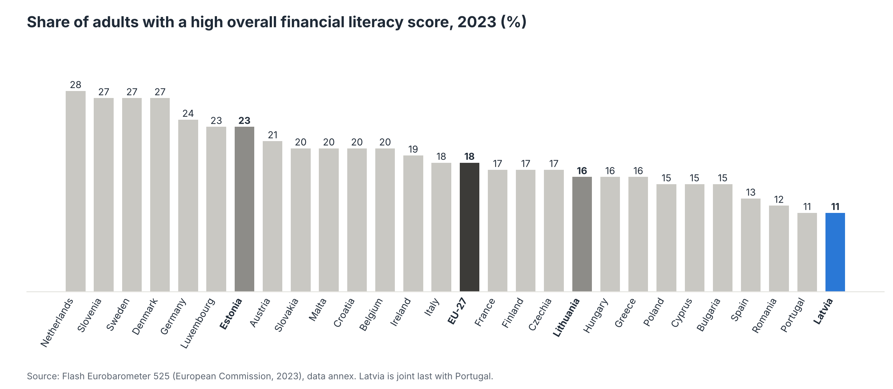

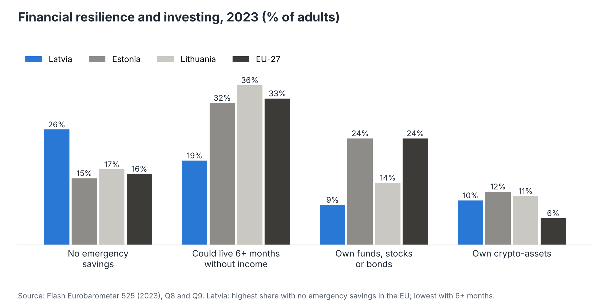

**What this tells us**

- Latvia's gap is largest in **behaviour** (planning, saving, buffers) and **investing**.
- Knowledge is below average but not last. Latvia even beats the EU average on inflation (69% correct, against 65%).
- Two OECD/INFE surveys confirm the low level: Latvia scored **61%** in 2022 and **59%** in 2023 (OECD averages 62% and 63%).
- Only **46%** of Latvian adults reach the OECD's minimum target, against **58%** in the OECD.

## 2. Latvian adults: knowledge has fallen since 2015

Latvijas Banka's survey (Latvijas Fakti, October 2022, n = 1,007, face-to-face, OECD/INFE 2022 toolkit) measures knowledge (0–7), behaviour (0–9) and attitudes (0–4), which add up to an index out of 20.

| Component | 2015 | 2022 |
|---|---|---|
| Overall index (% of maximum) | 63% | 61% |
| **Knowledge (0–7)** | **5.1** | **3.9** |
| Behaviour (0–9) | 5.3 | 5.4 |
| Attitudes (0–4) | 2.0 | 2.9 |
| Self-rated knowledge (1–5) | 3.2 | 2.6 |

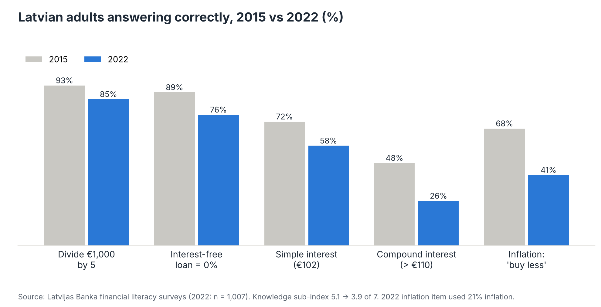

**Correct answers, 2015 → 2022**

- Compound interest: 48% → **26%**.
- Simple interest: 72% → **58%**.
- An interest-free loan costs 0%: 89% → **76%**.
- Inflation: 68% → **41%**. *(The 2022 question used 21% inflation, so this item is not fully comparable.)*
- Even dividing €1,000 by five fell, from 93% to 85%. So part of the decline may reflect survey conditions, but every item moved in the same direction.

**Gaps between groups (index out of 20)**

| Group | Index |
|---|---|
| Basic education vs higher education | 9.2 vs 13.4 |
| Income up to €350 vs over €1,000 per family member | 11.2 vs 14.0 |
| Riga | 11.6 (the lowest of all regions; knowledge only 3.4) |
| Gender | no difference |
| Latvian vs Russian home language | no difference |

**Behaviour**

- Only about **36–37%** make an income and expense plan or track their spending.
- **39%** have financial goals (47% in 2019).
- **30%** have no pension plan.
- Only **1%** hold shares.

## 3. Young people: the weakest group

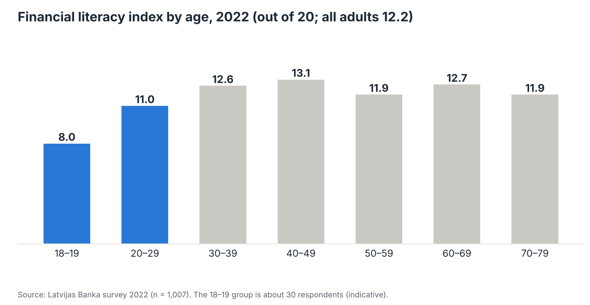

**Young adults (Latvijas Banka 2022)**

- **18–19-year-olds score 8.0 out of 20**: knowledge 3.0, behaviour 2.9, attitudes 2.1. This group is about 30 respondents, so the figure is indicative.
- **20–29-year-olds score 11.0**, which confirms the pattern with a larger sample.
- Only **40%** of 18–19-year-olds can calculate simple interest (all adults 58%).
- Only **11%** could cover an unexpected expense equal to a month's income without borrowing (all adults 43%).
- The same pattern holds across the EU: 18–24-year-olds have the lowest share with a high score (13%) and the highest share with a low score (25%) (Eurobarometer 525).

**9th graders (Latvijas Banka, Feb–Apr 2025, n = 1,159 pupils in 75 schools, online)**

- Index **12.33 out of 20 (61.7%)**, about the same as adults. Knowledge 5.46/8; behaviour and skills **4.62/8 (only 29% high)**; attitudes 2.26/4.

| Knowledge task | % correct |
|---|---|
| Divide €1,000 by 5 | 90% |
| Interest-free loan = 0% | 74% |
| 2nd pension pillar: 5% of €1,000 | 61% |
| Inflation 2%: "buy less" | 58% |
| Simple interest (€102) | **57%** |
| VAT in €121 at 21% | **41%** |
| Agree that a higher return means higher risk | **44%** |

**Misconceptions among 9th graders**

- 31% think Bitcoin is legal tender in Latvia.
- 43% think car insurance is voluntary.
- 25% think a budget is balanced when spending exceeds income.
- 48% don't know they join the 2nd pension pillar automatically when they start working.

## 4. The school system: compulsory but superficial

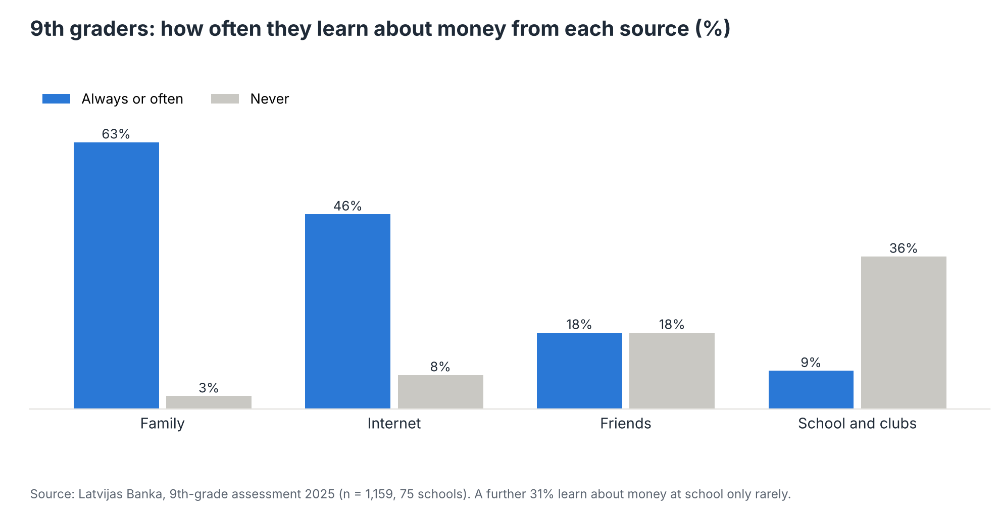

- **Legal status.** Since Skola2030, financial literacy is part of compulsory social studies from grade 1 and of the upper-secondary social and civic courses. Before that, "economics and financial literacy" was an elective. The basic education standard (Cabinet Regulation No. 747, in force from 01.09.2020) and the general secondary standard (No. 416 of 03.09.2019) set outcomes for the subject area. **They set no minimum number of finance lessons.**
- **What pupils experience.**
  - At school: only **9%** learn about money "always or often"; **36% never**; 31% rarely.
  - The internet (46% often) and family (63% often) dominate.
  - **73%** of pupils say only adults make money decisions at home.
- **Teaching quality.** LSM (18.02.2026) describes teaching as "superficial", because finance is one of many social studies topics, teachers must cover many fields and finance professionals rarely visit.
- **Teachers.** Latvijas Banka's 2024 survey of teachers who teach economics and finance found their knowledge of simple and compound interest **insufficient**, which "may affect their ability to teach investment, savings, pensions and borrowing". *[verify: a slide appears to show teachers at 38% on the savings-account question.]*
- **Where the national effort goes.** Latvijas Banka's 2025 strategy evaluation shows that about **38–39%** of strategy activities target pupils, but only about **9%** target **teachers**. Teachers are the group the research says matters most.
- **New in 2026.** Latvijas Banka launched a **three-year seminar cycle for teachers, "Finanšu pratība praksē"** (12 topics), plus materials, consultations and the "Naudas skola" website. This is a good base, but it is voluntary and does not count towards a required training topic.
- **Teacher workforce under strain.**
  - Average teacher age is about **50**.
  - **12%** of fully qualified teachers left the profession in 2024.
  - **53%** of teachers under 30 say they intend to leave within five years (TALIS 2024).
  - About 3% of posts are vacant, mostly in maths and Latvian.

  Any solution must be **light for teachers**: ready-made materials and training that counts within existing hours.

- **Benchmarking.**
  - Latvia scored 501 in PISA 2018 financial literacy (OECD 505; Estonia 547, the best in the world).
  - Scores did not improve between 2012 and 2018 (Mihno 2022).
  - Latvia **did not take part** in the PISA 2022 financial literacy module.
  - **PISA 2025** (published 08.09.2026) gave Latvia its **lowest results since it joined PISA in 2000** in mathematics, reading and science. Only 2.6% of students reach the top level (OECD 5.8%). Financial literacy depends heavily on maths and reading, so this makes the problem harder.

## 5. Fraud: why the issue is urgent

**OECD and Latvijas Banka survey** (Kantar, n = 1,400, ages 18–79, presented 20.11.2026, part of an EU-funded project with Lietuvos bankas)

| Indicator (past two years) | Value |
|---|---|
| Faced a fraud attempt | **74%** |
| Became a victim | **27%** |
| Victims who lost money | **55%** (≈ 15% of all adults) |
| Victims of 1 / 2 / 3+ types | 61% / 25% / 14% |
| Purchase fraud / phishing / investment fraud / unauthorised transactions | 15% / 8% / 6.5% / 5.6% |
| Victims who told no one | **37%**. Main reason: "it would change nothing" (57%). Shopping scams go unreported most often |

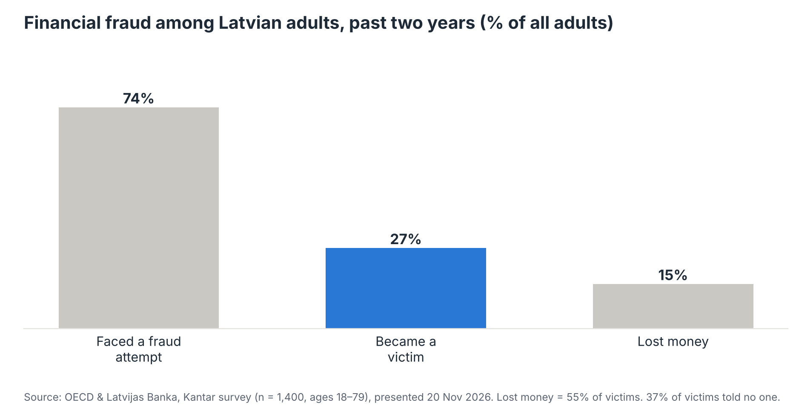

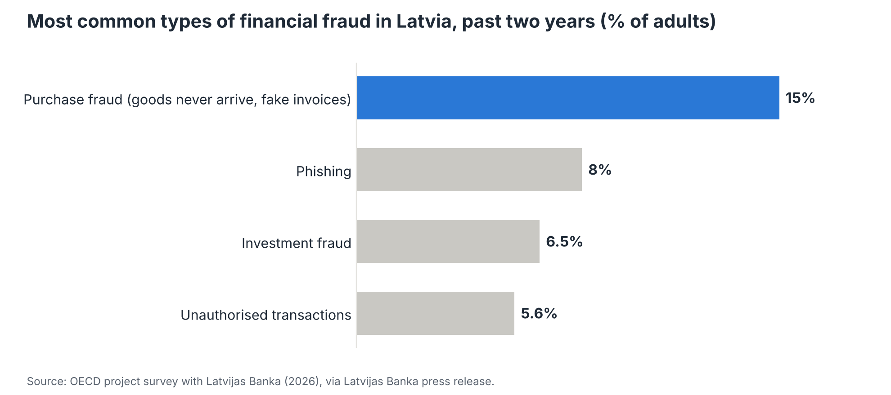

**Losses and cases**

- **Finance Latvia Association (first half of 2026):** institutions prevented 10,960 attempts worth €11.0m, but 2,829 succeeded and residents lost **€7.83m**, of which €4.26m was phone fraud (1,333 cases).
- **2025:** banks prevented more than €14m, while customers lost more than €12m in payments they approved themselves. The State Police puts total fraud losses at **€23.7m**, up from €16m in 2024. *[verify]*
- **Money mules:**
  - in one phone-fraud case the police identified **170+ money mules** and illegal crypto exchangers (Prosecutor's Office, 18.03.2026);
  - another network involved **213** mules from Latvia, mostly young *[verify]*;
  - police see people aged **20–24 and 25–29** most often in mule-related reports (LSM).
- **Teenagers (9th graders, 2025):**
  - **48%** have been offered "easy money" online by strangers;
  - **18%** have been asked to pass money through their account;
  - **16%** have been scammed buying online;
  - **6%** have given away a password or PIN.

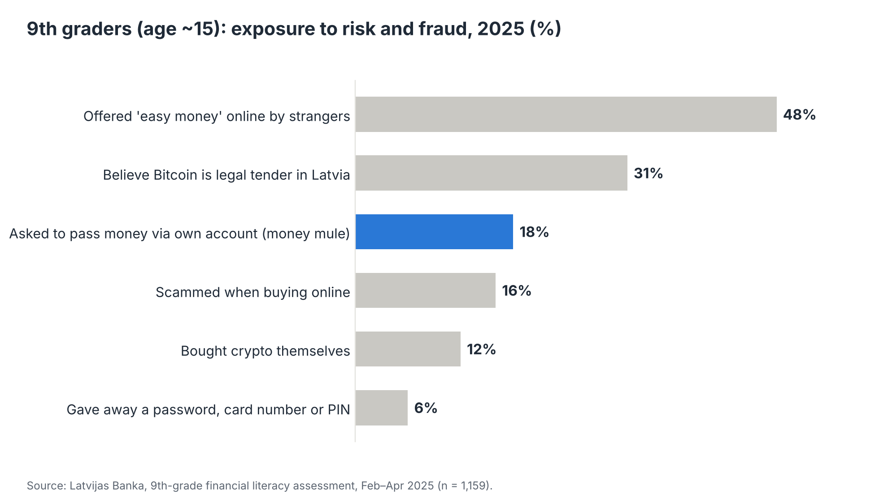

**International context (OECD, *Protecting Consumers from Financial Scams and Frauds*, June 2026)**

- About **15%** of adults in surveyed countries were scam victims.
- Scam incidence **rose in 69% of jurisdictions** in 2025.
- **Inadequate digital financial literacy** is the driver most often named.
- Older adults are **not** always the main victims.
- The OECD/INFE 2023 survey found **18%** of Latvian adults were fraud victims (Lithuania 14%).

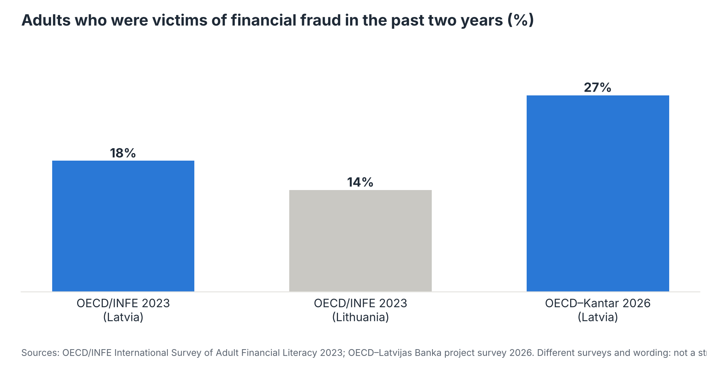

## 5a. Beyond fraud: the wider risk landscape for young people

Fraud is not the only financial risk young Latvians meet early. Several separate data sources point the same way: young people make real financial decisions early, often online, and without guidance.

| Risk | Latvian data | Source |
|---|---|---|
| **Gambling** | **29%** of 15–16-year-olds gambled for money in the past year; **6.4%** gamble excessively. Gambling among students, especially girls, is **rising** | ESPAD 2024 (SPKC; EUDA) |
| **Gambling advertising** | 17% of analysed gambling ads contained elements attractive to children and young people; the study recommends stricter rules and supervision | Ministry of Finance / PwC study (2026) |
| **Online credit** | New non-bank lending passed **€1 billion** for the first time in 2025. **Online (distance) loans reached €550m, +31.9%** in a year; 38 licensed non-bank lenders | PTAC market review, H2 2025 |
| **Debt among young households** | **70%** of households headed by someone aged 16–34 have debt (all households: 36%); 57% of them also have non-mortgage debt | Latvijas Banka data via IR |
| **Arrears** | Non-credit arrears (utilities, telecom) are most common among people aged 18–29 and 40–49 (**10%** each) | Kredītinformācijas birojs |
| **Investing** | Only **23%** of 18–30-year-olds invest; **22%** say they lack the knowledge, **19%** don't know how to start; crypto (16%) is almost as common as the 3rd pension pillar (17%) | Swedbank youth survey, Jan 2025 (n = 4,214) |
| **Money mules** | Police detained 16 mules in two weeks (Oct–Nov 2025; born 1990–2009, including minors) and 11 in October 2026, **recruited via Telegram**, including minors. Laundering in large amounts or in a group carries **3–12 years** in prison | State Police via LV portāls (2025, 2026) |

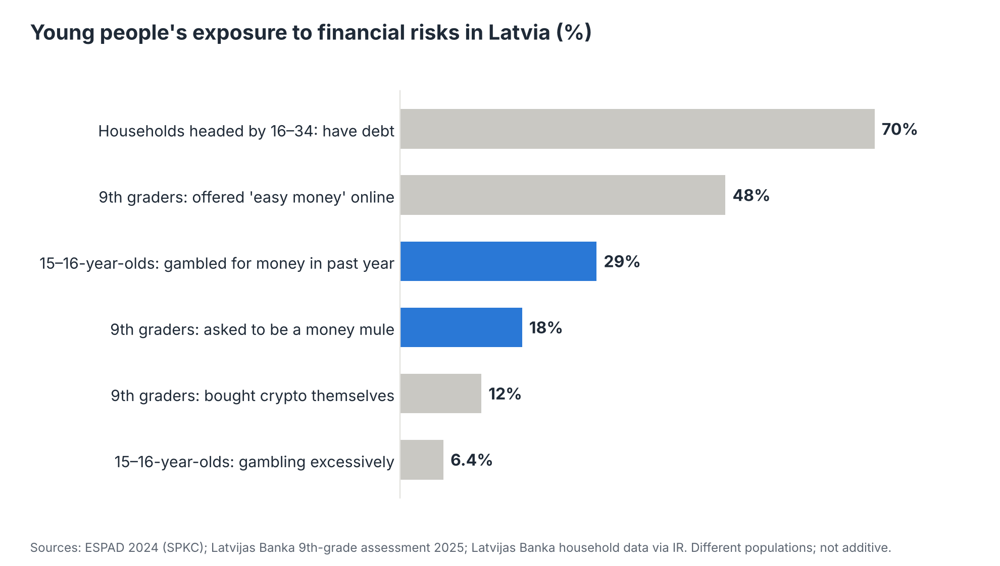

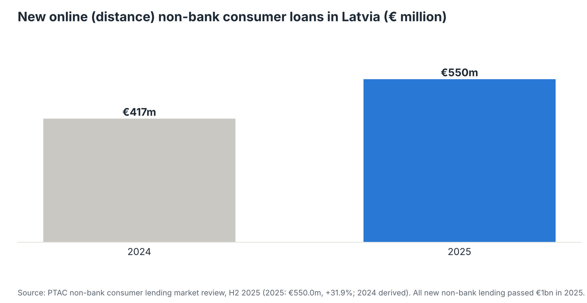

**What this means:** the 12-lesson module (section 11) deliberately covers **gambling odds, online credit and buy-now-pay-later, crypto and finfluencers, and money mules**, not only budgeting and interest.

## 6. Why it matters

- **For households.** Latvia has the EU's thinnest financial buffers, low regular saving (14% of Latvians save more than 10% of income, against 17% in Estonia and 23% in Lithuania; Luminor 2025) and the lowest retirement readiness in the Baltics. Financial literacy is linked to wealth accumulation, stock-market participation and retirement planning (Lusardi & Mitchell 2014, 2023; van Rooij, Lusardi & Alessie 2011; Lusardi, Michaud & Mitchell 2017).
- **For the economy.** The EU's Savings and Investments Union aims to turn savers into investors. Latvia starts from joint-last investment participation.
- **For security.** Fraud losses run to tens of millions of euros a year, and teenagers are recruited as money mules. A criminal record can follow them for life.
- **For timing.** The national strategy ends in 2027, the OECD has just proposed a digital financial literacy action plan, the government is drafting a fraud-prevention plan, and the EU reviews its strategy in 2027.

# Part II. How do research and data support our intention?

## 7. What works: the international evidence

**Meta-analyses**

| Study | Coverage | Knowledge | Behaviour | Main lesson |
|---|---|---|---|---|
| Fernandes, Lynch & Netemeyer (2014), *Management Science* | 201 studies | — | 0.1% of variance | Effects decay over time, so teach close to the decision |
| Kaiser & Menkhoff (2017), *World Bank Economic Review* | 126 studies | 0.26 SD | 0.09 SD | **Intensity** and **teachable moments** matter |
| Kaiser & Menkhoff (2020), *Economics of Education Review* | 37 school studies | **0.33 SD** (RCTs 0.15) | **0.07 SD** | More intensive programmes work better, with diminishing returns |
| Kaiser, Lusardi, Menkhoff & Urban (2022), *Journal of Financial Economics* | 76 RCTs, 160,000+ people | Positive | Positive | Effects are comparable to other education interventions |

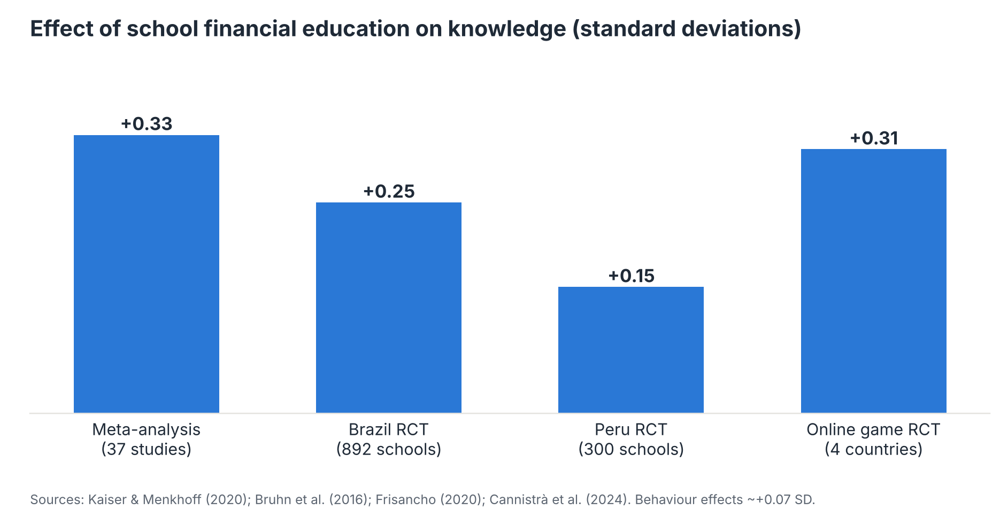

**Large school trials**

| Study | Design | Result |
|---|---|---|
| Bruhn et al. (2016), *AEJ: Applied* | Brazil, 892 schools, ~25,000 pupils | Proficiency **+0.25 SD**; more saving and budgeting; parents benefited. Cost BRL 206 per pupil, repaid in ~5 years through lower borrowing costs |
| Frisancho (2020), IDB | Peru, 300 schools | **+0.15 SD**; better credit records after 3 years; poorer parents' default probability −26%; cost **US$6.6 per pupil** |
| Cannistrà et al. (2024), *Journal of Comparative Economics* | 2,220 pupils in 4 countries; online escape-room game | **+0.31 SD** |
| Lührmann, Serra-Garcia & Winter (2015), *Journal of Banking & Finance* | Germany; 90-minute sessions by volunteer finance professionals | More interest and knowledge; fewer impulse purchases |

## 8. Mandates: a requirement on paper is not enough

| Country | Policy | Evidence |
|---|---|---|
| **United States** | **30 states** require a standalone personal finance course for graduation (NGPF, 2025/26); **39** if courses integrated into other subjects are counted (CEE 2026). 11 states apply it from the class of 2026, 19 more by 2031 | Dedicated courses raised credit scores and cut delinquency, with a lag (Urban et al. 2020). Earlier, weakly implemented mandates had **no effect** (Cole et al. 2016) |
| **England** | Statutory in secondary citizenship and maths since **2014**, but academies (~80% of schools) could opt out | Only **38%** of young people recall receiving financial education; over half of teachers were unaware it was in the curriculum. In **November 2025** the government announced it will be **mandatory in primary schools and strengthened at secondary**, and that academies will have to follow the curriculum |
| **Estonia** | "Money Smart Estonia" 2021–2030 (Ministry of Finance); financial literacy in a **6-month teacher programme** since 2019; materials for every school stage; linked to entrepreneurship education (in 71% of general schools) | PISA 2018: **547**, the best in the world (but Estonia also leads in maths and reading) |
| **Lithuania** | Public Financial Education Action Plan 2024–2028 (council chaired by the Ministry of Finance); pilot of a dedicated lesson from grade 1 | Early stage |
| **Czechia** | Financial literacy embedded in the national curriculum (maths and civics) with a national strategy | PISA 2022 financial literacy **507** (OECD 498), **5th of 20**; but 15% below baseline and a strong link to family background |
| **Slovakia** | **National Standard of Financial Literacy** since 2008 (latest version 1.2, 2017); performance standards built into state curricula, and schools must reflect them | Shows how a national standard can make outcomes explicit across subjects |
| **Portugal** | National Plan for Financial Education since 2011 (new plan **2026–2030**); a **Financial Education Framework** from pre-school to adults; the **"Todos Contam" school competition**, now in its 14th edition | A model for combining an explicit framework with a recurring school competition |

**Lesson for Latvia:** Latvia today resembles England before 2025: compulsory on paper, weak in delivery. The countries that make progress add **dedicated time, trained teachers and measurement**.

## 8a. Can education protect against scams?

| Study | Design | Result |
|---|---|---|
| Burke, Kieffer, Mottola & Perez-Arce (2021/22), RAND / GFLEC | RCT, representative US adults; short online module on investment fraud | **Reduced susceptibility to investment fraud**, but effects **decay** over time |
| Prebunking video experiment (US, 2021) | Randomised; short "prebunking" videos | Willingness to invest in fraudulent offers fell by **44%**; the effect faded over 6 months, but a **booster** restored it |
| Behavioural Insights Team Canada with the Ontario Securities Commission | RCT of prebunking against AI-enabled investment scams | Effective immediately, but **no longer significant after 10 days**, so timing is crucial |
| ShieldUp! (2025) | RCT, 3,000 participants; game-based "inoculation" | Players were **significantly better at spotting scams** than control and passive-awareness groups |

**Lesson:** one awareness campaign is not enough. Scam resilience needs **active practice (games), repetition (boosters) and timing close to risk**. That is why our strategy combines a module with **regular gamified sessions through the year**, and family tasks that bring the lesson home.

## 9. Latvian evidence on causes

| Cause | Latvian evidence | Research |
|---|---|---|
| Low intensity | 36% never learn about money at school; no minimum lessons | Intensity drives effects (Kaiser & Menkhoff 2017, 2020) |
| Teachers | Interest knowledge insufficient (Latvijas Banka 2024) | Teacher training is key (Compen, De Witte & Schelfhout 2019) |
| Weak link to real decisions | Teens already have cards (85%), shop online (87%) and buy crypto (12%) | Teachable moments (Kaiser & Menkhoff 2017) |
| Family | 73% of pupils are excluded from money decisions; involvement predicts higher scores | Family and school are complementary (Grohmann, Kouwenberg & Menkhoff 2015) |
| Many events, little learning | 230+ strategy activities since 2021; Money Day in 78% of schools; yet knowledge fell | One-off events are low-intensity |
| No measurement loop | No PISA financial literacy since 2018; strategy counts activities | — |

# Part III. What is our strategy?

## 10. Theory of change

**Inputs** (module, teacher training, games, volunteers, family tasks)
→ **outputs** (every pupil gets about 10–12 dedicated lessons in grades 9 and 11; every social-studies teacher is trained)
→ **outcomes** (knowledge +0.15–0.30 SD; fewer misconceptions; safer online behaviour)
→ **impact** (more saving and investing, fewer fraud victims and money mules, a higher national index).

**Assumption:** delivery is intensive and teachers are confident. That is why regulation targets **lessons** and **teacher training**, not just "topics".

## 11. Five actions

**1. A ready-to-teach module.** Ten to twelve lessons in grade 9, repeated at a higher level in grade 11, aligned with the EU/OECD financial competence framework for children and youth. Owners: IZM and VISC, with Latvijas Banka.

| # | Lesson | Hook (a real decision) |
|---|---|---|
| 1 | Income, budget, needs and wants | My first salary or pocket money |
| 2 | Interest and compounding | Saving €20 a month from age 15 |
| 3 | Inflation and the value of money | Why prices change |
| 4 | Payments, cards and online shopping | Safe online purchases |
| 5 | **Scams and phishing** | Spot the fake message |
| 6 | **Money mules and the law** | "Easy money" offers on social media |
| 7 | Borrowing, online credit and buy-now-pay-later | Quick online loans versus a bank loan |
| 8 | Risk, return and diversification | Shares versus a savings account |
| 9 | **Crypto-assets, finfluencers and gambling odds** | Is Bitcoin legal tender? Who pays the influencer? Why the house always wins |
| 10 | Taxes, VAT and the 2nd pension pillar | What happens to my first salary |
| 11–12 | Project: family budget or savings plan, plus an assessed test | Done with parents |

**2. Teacher professional development.**

- A **36-hour certified course**, matching the Regulation No. 569 cycle, for social-studies teachers.
- Focus on the weak spots: interest, compounding, risk and digital fraud.
- Designed on effective-training principles: content focus, active learning, duration, collaboration and ownership (Compen et al. 2019).
- Delivered by Latvijas Banka experts, universities and VISC. **Build on Latvijas Banka's new 3-year seminar cycle "Finanšu pratība praksē" (2026)**: certify it and make it count within the 36-hour requirement, rather than creating something new.

**3. Gamified, repeated practice.**

- Classroom games (an escape-room format, +0.31 SD in an RCT).
- The Open Economics Olympiad, which Jaunie Ekonomisti already runs for about 200 students from 30+ schools.
- Bank volunteers as "finance coaches" (a model shown to raise knowledge in Germany).
- Activities spread through the year, not only in Financial Literacy Week.

**4. Family tasks.** Homework that involves parents in a real money decision (a budget, comparing offers, a scam check). This uses the parent spillovers found in Brazil and Peru.

**5. Measurement.**

- Repeat Latvijas Banka's 9th-grade assessment every 2 years.
- Oversample young adults in the adult survey.
- Join the PISA 2029 financial literacy option.
- Publish a youth financial literacy indicator in the national strategy.

## 12. Stakeholders: who, what we ask, how we engage

| Stakeholder | Interest and power | Our ask | Channel |
|----|-----|-----|-----|
| **IZM** (Ministry of Education and Science) | High power; under pressure after PISA 2025 | Amend standards and teacher-training rules; join PISA 2029 | Policy brief; meeting with the state secretary's office; consultation on draft regulations |
| **VISC** (National Centre for Education) | Owns content and materials | Co-develop and approve the module and the 36-hour course | Working meetings; pilot data |
| **Latvijas Banka** | National coordinator; 28-partner coalition; OECD action plan | School pillar and youth targets in the 2028+ strategy; content experts | Working group; Financial Literacy Week |
| **Saeima Education, Culture and Science Committee; Budget Committee** | Political attention; budget | Hearing; support for funding | Briefing; testimony with our data |
| **Interior Ministry** (fraud-prevention plan) | Leads the plan; Saeima noted there is no single coordinator | Include school education as a prevention measure | Written proposal |
| **Finance Latvia Association and banks** | Liable for fraud prevention (EU PSR); sent 17 fraud proposals (2026) | Co-fund teacher training; volunteer coaches; data | FNA meeting; bank CSR teams |
| **Schools and teachers** | Deliver the change | 10 pilot schools in spring 2027; feedback | Teacher associations; school visits |
| **Parents** | Influence on pupils | Family tasks | Schools; e-klase |
| **Media** (LSM, Delfi, TVNet, LETA, teen social media) | Public pressure | Coverage of our data and pilot | Press release, op-eds, student stories |
| **European level** (Commission, EP, ECB) | Strategy and resolution back school curricula | Show Latvia as a pilot | Financial literacy ambassadors network; ECB contacts |

## 13. Media and communication plan

- **Core message:** "Financial literacy is compulsory in every Latvian school, but most teenagers say school never taught them about money, while scammers recruit them on TikTok."
- **Proof points:**
  - joint last in the EU (11%);
  - 36% never learn about money at school;
  - 18% of 9th graders approached as money mules;
  - knowledge fell from 5.1 to 3.9 out of 7.

| When | Activity | Channel |
|---|---|---|
| Dec 2026 | Release the evidence brief with the new OECD and PISA data | Press release; LSM and Delfi pitch |
| Jan–Feb 2027 | Op-eds by students and by the team | Delfi, LSM opinion, IR.lv |
| March 2027 (Financial Literacy Week) | Launch the pilot and the Olympiad; scam-awareness content for teens | TV and radio interviews; TikTok and Instagram with student creators |
| Spring 2027 | Pilot stories from schools | Regional media |
| Autumn 2027 | Pilot results; proposals for the new strategy | Saeima hearing; press conference |

**Rules for working with media:** use only verified numbers; show pupils and teachers, not only statistics; avoid blaming teachers (frame it as a system design problem).

## 14. Roadmap

| Period | Milestone |
|---|---|
| Dec 2026 – Feb 2027 | Evidence brief; meetings with Latvijas Banka, IZM, VISC and Finance Latvia; agree the pilot |
| March 2027 | Public launch at Financial Literacy Week |
| April – June 2027 | Pilot in 10 schools (module plus teacher course); before and after test |
| Sept – Dec 2027 | Proposals into the 2028+ strategy and draft amendments to Regulations No. 747, 416 and 569 |
| 2028 | Regulations adopted; national rollout begins |
| 2029 | PISA financial literacy; 9th-grade assessment |
| 2030 | Evaluate against the KPIs |

## 15. Risks and mitigation

| Risk | Mitigation |
|---|---|
| "Another topic in an overloaded curriculum" | Reuse existing social studies hours: a minimum block, not a new subject |
| Teachers resist extra training | Count it within the existing 36 hours; certified; materials ready to use |
| Budget pressure on learning materials (2026) | Low cost; co-funding by banks; EU funds (ESF+, Technical Support Instrument) |
| Industry branding in classrooms | Content approved by VISC; volunteers follow a code of conduct (as the EU strategy foresees) |
| Behaviour changes slowly | KPIs focus first on knowledge and misconceptions, with behaviour tracked over time |
| Data gaps (small youth samples) | Oversample young people; PISA 2029 |

# Part IV. What results do we expect?

## 16. KPIs

| KPI | Baseline | Target 2030 | Data source |
|---|---|---|---|
| 9th-grade financial literacy index (of 20) | 12.33 (2025) | 14.0 | Latvijas Banka 9th-grade assessment |
| 9th graders who calculate simple interest | 57% (2025) | 75% | Same |
| 9th graders who never learn about money at school | 36% (2025) | < 10% | Same |
| 9th graders who know Bitcoin is not legal tender | 69% (2025) | 90% | Same |
| 9th graders asked to be money mules who refused or reported it | Baseline 2027 | Rising | New question |
| Adults aged 20–29: index | 11.0 (2022) | ≥ 12.2 | Latvijas Banka adult survey |
| Adult knowledge sub-index | 3.9 (2022) | 5.1 (2015 level) | Same |
| Social-studies teachers trained | 0 | ≥ 80% | VISC |
| PISA financial literacy | Not participating | Participating (2029) | OECD |
| Regulations amended (No. 747, 416, 569) | No | Yes (2028) | likumi.lv |

**What size of change is realistic?** Raising 9th graders' knowledge by +0.15 to +0.30 SD (the range in the research) is consistent with moving the simple-interest share from 57% towards 65–75%. This is an illustration based on effect sizes, not a forecast. Behaviour effects are smaller (about +0.07 SD) and appear over years.

## 17. Cost and value (illustrative)

| Item | Assumption | Cost |
|---|---|---|
| Module development (grades 9 and 11, digital) | One-off | €50–100k |
| Teacher training | ~1,000 teachers × €150–250 *[verify numbers with IZM]* | €150–250k one-off |
| Delivery (materials, games, Olympiad, volunteers) | ~20,000 pupils × €5–10 a year | €100–200k a year |
| Measurement | Existing Latvijas Banka surveys | Within current budgets |
| **Total** | | **€0.2–0.35m one-off + €0.1–0.2m a year** |

**Value:**

- **About 1%** of one year's fraud losses (€23.7m in 2025 *[verify]*; €7.8m in the first half of 2026 alone).
- In Brazil, a comparable programme paid for itself through lower borrowing costs within ~5 years.
- **Who could pay:** IZM (teacher training), Latvijas Banka (content), banks and Finance Latvia (co-funding, volunteers), EU funds.

# Part V. What regulatory changes should be applied?

## 18. Four Cabinet-level changes

None of these needs a new law. All are Cabinet regulations or strategy decisions, so they are achievable within one policy cycle.

| # | Instrument | Current situation | Proposed change | Owner | When |
|-|------|-----|----------|--|---|
| 1 | **Basic education standard: Cabinet Regulation No. 747** (27.11.2018; in force 01.09.2020) | Financial literacy within the social and civic learning area; no explicit minimum | Add explicit, assessed outcomes for grades 7–9 (compound interest, inflation, risk, digital fraud, money mules) and a **minimum block of ~10 lessons** within social studies | IZM, VISC | Draft autumn 2027; in force Sept 2028 |
| 2 | **General secondary standard: Cabinet Regulation No. 416** (03.09.2019; last amended 2026) | Financial topics in social and civic courses | The same outcomes at a higher level (investing, credit, pensions) in grades 10–12 | IZM, VISC | Same |
| 3 | **Teacher training rules: Cabinet Regulation No. 569** (36 hours every 3 years) | 2024 amendment added sexual and reproductive health as a topic (a **precedent**) | Make **financial and digital financial literacy a required topic** for teachers of social studies (and economics) | IZM | 2027–2028 |
| 4 | **National Financial Literacy Strategy 2028+** (Cabinet-approved; Latvijas Banka coordinates) | 2021–2027 strategy ends; it measures activities, not learning | A **school pillar** with **youth outcome targets** (9th-grade index, 18–29 index); link to the OECD action plan and the government's fraud-prevention plan | Latvijas Banka, Cabinet | Drafted 2027 |
| + | **PISA participation** (IZM decision) | Latvia skipped financial literacy in 2022 | Join the **PISA 2029** financial literacy option | IZM | Decision 2027 |

**Also within reach:**

- **Government fraud-prevention plan (Interior Ministry).** Add a prevention measure: "financial and digital literacy education in schools, including money-mule awareness". Finance Latvia has already sent 17 proposals on reporting, blocking and victim support, but none on schools.
- **Recognise existing training.** Have IZM accredit Latvijas Banka's teacher seminar cycle so that it counts towards the Regulation No. 569 hours. This is a quick win before the regulation itself changes.
- **Gambling advertising.** Support the Ministry of Finance study's recommendation to tighten youth-targeted gambling advertising rules (Gambling and Lotteries Law). This complements the school module.
- **Exams.** Include financial literacy items in the grade 9 state assessment in social studies, so it is assessed and therefore taught. This is a longer-term option.

## 19. EU framework that supports these changes

| EU instrument | Date | What it says | Use for Latvia |
|------|---|---------|-----|
| Commission Financial Literacy Strategy, COM(2025) 681 | 30.09.2025 | Member states should embed financial literacy, starting in schools; EU/OECD competence frameworks; code of conduct for providers; new Eurobarometer in 2027 | Political backing; frameworks for the module |
| European Parliament resolution on financial literacy and finfluencers (Pereira report) | 30.04.2026 (502 for, 46 against) | **Integrate financial education into school curricula**; minimum standards for finfluencers; crypto in education; Commission report by end of 2027 | Direct support for regulatory change 1 |
| Payment Services Regulation (provisional agreement) | 27.11.2025 | Payment providers liable when fraud prevention fails; refunds for bank-impersonation fraud; platforms liable to payment providers if they don't remove scam content | Banks have a financial interest in prevention, so ask them to co-fund education |
| Savings and Investments Union | 2025– | Turn savers into investors | Latvia's joint-last investment participation |

# Appendix A. Methodology and conceptual frameworks

**Frameworks**

- **OECD/INFE definition:** financial literacy = knowledge + behaviour + attitudes. This is used by Latvijas Banka and the OECD.
- **EU/OECD financial competence frameworks** for children, youth and adults.
- **Lusardi & Mitchell:** financial literacy as human capital, and the "Big Three" questions.
- **Kaiser & Menkhoff:** intensity and teachable moments.
- **Grohmann et al.:** the family-and-school socialisation model.
- **A theory of change** linking inputs to impact.

**Data**

| Source | Method | Sample | Date |
|---|---|---|---|
| Flash Eurobarometer 525 | Online panel (CAWI) | ~1,000 per country; Latvia 1,018 | Mar–Apr 2023 |
| Latvijas Banka adult survey | Face-to-face (CAPI), random stratified | 1,007, ages 18–79 | Oct–Nov 2022 |
| Latvijas Banka 9th-grade assessment | Online (CAWI), 75 schools | 1,159 | Feb–Apr 2025 |
| OECD–Latvijas Banka fraud survey | Kantar | 1,400, ages 18–79 | 2026 |
| OECD/INFE adult survey | International | 39 countries | 2022–2023 |
| OECD PISA | Student assessment | — | 2018, 2025 |
| Finance Latvia Association; State Police | Administrative data | — | 2025–2026 |

**Our analysis**

- EU ranks computed from the Eurobarometer annex.
- Trends 2015–2022 from Latvijas Banka reports.
- Effect sizes taken from published meta-analyses and RCTs.
- The cost model uses explicit assumptions.

**Limitations**

- Online panels may over-represent digital users.
- The 18–19 subgroup is small.
- Fraud surveys differ in wording, so they don't give a strict trend.
- Most RCTs are from outside the Baltics.
- The cost assumptions need checking with IZM.
- Jaunie Ekonomisti's own Olympiad data is used only as illustration.

# Appendix B. Evidence register

| Claim | Source | Status |
|---|---|---|
| 11% high literacy, joint last; 26% no emergency savings; 19% 6+ months; 9% investment products | Eurobarometer 525 data annex | Verified (primary) |
| Knowledge 5.1 → 3.9; index by age; 40% simple interest among 18–19 | Latvijas Banka 2022 report | Verified (primary) |
| 9th-grade figures (12.33; 36%; 48%; 18%; 31%) | Latvijas Banka 9th-grade report 2025 | Verified (primary) |
| OECD/INFE 2023: 59% vs 63%; 46% vs 58% minimum; 18% fraud victims | Latvijas Banka press release, LSM | Verified (secondary) |
| OECD 2026: 74% / 27% / 55% / 37% | Latvijas Banka, LSM 20.11.2026 | Verified (secondary; full report not opened) |
| €7.83m lost in H1 2026 | Finance Latvia via LSM 21.07.2026 | Verified (secondary) |
| €23.7m lost in 2025; 213 money mules | State Police via media | [verify] |
| Teachers 38% | Saeima slide (jumbled extraction) | [verify] |
| Regulations No. 747, 416, 569; 2024 amendment of No. 569 | likumi.lv; LV portāls | Verified |
| PISA 2025: Latvia's lowest results ever | OECD country note; LV portāls | Verified (secondary) |
| England: 2014 statutory; 38% recall; Nov 2025 strengthening | APPG; Young Enterprise; MaPS | Verified (secondary) |
| US: 30 standalone / 39 total states | NGPF; CEE 2026 | Verified (secondary) |
| EP resolution 30.04.2026 | European Parliament, OEIL | Verified (secondary) |
| ESPAD 2024: 29% gambled, 6.4% excessively | SPKC fact sheet | Verified (secondary) |
| Non-bank lending > €1bn; online loans €550m (+31.9%) | PTAC via LV portāls | Verified (secondary) |
| 70% of 16–34 households have debt | Latvijas Banka via IR | Verified (secondary) |
| Swedbank youth survey (23% invest; 22% lack knowledge) | Investoru klubs, TVNet | Verified (secondary) |
| Activities: pupils ~38–39%, teachers ~9% | Latvijas Banka strategy evaluation 2025 (snippet) | [verify] |
| Teacher seminar cycle "Finanšu pratība praksē" | LV portāls 2026 | Verified (secondary) |
| Teachers: average age 50; 12% left; 53% of under-30s intend to leave | IZM; OECD EAG 2026; TALIS 2024 | Verified (secondary) |
| Scam-education RCTs (Burke et al.; prebunking; BIT/OSC; ShieldUp!) | GFLEC; OSC; arXiv | Verified (secondary) |
| Czechia PISA 2022 507; Slovakia standard; Portugal plan 2026–2030 | ČNB/MŠMT; Cedefop; Todos Contam | Verified (secondary) |

# References

**Peer-reviewed research**

- Batty, M., Collins, J. M., & Odders-White, E. (2015). *Journal of Consumer Affairs*, 49(1), 69–96.
- Bruhn, M., de Souza Leão, L., Legovini, A., Marchetti, R., & Zia, B. (2016). The impact of high school financial education. *AEJ: Applied Economics*, 8(4), 256–295.
- Cannistrà, M., De Beckker, K., Agasisti, T., Amagir, A., Põder, K., Vartiak, L., & De Witte, K. (2024). The impact of an online game-based financial education course. *Journal of Comparative Economics*, 52(4), 825–847.
- Cole, S., Paulson, A., & Shastry, G. K. (2016). High school curriculum and financial outcomes. *Journal of Human Resources*, 51(3), 656–698.
- Compen, B., De Witte, K., & Schelfhout, W. (2019). The role of teacher professional development in financial literacy education. *Educational Research Review*, 26, 16–31.
- Demertzis, M., Mejino-López, J., & Léry Moffat, L. (2024). The state of financial knowledge in the European Union. *Journal of Financial Literacy and Wellbeing*.
- Fernandes, D., Lynch, J. G., & Netemeyer, R. G. (2014). *Management Science*, 60(8), 1861–1883.
- Frisancho, V. (2020). *The impact of financial education for youth*. IDB Working Paper.
- Grohmann, A., Kouwenberg, R., & Menkhoff, L. (2015). Childhood roots of financial literacy. *Journal of Economic Psychology*, 51, 114–133.
- Kaiser, T., & Menkhoff, L. (2017). *World Bank Economic Review*, 31(3), 611–630.
- Kaiser, T., & Menkhoff, L. (2020). *Economics of Education Review*, 78, 101930.
- Kaiser, T., Lusardi, A., Menkhoff, L., & Urban, C. (2022). *Journal of Financial Economics*, 145, 255–272.
- Lührmann, M., Serra-Garcia, M., & Winter, J. (2015). *Journal of Banking & Finance*, 54, 160–174.
- Lusardi, A., & Mitchell, O. S. (2014). *Journal of Economic Literature*, 52(1), 5–44.
- Lusardi, A., & Mitchell, O. S. (2023). *Journal of Economic Perspectives*, 37(4), 137–154.
- Lusardi, A., Michaud, P.-C., & Mitchell, O. S. (2017). *Journal of Political Economy*, 125(2), 431–477.
- Mihno, J. (2021, 2022). Latvian PISA financial literacy analyses. University of Latvia / *IJSEUS*.
- Rupeika-Apoga, R., & Priede, J. (2025). Retirement readiness in the Baltics. *Risks*, 13(2), 30.
- Urban, C., Schmeiser, M., Collins, J. M., & Brown, A. (2020). *Economics of Education Review*, 78, 101786.
- van Rooij, M., Lusardi, A., & Alessie, R. (2011). *Journal of Financial Economics*, 101(2), 449–472.

**Official and institutional sources**

- European Commission (2023). *Flash Eurobarometer 525*. https://europa.eu/eurobarometer/surveys/detail/2953
- European Commission (2025). *Financial Literacy Strategy*, COM(2025) 681. https://eur-lex.europa.eu/legal-content/EN/TXT/?uri=CELEX:52025DC0681
- European Parliament (2026). Resolution on financial literacy and the rise of finfluencers (TA-10-2026-0156). https://oeil.europarl.europa.eu/oeil/en/document-summary?id=1900214
- European Parliament (27.11.2025). Payment services deal. https://www.europarl.europa.eu/news/en/press-room/20251121IPR31540/payment-services-deal-more-protection-from-online-fraud-and-hidden-fees
- Latvijas Banka (2022). *Latvijas iedzīvotāju finanšu pratības aptauja 2022*.
- Latvijas Banka (2025). *Latvijas skolu 9. klases skolēnu finanšu pratības novērtējums*.
- Latvijas Banka. OECD/INFE 2023 results. https://www.bank.lv/aktualitates-banklv/zinas-un-raksti/jaunumi/16730-latvija-finansu-pratiba-izaicinajumu-netrukst
- Latvijas Banka. Digital financial literacy and fraud resilience project. https://www.bank.lv/en/news-and-events/news-and-articles/news/17655-populations-digital-financial-literacy-and-resilience-against-financial-fraud-to-be-strengthened
- Brikše, A. (2025). Saeima conference presentation. https://m.saeima.lv/documents/e0d28b52248dea2ee0bcfe41a32aa18bc1327827
- Cabinet Regulation No. 747. https://likumi.lv/ta/id/303768
- Cabinet Regulation No. 416. https://likumi.lv/ta/id/309597
- Cabinet Regulation No. 569. https://likumi.lv/ta/id/301572
- OECD (2026). *Improving Adults' Resilience Against Financial Scams and Frauds in Latvia*. https://www.oecd.org/en/publications/improving-adults-resilience-against-financial-scams-and-frauds-in-latvia_5c0aaf74-en.html
- OECD (2026). *Protecting Consumers from Financial Scams and Frauds*. https://www.oecd.org/en/publications/protecting-consumers-from-financial-scams-and-frauds_d41817bb-en.html
- OECD (2026). PISA 2025, Latvia country note. https://www.oecd.org/en/publications/pisa-2025-results-volume-i-country-notes_2d4ff9ea-en/latvia_eea74d60-en
- OECD (2020, 2024). PISA 2018 and 2022 Results, Volume IV (financial literacy).
- Estonian Ministry of Finance. *Money Smart Estonia 2021–2030*. https://www.fin.ee/en/financial-policy/financial-wisdom
- NGPF (2026). How many states require a personal finance course? https://www.ngpf.org/blog/advocacy/how-many-states-require-students-to-take-a-personal-finance-course-for-high-school-graduation/
- K-12 Dive. 29 states will require a finance course by 2031. https://www.k12dive.com/news/29-states-will-require-finance-course-in-high-school-by-2031-report-says/875053/
- APPG on Financial Education for Young People (2025). Annual report 2024–2025. https://www.young-enterprise.org.uk/sites/default/files/2026-04/Annual%20Report%202024-2025%20-%20APPG%20on%20Financial%20Education%20for%20Young%20People%20%281%29.pdf
- Money and Pensions Service (2024). Hundreds of thousands leaving school without money skills. https://maps.org.uk/en/media-centre/press-releases/2024/hundreds-of-thousands-leaving-school-without-money-skills

**Additional sources (new research)**

- SPKC (2025). ESPAD 2024 Latvia fact sheet. https://www.spkc.gov.lv/lv/media/24107/download ; EUDA key findings. https://www.euda.europa.eu/publications/data-factsheets/espad-2024-key-findings_lv
- LV portāls (2026). Gambling advertising study (Ministry of Finance / PwC). https://lvportals.lv/dienaskartiba/396414-petijums-azartspelu-reklamas-ierobezojumi-japrecize-un-jastiprina-uzraudziba-2026
- PTAC (2026). Non-bank consumer lending market review, H2 2025. https://www.ptac.gov.lv/en/article/consumer-non-bank-lending-grows-market-review-second-half-2025 ; LV portāls. https://lvportals.lv/norises/390853-no-jauna-izsniegto-nebanku-kreditu-apjoms-pern-pirmoreiz-parsniedzis-miljardu-2026
- IR.lv. "Jaunie aizņemas biežāk". https://ir.lv/rubrika/viedoklis/jaunie-aiznemas-biezak-vai-mainijusies-attieksme-pret-dzivi-ar-kreditu.222047
- Investoru klubs (2026). Swedbank youth survey. https://www.investoruklubs.lv/viedokli/2026/02/19/jauniesus-no-investicijam-attur-zinasanu-un-finansu-trukums
- LV portāls (2025, 2026). Money mules detained. https://lvportals.lv/dienaskartiba/382751-policija-aizturejusi-16-naudas-mulus-telefonkrapnieku-tikla-verve-jauniesus-2025 ; https://lvportals.lv/dienaskartiba/396322-valsts-policija-oktobri-aizturejusi-11-naudas-mulus-un-kurjerus-2026
- LV portāls (2026). Latvijas Banka invites teachers to financial literacy seminars. https://lvportals.lv/dienaskartiba/395650-latvijas-banka-aicina-skolotajus-piedalities-izglitojosos-seminaros-par-finansu-pratibu-2026
- Latvijas Banka (2025). Strategy evaluation 2025. https://www.bank.lv/images/pielikumi/fails/Strategijas_izvertejums_2025.pdf
- OECD (2026). Education at a Glance 2026: Latvia. https://www.oecd.org/en/publications/education-at-a-glance-2026_c0e523a9-en/latvia_a3d9d136-en.html ; LV portāls. https://lvportals.lv/dienaskartiba/395126-oecd-ikgadejais-izglitibas-parskats-latvija-palielinajusas-pedagogu-algas-uzmaniba-japievers-pedagogu-ataudzei-un-jauniesu-atbalstam-2026
- Burke, J., Kieffer, C., Mottola, G., & Perez-Arce, F. (2021). Can educational interventions reduce susceptibility to financial fraud? https://gflec.org/wp-content/uploads/2021/04/Burke-Kieffer-Mottola-Perez-Arce-Can-Educational-Interventions-Reduce-Susceptibility-to-Financial-Fraud-CB2021.pdf
- Ontario Securities Commission (2025). Artificial intelligence and retail investing: scams and effective countermeasures. https://www.osc.ca/en/investors/investor-research-and-reports/artificial-intelligence-and-retail-investing-scams-and-effective-countermeasures
- ShieldUp! (2025). Inoculating users against online scams using a game-based intervention. https://arxiv.org/pdf/2503.12341
- Czech National Bank (2024). PISA 2022 financial literacy results. https://www.cnb.cz/cs/cnb-news/tiskove-zpravy/Vysledky-mezinarodniho-setreni-PISA-2022-k-urovni-financni-gramotnosti
- Cedefop. Slovakia: National standard of financial literacy. https://www.cedefop.europa.eu/en/news/slovakia-helping-young-become-financially-responsible-citizens
- Todos Contam (2026). National Plan for Financial Education 2026–2030 (Portugal). https://www.todoscontam.pt/sites/default/files/2026-04/national_plan_for_financial_education_2026-2030.pdf

**Media**

- LSM (20.11.2026). One in four Latvian adults scammed. https://eng.lsm.lv/article/society/crime/20.11.2026-one-in-four-latvian-citizens-has-been-scammed-study-suggests.a672790/
- LSM (21.07.2026). Almost €8m stolen in H1 2026. https://www.lsm.lv/raksts/zinas/latvija/21.07.2026-si-gada-pirmajos-sesos-menesos-latvijas-iedzivotajiem-izkrapti-teju-8-miljoni-eiro.a655765/
- LSM (18.02.2026). Financial literacy taught superficially. https://www.lsm.lv/raksts/zinas/ekonomika/18.02.2026-skolas-finansu-pratibu-maca-virspuseji-iecerets-papildinat-macibu-materialus.a635158/
- LSM. Money muling an increasing problem among youth. https://eng.lsm.lv/article/society/crime/money-muling-an-increasing-problem-among-youth-in-latvia.a441680/
- Prosecutor's Office (18.03.2026). 170+ money mules. https://www.prokuratura.lv/lv/aktualitates/2026/informacija-par-aktualitatem/izkrapti-2-miljoni-eiro-valsts-policija-telefonkrapsanas-lieta-noskaidro-vairak-neka-170-naudas-mulus-un-nelikumigos-kriptoaktivu-mainitajus-3712
- Investoru klubs (07.09.2026). FNA's 17 proposals on fraud. https://www.investoruklubs.lv/viedokli/2026/09/07/fna-virza-17-priekslikumus-efektivakai-finansu-krapsanas-noversanai-un-cietuso-atbalstam
- LV portāls (2026). PISA 2025 results. https://lvportals.lv/dienaskartiba/394157-pisa-2025-iezime-nepieciesamibu-merktiecigi-stiprinat-skolenu-lasitprasmi-2026
- LV portāls (2024). Changes to teacher training rules. https://lvportals.lv/skaidrojumi/369239-kas-mainijies-noteikumos-par-pedagogiem-nepieciesamo-izglitibu-profesionalo-kvalifikaciju-un-kompetences-pilnveidi-2024
