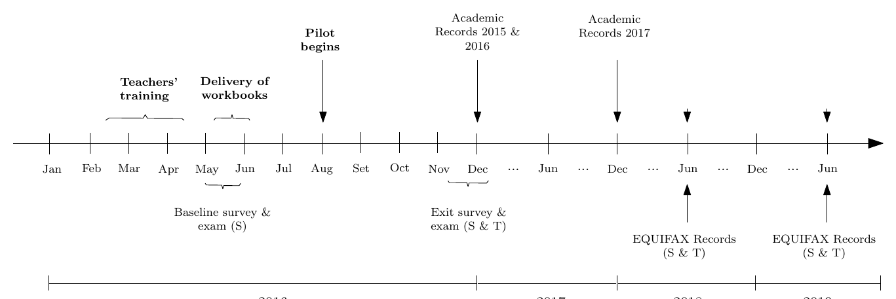
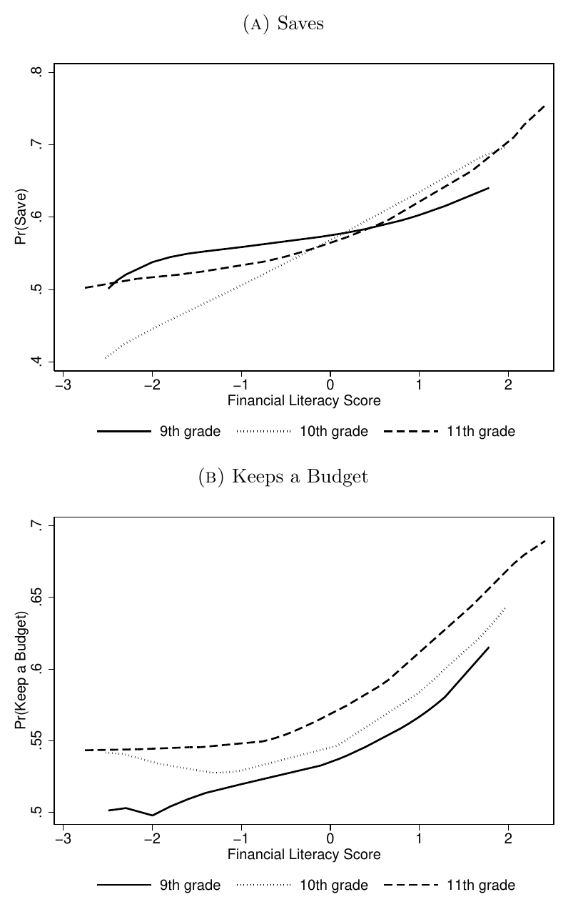
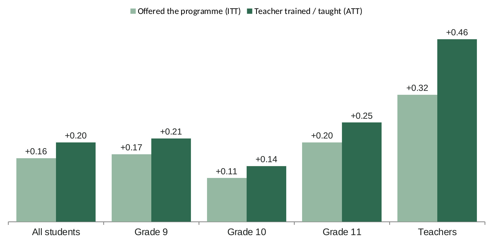
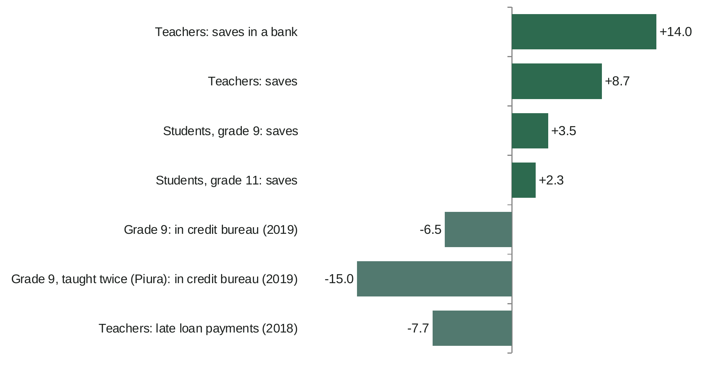
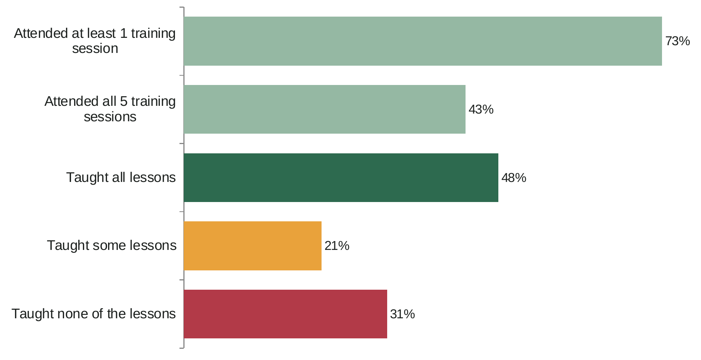
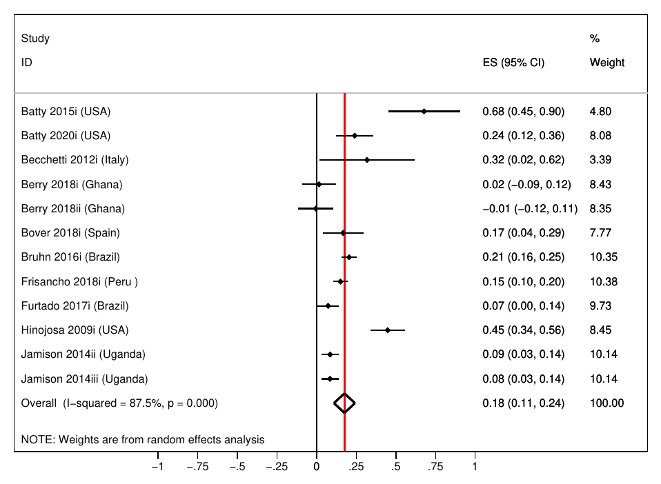
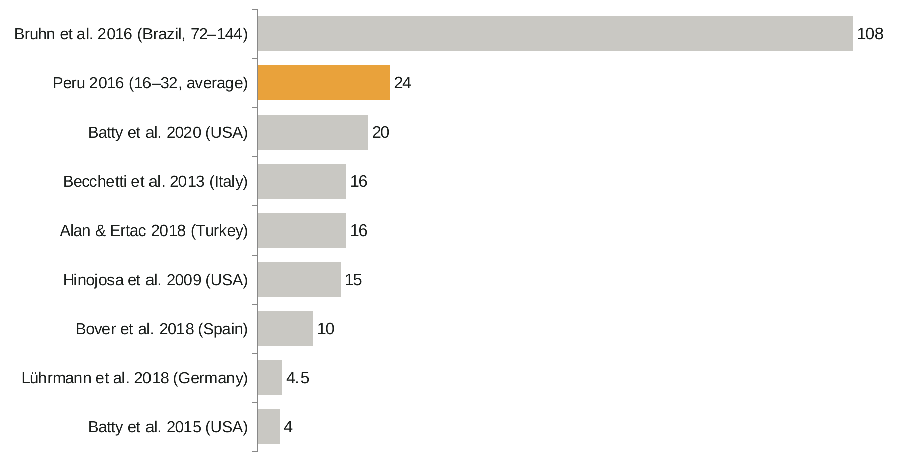

# Executive summary

**Peru has already run, at scale and under a randomised trial, almost exactly the programme we propose for Latvia.**

- **The problem it solved.** Peru made financial education a required school competence in 2009, but it was not being taught. That is the Latvian situation: compulsory on paper, missing in practice.
- **What Peru did in 2016:**
  - finance lessons placed inside the existing **History, Geography and Economics** course (comparable to Latvian social studies);
  - **workbooks for three grades and a teacher guide**;
  - **20 hours of teacher training**;
  - certificates that counted toward teachers' careers;
  - monitoring calls during the term.
- **How it was tested.** **300 public secondary schools** were paired, and a coin-flip in each pair decided which school got the programme. About **20,000 students and 453 teachers** were tested. Students were then followed in **school records and credit-bureau records** for three years.
- **Students:**
  - financial knowledge up **0.16 SD**, or **0.20 SD** where a teacher took part in training;
  - **no damage to other subjects**;
  - more saving and better shopping habits;
  - three years later, those with more exposure were **less likely to be in debt**;
  - poorer students and girls had **fewer late payments**.
- **Teachers:**
  - knowledge up **0.32 SD**, and **0.46 SD** for those who actually taught;
  - **14 percentage points** more likely to save in a bank;
  - late loan payments down **40%** after two years.
- **Cost:** **US$4.8 per student**, plus US$56,100 once to write the workbooks. That is about **US$31 per student for each standard deviation of knowledge**, cheaper than almost every comparable education programme.
- **What went wrong:**
  - participation was voluntary: only **43% of teachers did all the training**, and **a third taught none of the lessons**;
  - funding stopped after one year;
  - the effects were largest where the programme was repeated.
  - The author's own conclusion is to make it **"a mandatory course or course portion, subject to regular evaluation"**.

**What this means for Latvia:**

- The design works and is affordable. Latvia should copy it.
- Peru's weak points are exactly what our regulation proposals fix:
  - minimum lessons;
  - training that counts within teachers' required hours;
  - delivery that is recorded and checked;
  - multi-year funding.

# 1. Why Peru matters for our case

Most of the evidence on school financial education comes from short programmes, voluntary after-school clubs or the United States. Peru is different in four ways that make it unusually relevant to Latvia.

1. **The same starting problem.**
   - Peru put financial education into its national curriculum in 2009, as one of 29 competences every school must develop ("responsibly manages economic resources").
   - In 2015 its National Financial Inclusion Strategy set a goal of school financial education for **all** primary and secondary pupils by 2021.
   - Yet the subject was not really being taught. Latvia is in the same place after Skola2030: financial literacy is compulsory inside social studies, but 36% of 9th graders say they never learn about money at school.
2. **The same delivery model.**
   - Peru did not create a new subject. It placed the lessons inside an existing social-science course and supported teachers with materials and training.
   - That is precisely what we propose for Latvian social studies.
3. **The same kind of partnership.**
   - In Peru: the Ministry of Education, the financial regulator (SBS) and the banking association's education centre.
   - In Latvia: IZM and VIAA, Latvijas Banka (central bank and supervisor) and Finance Latvia.
4. **Unusually strong evidence:**
   - a large randomised trial;
   - real behaviour from **credit-bureau records**, not just surveys;
   - school grades to check for harm to other subjects;
   - measurement of **teachers** as well as students;
   - a published **cost-effectiveness** analysis.

Few studies anywhere have all of these.

# 2. The programme in detail

## 2.1 Partners and funding

- **Built by:** the Ministry of Education (MINEDU), the Superintendency of Banking, Insurance and Pensions (SBS) and the Center of Studies of the Peruvian Association of Banks (CEFI–ASBANC).
- **Paid for:** all delivery costs (training, materials, monitoring) were covered by these partners.
- **Evaluation:** paid for jointly by the Ministry and the Inter-American Development Bank (IDB).
- **Later scale-up:** the insurers' association (APESEG) and the German Sparkassen Foundation for International Cooperation joined, under the name *Finanzas en mi Colegio* ("Finance in my school").

## 2.2 What students learned

Each of the last three secondary grades (equivalent to grades 9–11) got its own workbook, aligned with the national curriculum and the national financial education plan.

| Grade 9: managing money | Grade 10: the financial system | Grade 11: the responsible consumer |
|---|---|---|
| Wants vs needs; opportunity cost; saving vs credit; spending vs investment; economic agents | The financial system; saving vs investment; assets and liabilities | Capacity to pay; **over-indebtedness** |
| Financial plan; income and expenses; making and using a budget | Financial future and capacity to pay; using financial products well | Financial consumer rights and their protection; the state and financial stability; transparency in contracts; consumers' responsibilities |

**How it was taught:**

- through **case analysis, exercises, group activities and homework**, not lectures;
- the concepts were deliberately kept simple;
- once a teacher taught the lessons, the content counted in course grades, so students took it seriously.

**The sequence makes sense:**

1. grade 9: personal money management;
2. grade 10: how financial products work;
3. grade 11: protection, debt and rights.

That fits the Latvian plan of a module in grade 9 and a deeper one in grade 11.

## 2.3 How much teaching

The ministry gave teachers a suggested schedule.

| Grade | Sessions | Weeks | Hours |
|---|---|---|---|
| 9 | 8 | 16 | 32 |
| 10 | 5 | 12 | 24 |
| 11 | 7 | 8 | 16 |

- **That is a lot by international standards** (Figure 7). Most tested school programmes run 4–20 hours.
- Only Brazil's programme was larger (72–144 hours).
- **The intensity matters.** Meta-analyses find that more intensive programmes have bigger effects, with diminishing returns.

**Where the time came from:**

- Teachers were told to use the economics part of the course, but were given no guidance on what to drop.
- Surveys show that in practice they **cut time from history, politics and world news**, while keeping economics time unchanged.
- **For Latvia:** give teachers explicit guidance on how the module fits the social-studies programme, so the trade-offs are planned rather than improvised.

## 2.4 Teacher training

- **Length:** **20 hours in five sessions**, four on financial content and one on teaching methods (charts, figures, case studies).
- **Timing:** before the school year (February–March 2016).
- **Trainers:** professional facilitators with years of experience, delivering the material "in a very interactive and clear format".
- **All three grades together.** Teachers learned the content for all three grades at once, so their own knowledge built up step by step.
- **Replica sessions.** In the first month of classes, trained teachers ran sessions for colleagues to widen coverage.

**Incentives** (this is the part Latvia should study most closely):

- **A completion certificate that counted toward teachers' performance evaluation.** Peru promotes teachers partly on merit, and professional development is one criterion. So the training had real career value.
- A transport subsidy, mostly in kind, and a full meal at each session.
- School principals were asked to free teachers to attend.

## 2.5 Monitoring and timeline

The timeline is shown in Figure 1.

- **February–March 2016:** teacher training.
- **May–July:** workbooks distributed to all programme schools.
- **May:** baseline survey and test.
- **August–December:** lessons in class.
- **September–November:** monitoring phone calls to keep delivery on track.
- **December:** exit survey and tests of students and teachers.
- **June 2018 and June 2019:** credit-bureau records collected.

# 3. How the evaluation worked

## 3.1 Who was included

- **Which schools:** public, full-day, urban secondary schools in six regions (Lima and Callao, Arequipa, Piura, Junín, Puno, San Martín).
- **How they were paired:** of 308 eligible schools, 300 were matched into **150 pairs** of very similar schools, on 10 characteristics such as size, facilities, dropout and pass rates.
- **The coin-flip:** within each pair, one school was randomly chosen for the programme. This is why the results can be read as **causal**: the two groups differed only by chance and by the programme.
- **Sample size:** chosen to detect an effect as small as 0.1 SD.
  - About **20,000 students** (one class per grade per school, 900 classes) and **453 teachers** were surveyed and tested.
  - The schools held about 60,000 students in total.
  - 17% of students were lost between the two survey rounds, equally in both groups.

## 3.2 What was measured

1. **Knowledge tests:**
   - 15 questions per grade, taken before and after;
   - four questions came from the US Jump$tart survey, the rest from the workbook topics;
   - teachers never saw the student test, so they could not "teach to the test";
   - the results hold even using only the independent questions.
2. **Behaviour surveys:** saving, budgeting, shopping habits and financial autonomy. They also measured self-control, patience and impulsiveness.
3. **School records:** every student's grades by subject for 2015–2017, used to check whether finance lessons hurt other learning.
4. **Credit-bureau records (Equifax):**
   - collected two and three years after the programme;
   - they show whether a young person has loans or credit-card debt, their debt level, and **late payments** on loans, bills or cards;
   - this is real, high-stakes behaviour, not self-reporting.

## 3.3 The starting point

- **Financial literacy was low.** Only half the students could answer half the questions correctly.
- **These teenagers already had real money lives:**
  - **40% already worked**;
  - students had a median monthly income of about US$33 (average about US$100).
  - A diary study in one region found the average teenager made **14 financial transactions a month**.
- **Knowledge and behaviour went together.** Students with higher scores were more likely to save and to keep a budget (Figure 2). This is the logic of the programme: raise knowledge, and behaviour should follow.

{width=50%}

**For Latvia:** our teenagers are in a similar position. Most hold bank cards, some invest in crypto, and many are targeted online. Their money decisions are real well before they finish school.

# 4. Results for students

## 4.1 Knowledge

**Average effect:** students in programme schools scored **0.16 SD** higher on the final test.

**By grade:** grade 9 **+0.17**, grade 10 **+0.11**, grade 11 **+0.20** (Figure 3).

**Two ways of measuring the effect:**

- **"Offered" (intention-to-treat, ITT):** compares all programme schools with all comparison schools, whether or not teachers took part.
- **"Took part" (treatment-on-the-treated, ATT):** estimates the effect where at least one teacher attended training. It is **0.20 SD** on average, with grade 11 at **+0.25 SD**.

**How it compares:** a meta-analysis of 10 youth trials in the paper gives an average of **0.18 SD** (Figure 6). Peru sits right at that average, similar to Brazil and Spain.

**What 0.16–0.20 SD means in practice:**

- It is a typical size for a good education programme, not a small one.
- It is achieved in one semester of lessons inside an existing course.
- It is a **lower bound**: a third of teachers did not teach at all (section 6).

## 4.2 No harm to other learning

A common objection is that time spent on finance is time lost elsewhere. Peru checked this with official school records.

- In 2016, **no effect** on overall grades or on any subject.
- In 2017, a **slight improvement in language grades**, with no fall in history and social science or maths grades.
- No effect on moving up a grade, or on university plans (83% already planned to go).

**For Latvia:** this answers the "teachers are overloaded and the curriculum is full" objection. Well-designed finance lessons do not damage other learning.

## 4.3 Behaviour right after the lessons

The effects were modest, as expected for teenagers with limited access to financial services, but they followed what each grade was taught.

- **Saving:** **+3.5 pp** among 9th graders (who studied budgeting) and **+2.3 pp** among 11th graders (who studied saving).
- **Financial autonomy:** **+0.08 SD** among 11th graders, matching their focus on consumer rights and information.
- **Shopping habits:**
  - in all grades, more students **saved up before buying** something they could not afford;
  - 11th graders became more likely to **compare prices and bargain**.
- **Budgeting:** no change in keeping a budget.

## 4.4 Behaviour three years later: credit records

This is the most important and most unusual part of the study.

- **June 2018 (two years later):** no clear differences. Most students were still too young to borrow.
- **June 2019 (three years later):**
  - students from programme schools were **less likely to appear in the credit bureau**, mainly because they **held less debt**;
  - their **debt-to-income ratios were better**;
  - the effect was strongest among **grade 9 students: −6.5 pp**. They had the most years left in school and so the most chance of further lessons.
- **Where the programme was repeated (Piura, 2016 and 2018):**
  - students were **6 pp less likely** to be in the credit bureau;
  - **9th graders**, who got two rounds, were **15 pp less likely** (Figure 4).
- **Students who started behind benefited most:**
  - the drop in debt and the better debt-to-income ratios held only for students in the bottom third of initial knowledge, for **girls**, and for **poorer students**;
  - **poorer students had fewer late payments** on loans and bills;
  - **girls had fewer late payments** on bills and credit cards.

**How to read the credit results:**

- Fewer students with debt is good in this context. Most young borrowers in Peru use credit cards, often from department stores, with high interest. The share of 18–25-year-olds with a credit card rose 33% in one year before the study.
- The author's conclusion is that **"sustained and intense exposure to financial education during high school is effective to keep their debt levels controlled"**.
- But behaviour effects depend on **intensity and repetition**. They appear where students got more lessons.

**Later research:**

- A follow-up of about 60,000 people, seven years after the programme ("Lasting Lessons", Frisancho et al. 2025), and the published version of the paper report about **20% less delinquent debt** among students who borrowed.
- A separate study finds benefits for **parents** in poorer households.
- These are from later papers and are not in the 2021 manuscript used here.

# 5. Results for teachers

**Teachers were not just the delivery channel; they were also beneficiaries.**

- **Knowledge:**
  - **+0.32 SD** for all teachers in programme schools, twice the student effect;
  - **+0.46 SD** for teachers who actually taught at least one lesson (Figure 3);
  - **teaching the material is how teachers learn it.**
- **Saving:**
  - **+8.7 pp** more likely to save;
  - **+14 pp** more likely to save **formally**, in a bank.
  - That is almost double the effect of a well-known classroom programme for poor urban households in India, and comparable to the most successful programmes designed only to promote saving.
- **Financial autonomy:** improved.
- **Budgeting and shopping:** no change. Teachers already managed these well.
- **Late loan payments:**
  - **−7.7 pp in 2018**, a **40% improvement** on the comparison group;
  - **gone by 2019**. Without repetition, the effect on behaviour faded.

**Why this matters for Latvia:**

- Latvijas Banka found Latvian teachers' knowledge of simple and compound interest insufficient.
- Peru shows that training teachers to teach finance also fixes **their own** knowledge and money habits.
- So a training course can be sold to teachers as **personal benefit**, not just extra work.

# 6. Implementation: what drove take-up, and what went wrong

## 6.1 Teacher take-up

The paper is unusually honest about how much of the programme actually happened (Figure 5).

- **Training:** 73% of teachers attended at least one session, but only **43% attended all five**.
- **Teaching:** **48%** taught all the lessons, **21%** taught some, and **about a third taught none**.

**The author calls this relatively high compliance**, and gives four reasons:

1. The teachers already taught economics, so they were interested.
2. **The certificate counted toward their career evaluation.**
3. The training was good: professional trainers, interactive, all grades together.
4. The materials were simple and ready to use.

## 6.2 What went wrong

1. **It was voluntary.**
   - Because finance lessons were not a stand-alone course or a required unit, **the ministry could not enforce delivery**;
   - a third of teachers simply did not teach it.
2. **No guidance on time.** Teachers improvised what to cut.
3. **Funding stopped after one year.**
   - In 2017 the partners could only afford to print workbooks;
   - there was no training, no instructions and no monitoring, and **nobody knows how much was taught**.
4. **Repetition was rare, but powerful.**
   - Only one region (Piura) re-ran the programme in 2018, with online training, an explicit request from the ministry, and certificates;
   - that is where the long-term credit effects were largest.
5. **Teacher behaviour effects faded** without follow-up.

**The author's conclusion:**

> "The ITT effects thus constitute a lower bound of the effect that these programs could have if they were to be included as a mandatory course or course portion, subject to regular evaluation. The formal inclusion of the content has the potential to improve compliance levels."

**Translated for Latvia:** making financial literacy a required, scheduled and checked part of social studies is not bureaucracy. It is how you get the full effect.

# 7. Cost and value for money

| Item | Amount |
|---|---|
| Writing the workbooks (one-off) | **US$56,100** |
| Delivery per student (150 schools, about 31,000 students) | **US$4.8** |
| Implied delivery total | about **US$150,000** (our calculation) |
| Cost per student for +1 SD of knowledge | **US$30.7** |

**How the cost was measured:**

- only the **extra** resources used in programme schools (training, materials, monitoring);
- costed with a standard method for education programmes (the "ingredients method");
- the workbook development cost is excluded, because it would not recur when scaling up.

**How it compares:**

- The cost-effectiveness estimate holds even at the edges of its 90% confidence interval.
- Of **21 cost-effective primary-school programmes** reviewed by Busso et al. (2017), **all but one** cost more per unit of learning gained.
- A voluntary after-school programme in Ghana cost US$4.15 per student actually reached, similar money for much smaller effects.
- An IDB summary gives US$6.6 per student, probably on a different cost basis. We use the paper's US$4.8.

**For Latvia:** at about 35,000 pupils a year in grades 9 and 11, a Peru-style programme would cost on the order of **€150–250k** in teacher training once, plus materials. That works out at about **€5–7 per pupil** in the first year, and less after that, because trained teachers keep teaching. This is consistent with our earlier estimate. The pupil and teacher numbers are our approximations and should be checked with IZM.

# 8. How Peru compares with other programmes

**Effect size.** The paper's meta-analysis of youth programmes (Figure 6) puts the average effect on knowledge at **0.18 SD**.

- Peru (0.15 in that analysis), Brazil (0.21) and Spain (0.17) sit close to the average.
- Some US programmes show larger effects.
- Two after-school clubs in Ghana show none.
- The author notes that students who start from a stronger base tend to gain more. Effects in higher-scoring countries (USA, Italy) were above average.
- **For Latvia:** our students start from a better base than Peru's, which suggests similar or larger effects are realistic.

{width=85%}

**Intensity.** Peru's 16–32 hours per grade is among the highest of the tested school programmes (Figure 7). Only Brazil, at 72–144 hours, was larger. Short programmes of 4–10 hours (Germany, Spain, some US studies) are more common.

**For Latvia:** our proposed 10–12 lessons per grade is **in the effective range**. It is more than most tested programmes, while realistic within social studies.

# 9. Limits of the evidence

- **Context differs.** Peru is a middle-income country with lower baseline literacy and a different school system. The **design** transfers well; the exact sizes may not.
- **Behaviour is self-reported in the short run.** Saving and shopping come from surveys, which can be biased. The credit results come from administrative records and are more reliable.
- **Credit effects appear only after three years, and mainly with more exposure.** They should not be presented as automatic.
- **The teacher-delivery estimates (ATT) are less certain.** Teachers who chose to teach may have been more motivated to begin with, so the +0.46 SD for teachers who taught should be read as indicative.
- **Versions differ slightly.** The 2021 manuscript reports 0.16 SD; the published version reports 0.14 SD. The 20% fewer arrears and the parent effects come from later papers.

# 10. Lessons for Latvia

## 10.1 What to copy

| Peru | Effect | Latvian version |
|---|---|---|
| Lessons inside an existing social-science course | Worked; no harm to other subjects | A financial literacy module inside social studies, grades 9 and 11 |
| Grade-by-grade sequence: money management, then products, then protection and debt | Effects matched each grade's content | Grade 9: budgeting, saving, scams and money mules. Grade 11: credit, investing, pensions, consumer rights |
| 16–32 hours per grade | Measurable knowledge gains | About 10–12 lessons per grade as a minimum |
| Workbooks and teacher guide; simple, active methods | Non-specialist teachers could deliver | Ready-to-teach lesson plans, slides, games and case studies |
| 20-hour training by professionals; all grades together | Teachers +0.32 to +0.46 SD | A 20-hour certified course built on Latvijas Banka's seminar cycle |
| Certificate counting toward teacher evaluation | Drove high take-up | **Count it within the 36 hours every 3 years (Regulation No. 569)** |
| Phone monitoring | Two-thirds taught some or all | Lesson topics recorded in e-klase; school-level check; the 9th-grade survey |
| Credit-bureau evaluation | Showed real behaviour change | Partner with Latvijas Banka for anonymised long-term follow-up |

## 10.2 What to fix

| Peru's weakness | Consequence | Our fix |
|---|---|---|
| Voluntary delivery | A third taught nothing | **Minimum lessons in the sample programmes; assessed outcomes in the standards (Regulations No. 747 and 416)** |
| Voluntary training | Only 43% did all of it | Training that counts toward required hours, during work time, with online options |
| No guidance on time | Teachers cut history and politics | Clear guidance on where the module fits in the social-studies programme |
| Funding for one year | No training or monitoring after 2016 | **Multi-year funding in the 2028+ strategy and education guidelines** |
| Little repetition | Behaviour effects faded | Grade 9 and grade 11 modules, plus practice during the year (games, Olympiad) |

## 10.3 Key numbers for the presentation

- **+0.16 SD** students; **+0.32 SD** teachers; **+0.46 SD** teachers who taught.
- **No harm** to other subjects.
- **−15 pp** chance of being in debt three years later, where students were taught twice.
- **+14 pp** teachers saving in a bank.
- **US$4.8 per student.**
- **43%** of teachers did all the training; **a third** taught nothing.

## 10.4 Lines for the talk

- "Peru put finance lessons inside its existing social-science course, with workbooks and 20 hours of teacher training. Students learned more, teachers learned twice as much, and three years later the students had less debt. All for under five dollars a student."
- "Teachers who taught the lessons learned the most. Training works best when it counts toward their career, which is why we want it inside the 36 hours teachers already owe."
- "A third of Peru's trained teachers never taught it, because it wasn't required. The researcher's own conclusion: make it a mandatory part of the course. That is our regulation ask."
- "When Peru's funding stopped, so did the training. Where it was repeated, the effect on debt more than doubled. A one-year pilot is not a policy."

## 10.5 Likely questions

| Question | Answer |
|---|---|
| "Peru is very different from Latvia." | Yes, but the design is the same: lessons inside an existing course, materials and teacher training. Latvian students start from a higher base, and evidence suggests that leads to similar or larger gains |
| "Won't this take time from other subjects?" | Peru checked with official grades: no harm, and slightly better language grades a year later |
| "Will teachers do it?" | Two-thirds did in Peru, voluntarily. With a career incentive and a requirement, more will. That is our ask |
| "Does knowledge change behaviour?" | In the short run modestly, in saving and shopping. After three years, students who got more lessons had less debt, and poorer students fewer late payments |
| "How much would it cost?" | Peru: US$4.8 per student. For Latvia, roughly €150–250k once for teacher training, about €5–7 per pupil in year one |

# Sources

- Frisancho, V. (2021 manuscript; published 2023). Is school-based financial education effective? Immediate and long-lasting impacts on high school students. *The Economic Journal*, 133(651), 1147–1180. https://ideas.repec.org/a/oup/econjl/v133y2023i651p1147-1180..html ; manuscript: https://veronicafrisancho.net/wp-content/uploads/2021/10/manuscript_finedperu_aug2021.pdf. AEA RCT Registry AEARCTR-0004719. **Figures 1, 2 and 6 are reproduced from this manuscript with attribution.**
- Frisancho, V., García, Ventura & Chong (2025). Lasting lessons: The long-term impacts of school-based financial education. CAF WP 2025/09. https://veronicafrisancho.net/wp-content/uploads/2025/10/frisancho-et-al-2025-lasting-lessons.pdf
- Frisancho, V. (2023). Spillover effects of financial education: The impact of school-based programs on parents. *Journal of Financial Literacy and Wellbeing*. https://www.cambridge.org/core/journals/journal-of-financial-literacy-and-wellbeing/article/spillover-effects-of-financial-education-the-impact-of-schoolbased-programs-on-parents/5640CEDED2AA1FA647DD0564E08D1674
- IDB. Evaluación experimental del piloto Finanzas en mi Colegio. https://publications.iadb.org/es/evaluacion-experimental-del-piloto-finanzas-en-mi-colegio
- SBS Peru. Finanzas en mi colegio. https://www.sbs.gob.pe/educacion-financiera/Otros-Programas/Finanzas-en-mi-colegio
- Busso, M., et al. (2017). *Learning Better: Public Policy for Skills Development*. IDB. (Cited in Frisancho for the cost comparison.)
- Kaiser, T., & Menkhoff, L. (2020). Financial education in schools: A meta-analysis of experimental studies. *Economics of Education Review*, 78.
