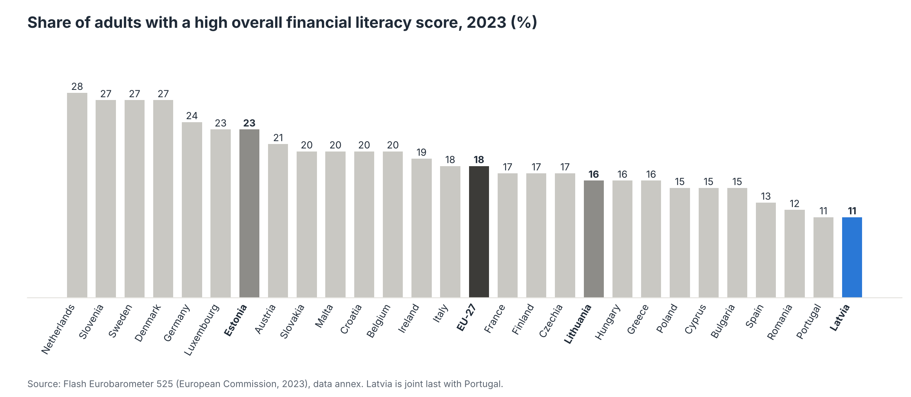

*How to use this template: write in Markdown, then build the Word file with*
`bash financial-literacy/tools/build_report.sh <this file> "<output.docx>"`.
*Styles (headings, callouts, captions, tables, header and page numbers) come from `templates/report-template.docx`. In Word, right-click the table of contents and choose "Update field".*

# Executive summary

> **Key message.** One or two sentences a policymaker remembers: the problem, why now, and what we ask for.

1. **Insight 1:** a number and what it means (Source, year).
2. **Insight 2:** …
3. **Insight 3:** …

**What we propose:** one line per action, each with an owner.

# 1. What is the problem, and why is it important?

## 1.1 The size of the problem

| Indicator | Latvia | Benchmark (EE / LT / EU) | Source |
|---|---|---|---|
| Example indicator | 11% | 23% / 16% / 18% | Flash Eurobarometer 525 (2023) |

**Reading:** two or three sentences on what the figure shows and why it matters.

## 1.2 Who is affected most

## 1.3 Why it matters now (stakes and policy window)

# 2. What do research and data say?

## 2.1 Causes (diagnosis)

| Cause | Local evidence | International evidence |
|---|---|---|
| … | … | Author (year), *Journal* |

## 2.2 Solutions and their evidence

| Study | Design | Result |
|---|---|---|
| Author (year), *Journal* | RCT, n = … | +0.xx SD knowledge |

## 2.3 Expected impact (illustrative, not a forecast)

# 3. What should be done, and how will we make an impact?

## 3.1 Actions (each with an owner and a timeline)

1. **Action:** what, who and when.

## 3.2 KPIs

| KPI | Baseline (year) | Target (year) | Data source |
|---|---|---|---|

## 3.3 Stakeholders and communication (Product + Communication + Partnership)

## 3.4 Cost and feasibility

## 3.5 Risks and how we mitigate them

# Appendix A. Research methodology and conceptual frameworks

- **Frameworks:** …
- **Data:** source, method, sample, fieldwork dates.
- **Limitations:** …

# Appendix B. Evidence register

| Claim | Source (page) | Status |
|---|---|---|
| … | … | Verified / [verify] |

# References

*APA 7th. Peer-reviewed research first, then official sources, then media.*
