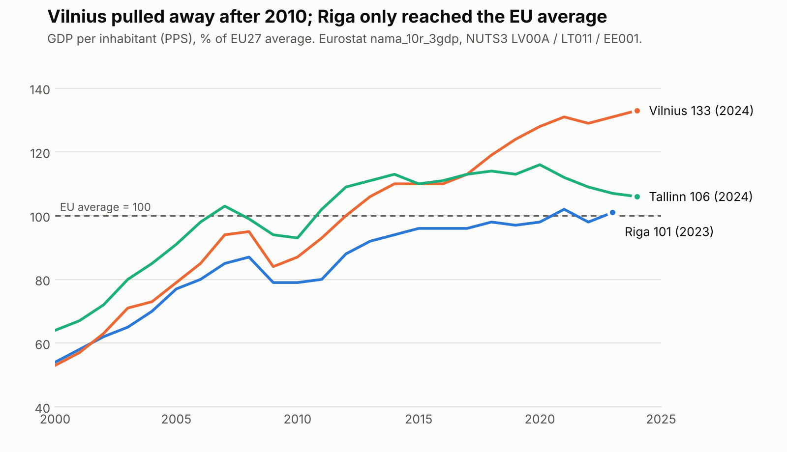

# 1. What problem are we solving, and why does it matter?

**Riga is falling behind its Baltic neighbours.** In 2000, Riga and Vilnius had the same GDP per head (54% and 53% of the EU average in purchasing-power terms). By 2023, Vilnius had reached **131%** and Riga only **101%**, so Vilnius is now about 30% richer per head. Riga is the **second-poorest of the EU's 27 capital regions**; only Cyprus's capital region is lower (Eurostat). The gap opened after 2010 and has not closed since 2020 (Figure 1). Riga has also lost people: its population fell from 766,000 in 2000 to **588,911 in 2026** (Statistics Latvia). Since 2025, Vilnius has been officially recognised as the largest Baltic city. The same pattern holds nationally: in 2010 Latvia and Lithuania had almost the same GDP per head (about US$11,400 vs US$12,000), but by 2023 Lithuania was at US$27,100 against Latvia's US$23,200, and Lithuania's economy was 1.8 times Latvia's (World Bank).

{width=15.5cm}

The gap is above all about innovation and talent:

- **Innovation.** Latvia ranks **25th of 27** in the European Innovation Scoreboard 2026, at 61% of the EU average, and is roughly flat since 2019. Over the same period Estonia rose to 108.6% (11th) and Lithuania to 86.6% (18th).
- **R&D spending.** Latvia spends **0.94%** of GDP on R&D, against 1.12% in Lithuania and 1.98% in Estonia (2024).
- **Young graduates.** Only **44.7%** of Latvians aged 25–34 have a tertiary degree, against 60.8% in Lithuania (2025).

**Riga's one clear strength is its students.** Riga ranks **105th** in the QS Best Student Cities 2027, ahead of Vilnius (=114th) and Tallinn (=135th). Latvia's international student numbers more than doubled in a decade, from 5,255 in 2014 to **11,895 in 2025**, or 15.6% of all students. Most of them study in Pārdaugava, where five universities (LU, RTU, RSU, RISEBA and BA Turība), two clinical university hospitals and the National Library sit within about 3 km². This area, the **Knowledge Mile** (Zināšanu jūdze), holds roughly 30,000 students and 4,000 researchers. It is where Riga's main strength (attracting students) meets its main weakness (turning knowledge into firms, jobs and residents).

**The problem we will solve: the Knowledge Mile has no owner.** Riga City Council signed a memorandum with LU in 2023 and with LU, RTU and RSU in June 2024. According to the think tank LaSER, the 2024 memorandum does not even define the Mile. It names no projects, KPIs, budget or responsible person, and it leaves out RISEBA, BA Turība and business. City deputies told LaSER that *"nobody asks how we are doing with it."* The district has no website. Students rarely cross between campuses, and they see the university as "a place to attend lectures, full stop" (LaSER focus groups). The universities plan major investments separately: LU is planning a 15,000 m² sports and health building 1.5 km from RSU's new sports complex.

Riga already has the "hardware" of an innovation district. What it lacks is the "software" that turns proximity into collaboration. That is a problem of policy implementation, not of money or buildings, and it can be fixed by decisions within the city's and the universities' own powers.

# 2. What do the research and data say?

**Why proximity is not enough.** Boschma (2005, *Regional Studies*) shows that **geographical proximity is neither necessary nor sufficient** for interactive learning. Collaboration also needs organisational, institutional, social and cognitive proximity. The Knowledge Mile has only the first. Riga is an example of what Katz & Wagner (2014, Brookings) call an *anchor-plus* innovation district with strong **economic assets** (universities, hospitals, firms) and improving **physical assets**, but missing **networking assets** (relationships, shared events, identity) and **governance**.

**How the problem can be solved: cheap coordination works.** The strongest causal evidence comes from deliberately creating contact between researchers:

- **Matchmaking sessions.** In a randomised field experiment at Harvard Medical School, a single **90-minute structured information-sharing session raised the probability that two scientists co-applied for a grant by 75%** (from 0.16% to 0.28%), even among scientists in the same institution (Boudreau et al. 2017, *REStat*).
- **Co-location.** At Paris's Jussieu campus, asbestos removal forced labs to move, which created a natural experiment. **Co-location made two labs 3.5 times more likely to collaborate**, mainly for labs that had found each other hard to discover before (Catalini 2018, *Management Science*).
- **Face-to-face meetings.** In Silicon Valley, removing a quarter of face-to-face meetings would cut patent citations by about 8% (Atkin, Chen & Popov 2022, NBER working paper).

Large subsidy-led cluster programmes have weaker records. Duranton (2011) calls the case for them "feeble", and London's Tech City mostly took credit for trends that already existed (Nathan 2022, *Research Policy*). **This points to coordination and governance, not new buildings.**

**What our neighbours and peers did.** Every Baltic competitor gave its district an institution with the city at the table, years ago. Riga signed memoranda.

| City | Institution | City's role |
|---|---|---|
| Tartu | Science park foundation (1996) | Co-founder with the University of Tartu, the county and institutes |
| Vilnius | Sunrise Valley science and technology park (2003); national "valleys" programme | Co-founder with Vilnius University and VILNIUS TECH; runs the agency Go Vilnius |
| Tallinn | Ülemiste City and Tehnopol next to TalTech | Co-funds a TalTech "Future City" professorship with the district's developers |
| Tampere | City–university agreement for 2026–2029 | Work programme and a management group meeting four times a year |
| Eindhoven | Brainport foundation and development agency | About €1 per inhabitant from municipalities, plus about €2 raised from other sources for each public euro |
| **Riga** | **Memoranda (2023, 2024)** | **Signatory only: no entity, budget or KPIs** |

**Why Vilnius pulled ahead: organisation, not geography.** Vilnius's take-off after 2010 coincides with deliberate choices:

- **Fintech.** The Bank of Lithuania built the EU's most active fintech licensing regime. It advertised licensing "2–3 times faster" than elsewhere in the EU, licensed Google and Revolut in December 2018, and by the end of 2020 supervised about 80 e-money and 52 payment institutions, whose payment transactions tripled to over €50bn that year. A Lithuanian licence lets a firm operate across the EU, so Vilnius became an EU fintech gateway.
- **Investment.** Lithuania targeted global business-services and tech centres (Barclays, Danske Bank, Nasdaq, Western Union). Invest Lithuania counts 80+ such centres with over 26,000 jobs.
- **Home-grown tech.** Firms such as Vinted and Nord Security grew into unicorns, and Vilnius start-ups raised about €212m of venture capital in 2025, against Latvia's €78m.
- **The city as organiser.** Vilnius co-founded Sunrise Valley in 2003, runs the Go Vilnius development agency, and leased municipal buildings for Vilnius Tech Park.

Regulators and cities that organise attract talent and capital; Riga's universities have not been connected to such a strategy.

Two lessons from abroad shape our design:

- **Signatures alone do not deliver.** Some 50–60 UK universities pledged "Civic University Agreements" in 2019, but only about ten agreements followed, with "very little impact on policy". Any agreement therefore needs an owner, a work programme and public reporting.
- **Cross-enrolment works when the home university pays and credit is agreed in advance.** Examples are Leiden–Delft–Erasmus (a shared portal with 7,000+ minor applications), UvA–VU in Amsterdam, and Finland's national RIPA service, which in 2024–2026 replaced the older bilateral agreements (JOO).

**There is no legal barrier to cross-enrolment.** We checked the consolidated legal texts. The study-standard regulation (MK No. 240) sets minimums for the compulsory part (60 credit points) and the restricted-choice part (30 credit points). It sets **no minimum and no restriction for the free-choice part**. The Ministry of Education has stated that recognising courses taken elsewhere is "entirely up to the institution", and LU's own rules already allow it. So LaSER's claim that accreditation rules block electives at a neighbouring university is overstated. The real barriers are practice: no shared catalogue, recognition decided case by case, and funding tied to one institution.

**What impact can we expect?** Universities raise regional prosperity. Across 78 countries, **doubling universities per capita is associated with about 4% higher regional GDP per capita**, with spillovers to neighbouring regions (Valero & Van Reenen 2019). In Finland, three new technical universities raised national patenting by about **20%** (Toivanen & Väänänen 2016, *REStat*). Strong clusters lift employment growth (Delgado, Porter & Stern 2014, *Research Policy*). Much of the local effect comes from **attracting and keeping people** (Andrews 2023, *AEJ: Policy*).

Riga does not need more universities; it needs a better return on the ones it has. Talent retention is the biggest lever. RSU reports that only about **5% of its foreign graduates stay** in Latvia, whereas Estonia keeps about half of its international students for five years (OECD). LaSER estimates that each international student spends about €15,780 a year. Keeping or attracting an extra 1,000 students would therefore bring roughly **€15m a year** in direct spending. These are illustrations, not forecasts, which is why our proposal includes pre-set KPIs and a comparison with Tallinn and Vilnius.

# 3. What should be done, and how will we make an impact?

We propose **three decisions, each with a single decision-maker and each tied to a process that is already open**:

1. **Riga City Council writes a Knowledge Mile chapter into the new Riga 2050 strategy and Development Programme 2028–2034**, whose drafting began on 29 October 2026. The decision-maker is Mayor Viesturs Kleinbergs; the natural champion is Deputy Mayor Vilnis Ķirsis, who signed the 2024 memorandum. The chapter would:
   - create a **Knowledge Mile coordinator** in the Executive Director's office, with a base budget of about €0.6m a year (Brainport's ~€1 per inhabitant) and a target of raising €2 externally for each city euro;
   - replace the memorandum with a **five-year partnership agreement and work programme** that adds RISEBA, BA Turība, student councils and business;
   - require an **annual public progress report** every October.
2. **The five rectors sign a Knowledge Mile Study Agreement.** It would include:
   - a shared catalogue of free-choice courses;
   - automatic credit recognition;
   - up to two partner courses per semester;
   - reserved seats for partner students;
   - "home university pays" clearing between institutions.

   This needs no change in the law and can be piloted in **autumn 2027**.
3. **The Ministry of Education and Science and the Academic Information Centre** add an explicit "electives at a partner institution" clause to the accreditation regulation that must replace **MK No. 793 before it lapses on 1 January 2028**. This makes the practice permanent.

Commercialisation reforms are the coordinator's next agenda. Under the science-funding formula (MK No. 252), an international patent counts the same as a Q1 article, and licences and spin-offs count for nothing. Public-property law makes auction the default way to dispose of research IP.

**KPIs (baseline → target):**

| KPI | Baseline | Target |
|---|---|---|
| Funded coordinator | none | in place by end of 2027 |
| Cross-enrolments | ~0 | 100+ in the pilot semester; 300 a semester by 2029/30 |
| Joint grant applications across universities | to be measured in 2027 | +25% by 2030 |
| Stay rate of international graduates | not measured | first official figure by 2028 |
| QS Best Student Cities rank | 105th | Top 100 by 2030 |
| Public progress report | none | every October |

**How we will make the impact: Product + Communication + Partnership.**

- **Product:**
  - a two-page policy brief with the Baltic comparison and the Eurostat chart;
  - draft text for the Riga 2050 chapter;
  - a one-page model Study Agreement;
  - a KPI dashboard.
- **Communication:**
  - **Our headline:** *"Tartu's city co-founded its science park in 1996, Vilnius's in 2003. Riga signed a memo in 2024, and nobody owns it."*
  - **Supporting data:** the verified Eurostat line showing Vilnius 30 points ahead.
  - **Channels:** a press release to LSM, TVNet and IR.lv, timed to the Riga 2050 public consultation.
  - **Voices:** LaSER and Bank of Latvia economists as experts; a student taking a course "across the river" as the human story.
- **Partnership:**
  - **Riga City Council:** the owner;
  - **the five rectors and the Rectors' Council:** the Study Agreement;
  - **the five student councils:** users and advocates;
  - **LaSER:** research credibility;
  - **LTRK, FICIL and Riga's fintech and tech firms:** the business voice missing from the memorandum;
  - **IZM and AIC:** the regulation.

**What success looks like:** a funded owner by the end of 2027 and the first public Knowledge Mile progress report in October 2028. That would be the first time anyone can answer the deputies' question: *how are we doing?*

# Appendix: Research methodology and conceptual frameworks

**Conceptual frameworks.**

- **Proximity framework** (Boschma 2005). Five dimensions of proximity (geographical, cognitive, organisational, social, institutional), used to **diagnose** why co-location has not produced collaboration.
- **Innovation-district asset model** (Katz & Wagner 2014; Wagner, Katz & Osha 2019). Economic, physical and networking assets plus governance, used to **design** the intervention.
- **Triple Helix** (Etzkowitz & Leydesdorff 2000). University, industry and government interaction, used to decide **who must be at the table**.
- **Civic university / stakeholdership approach** (Goddard & Vallance 2013; Russo, van den Berg & Lavanga 2007). Used to explain **why universities benefit** from engaging with their city.

**Methods in the evidence base.** Expected effects come from studies with credible identification:

| Method | Studies |
|---|---|
| Randomised field experiment | Boudreau et al. 2017 |
| Natural experiment | Catalini 2018 |
| Instrumental variables | Toivanen & Väänänen 2016; Atkin et al. 2022 |
| Difference-in-differences with runner-up sites | Andrews 2023 |
| Regional panel with fixed effects | Valero & Van Reenen 2019 |
| Cluster-level regressions | Delgado, Porter & Stern 2014 |
| Synthetic control (counter-evidence on cluster policy) | Nathan 2022 |

The Riga-specific diagnosis comes from LaSER (2026), *Rīgas Zināšanu jūdze (2.0)*. That report is qualitative: desk research, transport and ministry data, 16 interviews on commercialisation, interviews with universities and city deputies, and student focus groups with mental mapping.

**Our own work.**

- **Primary data.** We downloaded data from Eurostat (`nama_10r_3gdp` GDP by region, `rd_e_gerdtot` R&D spending, `edat_lfse_03` education attainment) and Statistics Latvia (IRS030/031 population, IGA050 students). We verified the EIS 2026, QS 2027 and Oxford Economics 2026 figures on the official sites.
- **Legal review.** We read the consolidated texts of MK No. 240, 793, 795 and 252, the Law on Scientific Activity and the Law on Disposal of Public Person Property on likumi.lv.
- **Comparison.** We built a structured comparison of the Baltic and international governance models.
- **Papers.** We read five core papers in full: Boschma, Catalini, Boudreau et al., Delgado et al., and Toivanen & Väänänen.

**Limitations.**

- Riga's 2024 regional GDP is not yet published.
- No official stay rate for international graduates exists in Latvia; RSU's 5% is the university's own estimate.
- Student counts per university and the start-up and venture-capital figures come from secondary sources.
- No causal evaluation of a Baltic innovation district exists. Our comparison is therefore partly an original contribution, and partly a call for better data.

**Key references.**

- Andrews, M. (2023). *AEJ: Economic Policy* 15(2).
- Atkin, D., Chen, K. & Popov, A. (2022). NBER WP 30147.
- Boschma, R. (2005). *Regional Studies* 39(1).
- Boudreau, K. et al. (2017). *REStat* 99(4).
- Catalini, C. (2018). *Management Science* 64(9).
- Delgado, M., Porter, M. & Stern, S. (2014). *Research Policy* 43(10).
- Etzkowitz, H. & Leydesdorff, L. (2000). *Research Policy* 29(2).
- Katz, B. & Wagner, J. (2014). Brookings.
- LaSER (2026). *Rīgas Zināšanu jūdze (2.0)*.
- Nathan, M. (2022). *Research Policy* 51(9).
- Toivanen, O. & Väänänen, L. (2016). *REStat* 98(2).
- Valero, A. & Van Reenen, J. (2019). *Economics of Education Review* 68.
- European Commission, *European Innovation Scoreboard 2026*.
- Eurostat; Statistics Latvia; World Bank WDI; Bank of Lithuania; Invest Lithuania.
