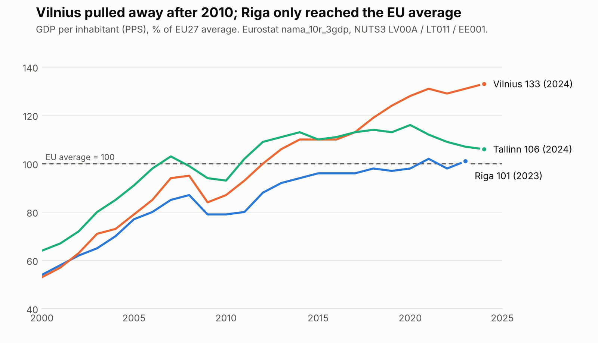
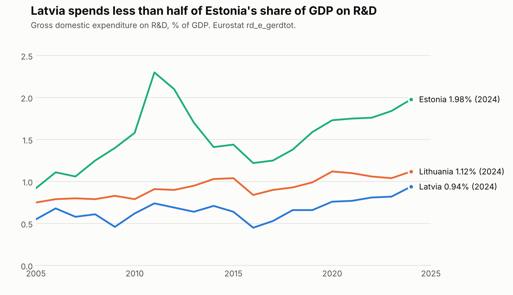
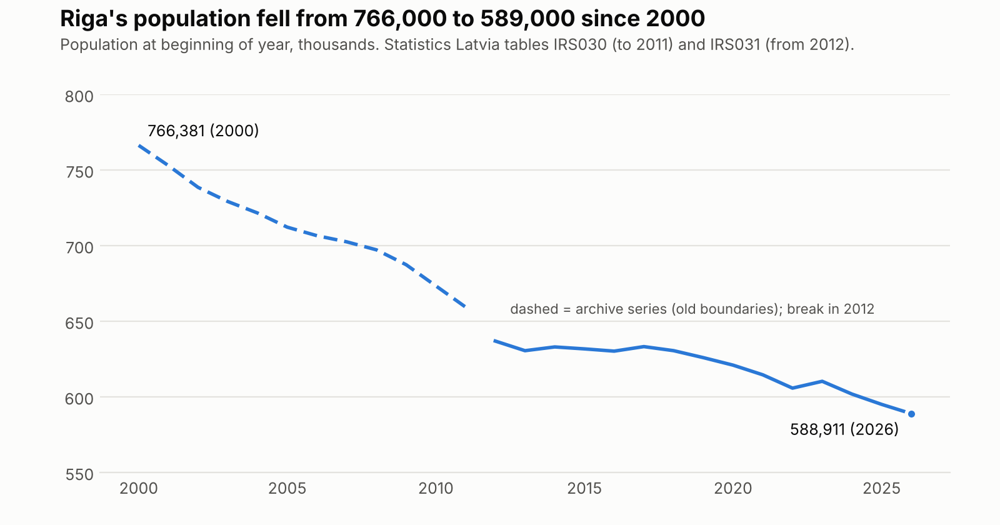

# About this document

This document brings together **all the analysis produced so far** for the impact case on the Riga Knowledge Mile (Zināšanu jūdze), in one place:

- **Part 1:** executive summary and the policy ask
- **Part 2:** verified data from Eurostat and Statistics Latvia, with charts
- **Part 3:** the full analysis: problem, Baltic comparison, international models, evidence, policy ask, objections
- **Part 4:** evidence register (what is verified, corrected or still open)
- **Part 5:** draft case description for the 28.10 brief (due 3.11)
- **Part 6:** 7-minute presentation outline with speaker notes
- **Part 7:** Latvian legal texts, verified
- **Part 8:** academic papers: those read in full, the starred reading list, and the best sources of ideas
- **Part 9:** the LaSER report summary and the case angles considered
- **Part 10:** course context and lecture notes
- **Appendices A–F:** the full research notes from each research stream, the data sources and the verification log

**Verification status.** The headline data, the key Latvian legal texts and five core papers were checked against primary sources on 1 November 2026. **Where the appendices (written earlier) disagree with Parts 1–7, Parts 1–7 are correct.** The most important correction: Riga is at 101% of the EU average and is the **second-poorest** EU capital region, not the poorest at about 77%.

# Part 1. Executive summary

Riga's Knowledge Mile does not need more universities or buildings. What it lacks is anyone accountable for making five institutions within about 3 km work as one district. The most realistic policy fix is a three-part package:

1. **Riga City Council** writes a named Knowledge Mile owner, a budget line and KPIs into the **Riga 2050 strategy and Development Programme 2028–2034**, which began drafting on 29 October 2026.
2. **The five rectors** sign a **cross-enrolment agreement**, which needs no change to the law.
3. **IZM and AIC** write an explicit partner-institution elective clause into the **accreditation regulations that must replace Cabinet Regulation (MK) No. 793 before it lapses on 1 January 2028**.

The stakes are measurable. On Eurostat data (GDP per inhabitant in PPS), Riga was level with Vilnius in 2000 and 8 points behind it in 2010; by 2023 Riga stood at **101%** of the EU average and Vilnius at **131%**, about 30% richer per head. Latvia sits 25th of 27 in the European Innovation Scoreboard at 61% of the EU average, while Estonia and Lithuania have each gained about 20 points since 2019. Vilnius start-ups raised roughly 2.5 times Riga's venture capital in 2025.

Each Baltic competitor gave its district a legal entity with the city at the table: Tartu in 1996, Vilnius in 2003, and Tallinn through Tehnopol and a city co-funded TalTech professorship. Riga has signed memoranda (2023, 2024) that have no owner, budget or KPIs. The best causal evidence favours this kind of cheap coordination. At Harvard Medical School, a 90-minute structured matchmaking session raised scientists' co-application rate by 75%. In Silicon Valley, cutting a quarter of face-to-face meetings cut patent citations by about 8%. By contrast, large cluster programmes and building-led districts have mixed or null evaluations.

The research also corrects five of the team's working assumptions:
- No national rule bans cross-university electives.
- The IP auction comes mainly from the public-property disposal law, not the Law on Scientific Activity.
- The UK Civic University Agreements mostly failed to deliver.
- Finland's JOO system no longer exists; the RIPA digital service has replaced it.
- LaSER's €385m and €15,780-per-student figures cannot both describe international students. Divided, they imply about 24,400 international students, roughly double Latvia's whole stock of 11,600.

**Verification status (1 November 2026):** the headline data (Eurostat GDP, R&D and tertiary attainment; Statistics Latvia population and students; EIS 2026; QS 2027; Oxford Economics 2026), the key Latvian legal texts (MK No. 240, 793, 795, 252; Law on Scientific Activity; public-property disposal law) and five core papers (Boschma, Catalini, Boudreau et al., Delgado et al., Toivanen & Väänänen) have now been checked against primary sources. The biggest correction: Riga is at 101% of the EU average, the **second-poorest** EU capital region, not the poorest at ~77%. Figures that remain unverified are still tagged and listed in the evidence register near the end.

**How figures are flagged.**

| Tag | Meaning |
| --- | --- |
| [P] | Official or primary publisher page, seen only through a search snippet, not read in full |
| [S] | Secondary source (press, bank economist, blog, Wikipedia compilation) |
| [L] | Taken from the LaSER report (team summary) and not independently verified |
| [A] | Our own arithmetic or inference |
| [U] | Unverified or conflicting across sources |

An untagged figure in a citation is [P].

# Part 2. Verified data (primary sources, pulled 1 November 2026)

All figures in this part were downloaded directly from Eurostat's and Statistics Latvia's APIs, or read live on the official sites, from a computer with full internet access. The raw files are in the repository folder `research_notes/data/`.

## 2.1 GDP per head: Riga vs Vilnius vs Tallinn

**Note on codes:** under the 2021 NUTS revision Riga's NUTS3 code changed from LV006 to **LV00A**. LV006 returns no data, which is why the earlier cloud research could not find it. Eurostat has not yet published Latvia's 2024 regional figure.

Table: GDP per inhabitant, % of EU27 average (PPS per inhabitant in brackets). Eurostat `nama_10r_3gdp`.

| Year | Riga (LV00A) | Vilnius (LT011) | Tallinn / Põhja-Eesti (EE001) |
| --- | --- | --- | --- |
| 2000 | 54 (10000) | 53 (9700) | 64 (11700) |
| 2001 | 58 (11300) | 57 (11000) | 67 (12800) |
| 2002 | 62 (12300) | 63 (12600) | 72 (14400) |
| 2003 | 65 (13400) | 71 (14500) | 80 (16300) |
| 2004 | 70 (14800) | 73 (15600) | 85 (18000) |
| 2005 | 77 (16900) | 79 (17400) | 91 (20200) |
| 2006 | 80 (18600) | 85 (19800) | 98 (23000) |
| 2007 | 85 (21000) | 94 (23200) | 103 (25500) |
| 2008 | 87 (22100) | 95 (24100) | 99 (25200) |
| 2009 | 79 (19100) | 84 (20300) | 94 (22700) |
| 2010 | 79 (19900) | 87 (21900) | 93 (23300) |
| 2011 | 80 (20600) | 93 (24100) | 102 (26500) |
| 2012 | 88 (22800) | 100 (26000) | 109 (28200) |
| 2013 | 92 (24100) | 106 (27900) | 111 (29100) |
| 2014 | 94 (25200) | 110 (29500) | 113 (30300) |
| 2015 | 96 (26600) | 110 (30500) | 110 (30600) |
| 2016 | 96 (27200) | 110 (31400) | 111 (31800) |
| 2017 | 96 (28500) | 113 (33500) | 113 (33600) |
| 2018 | 98 (29900) | 119 (36500) | 114 (34800) |
| 2019 | 97 (30700) | 124 (39300) | 113 (35800) |
| 2020 | 98 (30000) | 128 (39000) | 116 (35300) |
| 2021 | 102 (33800) | 131 (43700) | 112 (37100) |
| 2022 | 98 (35500) | 129 (46500) | 109 (39400) |
| 2023 | 101 (38700) | 131 (50100) | 107 (41000) |
| 2024 | – (–) | 133 (53000) | 106 (42300) |

**What it shows:** Riga and Vilnius were level in 2000 (54% and 53%). The gap opened after 2010 (79% vs 87%) and reached 30 points by 2020, where it has stayed. In 2023 Riga is at **101%** of the EU average, Vilnius at **131%** and Tallinn at **107%**; Vilnius is about **29.5% richer per head** than Riga.

## 2.2 Riga is the second-poorest EU capital region

Table: GDP per inhabitant in PPS, all 27 EU capital regions (NUTS3), 2023, poorest first.

| Rank | Capital region | % of EU27 average | PPS per inhabitant |
| --- | --- | --- | --- |
| 1 | Kýpros (CY) | 97% | 37,400 |
| 2 | Rīga (LV) | 101% | 38,700 |
| 3 | Põhja-Eesti (EE) | 107% | 41,000 |
| 4 | Malta (MT) | 112% | 43,100 |
| 5 | Madrid (ES) | 125% | 47,900 |
| 6 | Berlin (DE) | 127% | 48,700 |
| 7 | Grande Lisboa (PT) | 127% | 48,800 |
| 8 | Roma (IT) | 129% | 49,400 |
| 9 | Helsinki-Uusimaa (FI) | 131% | 50,400 |
| 10 | Grad Zagreb (HR) | 131% | 50,200 |
| 11 | Vilniaus apskritis (LT) | 131% | 50,100 |
| 12 | Osrednjeslovenska (SI) | 135% | 52,000 |
| 13 | Sofia (stolitsa) (BG) | 136% | 52,000 |
| 14 | Kentrikos Tomeas Athinon (EL) | 138% | 52,800 |
| 15 | Wien (AT) | 139% | 53,400 |
| 16 | Stockholms län (SE) | 151% | 57,800 |
| 17 | Bratislavský kraj (SK) | 151% | 58,000 |
| 18 | Budapest (HU) | 164% | 63,000 |
| 19 | Byen København (DK) | 177% | 68,000 |
| 20 | Arr. de Bruxelles-Capitale/Arr. Brussel-Hoofdstad (BE) | 190% | 73,100 |
| 21 | Hlavní město Praha (CZ) | 197% | 75,700 |
| 22 | Miasto Warszawa (PL) | 212% | 81,400 |
| 23 | Bucureşti (RO) | 217% | 83,200 |
| 24 | Luxembourg (LU) | 248% | 95,100 |
| 25 | Groot-Amsterdam (NL) | 251% | 96,500 |
| 26 | Paris (FR) | 301% | 115,300 |
| 27 | Dublin (IE) | 366% | 140,600 |

## 2.3 R&D intensity

Table: Gross domestic expenditure on R&D, % of GDP. Eurostat `rd_e_gerdtot`.

| Year | Latvia | Lithuania | Estonia |
| --- | --- | --- | --- |
| 2005 | 0.55 | 0.75 | 0.92 |
| 2010 | 0.62 | 0.79 | 1.58 |
| 2015 | 0.64 | 1.04 | 1.44 |
| 2019 | 0.66 | 0.99 | 1.59 |
| 2020 | 0.76 | 1.12 | 1.73 |
| 2021 | 0.77 | 1.1 | 1.75 |
| 2022 | 0.81 | 1.06 | 1.76 |
| 2023 | 0.82 | 1.04 | 1.84 |
| 2024 | 0.94 | 1.12 | 1.98 |

## 2.4 Tertiary attainment of 25–34-year-olds

Table: Share of 25–34-year-olds with tertiary education (ISCED 5–8), %. Eurostat `edat_lfse_03`.

| Year | Latvia | Lithuania | Estonia |
| --- | --- | --- | --- |
| 2005 | 21.7 | 36.9 | 33.1 |
| 2010 | 34.7 | 46.3 | 38.2 |
| 2015 | 39.9 | 54.8 | 38.5 |
| 2020 | 44.2 | 56.2 | 40.1 |
| 2023 | 45.1 | 57.4 | 43.5 |
| 2024 | 45.0 | 58.2 | 42.7 |
| 2025 | 44.7 | 60.8 | 44.3 |

## 2.5 Riga's population

Table: Riga population at the beginning of the year. Statistics Latvia. The two tables use different boundaries, so there is a methodology break in 2012 (for example, 2012 is 649,853 in the archive table and 636,933 in the current one).

| Year | Population | Series |
| --- | --- | --- |
| 2000 | 766,381 | archive (IRS030) |
| 2005 | 712,262 | archive (IRS030) |
| 2010 | 673,433 | archive (IRS030) |
| 2011 | 659,418 | archive (IRS030) |
| 2012 | 636,933 | current (IRS031) |
| 2015 | 631,754 | current (IRS031) |
| 2020 | 621,012 | current (IRS031) |
| 2022 | 605,802 | current (IRS031) |
| 2024 | 601,882 | current (IRS031) |
| 2025 | 595,053 | current (IRS031) |
| 2026 | 588,911 | current (IRS031) |

## 2.6 Students and international students in Latvia

Table: Tertiary students and internationally mobile students in Latvia (ISCED 5–8). Statistics Latvia table IGA050. National totals only: Statistics Latvia's public API has no breakdown by university.

| Year | All students | International (mobile) | Share |
| --- | --- | --- | --- |
| 2014 | 85,881 | 5,255 | 6.1% |
| 2015 | 84,282 | 6,465 | 7.7% |
| 2016 | 82,914 | 6,130 | 7.4% |
| 2017 | 81,602 | 7,564 | 9.3% |
| 2018 | 80,355 | 8,380 | 10.4% |
| 2019 | 79,408 | 10,148 | 12.8% |
| 2020 | 78,548 | 10,025 | 12.8% |
| 2021 | 77,376 | 9,810 | 12.7% |
| 2022 | 75,368 | 10,080 | 13.4% |
| 2023 | 74,017 | 10,425 | 14.1% |
| 2024 | 74,790 | 11,064 | 14.8% |
| 2025 | 76,384 | 11,895 | 15.6% |

## 2.7 Rankings and scoreboards (verified on the official sites)

| Measure | Riga / Latvia | Vilnius / Lithuania | Tallinn / Estonia | Source |
| --- | --- | --- | --- | --- |
| European Innovation Scoreboard 2026 | 61.0% of EU, 25th | 86.6%, 18th | 108.6%, 11th | EC country-profile PDFs |
| QS Best Student Cities 2027 | **105th** (59.7) | =114th (56.1) | **=135th** (50.6) | topuniversities.com |
| Oxford Economics Global Cities Index 2026 | 351st | 264th | 207th | oxfordeconomics.com |

**Correction:** Tallinn is =135th in QS 2027, not 129th as the LaSER report states. Riga's student-city rank is the one ranking where it leads both neighbours.

# Part 3. Full analysis

## Riga has slipped from parity with Vilnius to a 30-point gap

The trajectory is the core of the problem statement.

**GDP per capita: verified Eurostat data** (`nama_10r_3gdp`, PPS per inhabitant, % of EU27 average; pulled 1 November 2026; Riga is NUTS3 code **LV00A** since the 2021 NUTS revision, which is why LV006 returned nothing earlier)

| Year | Riga (LV00A) | Vilnius (LT011) | Tallinn (EE001) | Vilnius minus Riga |
| --- | --- | --- | --- | --- |
| 2000 | 54% | 53% | 64% | −1 pt |
| 2005 | 77% | 79% | 91% | +2 pts |
| 2010 | 79% | 87% | 93% | +8 pts |
| 2015 | 96% | 110% | 110% | +14 pts |
| 2020 | 98% | 128% | 116% | +30 pts |
| 2023 | **101%** (38,700 PPS) | **131%** (50,100 PPS) | **107%** (41,000 PPS) | **+30 pts** |
| 2024 | not yet published | 133% | 106% | — |

- Riga and Vilnius were level in 2000. Riga "began to fall behind Vilnius precisely after 2010", according to Bank of Latvia economist Oļegs Krasnopjorovs ([TVNet](https://www.tvnet.lv/8260013/noskaties-kapec-riga-sava-attistiba-jau-hroniski-atpaliek-no-vilnas-un-tallinas)). The Eurostat series confirms it: the gap grew from 8 points in 2010 to 30 points in 2020 and has stayed there.
- **Vilnius is about 29.5% richer per head than Riga (2023, PPS)**. The 36% figure used earlier came from a Luminor economist's preliminary 2024 estimate with unclear measurement; do not use it.
- Riga has **converged on the EU average** (from 54% to 101%), so the problem is **relative decline against its direct competitors**, not absolute poverty. Vilnius pulled away; Tallinn was overtaken by Vilnius around 2014–2015 and has drifted down since 2018.

**Income and quality of life**
- Riga lags Vilnius and Tallinn by **7–8 years on income**, and grows at 5–6% a year while its neighbours grow faster. Krasnopjorovs concludes that "at the current pace of development Riga will never catch up" ([LSM](https://www.lsm.lv/raksts/zinas/ekonomika/ekonomists-riga-ienakumu-un-dzives-kvalitates-zina-atpaliek-no-tallinas-un-vilnas.a454023/)).
- He ties the gap to a quality-of-life deficit (safety, trust, governance) that drives depopulation.

**The "poorest capital in the EU" claim: corrected**
- Ranking all 27 EU capital regions (NUTS3, 2023, PPS per inhabitant), **Riga is the second-poorest (101%)**. The poorest is Cyprus's capital region (97%). Tallinn is third (107%), Vilnius 11th (131%).
- So LaSER's headline "poorest capital in the EU" is slightly wrong on the latest Eurostat data. Use: **"Riga is the second-poorest capital region in the EU, and the poorest in the Baltics by a wide margin."**
- Krasnopjorovs's version (2021: one of only three EU metropolitan areas below the EU average) was true for 2021, when Riga was at 102% on today's series but measured differently; avoid it now ([IR.lv](https://ir.lv/2022/07/29/ka-rigai-panakt-vilnu-tallinu-un-ziemeleiropu-laiks-secinajumiem/)).

**Population**
- Riga had **588,911 residents on 1 January 2026** (Statistics Latvia, table IRS031; verified), down 1.0% in a year and from **766,381 in 2000** (archive table IRS030; the two tables have a boundary/methodology break in 2012, so compare with care). On the current series alone, Riga lost **48,000 people (−7.5%) between 2012 and 2026**.
- Vilnius was officially declared the largest Baltic city in June 2025 ([Go Vilnius](https://www.govilnius.lt/media-news/vilnius-officially-becomes-the-largest-city-in-the-baltics)).
- That claim depends on register versus statistical definitions. An earlier LRT fact-check found that Statistics Lithuania still put Riga ahead ([LRT](https://www.lrt.lt/en/news-in-english/19/1773997/lrt-facts-has-vilnius-really-become-the-biggest-city-in-the-baltic-states)). Phrase it as "officially recognised as largest since 2025".

**Innovation**

The innovation data show the same divergence.
- In the **European Innovation Scoreboard 2026**, Latvia ranks **25th at 61.0% of the EU average**, an Emerging Innovator. It is roughly flat since 2019, while **Estonia gained 19.8 points and Lithuania 19.7** ([The Recursive](https://www.therecursive.com/europes-innovation-landscape-in-2026/)). **Verified against the EC country-profile PDFs, 1 November 2026.**
- Estonia sits 11th at 108.6% and Lithuania 18th at 86.6%. **All three headline figures verified exactly** against the EIS 2026 country profiles.

**R&D spending**
- **Verified Eurostat R&D intensity** (`rd_e_gerdtot`, % of GDP): Latvia **0.82% (2023) → 0.94% (2024)**; Lithuania 1.04% → 1.12%; Estonia 1.84% → **1.98%**. Latvia has risen from 0.62% in 2010 but is still at less than half of Estonia's level.
- **Tertiary attainment of 25–34-year-olds** (Eurostat `edat_lfse_03`, 2025): Latvia **44.7%**, Estonia 44.3%, Lithuania **60.8%**. Lithuania's lead in young graduates is one structural reason Vilnius pulled away.
- Government R&D budgets per inhabitant were **€104 in Latvia, €138 in Lithuania and €284 in Estonia** (2025, provisional) ([LSM](https://eng.lsm.lv/article/society/education/04.12.2025-latvia-remains-low-in-eu-rd-league.a625105/)).
- An August 2026 LSM headline reports R&D spending up more than 30% in a year ([LSM](https://eng.lsm.lv/article/society/education/07.08.2026-latvias-rd-spending-up-by-more-than-30-in-a-year.a657221/)). The verified 2024 figure (0.94%) is already up from 0.82% in 2023, which is consistent with that headline.

**Start-ups**

Start-up data make the gap concrete:

| Indicator | Riga / Latvia | Vilnius / Lithuania | Tallinn / Estonia |
| --- | --- | --- | --- |
| VC raised | Riga **$85.3m** (last 12 months, Dealroom) [P][U: snapshot date unclear]; Latvia €78m in 2025 ([LIAA](https://www.liaa.gov.lv/en/article/startups-latvia-continue-grow-and-become-increasingly-important-economic-driver)) | Vilnius **€212–215m in 2025, +60%** ([Go Vilnius](https://www.govilnius.lt/vilnius-startups-raise-215m-in-vc)) | Estonia €476m in 2025 ([tech.eu](https://funding.tech.eu/geographies/estonia/2025)) |
| Start-up enterprise value | Riga **$4.2bn** ([Dealroom](https://dealroom.co/cities/riga/)) | Vilnius **$15.1bn** ([Dealroom](https://dealroom.co/cities/vilnius/)) | n/a |
| StartupBlink city rank | **186th (2024)** ([StartupBlink](https://startupblink.com/startup-ecosystem/riga-lv)) | 66th (2026) ([lithuania.lt](https://lithuania.lt/news/business-and-innovations-in-lithuania/vilnius-records-historic-rise-in-the-global-startupblink-2026-ranking/)) | 49th (2025) ([Invest in Estonia](https://investinestonia.com/estonia-and-tallinn-break-new-ground-in-global-startup-rankings/)) |
| Number of start-ups | Latvia 569 (end of 2025) ([LIAA](https://www.liaa.gov.lv/en/article/startups-latvia-continue-grow-and-become-increasingly-important-economic-driver)) | n/a | Estonia 1,544 ([Baltic Times](https://www.baltictimes.com/record_number_of_nominees_vie_for_estonia_s_top_startup_title/)) [S] |
| Unicorns | Latvia 1 ([Dealroom](https://dealroom.co/countries/latvia/)) | not verified | Estonia 10 ([Global Estonian](https://globalestonian.com/en/node/2536)) [S] |

On the most conservative reading, Vilnius's start-up ecosystem is worth about 3.5 times Riga's, and its 2025 VC was about 2.5 times larger [A]. National agencies count start-ups differently, so use the counts only as orders of magnitude.

**Talent: the pipeline leaks at the exit, not the entrance**

Latvia attracts students well:
- Enrolment rose in 2024/25 to almost 75,000, the first increase since 2005 ([LSM](https://eng.lsm.lv/article/society/education/04.08.2025-student-numbers-saw-positive-trends-last-year-in-latvia.a609104/)).
- **Verified (Statistics Latvia, table IGA050, mobile students):** international students rose from **5,255 (6.1%) in 2014 to 11,895 (15.6%) in 2025** of 76,384 tertiary students. Total enrolment fell from 131,125 in 2005 to 74,017 in 2023, then rose to 76,384 in 2025. (Eurydice's 13.4% for 2023 uses a different definition; CSB gives 14.1%.) That is above Estonia's 8.7% ([Harno](https://harno.ee/en/news/eero-loonurm-about-study-estonia-2030-todays-international-students-are-tomorrows-strategic)) and level with Lithuanian universities' 13.2% ([Statistics Lithuania](https://osp.stat.gov.lt/lietuvos-svietimas-ir-kultura-2023/svietimas/aukstasis-mokslas)).

It keeps few of them:
- RSU says **only about 5% of its foreign graduates stay** ([RSU](https://www.rsu.lv/en/node/279683)).
- A FREE Network/BICEPS policy brief, seen only as a snippet, reports that **42.6% of international students plan to leave Latvia**, that higher achievers are more likely to go, and that bachelor's graduates get only **four months** of post-study residence ([FREE Network](https://freepolicybriefs.org/tag/foreign-graduates/)) [S][U].
- For comparison, the OECD finds that **about half of 2015 study-permit holders were still in Estonia five years later**, against under 15% in Denmark, Italy and Norway ([OECD IMO 2022](https://www.oecd.org/en/publications/international-migration-outlook-2022_30fe16d2-en/full-report/component-11.html)). No comparable Latvian stay rate exists. That data gap is itself a finding.

**Riga's one bright spot is as a student city**

**Verified on topuniversities.com (1 November 2026):** Riga ranks **105th in QS Best Student Cities 2027** (score 59.7), ahead of **Vilnius (=114th, 56.1)** and **Tallinn (=135th, 50.6)**. Correction: Tallinn is =135th, not 129th as LaSER states.

**Verified on oxfordeconomics.com:** Oxford Economics Global Cities Index 2026 ranks Riga **351st**, Vilnius 264th and Tallinn 207th. Oxford Economics also singled out **Tallinn as a European "city to watch"**, with the strongest expected GDP growth among major EU cities over the next decade ([Euronews](https://www.euronews.com/business/2026/09/17/europe-versus-the-us-the-worlds-best-cities-in-2026-ranked)).

Taken together, the Knowledge Mile sits where Riga's main weakness (innovation and talent retention) meets its only comparative strength (attractiveness to students). That is why it is the right lever.

## Five corrections the team must make before presenting

Several claims in the team's files, most inherited from LaSER, do not survive the evidence. Presenting them uncorrected to a room that includes policy professionals would undermine the case.

**1. No national rule bans cross-university electives.**
- LaSER says "accreditation rules prevent students from taking electives at a neighbouring university". On the evidence found, that is an overstatement.
- In a 2015 consultation answer, IZM said that recognising courses taken in another programme is **"entirely up to the institution"**, decided case by case by the university's commission ([LV portāls](https://lvportals.lv/e-konsultacijas/7756-studiju-kursu-pielidzinasana-2015)) [P, snippet].
- LU's own recognition procedure already lets courses taken elsewhere be **included in the restricted-choice (B) or free-choice (C) part** of a programme ([LU](https://www.jf.lu.lv/fileadmin/user_upload/lu_portal/par/starptautiska-sadarbiba/ERASMUS/Studiju_kursu_atzisanas_kartiba_Latvijas_Universitate.pdf)).
- The academic standard, MK No. 240, sets minimums for the compulsory (60 KP) and restricted-choice (30 KP) parts. **Verified on the full consolidated text:** MK No. 240 sets no minimum for the free-choice part at all, and nothing in it prohibits taking that part at another institution ([likumi.lv 266187](https://likumi.lv/ta/id/266187)). MK No. 793 (in force to 31.12.2027) even excludes the free-choice part from academic-staff-workload calculations (point 2.3.5).
- The real frictions are administrative: programme descriptions are fixed at licensing, recognition is case by case, there is no shared catalogue, and budget-funded places are tied to one institution.
- So **a rectors' agreement is the realistic fix**, and a regulation change is the reinforcement.
- A smaller correction: the programme licensing regulation is **MK No. 795, not No. 794** ([likumi.lv 303957](https://m.likumi.lv/ta/id/303957-studiju-programmu-licencesanas-noteikumi)).

**2. The IP auction comes mainly from the public-property disposal law.**
- The team's files attribute the closed IP auction to the Law on Scientific Activity. The consultation record on draft 23-TA-2275 shows something different.
- Stakeholders argued that the **Law on Disposal of Public Person Property** should no longer apply to IP. Under that law, IP is treated as movable property sold by the normal disposal procedure, typically an auction ([TAP 23-TA-2275 opinions](https://tapportals.mk.gov.lv/attachments/legal_acts/reviews/additional_documents/2a5d231e-bee7-4809-8a11-eef2a8f04837/download)).
- The amended Law on Scientific Activity does something else: it gives state scientific institutions ownership of publicly funded inventions and lets them reinvest the income ([likumi.lv 357463](https://likumi.lv/ta/id/357463)).
- **Verified on the full texts (1 November 2026):**
  - The **Law on Disposal of Public Person Property, Art. 3(2)**, makes sale by auction the **default** method for disposing of public property. Art. 2(2)(1) exempts "mantiskas tiesības (securities, equity shares and the like)", and it is genuinely ambiguous whether IP falls under that exemption ([likumi.lv 68490](https://likumi.lv/ta/id/68490)).
  - The amended **Law on Scientific Activity** (in force 01.01.2025) requires commercialisation "in the way most advantageous to the state, at market-equivalent remuneration" (Art. 39.5). It does **not** itself mandate an auction. Its transitional provisions (point 45) required the Cabinet to adopt the implementing regulations **by 30 June 2025**.
- A pending draft Cabinet regulation, 25-TA-879, would set prices **"through auctions, negotiations or independent expert valuation"** ([TAP annotation](https://tapportals.mk.gov.lv/annotation/33808ad1-f36f-4545-86cb-2220b49f4160.docx)). Whether it was adopted by the 30 June 2025 deadline is still unconfirmed [U]. A missed legal deadline is itself a strong media angle.
- **MK No. 252 verified on the full text:** the weighting is in the funding formula itself (point 3, "Publ" element), not an annex. An **international patent = a Q1 journal article = a peer-reviewed monograph (coefficient 3)**; Q2 articles = 2; national patents = 1. EU Framework project funding gets a separate ×2 multiplier. **Licences and spin-offs appear nowhere in the formula.** The September 2025 amendment (MK No. 541) did not change this ([likumi.lv 331784](https://likumi.lv/ta/id/331784)).

**3. The UK Civic University Agreements are a warning, not a success story.**
- The team's best-ideas file says "50+ universities signed". They **pledged**. When Wonkhe followed up with the Civic University Network, only **10 agreements covering 17 universities** were in place ([Wonkhe](https://wonkhe.com/blogs/are-universities-civic-washing/)).
- Richard Brabner of the UPP Foundation conceded that the Commission and its aftermath "had very little impact on policy" ([Wonkhe](https://wonkhe.com/blogs/proving-commitment-to-a-civic-agenda/)).
- Commentators described the agreements as "sometimes a fresh coat of paint on already ongoing work" ([Wonkhe](https://wonkhe.com/blogs/civic-2-0-the-civic-university-agenda-but-with-sustainable-impact/)).
- The network's own 2025 reflection found evaluation capacity "often limited". It produced a prototype Civic Impact Dashboard only in 2025, six years after the pledges ([Civic University Network](https://civicuniversitynetwork.co.uk/wp-content/uploads/2025/10/Establishing-Civic-Strategy-and-Practice.pdf)).
- The lesson for Riga is sharper than "copy the UK": **a signature is not delivery, so build in owners, KPIs and public reporting from day one.**

**4. Finland's JOO no longer exists.**
- Under JOO, the **home university paid the host university** and students paid nothing ([University of Helsinki](https://studies.helsinki.fi/ohjeet/artikkeli/joustava-opinto-oikeus-joo)).
- **No new JOO rights were granted after 31 July 2025, and universities left the agreement on 1 January 2026** ([University of Helsinki](https://studies.helsinki.fi/instructions/node/4717); [JYU](https://www.jyu.fi/fi/uutinen/joo-sopimuksen-joustava-opinto-oikeus-paattyminen)).
- It was replaced by **RIPA**, a national digital cross-institutional study service launched on 19 November 2024. CampusOnline closed on 31 December 2024 ([LAB](https://elab.lab.fi/en/completing-studies/other-study-opportunities/campusonline)).
- RIPA transfers course offerings, enrolments and credits automatically between universities' student information systems ([Hanken](https://www.hanken.fi/en/students/study-programmes/non-degree-studies/cross-institutional-studies)).
- Cite Finland as "Finland moved from bilateral paper agreements to a shared digital service". Do not cite it as "copy JOO".

**5. LaSER's €385m and €15,780 cannot both describe the same students.**
- €385m ÷ €15,780 implies **about 24,400 international students** [A]. That is more than double the **11,600 international students in the whole of Latvia in 2024/25**, according to Ministry data quoted by RSU ([RSU](https://www.rsu.lv/en/node/279683)).
- It is also far more than the roughly 10,000 implied by "a third of 30,000" in the Mile [L].
- The primary description of the €385m calls it the national contribution of **higher-education exports, "just under 1% of GDP"**. It is based on an SKDS survey of 1,809 students and includes tuition, housing, living costs and spending by visitors ([Research Latvia](https://www.researchlatvia.gov.lv/en/latvian-institute-strategy-and-economic-solutions-presents-research-findings)).
- So it is most likely a national figure that includes items beyond per-student spending. Dividing it by the national stock gives about €33,200 per student [A], which supports that reading.
- **Use €385m as a national figure and do not pair it with €15,780 until LaSER clarifies.**

**Smaller fixes**
- **R&D intensity.** LaSER's 0.83% is close to the verified 2023 value (0.82%); 2024 is **0.94%** (Eurostat).
- **The "10% by 2030" target** is a **share of foreign students** target, which Latvia has already exceeded, not a retention target ([Eurydice](https://eurydice.eacea.ec.europa.eu/eurypedia/latvia/mobility-and-internationalisation)).
- **Riga's mayor has changed.** Since 27 June 2025 the mayor is **Viesturs Kleinbergs (Progresīvie)**. Vilnis Ķirsis, the mayor who signed the 2024 memorandum, is now a deputy mayor ([LSM](https://www.lsm.lv/raksts/zinas/latvija/27.06.2025-par-rigas-meru-ievelets-viesturs-kleinbergs-no-progresivajiem.a604705/); [LSM](https://www.lsm.lv/raksts/zinas/latvija/01.07.2025-par-rigas-mera-vietniekiem-ievele-ratnieku-kirsi-un-sprindzuku.a605211/)).
- **Student numbers in the Mile.** A Mad City planning article puts the area at **40,000 students and 20,000+ workers**, not 30,000 ([LSM](https://www.lsm.lv/raksts/dzive--stils/pilsetvide/septinas-mad-city-idejas-daugavas-kreisa-krasta-infrastrukturas-uzlabosanai.a323108/)) [U].
- **Unverified claims in the team's files:**
  - the €93m Saulėtekis total;
  - Brainport's "only do what needs collaboration" rule;
  - the claim that the Amsterdam Knowledge Mile was started by one dean in 2015;
  - London's KQ2050 strategy.
- **Confirmed at abstract level:**
  - Toivanen and Väänänen's ~20% patent effect;
  - Andrews's **62% and 12%**. The 48% and 5% belong to an earlier version.

## Tartu, Vilnius and Tallinn built institutions; Riga signed memoranda

The Baltic comparison is the most persuasive argument for Latvian policymakers. It shows that neighbours with similar post-Soviet starting points gave their districts an owner years ago.

**Vilnius**
- Sunrise Valley (Saulėtekis) Science and Technology Park was founded in 2003. Its **founders are Vilnius University, VGTU (now VILNIUS TECH), Vilnius City Municipality**, Alna Group and the Lithuanian Laser Association ([Infocloud.lt](https://infocloud.lt/imone/sauletekio-slenio-mokslo-ir-technologiju-parkas/)) [S].
- A government valleys programme (2008, revised 2014) channelled EU structural funds into the district ([SMSM](https://smsm.lrv.lt/en/sector-activities/science-1/science_1/sauletekis-valley/)).
- The park reports serving **350+ companies and nearly 150 start-ups** over 20 years ([SSMTP](https://ssmtp.lt/en/?p=7959)) [self-reported].
- The Santara life-sciences valley, with Vilnius Municipality among its members, attracted **€73.3m of public R&D infrastructure grants plus over €80m private and EU money** ([Go Vilnius](https://www.govilnius.lt/life-science)).
- The city runs **Go Vilnius**, an agency that markets sectors, publishes start-up statistics and runs International House Vilnius.
- The city leased municipal buildings for 25 years so that private investors could open **Vilnius Tech Park (nearly 800 jobs)** ([Eurocities](https://eurocities.eu/?p=2603)).

**Tallinn**
- Tallinn mixes a **private developer-led district** with public co-funding. Ülemiste City reports 500+ companies and 11,000+ employees ([Mainor Ülemiste, Nasdaq Baltic report](https://nasdaqbaltic.com/market/upload/reports/may/2025_q4_en_eur_con.pdf)). Wikipedia gives 400+ companies and over €2.5bn turnover [U: counts conflict].
- **The City of Tallinn co-funds a TalTech "Future City" professorship** with the developers, who put in about €500,000. The professorship uses the district as a test bed ([Ülemiste City](https://www.ulemistecity.ee/en/news-messages/ulemiste-city-arendajad-investeerivad-tallinna-tehnikaulikooli-professuuri-ligi-pool-miljonit/)).
- Tehnopol hosts 180+ companies next to TalTech ([Tehnopol](https://www.tehnopol.ee/en/about-us/history/)).
- The Tallinn 2035 strategy measures its "creative global city" goal by productivity per employee ([Tallinn](https://strateegia.tallinn.ee/en/creative-global-city/annex-2-1)).

**Tartu**
- Tartu Science Park's foundation was **set up in 1996 by the city, the county, the University of Tartu, the Estonian University of Life Sciences and the Institute of Physics** ([Wikipedia](https://en.wikipedia.org/wiki/Tartu_Science_Park) [S]; [Sparkup](https://teaduspark.ee/en/about-us/)).
- The city strategy Tartu 2030, adopted in **2006**, already named university spin-offs as the city's development base ([Tartu 2030](https://www.tartu.ee/sites/default/files/uploads/Kontaktid%20ja%20linnajuhtimine/Arengukavad/tartu2030_2006.pdf)).

**Riga**
- Riga has strong individual campus projects:
  - the LU House of Science, about €38m and mostly EU-funded ([EU funds](https://www.esfondi.lv/en/implemented-projects/inspirational-stories/university-of-latvia-house-of-science-the-most-modern-study-and-research-centre-in-latvia)), with about €120m more planned ([LSM](https://www.lsm.lv/raksts/zinas/latvija/vai-lu-akademiskais-centrs-spes-radit-specigu-grudienu-tornakalna-attistibai.a488075/));
  - RTU's Ķīpsala "island of innovation" plan;
  - a **€15m MikroTik donation to RTU** ([LSM](https://www.lsm.lv/raksts/zinas/latvija/04.11.2024-mikrotikls-ziedojis-15-miljonus-eiro-rigas-tehniskajai-universitatei.a575089/)).
- RTU's rector says plainly that 80% of Latvia's science is in Riga, "but there is a lack of a science park here" ([RTU](https://rtu.lv/en/iad/about-us-4/af-news/open/rtu-iepazistina-ekonomikas-ministru-ar-attistibas-planiem)).
- The city–university relationship consists of memoranda: with LU in October 2023, and with **LU, RTU and RSU on 27 June 2024** ([LV portāls](https://lvportals.lv/dienaskartiba/365068-rigas-dome-ar-universitatem-parakstis-memorandu-par-rigas-attistisanu-ka-eiropas-inovaciju-un-zinasanu-pilsetu-2024)).
- LaSER describes the 2024 memorandum as three pages long, with no definition, KPIs, budget or owner, and without RISEBA, BA Turība or business [L].

| | Vilnius (Saulėtekis, Santara) | Tallinn (Ülemiste, Tehnopol) | Tartu (Sparkup) | Riga (Knowledge Mile) |
| --- | --- | --- | --- | --- |
| Since | Park 2003; valleys programme c. 2008 | 2000s; TalTech chair agreed 2016, started c. 2019 | Park 1992; foundation 1996 | Memoranda 2023 and 2024 |
| Legal owner | Non-profit park; **city a co-founder** | Private developer plus public foundation | Foundation; **city a co-founder** | **None** |
| City role | Co-founder, consortium member, leases property, Go Vilnius agency | Co-funds a professorship; Tallinn 2035 strategy | Co-founder; university in city strategy since 2006 | Memorandum signatory |
| Scale signal | 350+ firms served; Santara €73m public plus €80m+ private | 500+ firms, 11,000+ jobs | 80+ firms | No district-level count |

**The neighbours are not perfect, and saying so strengthens the case**
- Lithuania's own evaluations found that the valley infrastructure was **"not fully exploited for business–science cooperation"** ([Research Council of Lithuania roadmap](https://lmt.lrv.lt/public/canonical/1748418865/4730/LMT%20infrastrukturu%20kelrodis%202024_EN_2025%2005.pdf)).
- An EU-funded Go Vilnius project reported that **only 7% of international students stay** in Lithuania ([Kurk Lietuvai](https://www.kurklt.lt/en/projects/uzsienio-studentu-idarbinimo-skatinimas-vilniaus-mieste)).
- The University of Tartu's international student numbers fell **18% from 2021 to 2025** ([ERR](https://news.err.ee/1610115100/international-student-interest-in-estonian-universities-rising-again)).

The honest framing is therefore that the neighbours have not solved everything, but **each has an owner for the problem, and Riga does not**. Because Riga is late, it can copy the governance and skip the over-investment in buildings that Lithuania's evaluators criticised.

## Why Vilnius pulled ahead: organisation, not geography

**The national picture matches the capitals.** On World Bank data (current US$), Latvia and Lithuania had almost the same GDP per head in 2010 (US$11,421 vs US$11,988). By 2023 Lithuania was at **US$27,106** and Latvia at **US$23,160**, a growth of 126% against 103% since 2010. Lithuania's whole economy (US$77.8bn) was **1.8 times Latvia's** (US$43.6bn); Estonia's was US$40.7bn, at US$29,735 per head ([World Bank WDI via datasets/gdp](https://github.com/datasets/gdp)). Eurostat's price-adjusted index tells the same story: in 2010 Latvia was at 52% of the EU average, Lithuania at 58% and Estonia at 65% (first estimates). Preliminary 2024 figures put Lithuania at about 87%, Estonia at 79% and Latvia at 68–71%. Sources differ on Latvia's figure ([LRT](https://www.lrt.lt/en/news-in-english/19/2783105/lithuania-s-real-gdp-at-87-of-eu-average-ahead-of-other-baltic-states)) [S; verify in Eurostat tec00114].

No study isolates the causes, but Vilnius's take-off coincides with deliberate choices that Riga did not make:

- **Fintech: a regulator that courted the industry.**
  - The Bank of Lithuania built the EU's most active fintech licensing regime and advertised licensing "2–3 times faster" than elsewhere in the EU.
  - It licensed Google and Revolut in December 2018. By the end of 2020 it supervised about 80 e-money and 52 payment institutions, whose payment transactions tripled to over €50bn that year ([Bank of Lithuania](https://www.lb.lt/en/news/electronic-money-and-payment-institutions-the-amount-of-payment-transactions-tripled-and-exceeded-eu50-billion-in-2020); [FinTech Futures](https://www.fintechfutures.com/fintech/licence-lust-lets-lithuania-s-fintech-sector-soar)).
  - A Lithuanian licence lets a firm operate across the EU, so Vilnius became an EU fintech gateway.
- **Foreign investment in business services.**
  - Lithuania targeted global business-services and tech centres: Barclays, Danske Bank, Nasdaq and Western Union, whose Vilnius site is described as its largest in the world.
  - Invest Lithuania counts 80+ such centres with over 26,000 jobs [S]. In 2024 Vilnius won 26 of Lithuania's 47 new investment projects ([Invest Lithuania](https://investlithuania.com/report/gbs-report-2024/); [Go Vilnius](https://www.govilnius.lt/economic-overview)).
- **Home-grown tech and talent inflows.**
  - Vinted and Nord Security became unicorns, and their alumni have founded about 30 more start-ups ([tech.eu](https://tech.eu/2025/10/24/lithuanias-tech-ecosystem-founders-discuss-its-evolution/)).
  - After 2020, dozens of Belarusian and later Russian IT firms moved staff to Vilnius ([OSW](https://www.osw.waw.pl/en/publikacje/analyses/2024-10-01/shadow-recent-glory-belarusian-it-sector-after-2022)).
- **More graduates.** 60.8% of Lithuanians aged 25–34 hold a tertiary degree, against 44.7% in Latvia (Eurostat 2025).
- **The city as organiser.** Vilnius co-founded Sunrise Valley in 2003, runs the Go Vilnius agency and leased municipal buildings for Vilnius Tech Park.

**On Riga's side:**
- Transit and East–West business shrank after 2014 and again after 2022.
- Non-resident banking contracted after the ABLV collapse in 2018, although its direct share of GDP was small, about 0.8–1.5% ([GMF](https://gmfus.org/news/latvian-banking-recent-reforms-sustainable-solutions)).

**Caveat on the comparison:** LT011 is Vilnius county including its suburbs, while LV00A is the city of Riga only. City-only figures are usually flattered by in-commuting, so the true gap is, if anything, understated.

**Implication for the case:** fintech and business services are exactly the graduate-hungry sectors that a functioning Knowledge Mile should feed. Riga's universities are not yet connected to any such strategy, which is why the "city as organiser" role is the core of our ask.

## Agreements work only when they carry a work programme, money and data

### City–university agreements: Espoo, Tampere and the UK warning

**Espoo and Aalto**
- They have renewed fixed-term partnership agreements since 2012. The latest five-year agreement, signed in December 2024, has five focus areas: Otaniemi, talent, business and innovation, learning, and joint advocacy and research ([Espoo](https://www.espoo.fi/en/news/2024/12/city-espoo-and-aalto-university-signed-strategic-agreement-new-five-year-partnership-period)).
- Delivery happens in named projects:
  - Joint student housing: Aalto Village 2 will combine a city fire station with HOAS housing and student-union (AYY) housing on a plot Espoo is leasing, with a decision due on 2 November 2026 ([Espoo](https://www.espoo.fi/en/news/2026/10/espoo-will-lease-plot-fire-station-otaniemi-student-housing-be-built-connection-it)).
  - A Grid, with 160+ start-ups ([Aalto](https://www.aalto.fi/en/advancing-entrepreneurship-and-innovations/a-grid-founders-factory)).
- No dedicated budget, numeric KPIs or independent evaluation of the agreement was found [U].

**Tampere: the better template**
- Tampere's 2026–2029 renewal is the first Finnish city–university agreement to add a **Work Programme**. Its management group **meets four times a year**, and its first priority is making Tampere the **most student-friendly city** ([City of Tampere](https://www.tampere.fi/en/current/2026/02/19/strategic-partnership-between-tampere-universities-and-city-tampere)).
- A separate student-city action programme is **co-written with student organisations**. It is measured by an external survey in which Tampere has ranked first every year since 2021 ([City of Tampere](https://www.tampere.fi/en/current/2026/06/03/tampere-remains-finlands-most-highly-regarded-student-city)).
- Tampere is mid-sized, has several institutions and leads with student-friendliness, so it is a closer analogue to Riga than Espoo.
- The Helsinki capital region adds a cheap research-to-policy tool: an "Urban Impact" call of about **€400,000 a year** for city-relevant research ([Aalto](https://www.aalto.fi/en/news/helsinki-capital-region-research-collaboration-research-funding-for-impact-assessment-research-for)).

**The UK pattern**
- As described above, pledges far outran agreements and evaluation came last. That is the failure mode Riga's 2024 memorandum is already showing.

### District bodies: Brainport, Amsterdam, London, Stockholm, Philadelphia

**Brainport Eindhoven: the funding model to copy**
- A foundation sets strategy, and an implementing company, Brainport Development, is owned by the region's municipalities.
- Base funding is per inhabitant: the 2025 proposal was **€1.09 per inhabitant**, of which €0.87 goes to Brainport Development.
- That base covers only **about one third of the agency's budget**. The rest is raised from the province, national government, the EU and private parties ([Metropoolregio Eindhoven](https://static.metropoolregioeindhoven.nl/assets/Bestanden/Presentatie-Begroting-2025/Bijlage-3-Notitie-Meerjarenplan-2025-2032-financieringsparagraaf.pdf)) [proposal document; final adoption not confirmed].
- The Brainport Regio Deal mobilised **€479m in 2018–2025** from national, provincial and regional sources ([MRE](https://metropoolregioeindhoven.nl/actueel/ons-nieuws/regio-deal-brainport-eindhoven-officieel-afgerond)).
- Applied to Riga's ~589,000 residents, the Brainport per-inhabitant rate gives **about €0.6m a year** for a coordinator, with a target of raising two external euros per city euro [A].

**Other districts show three funding logics**
- **A compulsory levy.** The Amsterdam Knowledge Mile is a BIZ business investment zone: a mandatory levy that the municipality collects once local businesses vote for it ([Stadenco](https://stadenco.nl/projectstad/biz-knowledge-mile-wibautstraat/)). It is probably not portable to Latvia without legislation [U].
- **Tiered membership.**
  - London's Knowledge Quarter charges **£500–£20,000 a year** by headcount within a one-mile radius and has a 10-organisation board that includes Camden and Islington councils ([KQ](https://www.knowledgequarter.london/partner-benefits/)).
  - Kendall Square's association charges US$550–22,000.
- **Anchor-funded neutral foundations.**
  - Stockholm's Vision 2025 (2007) was signed by both cities, the region and three universities, with "no one project manager". A university-founded foundation acts as the "neutral facilitator" for soft infrastructure ([SSCi](https://ssci.se/en/about-us); [Nordic Life Science](https://nordiclifescience.org/hagastaden-a-vibrant-science-city/)).
  - Philadelphia's University City District has a budget of about US$12–14m a year [U: sources conflict]. It publishes an annual **State of University City** report ([UCD](https://www.universitycity.org/report/state-of-university-city-2025/)), a direct template for Riga's progress report.
- All of these bodies run soft infrastructure (events, branding, data, advocacy), not buildings.

### Cross-enrolment: home pays, one portal, automatic credit

The working cross-enrolment systems share four design rules: tuition stays at home, a cap, reserved seats, and automatic credit through a single portal.

| System | How it works | Scale |
| --- | --- | --- |
| **Leiden–Delft–Erasmus (eduXchange)** | One portal for all minors; partner students get priority, and **one third of minor places is reserved** for them | **Over 7,000** registrations in a recent round ([LDE](https://www.leiden-delft-erasmus.nl/en/news/successful-minor-enrolment-over-7000-applications-via-eduxchange); [LDE](https://www.leiden-delft-erasmus.nl/en/education/minors/take-a-minor-at-a-different-university)) |
| **UvA–VU Amsterdam** | Student stays enrolled at home and registers as a "secondary-subject student" at the other university; **tuition paid once, at home**; the home programme decides recognition | No figure found ([VU](https://vu.nl/en/education/more-about/course-level-collaborations-uva); [VU](https://vu.nl/en/education/more-about/secondary-subject-or-minor)) |
| **Colleges of the Fenway, Boston** | Up to **2 courses a semester at no extra tuition** | About **300 cross-registrations a semester** ([COF](https://www.colleges-fenway.org/activities/students/student-cross-registration/)) |
| **Finland, RIPA** | Successor to JOO: offerings, registrations and credits move automatically between student information systems | Usage statistics not found ([Hanken](https://www.hanken.fi/en/students/study-programmes/non-degree-studies/cross-institutional-studies)) |

Even under RIPA, some institutions still make students apply separately to transfer credits ([Humak](https://opiskelijanopas.humak.fi/?page_id=9801&lang=en)). Recognition must therefore be automatic by agreement, not merely possible.

## Cheap coordination carries the strongest causal evidence

The literature agrees that universities raise local output, wages and patenting, but the effects are modest per unit of input and local.

**"Size of the prize" studies: context, not forecasts**
- Doubling universities per capita is associated with **about 4% higher regional GDP per capita**, with spillovers to neighbouring regions ([Valero & Van Reenen, NBER WP 22501](https://www.nber.org/papers/w22501)).
- A 10% rise in university spending raises local non-education labour income by about 0.5%, more when local firms are technologically close ([Kantor & Whalley, NBER WP 15299](https://www.nber.org/papers/w15299)).
- Finland's three new post-war technical universities raised Finnish inventors' US patents by about **20%** ([Toivanen & Väänänen](https://research.aalto.fi/en/publications/education-and-invention/)).
- New Italian departments raised regional industry patenting by about **10% within 3–4 years** ([Cowan & Zinovyeva, WP abstract](https://www.merit.unu.edu/publications/working-papers/abstract/?id=3017)).
- New US colleges raised county patenting by **62%**, but only 12% of that came from the college's own people. **Population growth** was the main channel ([Andrews, AEA](https://www.aeaweb.org/research/local-invention-runner-up-colleges-us)).
- A 1-percentage-point rise in the graduate share raises wages of non-graduates by **1.6–1.9%** ([Moretti 2004](https://eml.berkeley.edu/~moretti/socret.pdf)).

Riga is not founding a university, so these are context. Andrews and Moretti together do make **attracting and keeping students and graduates** a credible and measurable impact channel.

**Coordination studies: the right anchor for Riga's intervention**
- **Boudreau et al. (2017), a randomised experiment at Harvard Medical School.** A 90-minute structured information-sharing session raised the chance that a pair of scientists co-applied for a grant by **75% (0.16% to 0.28%)**, even among scientists in the same institution (**verified in the full paper**; the effect is concentrated among pairs in the same clinical area) ([RePEc](https://ideas.repec.org/a/tpr/restat/v99y2017i4p565-576.html)).
- **Catalini (2018), a natural experiment at Paris's Jussieu campus.** Asbestos removal forced labs to relocate. **Verified in the full paper:** "colocation increases the likelihood that two labs will collaborate by 3.5 times", driven by lab pairs with high search costs beforehand; separating labs did not break existing ties ([MIT DSpace](https://dspace.mit.edu/handle/1721.1/120163)).
- **Atkin, Chen & Popov (2022), using smartphone data from Silicon Valley.** Removing a quarter of face-to-face meetings would cut patent citations by **about 8%** ([NBER WP 30147](https://www.nber.org/papers/w30147); working paper).
- **Boschma (2005)** explains why: geographical proximity without organisational, institutional, social and cognitive proximity does not produce learning ([Regional Studies](https://doi.org/10.1080/0034340052000320887)).

Riga's five campuses have the geographical proximity and lack the rest.

**What a Riga version could deliver: illustrations, not forecasts [A]**
- **Matchmaking.** If 10% of the Mile's ~4,000 researchers [L] joined Boudreau-style sessions each year, the +0.12 percentage-point pair effect implies about **95 additional collaborating pairs a year**. Pairs are not projects, and Harvard had a grant call attached.
- **More face-to-face contact.** A 10% rise in cross-organisation meetings would imply roughly **3% more knowledge flows**, using the implied elasticity of about 0.3 from Atkin et al.
- **Student spending.** At LaSER's €15,780 per international student [L], **1,000 additional international students mean about €15.8m a year** of direct spending, subject to the inconsistency in correction 5.
- **Bavarian benchmark.** If a Mile programme performed like Bavaria's cluster policy, firms in target industries would be **4.6–5.7 percentage points more likely to innovate**. In Bavaria, however, R&D spending fell by about 19% in the target industries ([Falck et al.](https://ideas.repec.org/a/eee/regeco/v40y2010i6p574-582.html)).

**The honest claim** is that coordination is necessary for these mechanisms to work in Riga, not that governance alone causes growth.

## The policy ask: three decisions, three decision-makers, one 2027 window

The brief asks for macro-level change in laws, regulations or how they are implemented. On current evidence, the realistic package is one municipal implementation decision, one inter-institutional agreement and one national regulatory clause. All three are timed to processes that are already open.

**Decision 1: Riga City Council gives the Mile an owner, a budget and KPIs**
- **Who decides:** Mayor **Viesturs Kleinbergs** (Progresīvie) and the city's Executive Director. The coalition of Progresīvie, the National Alliance, Jaunā Vienotība and Apvienotais saraksts holds **34 of 60 seats** ([LSM](https://www.lsm.lv/raksts/zinas/latvija/19.06.2025-rigas-dome-jauna-koalicija-cetras-partijas-ar-progresivajiem-prieksgala-paraksta-sadarbibas-ligumu.a603916/)).
- **Natural champion:** Deputy Mayor **Vilnis Ķirsis** (Jaunā Vienotība), who was mayor when the 2024 memorandum was signed.
- **Instrument:** a Knowledge Mile chapter in the **Riga Sustainable Development Strategy to 2050 and the Development Programme 2028–2034**. Drafting was launched at the RĪGA 2050 conference on 29 October 2026 ([LV portāls](https://lvportals.lv/dienaskartiba/395919-konference-riga-2050-diskutes-par-rigas-ilgtermina-attistibu-2026)). The chapter would contain:
  - a coordinator post in the Executive Director's office;
  - a base budget of about €0.6m a year on the Brainport per-inhabitant logic [A], with a 2:1 external leverage target;
  - a duty to publish an **annual progress report**.
- **Partnership agreement:** the 2024 memorandum is replaced by a **five-year partnership agreement with a work programme** on the Tampere model. It would add RISEBA, BA Turība, the student councils and business (LTRK, FICIL), and have a steering group that meets quarterly.

**Decision 2: the five rectors sign a Knowledge Mile Study Agreement**
- **Who decides:** the rectors and senates of LU, RTU, RSU, RISEBA and BA Turība. The Rectors' Council is the forum.
- **Why this route:** because no national rule blocks it (correction 1), this is the quick win.
- **Instrument:**
  - a shared catalogue of free-choice (C-part) courses;
  - **automatic recognition** of listed courses into the C-part by prior senate decision, extending what LU's rules already allow;
  - a cap of two courses per semester (the Fenway rule);
  - reserved seats for partner students (LDE reserves a third; Riga could start at 10%);
  - **home-pays clearing**: tuition stays at home, and an annual per-ECTS settlement is netted between institutions (the JOO and UvA–VU logic).
- **Design caution:** the 2026 amendment limiting students to **one place funded from a university's own resources** ([likumi.lv 368491](https://likumi.lv/ta/id/368491)) means the agreement must define cross-enrolment as single courses, not a second study place.

**Decision 3: IZM and AIC write the clause into the new accreditation regulations**
- **Who decides:** the **Minister for Education and Science** (name to confirm) proposes to the Cabinet. **AIC** drafts the methodology, and the new **Study Quality Commission** applies it.
- **Instrument:** a provision stating that the free-choice part may be completed at another accredited Latvian institution under an inter-institutional agreement, and is recorded in the diploma supplement.
- **Timing:** the transition to institutional accreditation is under way. Amendments adopted on 3 December 2025 take effect from 1 September 2026 ([likumi.lv 367179](https://likumi.lv/ta/id/367179)), and **MK No. 793 lapses on 1 January 2028** ([likumi.lv 303956](https://m.likumi.lv/ta/id/303956-studiju-virzienu-atversanas-un-akreditacijas-noteikumi)). Its replacement must therefore be drafted during 2027 and go through public consultation on the TAP portal.
- **Saeima:** the Education, Culture and Science Committee becomes relevant only if a law change proves necessary.

**Phase 2, after the coordinator exists: commercialisation**
- Exempt research IP from the public-property disposal law, or adopt draft regulation 25-TA-879 with negotiation as the default.
- Add licence and spin-off indicators to the MK No. 252 base-funding formula.
- Decision-makers are IZM, the Cabinet and the Ministry of Economics (EM) with LIAA.
- Keeping this as phase 2 avoids LaSER's mistake of making about 15 recommendations at once. Hvide and Jones show why IP rules deserve attention later: when Norway moved IP rights from professors to universities in 2003, university start-ups and patenting fell by about half ([AER](https://doi.org/10.1257/aer.20160284)) [from the team's file; not re-verified this round].

**KPIs: baselines and targets**

Targets are our proposals, chosen to be measurable from public or university data.

| KPI | Baseline | Target | Benchmark |
| --- | --- | --- | --- |
| Named owner with a budget line | None | Coordinator appointed and funded by end of 2027 | Go Vilnius; Sparkup; Brainport |
| Signatories | City plus LU, RTU, RSU | City plus 5 universities, student councils and at least 2 business bodies by 2028 | Stockholm Vision 2025 |
| Cross-enrolments | Not measured (assumed near 0) [U] | 100+ in the pilot semester (autumn 2027); 300 a semester by 2029/30 | Colleges of the Fenway, ~300 a semester |
| Cross-university co-applications and co-authorships | Measure in 2027 | +25% by 2030 | Boudreau +75% at pair level |
| International graduate 5-year stay rate | No official figure; RSU 5% [S] | Official measurement by 2028 (CSP/PMLP linked data); 20% by 2032 | Estonia ~50% (OECD); Vilnius 7% |
| QS Best Student Cities | 105th [L][U] | Top 100 by 2030 | LaSER target |
| External funds per city euro | n/a | 2:1 by year three | Brainport, roughly 2:1 |
| Annual public progress report | None | Every October from 2027 | Philadelphia UCD; UK Civic Impact Dashboard |

**Timeline**

| When | Milestone |
| --- | --- |
| 3–30 Nov 2026 | Class presentation; meetings with Ķirsis's office, the Development Committee, rectors' offices and student councils; policy brief by 30 November |
| Dec 2026 – Mar 2027 | Submission to the Riga 2050 / Development Programme 2028–2034 drafting; rectors' working group drafts the Study Agreement |
| Spring 2027 | Rectors sign; pilot catalogue published on a single Knowledge Mile web page (which also fixes the "no website" problem) |
| 2027 | Clause submitted to IZM/AIC during drafting of the MK No. 793 replacement; city decides on the coordinator post in the 2027 amended or 2028 budget |
| Sept – Oct 2027 | Pilot semester; first annual progress report |
| 2028 | MK No. 793 replacement in force; Development Programme 2028–2034 adopted; five-year partnership agreement 2028–2032 signed |
| 2030 | Mid-term review against the KPIs, including QS Top 100 |

**Sauka's formula: Product + Communication + Partnership = Impact**

**Product.** A two-page policy brief carrying:
- the Baltic comparison table;
- a draft Knowledge Mile chapter text for Riga 2050;
- a one-page model Study Agreement;
- a KPI dashboard mock-up.

**Communication.** The story is a contrast that journalists can verify: *"Tartu's city co-founded its science park in 1996, and Vilnius did the same in 2003. Riga signed a memo in 2024, and nobody owns it."*
- The supporting chart is the verified Eurostat line chart: Riga and Vilnius level in 2000, then Vilnius 30 points ahead (131% vs 101% of the EU average) by 2020–2023.
- Natural outlets: LSM, which has already covered Krasnopjorovs's analysis, plus TVNet and IR.lv.
- Credible voices: LaSER and the Bank of Latvia.
- Students are the faces: the cross-enrolment pilot is a story about a person taking a course across the river.

**Partnership.**
- **Riga City Council:** Kleinbergs, Ķirsis and the Development Committee.
- **Universities:** the five rectors and the Rectors' Council.
- **Students:** the student councils of LU, RTU and RSU, plus RISEBA and BA Turība, who are missing from the memorandum.
- **Research and expert voices:** LaSER (Auers, Spuriņš, Šipkēvica, Celmiņš) and Krasnopjorovs at Latvijas Banka.
- **Business:** LTRK, FICIL, and the firms LaSER lists (LVM, Latvijas Finieris, Swedbank, Draugiem Group).
- **National bodies:** AIC and IZM for the regulatory clause.

## Six objections the class and policymakers will raise

**"Cluster policy doesn't work."**
- Duranton calls the case for cluster policy "feeble": the benefits are too small to justify significant sustained effort ([Penn repository](https://repository.upenn.edu/real-estate_papers/2)).
- France's Local Productive Systems programme had no robust effect on productivity, employment or exports ([Martin, Mayer & Mayneris](https://perso.uclouvain.be/florian.mayneris/papers/MMM_rsue.pdf)).
- **Answer:** the ask is not a subsidy or cluster programme. It is about €0.6m a year of coordination for an existing concentration of 30,000–40,000 students. That is exactly the low-cost end the sceptics accept, and the mechanism has randomised and natural-experiment support.

**"Light-touch districts claim credit for trends."**
- London's Tech City grew and densified the cluster but had weak effects on firms, and **most "effects" began before rollout** ([Nathan, IZA DP 12631](https://www.iza.org/publications/dp/12631/does-light-touch-cluster-policy-work-evaluating-the-tech-city-programme)).
- **Answer:** pre-register the KPIs, collect 2027 baselines, use Tallinn and Vilnius as comparison trajectories, and phase in the matchmaking sessions so that their effect can be measured.

**"Agreements are paper."**
- The UK record proves the point.
- **Answer:** that is why the ask is a work programme with an owner, a budget line in the city's statutory planning documents, and public reporting, rather than a second memorandum.

**"Universities will not cooperate."**
- LaSER quotes LU calling the Mile "a municipal project that only benefits the city" [L]. LU–RSU rivalry over Riga 1st Medical College is on record ([LSM](https://www.lsm.lv/raksts/zinas/latvija/rsu-nemiera-ar-lemumu-rigas-1medicinas-koledzu-pievienot-lu.a294688/)).
- **Answer:** start with the student offer, where interests align, and use netted home-pays clearing so that no institution loses tuition. Following Russo et al. ([JPER](https://doi.org/10.1177/0739456X07307208)), the steering group should cover only what needs collaboration and leave each university's own development decisions alone.

**"Gentrification and rents."**
- Studentification is a form of gentrification ([Smith & Holt](https://doi.org/10.1068/a38476)), and Tech City made Shoreditch more expensive.
- **Answer:** LaSER's housing proposal becomes a risk mitigator. Espoo's model of city land plus a student housing foundation plus the student union is a ready template.

**"Retention is national, not municipal."**
- The four-month post-study residence window and Vilnius's own 7% stay rate show that city action alone cannot fix retention.
- **Answer:** the coordinator's first data task is to get Latvia an official stay-rate statistic. The residence-window issue becomes a phase-2 national ask to the Interior Ministry and the Office of Citizenship and Migration Affairs (PMLP).

The remaining risks are execution risks:
- **Political turnover.** The 2024 memorandum stalled when officials changed jobs, according to LaSER [L].
- **Accreditation capacity.** The Rectors' Council and LTRK both warned about capacity during the accreditation consultation ([TAP](https://tapportals.mk.gov.lv/public_participation/57feebac-c60b-4193-808d-2866b52e8780/additional_documents/b12c3c64-096a-48f9-9201-cb55640b741c/download)).
- **Low uptake.** Cross-enrolment uptake may be low unless credits count automatically.

## Conclusion

The research changes the case in an important way: the binding constraint is implementation, not law. The team expected to argue for a regulation change that would lift a ban. The evidence shows there is no ban to lift. What is missing is an agreement, a catalogue, a clearing rule and an owner, and those are cheaper and faster to deliver.

That makes the ask more credible to policymakers, because each decision sits with one identifiable actor and is timed to a window that is already open: Riga 2050, the 2027 drafting of the MK No. 793 replacement, and the 2027/28 academic year. It also shows why the Baltic comparison matters more than the elite international models. Tartu and Vilnius did not out-build Riga; they out-organised it, decades earlier. The UK experience shows that organising without measuring fails. The case should therefore be judged, and should judge itself, by whether an annual Knowledge Mile progress report exists in October 2027.

# Part 4. Evidence register (updated 1 November 2026 after primary-source verification)

Status key: ✅ verified on the primary source · ✏️ corrected · ⚠️ still unverified.

| Figure | Status | Source / correct value |
| --- | --- | --- |
| Riga vs Vilnius GDP per head | ✏️ corrected | Eurostat `nama_10r_3gdp` 2023, PPS: Riga **101%** of EU avg, Vilnius **131%**, Tallinn **107%**; Vilnius ≈29.5% richer (not 36%) |
| "Poorest EU capital" | ✏️ corrected | Riga is **2nd-poorest of 27 capital regions** (Cyprus 97% is poorest) |
| Riga about 77% of EU average | ✏️ corrected | Wrong; 101% (2023) |
| EIS 2026: LV 61.0% (25th), EE 108.6% (11th), LT 86.6% (18th) | ✅ | EC country-profile PDFs |
| R&D intensity | ✏️ refined | LV 0.82% (2023), **0.94% (2024)**; LT 1.12%; EE 1.98% (2024) |
| Tertiary attainment 25–34 | ✅ new | LV 44.7%, EE 44.3%, LT 60.8% (2025) |
| Riga population | ✅ | 588,911 (1.1.2026); 766,381 in 2000 (series break in 2012) |
| International students in Latvia | ✏️ refined | CSB: 11,895 = **15.6%** of 76,384 (2025); 14.1% (2023) |
| QS Best Student Cities 2027 | ✏️ partly corrected | Riga 105 ✅, Vilnius =114 ✅, **Tallinn =135** (not 129) |
| Oxford Economics GCI 2026: 351 / 264 / 207 | ✅ | oxfordeconomics.com city search |
| MK No. 240 free-choice minimum | ✅ | None exists in the regulation |
| MK No. 252 weighting | ✅ | Int'l patent = Q1 article = monograph (coef. 3); licences and spin-offs absent |
| IP auction legal basis | ✅ | Public-property disposal law Art. 3(2) (auction default); Art. 2(2)(1) carve-out ambiguous for IP; science law requires market-equivalent price only |
| Catalini 3.5× | ✅ | Full paper |
| Boudreau et al. 75% (0.16% → 0.28%) | ✅ | Full paper |
| Delgado, Porter & Stern; Toivanen & Väänänen ~20% | ✅ | Full papers |
| Boschma (2005) five proximities | ✅ | Full paper |
| Status of 25-TA-879 (due by 30.06.2025) | ⚠️ | TAP portal |
| Riga VC $85.3m; Vilnius €212m vs €215m | ⚠️ | Dealroom snapshot date; Go Vilnius |
| Mercer and EC satisfaction figures | ⚠️ | Primary reports |
| RSU 5% stay; 42.6% plan to leave; 4-month residence window | ⚠️ | FREE Network/BICEPS brief; RSU |
| €385m vs €15,780 per student | ⚠️ inconsistent | Ask LaSER |
| Students per institution (30,000 vs 40,000) | ⚠️ | Not in CSB's public API; use each university's statistics |
| €93m Saulėtekis; Ülemiste 400+ vs 500+ | ⚠️ | SMSM; Mainor Ülemiste |
| Current education minister; rectors of LU, RSU, RISEBA, Turība | ⚠️ | Ministry and university sites |
| Valero & Van Reenen, Hvide & Jones, Andrews, Russo et al., Martin & Sunley, Etzkowitz & Leydesdorff, Nathan | ⚠️ abstract-level only | Read in full |
| Brainport €1.09 per inhabitant | ⚠️ | Adopted MRE budget 2025 |

# Part 5. Case description draft (for the 28.10 brief)

**Title:** Five universities, one mile, no owner: making the Riga Knowledge Mile work
**Author(s):** [team names]

## 1. What problem are we planning to solve, and why is it important?

Riga is falling behind its Baltic neighbours, and the gap is widening.
- In 2000, Riga and Vilnius had the same GDP per head. By 2023 (Eurostat, PPS), Vilnius was at 131% of the EU average and Riga at 101%: Vilnius is about 30% richer per head. Riga is the second-poorest of the EU's 27 capital regions.
- Latvia ranks 25th of 27 in the European Innovation Scoreboard 2026, at 61% of the EU average. It is roughly flat since 2019, while Estonia and Lithuania each gained about 20 points.
- Vilnius start-ups raised about €212m of venture capital in 2025, roughly 2.5 times Riga's.
- Riga's population fell to about 589,000 in 2026, and Vilnius is now officially the largest Baltic city.

One asset bucks this trend: Riga's students. In Pārdaugava, five universities (LU, RTU, RSU, RISEBA and BA Turība), two clinical hospitals and the National Library sit within about 3 km. They host roughly 30,000–40,000 students and 4,000 researchers (sources differ). This "Knowledge Mile" (Zināšanu jūdze) is Riga's best chance to turn talent into firms, jobs and residents.

**The problem we will solve is that the Knowledge Mile has no owner.**
- Riga City Council signed memoranda with LU (2023) and with LU, RTU and RSU (June 2024). According to the LaSER think tank, the 2024 memorandum does not define the Mile and contains no projects, KPIs, budget or responsible person.
- RISEBA, BA Turība and business are not part of it.
- City deputies told LaSER that "nobody asks how we are doing with it."
- Students cannot easily take a course at the university across the river, and the district has no website.

This matters because geography alone does not create collaboration. Riga has the "hardware" of an innovation district and lacks the "software".

## 2. What does the research and data say?

**How big is the problem?**
- Bank of Latvia economist Krasnopjorovs estimates that Riga lags Vilnius and Tallinn by 7–8 years in income and diverged from Vilnius after 2010. In 2021 it was one of only three EU metropolitan areas below the EU average in GDP per capita.
- On innovation, Latvia's R&D spending was 0.94% of GDP in 2024 (Lithuania 1.12%, Estonia 1.98%). Only 44.7% of Latvians aged 25–34 hold a tertiary degree, against 60.8% in Lithuania. Government R&D budgets are €104 per inhabitant, against €138 in Lithuania and €284 in Estonia.
- On talent, the pipeline leaks at the exit: 15.6% of Latvia's students are international (11,895 in 2025, up from 5,255 in 2014), more than Estonia's 8.7%, but RSU reports that only about 5% of its foreign graduates stay. Estonia keeps about half of its international students for five years (OECD).
- LaSER estimates that higher-education exports are worth about €385m a year, just under 1% of GDP. Retaining and expanding this is a direct economic gain.

**Why the problem exists, and how it can be solved.**
- Boschma's proximity framework explains the failure: geographical proximity is not enough without organisational, institutional and social proximity. The Knowledge Mile has the first and lacks the others.
- Causal studies show that cheap coordination closes this gap:
  - In a randomised experiment at Harvard Medical School (Boudreau et al. 2017), a 90-minute structured matchmaking session raised scientists' probability of co-applying for grants by 75%, even within one institution.
  - When labs were relocated at a Paris campus (Catalini 2018), co-located labs became far more likely to collaborate.
  - In Silicon Valley, a quarter fewer face-to-face meetings would mean about 8% fewer patent citations (Atkin et al. 2022).
- Our Baltic neighbours acted on this long ago:
  - Tartu's science park foundation was co-founded by the city and its universities in 1996.
  - Vilnius's Sunrise Valley park was co-founded by Vilnius University, VGTU and Vilnius City Municipality in 2003.
  - The City of Tallinn co-funds a TalTech professorship inside the Ülemiste district.
- International models show what works:
  - Tampere's 2026–2029 city–university agreement has a work programme and a management group that meets four times a year.
  - Brainport Eindhoven funds its coordinating agency with about €1 per inhabitant and raises two further euros from other sources.
  - Leiden–Delft–Erasmus and UvA–VU let students take courses at partner universities with tuition paid at home and recognition agreed in advance. Over 7,000 students registered for a minor through Leiden–Delft–Erasmus's shared portal in one round.
- The UK Civic University Agreements show the risk: about 50–60 universities pledged, but few agreements were finalised or evaluated.

**What impact can we expect?**
- Universities raise regional growth. Doubling universities per capita is associated with about 4% higher regional GDP per capita (Valero & Van Reenen 2019). Much of the effect works through attracting and keeping people (Andrews 2023).
- The goal is to raise the yield of the universities Riga already has. As an illustration, matchmaking sessions for 10% of the Mile's researchers would, on Boudreau's estimates, create about 95 additional collaborating pairs a year. Every 1,000 additional international students retained or attracted brings roughly €15m a year in direct spending (on LaSER's per-student figure).
- We do not claim that governance alone causes growth. Light-touch policies can claim credit for existing trends (London's Tech City), so we propose pre-registered KPIs and a comparison with Tallinn and Vilnius.

## 3. What should be done, and how will we make an impact?

Our research shows that no national law forbids cross-university electives. IZM has stated that recognition is up to each institution, and LU's rules already allow it. The barrier is implementation. We therefore propose three decisions, each with one owner and timed to a process that is already open.

1. **Riga City Council** (Mayor Viesturs Kleinbergs; Deputy Mayor Vilnis Ķirsis, who signed the 2024 memorandum as mayor) writes a Knowledge Mile chapter into the Riga 2050 strategy and Development Programme 2028–2034, whose drafting started on 29 October 2026. The chapter would:
   - create a coordinator post in the Executive Director's office with a base budget of about €0.6m a year, with a target of raising two external euros for each city euro;
   - replace the 2024 memorandum with a five-year partnership agreement and work programme that adds RISEBA, BA Turība, student councils and business;
   - require an annual public progress report.
2. **The five rectors** sign a Knowledge Mile Study Agreement. It would contain:
   - a shared catalogue of free-choice courses;
   - automatic recognition;
   - a cap of two courses per semester;
   - reserved seats for partner students;
   - home-pays clearing between universities.
   
   This needs no law change and can be piloted in autumn 2027.
3. **The Ministry of Education and Science and AIC** add an explicit clause, when they draft the regulation that must replace Cabinet Regulation No. 793 before it lapses on 1 January 2028. The clause would allow the free-choice part to be completed at a partner institution under such an agreement.

Commercialisation reforms are the coordinator's next agenda, not ours now: exempting research IP from the public-property disposal law that leads to auctions, and adding spin-offs to base funding.

**KPIs:**
- a funded coordinator by the end of 2027;
- 100+ cross-enrolments in the pilot semester and 300 per semester by 2029/30;
- +25% cross-university co-applications by 2030;
- an official international-graduate stay rate by 2028;
- QS Best Student Cities Top 100 by 2030;
- a progress report every October.

**Product + Communication + Partnership = Impact.**
- **Product:** a policy brief with a Baltic comparison table, draft strategy text, a model Study Agreement and a KPI dashboard.
- **Communication:** our story is "Tartu co-founded its science park in 1996, Vilnius in 2003; Riga signed a memo in 2024 and nobody owns it", illustrated with the GDP chart. We will target LSM, TVNet and IR.lv, timed to the Riga 2050 consultation, with LaSER and Bank of Latvia economists as expert voices and students as the human story.
- **Partnership:** Riga City Council, the Rectors' Council and five rectors, the five student councils, LaSER, LTRK and FICIL, and AIC.

**References (short form):** Andrews (2023) *AEJ: Policy*; Atkin, Chen & Popov (2022) NBER WP 30147; Boschma (2005) *Regional Studies*; Boudreau et al. (2017) *REStat*; Catalini (2018) *Management Science*; Duranton (2011) *Review of Economic Analysis*; Katz & Wagner (2014) Brookings; Krasnopjorovs (2022) Latvijas Banka DP 2/2022; LaSER (2026) *Rīgas Zināšanu jūdze 2.0*; Nathan (2022) *Research Policy*; Russo, van den Berg & Lavanga (2007) *JPER*; Valero & Van Reenen (2019) *Economics of Education Review*; European Innovation Scoreboard 2026; OECD International Migration Outlook 2022; Riga City Council memoranda (2023, 2024); MK No. 240, 793 and 795; Law on Higher Education Institutions amendments (2025, 2026).

## Appendix: research methodology and conceptual frameworks

**Frameworks.** We combine four frameworks:
- **Boschma's proximity framework (2005)** for the diagnosis. Of the five proximities (geographical, cognitive, organisational, social and institutional), the Mile has only the first.
- **The Brookings and GIID innovation-district model** (Katz & Wagner 2014; Wagner, Katz & Osha 2019) for the design. It distinguishes economic, physical and networking assets plus governance. Riga is strong on economic assets, partial on physical ones, and lacks networking assets and governance.
- **The Triple Helix** (Etzkowitz & Leydesdorff 2000) for who must be at the table. The 2024 memorandum omits industry.
- **The civic university and stakeholdership approach** (Goddard & Vallance 2013; Russo et al. 2007) for why universities should engage.

**Evidence and methods.** Expected impact rests on studies with credible identification:
- a randomised field experiment (Boudreau et al. 2017);
- a natural experiment (Catalini 2018);
- instrumental variables (Atkin et al. 2022; Kantor & Whalley 2014; Moretti 2004; Toivanen & Väänänen 2016);
- difference-in-differences with runner-up controls (Andrews 2023);
- synthetic control (Nathan 2022);
- regional panels with fixed effects (Valero & Van Reenen 2019).

Counter-evidence comes from cluster-programme evaluations (Martin, Mayer & Mayneris 2011; Falck et al. 2010) and Duranton (2011).

Riga-specific diagnosis comes from LaSER (2026). That report used desk research, Rīgas satiksme and IZM data, 16 interviews on commercialisation, summer 2026 interviews with universities and city deputies, and student focus groups with mental mapping. It is descriptive and qualitative, with no causal analysis.

**Our own analysis** consists of:
- a structured Baltic comparison of district governance (Vilnius, Tallinn, Tartu) and international models (Espoo, Tampere, Brainport, Amsterdam, London, Stockholm, Philadelphia, UK Civic University Agreements, Finland's RIPA, Leiden–Delft–Erasmus, UvA–VU);
- a review of the Latvian legal framework (the Law on Higher Education Institutions, MK No. 240, 793, 795 and 252, the Law on Scientific Activity, and draft acts on the TAP portal);
- back-of-envelope transfers of effect sizes, which are illustrations and not forecasts.

**Limitations.** Many primary sources (Eurostat, likumi.lv, QS) could not be accessed in full, so several figures are from secondary sources and are flagged for verification. No causal evaluation of a Baltic innovation district exists, and no official stay rate for international graduates in Latvia exists. The comparison table is therefore partly an original contribution, and partly a call for better data.

# Part 6. Seven-minute presentation outline (3 November 2026)

**Pacing:** the notes total about 760 words, roughly 110–120 spoken words per minute. That finishes at 6:50 and leaves a 10-second buffer.

| # | Slide title | On the slide | Time |
| --- | --- | --- | --- |
| 1 | Five universities, one mile, no owner | Map of Pārdaugava with the 5 campuses, "~3 km, 30–40k students" | 0:00–0:30 |
| 2 | Riga is falling behind, and the gap is widening | Eurostat line chart: Riga vs Vilnius vs Tallinn GDP per head (% EU avg), 2000 → 2023 (54/53/64 → 101/131/107); EIS 61% vs 87% vs 109%; VC €212m vs ~€80m | 0:30–1:30 |
| 3 | Our neighbours built institutions; we signed memos | Timeline: Tartu 1996 · Vilnius 2003 · Tallinn professorship · Riga memo 2024; three-asset table (economic ✓, physical ~, networking ✗) | 1:30–2:30 |
| 4 | What the research says works, and what doesn't | Boudreau +75%; Atkin −25% meetings → −8% citations; Tampere work programme; UK pledges vs 10 agreements | 2:30–3:30 |
| 5 | The ask: three decisions, three decision-makers | City: owner and KPIs in Riga 2050 · Rectors: Study Agreement · IZM/AIC: clause in the MK No. 793 replacement | 3:30–4:45 |
| 6 | How we'll know it worked | KPI table plus timeline to 2030 | 4:45–5:30 |
| 7 | Product + Communication + Partnership | Brief, model agreement, dashboard · headline · partner logos | 5:30–6:30 |
| 8 | Questions for you | Two discussion questions | 6:30–6:50 |

## Speaker notes

**Slide 1 (0:30).** "Within three kilometres in Pārdaugava sit LU, RTU, RSU, RISEBA and Turība, plus two clinical hospitals and the National Library. That's thirty to forty thousand students and four thousand researchers. Vilnius or Tallinn would call this an innovation district. In Riga it has a name, the Knowledge Mile, but no owner, no budget and not even a website. Our case is about fixing that."

**Slide 2 (1:00).** "Why does this matter? In 2000, Riga and Vilnius were equally rich. After 2010 Riga fell behind: by 2023 Vilnius is at 131 percent of the EU average and Riga at 101, so Vilnius is about thirty percent richer per head, and Riga is now the second-poorest capital region in the whole EU. The Bank of Latvia's Krasnopjorovs says we are seven to eight years behind in income. On innovation, Latvia is 25th of 27 in the EU scoreboard, flat since 2019, while Estonia and Lithuania each gained about 20 points. Vilnius start-ups raised about two and a half times Riga's venture capital last year. One thing is different: Latvia attracts international students at a higher rate than Estonia. But we keep very few of them. RSU says about five percent of its foreign graduates stay. The pipeline leaks at the exit."

**Slide 3 (1:00).** "Our neighbours saw this decades ago. Tartu's city co-founded its science park in 1996. Vilnius's city co-founded Sunrise Valley in 2003, with its universities. Tallinn's city co-funds a TalTech professorship inside Ülemiste City. Riga signed a memorandum in 2024. LaSER found it's three pages long, with no KPIs, no budget, and no RISEBA, Turība or business. In the language of the innovation-district literature, Riga has strong economic assets and improving physical ones, but no networking assets and no governance. Boschma calls this geographic proximity without organisational proximity. Being close is not enough."

**Slide 4 (1:00).** "The research is encouraging, because the fix is cheap. In a Harvard randomised trial, one ninety-minute structured matchmaking session raised the chance that two scientists applied for a grant together by 75 percent. In Silicon Valley, a quarter fewer face-to-face meetings means about 8 percent fewer patent citations. And there is a warning. Fifty to sixty UK universities pledged civic agreements, but only around ten agreements were in place at the first count, with very little policy impact. Tampere learned that lesson. Its new city–university agreement comes with a work programme and quarterly management meetings. Signatures aren't delivery."

**Slide 5 (1:15).** "So here is our ask: three decisions, each with one owner. First, Riga City Council, meaning Mayor Kleinbergs, with Deputy Mayor Ķirsis, who signed the 2024 memo, as champion. Drafting of the Riga 2050 strategy started last week. We want a Knowledge Mile chapter with a coordinator, about six hundred thousand euros a year on Eindhoven's one-euro-per-resident model, and an annual public report. Second, the five rectors. Here we corrected our own assumption: no national law bans taking an elective at the neighbouring university. The Ministry says recognition is up to each institution. So a rectors' Study Agreement can do it: a shared catalogue, automatic credit, home-pays clearing, piloted in autumn 2027. Third, the Ministry and AIC. The accreditation regulation MK No. 793 expires on the first of January 2028. Its replacement should say explicitly that free-choice credits can be taken at a partner university."

**Slide 6 (0:45).** "How will we know it worked? A funded coordinator by end-2027. A hundred cross-enrolments in the pilot semester and three hundred a semester by 2030, which is what Boston's Colleges of the Fenway achieve. Twenty-five percent more cross-university grant applications. And Latvia's first official stay rate for international graduates, because today nobody even measures it. The headline target is LaSER's: QS Top 100 student city by 2030. Every October, a public progress report, so someone finally asks how we are doing."

**Slide 7 (1:00).** "Our product is a two-page brief with draft strategy text, a one-page model Study Agreement and a KPI dashboard. Our media story is one sentence: Tartu co-founded its science park in 1996, Vilnius in 2003, Riga signed a memo in 2024 and nobody owns it. We'll pitch it to LSM, TVNet and IR around the Riga 2050 consultation, with LaSER and the Bank of Latvia as expert voices and a student taking a course across the river as the human story. Our partners are the city, the Rectors' Council, all five student councils, LaSER, LTRK and FICIL."

**Slide 8 (0:20).** "Two questions for you. First: is a city-level owner enough, or does this need a national programme like Lithuania's valleys? Second: if you could put one number in front of the mayor every October, which KPI would make him care?"

**Backup slide for Q&A (not timed).** Objections and answers:
- Cluster policy is feeble (Duranton) → this is coordination, not subsidy.
- Tech City took credit for trends → pre-registered KPIs and Tallinn/Vilnius comparisons.
- Gentrification → Espoo's model of city land plus student-housing foundation plus student union.
- Retention is national → the four-month residence window is a phase-2 ask.

Also show the evidence register so that unverified figures are visibly flagged.

# Part 7. Latvian legal texts: verified on likumi.lv

**MK No. 240 (likumi.lv/ta/id/266187), full consolidated text, in force 05.10.2023–...:**
- Confirmed: bachelor's programme = compulsory part **≥60 KP** (point 8) + restricted-choice part **≥30 KP** + free-choice part.
- **The free-choice part has no stated minimum anywhere in the regulation.** It is simply whatever remains once the total programme volume (≥180 KP, point 6) and the other two parts are set. This settles the Q1 gap: there is no minimum to find, because none exists.

**MK No. 793 (likumi.lv/ta/id/303956), in force 01.09.2024–31.12.2027, lapses 01.01.2028:**
- Confirmed exactly as previously noted.
- Point 2.3.5 explicitly excludes "studiju programmas brīvās izvēles daļas" (the programme's free-choice part) from academic-staff-workload calculations — confirms the free-choice-part-excluded-from-workload snippet.

**MK No. 795 (likumi.lv/ta/id/303957), in force 30.12.2025–...:**
- Confirmed: point 1.1 explicitly covers licensing of "kopīgo studiju programmu" (joint study programmes); point 14 requires proof of compliance with Augstskolu likuma 55.1 panta otrā/trešā daļa for joint-programme applications.

**MK No. 252 (likumi.lv/ta/id/331784), in force 16.09.2025–...:**
- **There is no separate annex.** The patent/publication weighting LaSER describes is embedded directly in point 3 of the regulation's own funding formula (the "Publ" element), not in a "pielikums".
- Exact coefficients: **Q1 WoS/Scopus journal article = peer-reviewed scientific monograph = international patent → coefficient 3** (all three literally share one coefficient). Q2 article → coefficient 2. Other WoS/Scopus articles and **other (non-international) patents** → coefficient 1. Other international-database original articles → coefficient 0.5. A 0.1× penalty applies to papers with >50 authors where the institution's author isn't 1st/2nd/last.
- Separately, EU Framework Programme (Horizon) project funding gets its own ×2 multiplier inside a different formula element ("Konk") — same coefficient value as Q2 articles, but a structurally separate line, not the same mechanism.
- **Licences and spin-offs appear nowhere in the formula.** This confirms (by omission, on the full text) LaSER's claim that "licences get no multiplier; spin-offs count zero" — there is no indicator for either. The only commercialisation-adjacent element is "Ligum" (contract-research revenue, which also sweeps in IP-transfer-rights revenue), counted as money, not as a weighted output.

**Grozījumi Zinātniskās darbības likumā (likumi.lv/ta/id/357463), in force 01.01.2025:**
- Confirmed ownership (Art. 39.1), definition of commercialisation, and the requirement for a state scientific institution to adopt an investment/technology-transfer strategy (Art. 32.1).
- Art. 39.5 requires commercialisation "pēc iespējas valstij izdevīgākā veidā, saņemot tādu atlīdzību, kas ir līdzvērtīga tirgus cenai" (in the way most advantageous to the state, at market-equivalent remuneration) — this does **not** itself mandate an auction; it leaves the method open, consistent with the finding below.
- Pārejas noteikumi, point 45: the Cabinet had to issue the implementing MK regulations (including the one on IP commercialisation, i.e. 25-TA-879) **by 30 June 2025**. Worth checking in the case whether that deadline was met — the TAP portal page for 25-TA-879 itself could not be loaded this round (its annotation is a .docx that downloads rather than renders in-browser).

**Publiskas personas mantas atsavināšanas likums (likumi.lv/ta/id/68490), in force 01.01.2026–...:**
- Confirmed: Article 3(2) states the law's **default/basic method of disposing of public property is sale by auction** ("Publisku personu mantas atsavināšanas pamatveids ir mantas pārdošana izsolē"); other methods may be used only in cases the law specifically allows.
- Article 2(2)(1) excludes "publiskai personai piederošu mantisku tiesību (vērtspapīri, kapitāla daļas kapitālsabiedrībās u.tml.) atsavināšanu" (disposal of intangible property rights such as securities, equity shares, "and the like") from the law's scope, leaving their disposal to other laws.
- **This is genuinely ambiguous on IP**: whether patents/know-how count as "mantiskas tiesības ... u.tml." (and are thus exempt) or as ordinary "kustama manta" (movable property, subject to the Article 3(2) auction default) is exactly the point the 2023–2025 TAP consultation opinions argued over, per the earlier research. The text itself does not resolve it either way — hence the push for 25-TA-879 to settle it by regulation.

# Part 8. Academic literature

## 8.1 Papers read in full (1 November 2026)

5 of 12 core papers read and findings confirmed against the report's claims:

1. **Boschma (2005)**, *Regional Studies* 39(1), 61–74. Confirmed DOI 10.1080/0034340052000320887. Five dimensions of proximity (cognitive, organizational, social, institutional, geographical); geographical proximity alone is neither necessary nor sufficient for interactive learning — exactly the framework the report cites for why the Knowledge Mile's geographic proximity hasn't produced collaboration.
2. **Catalini (2018)**, *Management Science* 64(9), 4348–4364. **The "3.5×" figure in the report is exact**: "colocation increases the likelihood that two labs will collaborate by 3.5 times" (Jussieu campus asbestos-relocation natural experiment). Effect driven by lab pairs with higher search costs ex ante.
3. **Delgado, Porter & Stern (2014)**, *Research Policy* 43(10), 1785–1799. Confirms cluster-agglomeration effects on regional employment/patenting growth net of convergence; a one-SD increase in cluster strength → ~1.3pp higher annual employment growth.
4. **Boudreau et al. (2017)**, *Review of Economics and Statistics* 99(4), 565–576. **Confirmed exactly**: random assignment to the same 90-minute breakout room raised the probability of co-applying for a grant by 75% (0.16%→0.28%). Effect concentrated among pairs in the same clinical area — directly analogous to a Knowledge Mile cross-enrolment/shared-space intervention.
5. **Toivanen & Väänänen (2016)**, *Review of Economics and Statistics* 98(2), 382–396. Using distance-to-nearest-technical-university as an instrument: university engineering education has a positive causal effect on patenting; counterfactual shows Finland's 3 new technical universities raised national USPTO patents by ~20%. Useful analogy for "more/closer higher-education capacity → more invention."

## 8.2 Starred (top-journal) reading list

> Written before the 1 November verification pass. Corrections in Parts 1–7 (e.g. Riga is the EU's second-poorest capital region at 101%; UK civic agreements were mostly pledges; Finland's JOO has been replaced by RIPA; no national rule bans cross-university electives) take precedence.

Papers in **top-rated journals**: ABS / Chartered ABS *Academic Journal Guide* (AJG) **4\*** and **4**, and the **FT50** list, as discussed in the 27.10 lecture. All citations were checked against publisher or repository records.

> ⚠️ **About the star ratings:** the AJG is behind a free registration at [charteredabs.org/academic-journal-guide](https://charteredabs.org/academic-journal-guide) and I couldn't open it from here.
> - **FT50 membership** is certain (the list is public).
> - **AJG ratings** are from memory of the 2021 guide. Ratings marked **?** are ones I'm unsure about.
> - **Check each journal before you cite a rating in the case description.**

| Journal | AJG (2021) | FT50 |
| --- | --- | --- |
| American Economic Review | 4\* | ✅ |
| Quarterly Journal of Economics | 4\* | ✅ |
| Research Policy | 4\* | ✅ |
| Management Science | 4\* | ✅ |
| Review of Economics and Statistics | 4 | |
| Journal of Economic Geography | 4 | |
| Regional Studies | 4 | |
| Environment and Planning A | 4 | |
| AEJ: Economic Policy | 4 ? | |
| Journal of Economic Perspectives | 4 ? | |

---

### How the papers support the argument

Our case structure is **problem → evidence → solution → expected impact**. Each paper below answers one step.

#### Step 1: "Why should anyone care?" Universities and clusters create growth

| # | Paper | Journal | Key finding | Use in our case |
| --- | --- | --- | --- | --- |
| 1 | **Delgado, M., Porter, M. E. & Stern, S. (2014).** Clusters, convergence, and economic performance. *Research Policy*, 43(10), 1785–1799. | **4\* · FT50** | US data, 1990–2005, 177 regions and 41 clusters. Industries grow faster where **related clusters are strong** in the same or neighbouring regions. | Clusters raise growth. This is the "size of the prize". |
| 2 | **Toivanen, O. & Väänänen, L. (2016).** Education and invention. *Review of Economics and Statistics*, 98(2), 382–396. | 4 | **Finland:** the three technical universities founded after WWII raised Finnish inventors' US patents by about 20% *(figure from a secondary summary; check the paper)*. | **A Nordic neighbour.** Universities causally raise national invention. |
| 3 | **Kantor, S. & Whalley, A. (2014).** Knowledge spillovers from research universities: Evidence from endowment value shocks. *Review of Economics and Statistics*, 96(1), 171–188. | 4 | University spending creates **local** spillovers, and they are larger when local firms are technologically close to the university. Magnitudes are modest. | Benefits are local, so Riga gains if firms are near and linked to the universities. |
| 4 | **Cowan, R. & Zinovyeva, N. (2013).** University effects on regional innovation. *Research Policy*, 42(3), 788–800. | **4\* · FT50** | **Italy:** a new university department raises regional firm patenting within 3–4 years *(the working paper says about 10% per department)*. | European evidence that the effect is fast. |
| 5 | **Audretsch, D. B. & Feldman, M. P. (1996).** R&D spillovers and the geography of innovation and production. *American Economic Review*, 86(3), 630–640. | **4\* · FT50** | Innovation clusters spatially **because of knowledge spillovers**, not just because production clusters. | Classic theory. Cite it in the methodology appendix. |
| 6 | **Jaffe, A. B., Trajtenberg, M. & Henderson, R. (1993).** Geographic localization of knowledge spillovers as evidenced by patent citations. *Quarterly Journal of Economics*, 108(3), 577–598. | **4\* · FT50** | Patents are cited disproportionately by inventors in the **same metro area**. | Classic evidence that knowledge doesn't travel well. |

#### Step 2: "Then why isn't it working in Riga?" Proximity alone is not enough ⭐ core of our argument

| # | Paper | Journal | Key finding | Use in our case |
| --- | --- | --- | --- | --- |
| 7 | **Boschma, R. (2005).** Proximity and innovation: A critical assessment. *Regional Studies*, 39(1), 61–74. | 4 | Five types of proximity: geographical, cognitive, organisational, social and institutional. **Geographical proximity is neither necessary nor sufficient.** | **Main conceptual framework.** Riga has geographical proximity and lacks organisational and institutional proximity, so there is no governance. |
| 8 | **D'Este, P., Guy, F. & Iammarino, S. (2013).** Shaping the formation of university–industry research collaborations: What type of proximity does really matter? *Journal of Economic Geography*, 13(4), 537–558. | 4 | UK research-council grants. Which proximity drives university–industry collaboration depends on **firm clustering and technological complementarity**, not distance alone. | Empirical backing for Boschma. |
| 9 | **Catalini, C. (2018).** Microgeography and the direction of inventive activity. *Management Science*, 64(9), 4348–4364. | **4\* · FT50** | **Natural experiment at the Jussieu campus in Paris.** Asbestos removal randomly relocated labs. **Labs placed next to each other started collaborating**, and separating labs did not hurt existing ties. | Even within one campus, collaboration needs deliberate co-location. Five campuses 3 km apart is far too much distance without a reason to meet. |
| 10 | **Roche, M. P. (2020).** Taking innovation to the streets: Microgeography, physical structure, and innovation. *Review of Economics and Statistics*, 102(5), 912–928. | 4 | **Denser street networks predict more innovation**, using historic city plans as instruments. | Physical design matters. Supports LaSER's findings on public space and pedestrian links, such as the Zunda canal bridge. |

#### Step 3: "What would fix it?" Cheap coordination works ⭐ supports Option A

| # | Paper | Journal | Key finding | Use in our case |
| --- | --- | --- | --- | --- |
| 11 | **Boudreau, K. J., Brady, T., Ganguli, I., Gaule, P., Guinan, E., Hollenberg, A. & Lakhani, K. R. (2017).** A field experiment on search costs and the formation of scientific collaborations. *Review of Economics and Statistics*, 99(4), 565–576. | 4 | **Randomised experiment at Harvard Medical School.** A **90-minute structured meeting** raised the chance that a pair of scientists co-applied for a grant by **75%** (from 0.16% to 0.28%). There was friction **even between scientists at the same institution**. | **Our best paper.** A coordinator running regular cross-university events is a cheap intervention with causal evidence behind it. |
| 12 | **Etzkowitz, H. & Leydesdorff, L. (2000).** The dynamics of innovation: From national systems and "Mode 2" to a Triple Helix of university–industry–government relations. *Research Policy*, 29(2), 109–123. | **4\* · FT50** | The **Triple Helix** model: innovation comes from the interaction of university, industry and government. | Explains why the 2024 memorandum (city plus 3 universities, **no business**) is incomplete. |
| 13 | **Perkmann, M. et al. (2013).** Academic engagement and commercialisation: A review of the literature on university–industry relations. *Research Policy*, 42(2), 423–442. | **4\* · FT50** | **Academic engagement** (joint research, consulting, informal ties) is far more common than patents and spin-offs, and academics do it mainly to fund their research. **Open access.** | Don't judge the Knowledge Mile only by spin-offs. Count collaborations too, which feeds into the KPI design. |

#### Step 4: Commercialisation rules (supports Option C, the IP auction and base funding)

| # | Paper | Journal | Key finding | Use in our case |
| --- | --- | --- | --- | --- |
| 14 | **Hvide, H. K. & Jones, B. F. (2018).** University innovation and the professor's privilege. *American Economic Review*, 108(7), 1860–1898. | **4\* · FT50** | **Norway, 2003:** IP rights moved from professors to universities, and **start-ups and patenting by university researchers fell about 50%**. | **The strongest evidence that IP rules matter.** A Nordic case, so comparable to Latvia. Shows that bad IP rules kill spin-offs, as Latvia's mandatory auction may do. |
| 15 | **Di Gregorio, D. & Shane, S. (2003).** Why do some universities generate more start-ups than others? *Research Policy*, 32(2), 209–227. | **4\* · FT50** | Start-ups depend on university **reputation and IP policy**: taking equity in start-ups and keeping a low inventor royalty share. Local venture capital availability does *not* explain the differences. | University-level IP policy is a lever, which supports LaSER's proposal for shared IP rules across the Knowledge Mile. |
| 16 | **Audretsch, D. B., Lehmann, E. E. & Warning, S. (2005).** University spillovers and new firm location. *Research Policy*, 34(7), 1113–1122. | **4\* · FT50** | Knowledge-based start-ups **choose to locate near universities** to access spillovers. | The Knowledge Mile is a natural location for start-ups if the space exists. |
| 17 | **Hausman, N. (2022).** University innovation and local economic growth. *Review of Economics and Statistics*, 104(4), 718–735. | 4 | After the US Bayh-Dole Act, **jobs, wages and innovation grew faster near universities**, more so in bigger cities and closer in. | IP reform has local growth effects. |

#### Step 5: Counter-arguments (needed for Q&A credibility)

| # | Paper | Journal | Key finding | How we answer |
| --- | --- | --- | --- | --- |
| 18 | **Martin, R. & Sunley, P. (2003).** Deconstructing clusters: Chaotic concept or policy panacea? *Journal of Economic Geography*, 3(1), 5–35. | 4 | Cluster policy deserves a "health warning". The concept is vague. | We aren't creating a cluster. We're asking for coordination of one that already exists. |
| 19 | **Andrews, M. J. (2023).** How do institutions of higher education affect local invention? *AEJ: Economic Policy*, 15(2), 1–41. | 4 ? | New US colleges raised local patenting, but only about 12% came from their own alumni or faculty. The effect works mainly through **population growth**. | Attracting and *keeping* students and graduates in Riga is the mechanism, which strengthens the student-city argument. |
| 20 | **Smith, D. P. & Holt, L. (2007).** Studentification and "apprentice" gentrifiers within Britain's provincial towns and cities. *Environment and Planning A*, 39(1), 142–161. | 4 | Student concentration is a form of gentrification. | Address the rent and housing effects in Āgenskalns and Torņakalns, and the Student Housing proposal. |

#### Readable overview (good to read first)

| Paper | Journal | Why |
| --- | --- | --- |
| **Kerr, W. R. & Robert-Nicoud, F. (2020).** Tech clusters. *Journal of Economic Perspectives*, 34(3), 50–76. | 4 ? | A non-technical overview: what tech clusters are, how they work, and **whether policy can build them**. The best single introduction. |

---

### Suggested reading order (about 8 papers)

1. **Kerr & Robert-Nicoud (2020)** for the overview.
2. **Boschma (2005)** for the framework.
3. **Catalini (2018)** for the proximity mechanism.
4. **Boudreau et al. (2017)** for the solution.
5. **Delgado, Porter & Stern (2014)** for why clusters matter.
6. **Toivanen & Väänänen (2016)** for Nordic evidence.
7. **Hvide & Jones (2018)**, if you take the commercialisation angle.
8. **Martin & Sunley (2003)** for the critique.

### Not starred, but still useful

These are in lower-rated journals or aren't journal articles, so use them as **supporting** sources rather than the main backbone:
- **Katz & Wagner (2014)**, Brookings report: the definition of an innovation district.
- **Russo, van den Berg & Lavanga (2007)**, *Journal of Planning Education and Research*: the city–university relationship.
- **Valero & Van Reenen (2019)**, *Economics of Education Review*, a good journal with 78-country evidence.
- **LaSER (2026)**, **Krasnopjorovs (2022, Latvijas Banka)** and the **European Innovation Scoreboard 2026** for Latvian data.

Details are in `sources.md`.

## 8.3 The most useful sources for ideas

> Written before the 1 November verification pass. Corrections in Parts 1–7 (e.g. Riga is the EU's second-poorest capital region at 101%; UK civic agreements were mostly pledges; Finland's JOO has been replaced by RIPA; no national rule bans cross-university electives) take precedence.

**An honest note on the starred list:** most top-journal papers in `starred-papers.md` are **evidence**. They prove that universities and clusters matter, usually with US data. They rarely tell you **what to actually do in Riga**.

The best **ideas** come from practitioner reports and real cases. The ideal case uses both: **ideas from the cases below, credibility from the starred papers.**

Ranked by how useful each source is for *our* case.

---

### 1. Espoo and Aalto University (Otaniemi, Finland) ⭐ the closest model to copy

**What it is:** the City of Espoo and Aalto University have a formal **5-year strategic agreement**, renewed in December 2024. It has five focus areas:
1. developing the Otaniemi district
2. attracting talent
3. business and innovation collaboration
4. learning
5. joint advocacy

The shared goal is to make Otaniemi "the most attractive, diverse and international innovation and entrepreneurship ecosystem in Europe".

**Good ideas in it:**
- **A time-limited agreement that is renewed** rather than an open-ended memorandum, which forces a review every 5 years.
- **Land-use planning is done jointly** by the city, the university, residents and business.
- **Student housing is built jointly** by the city, HOAS (the Helsinki student housing foundation) and the student union. This is a direct answer to LaSER's housing chapter.
- **A Grid:** one shared start-up building with 160+ start-ups next to campus, run by the university's start-up centre.
- **"School as a Service":** secondary schools on the campus.

**Why it's the best fit:** it's Nordic, it's a city and university agreement (exactly what Riga signed in 2024), and it's an agreement **with substance**. "Riga signed a memorandum; Espoo signed a strategy" is a strong line for the presentation.

**Source:** Aalto University news, "The City of Espoo and Aalto University signed a strategic agreement for a new five-year partnership period" (December 2024): aalto.fi and espoo.fi. *(I couldn't open espoo.fi from this session, so get the agreement text itself.)*

### 2. UK Civic University Agreements ⭐ the fix for "nobody asks how we're doing"

**What it is:** in 2019 the **UPP Foundation's Civic University Commission**, chaired by Lord Kerslake, published *Truly Civic*. It proposed that every university sign a **Civic University Agreement** with its local government and major local institutions. Within months **50+ universities pledged** (verified later: only about 10 agreements covering 17 universities followed, with little policy impact, so treat this as a warning as much as a model), including Glasgow, Warwick and Coventry.

**Good ideas in it:**
- The agreement is **written with local government** and based on an analysis of local needs.
- It is explicitly about **accountability**. Goldsmiths described it as letting local residents and institutions *hold the university to account*.
- It has a **national push**: the report asked government to support civic engagement by universities.

**Why it matters:** LaSER's most damning quote is from Riga City Council deputies: *"Nobody asks how we [Riga City Council] are doing with it."* Civic University Agreements are a ready-made, tested model for building accountability into the memorandum.

**Source:** UPP Foundation (2019), *Truly Civic: Strengthening the connection between universities and their places*. Final report of the Civic University Commission. [upp-foundation.org](https://upp-foundation.org/over-50-universities-pledge-commitment-to-local-communities-through-civic-university-agreement/)

### 3. Katz & Wagner: the "three assets" diagnostic ⭐ the cleanest framework

**What it is:** Brookings (2014), *The Rise of Innovation Districts*, and its follow-up **Wagner, Katz & Osha (2019), *The Evolution of Innovation Districts*** (Global Institute on Innovation Districts). Strong districts combine three kinds of asset:

| Asset | What it means | Riga Knowledge Mile |
| --- | --- | --- |
| **Economic** | Anchor institutions, firms, start-ups | ✅ Strong: 5 universities, hospitals, LVM, Swedbank, Draugiem |
| **Physical** | Buildings, public space, transport | 🟡 Improving: the new 57 bus, the Zunda bridge, the LU Rakstu māja building, but a shortage of places to just sit |
| **Networking** | Relationships, events, trust, shared identity | ❌ **Missing**: no website, no owner, no shared events, and students don't know it exists |

**Why it matters:** this table *is* our problem statement in one slide. It turns "something is wrong" into **"Riga has the hardware and is missing the software."** The 2019 brief also discusses inclusion and gentrification risks.

**Sources:** [giid.org PDF](https://giid.org/app/uploads/2019/06/the-evolution-of-innovation-districts.pdf) and Brookings (2014), free online.

### 4. Brainport Eindhoven (Netherlands): a triple-helix organisation

**What it is:** after Philips and DAF collapsed in the early 1990s, the city, the university (TU/e), industry and knowledge institutes formed a **triple-helix** structure:
- **Stichting Brainport**, a foundation for strategy
- **Brainport Development** (since 2006), an implementing agency

Eindhoven went from crisis to one of Europe's most innovative regions.

**Good idea:** Brainport Development's rule is to **only do what needs collaboration**, never what a single partner can do alone. This answers the universities' fear that the city will take over their decisions. LaSER says governance should not take over universities' own development decisions.

**Also:** it was **born from crisis**. Riga falling 30 points behind Vilnius (101% vs 131% of the EU average, Eurostat 2023) and being the EU's second-poorest capital region is our crisis framing.

**Source:** Bronneberg, Pieterse & Post (2023), "Brainport Eindhoven: born from crisis – 25 years as a Triple Helix governed ecosystem", *Journal of Innovation Management*. [Link](https://journalsojs3.fe.up.pt/index.php/jim/article/view/1345) *(open access)*

### 5. Boudreau et al. (2017): cheap events work, with proof

**The idea:** a **90-minute structured matchmaking session** between researchers raised collaboration by 75%, even inside one institution. Detail is in `starred-papers.md`.

**For Riga:** a coordinator running regular cross-university **matchmaking sessions** (researchers × companies × students) is the cheapest intervention with causal evidence behind it. Compare Amsterdam's monthly **Morning Meetups**.

### 6. Bottom-up starters: Amsterdam and Kendall Square

- **Amsterdam Knowledge Mile:** started in **2015 by one faculty dean** at the Amsterdam University of Applied Sciences as a living lab. It later became a **BIZ (business investment zone)**, where about 200 businesses pay a levy that the city collects and passes to the BIZ organisation.
  - **Idea:** it doesn't have to wait for the city. A university or student initiative can start it.
- **Kendall Square Association (Cambridge, US, 2008):** a non-profit of firms (Google, Microsoft, the Cambridge Innovation Center) and MIT, funded by **membership**, that runs events and advocates for the district.
  - **Idea:** business can lead. The Riga memorandum left business out entirely.

### 7. Studenterhus Aarhus (Denmark): the "Student House"

A city-wide student organisation whose members include all 9 Aarhus higher education institutions, students and companies. It is both a physical place and a platform for events and volunteering. LaSER proposes copying it.

**Idea:** start it as a **joint programme of the student councils**, with no building needed.

### 8. Goddard & Vallance (2013), *The University and the City* (Routledge)

The **"civic university"** idea. Its key point for policy makers: **cities need to understand how universities make decisions internally** (who decides, and what incentives they face). Based on UK cases: Bristol, Manchester, Newcastle and Sheffield.

**Use it to:** explain *why* the memorandum stalled. The city and universities don't understand each other's decision structures. An LU representative called it "a municipal project that only benefits the city."

---

### Practical "quick win" ideas (from LaSER plus the cases above)

These are small, cheap and concrete, the kind of thing a coordinator could deliver in year 1 and a journalist could write about:

1. **A Knowledge Mile student card.** One card gives access to every university's libraries, study spaces, sports facilities and lockers. LaSER found that LU medical students can't use the lockers in RSU-run hospitals.
2. **Cross-enrolment for electives** (the regulation change; see `case-angles.md`, option B).
3. **A Knowledge Mile website and map.** LaSER: "it doesn't even have a website."
4. **A monthly matchmaking event**, like Amsterdam's Morning Meetups and backed by Boudreau et al.
5. **A shared assessment of planned investments.** LU's sports house and RSU's sports complex are 1.5 km apart.
6. **A one-page annual progress report** with 5 KPIs, with the QS Best Student Cities ranking as the headline.
7. **A welcome kit** for international students, which LaSER's interviewees asked for.

### How the strands fit together

| Source | Gives us |
| --- | --- |
| Starred papers (Boschma, Catalini, Boudreau, Delgado et al.) | **Credibility.** "Top research says…" |
| Katz & Wagner's three assets | **Diagnosis.** "Riga lacks networking assets" |
| Espoo–Aalto and Civic University Agreements | **Solution design.** "Rewrite the memorandum like this" |
| Vilnius and Tallinn | **Urgency.** "Our neighbours already did it" |
| LaSER and Latvian data | **Local facts** |

## 8.4 Full source list

> **Looking for top-journal (AJG 4*/4, FT50) papers?** See `starred-papers.md`.

Reading list for an impact case on the **Riga Knowledge Mile** (Zināšanu jūdze): the cluster of LU, RTU, RSU, RISEBA and BA Turība in Pārdaugava.

The LaSER report (`laser-knowledge-mile-summary.md`) gives us the **local facts**. The sources below give the **academic backbone** that the LaSER report mostly lacks. All citations below were checked against publisher or repository records. Where I couldn't read the full text, the summary is based on the abstract and is marked *(abstract only)*.

---

### Tier 1: read these first (the core argument)

#### 1. Boschma (2005): proximity alone is not enough
**Boschma, R. (2005). Proximity and innovation: A critical assessment. *Regional Studies*, 39(1), 61–74.** [doi:10.1080/0034340052000320887](https://doi.org/10.1080/0034340052000320887)
- Distinguishes five kinds of proximity: **geographical, cognitive, organisational, social and institutional**. Geographical proximity on its own is neither necessary nor sufficient for learning and innovation.
- **Why it matters for us:** this is the theory behind LaSER's central finding that five universities 3 km apart do not make a cluster. Riga has the geographical proximity and lacks the other four. That gives us a clean conceptual framework for the methodology appendix.

#### 2. Katz & Wagner (2014): what an innovation district is
**Katz, B. & Wagner, J. (2014). *The Rise of Innovation Districts: A New Geography of Innovation in America*. Brookings Institution, Metropolitan Policy Program.** Free on brookings.edu.
- Defines innovation districts as compact, transit-accessible areas where anchor institutions, firms, start-ups and incubators cluster, with housing, office and retail mixed in. The report sets out three models and seven US case studies.
- **Why it matters:** this is the standard definition and typology. Riga's Knowledge Mile is an "anchor plus" type district in their terms, built around universities and hospitals.

#### 3. Valero & Van Reenen (2019): universities raise regional growth
**Valero, A. & Van Reenen, J. (2019). The economic impact of universities: Evidence from across the globe. *Economics of Education Review*, 68, 53–67.** [NBER WP 22501](https://www.nber.org/papers/w22501)
- Covers about 15,000 universities in 1,500 regions across 78 countries from 1950 to 2010. **Doubling universities per capita is associated with about 4% higher future regional GDP per capita**, with spillovers to neighbouring regions. Part of the effect runs through human capital and innovation, and benefits likely exceed costs.
- **Why it matters:** this is the "why should a politician care" number. Use it to show the size of the problem and the expected impact.

#### 4. Russo, van den Berg & Lavanga (2007): how cities and universities work together
**Russo, A. P., van den Berg, L. & Lavanga, M. (2007). Toward a sustainable relationship between city and university: A stakeholdership approach. *Journal of Planning Education and Research*, 27(2), 199–216.** [doi:10.1177/0739456X07307208](https://doi.org/10.1177/0739456X07307208)
- Universities drive urban development **only if the city embeds knowledge in local networks**. That depends on balancing stakeholders: students, academics, entrepreneurs and local communities. Based on nine European case studies. *(abstract only)*
- **Why it matters:** this is the "student city" governance argument, and the academic grounding for LaSER's ideas of a Student House and a coordinator.

#### 5. Hausman (2022): university innovation spills over locally
**Hausman, N. (2022). University innovation and local economic growth. *Review of Economics and Statistics*, 104(4), 718–735.** [doi:10.1162/rest_a_01027](https://doi.org/10.1162/rest_a_01027)
- After the US Bayh-Dole Act gave universities rights to their inventions, **employment, wages and corporate innovation grew faster near universities**, in industries linked to each university's strengths. The effect is stronger closer to the university and in bigger cities.
- **Why it matters:** this is causal evidence that IP rules for commercialisation matter, and that the benefits are local. It directly supports the LaSER commercialisation chapter's call to drop the mandatory IP auction.

---

### Tier 2: the counter-arguments (needed for a credible case)

#### 6. Martin & Sunley (2003): be careful with "clusters"
**Martin, R. & Sunley, P. (2003). Deconstructing clusters: chaotic concept or policy panacea? *Journal of Economic Geography*, 3(1), 5–35.** [doi:10.1093/jeg/3.1.5](https://doi.org/10.1093/jeg/3.1.5)
- A famous critique of Porter-style cluster policy. The concept is vague and "should carry a public policy health warning."
- **Use it to:** anticipate pushback. Our answer is that we're not asking for a big new cluster programme, only for governance of something that already exists.

#### 7. Duranton, Martin, Mayer & Mayneris (2010): cluster policy has limits
**Duranton, G., Martin, P., Mayer, T. & Mayneris, F. (2010). *The Economics of Clusters: Lessons from the French Experience*. Oxford University Press.**
- Clustering produces real gains, but only up to a point, after which congestion eats them. The authors are sceptical of policies that try to engineer firm concentration directly.
- **Use it to:** argue for cheap governance and coordination rather than subsidies and buildings.

#### 8. Andrews (2023): local effects of colleges may be smaller than we think
**Andrews, M. J. (2023). How do institutions of higher education affect local invention? Evidence from the establishment of US colleges. *American Economic Journal: Economic Policy*, 15(2), 1–41.** [doi:10.1257/pol.20200320](https://doi.org/10.1257/pol.20200320)
- A new college raises county patenting substantially. The published abstract says +62%, but only about 12% of those patents come from the college's own alumni or faculty, so much of the effect works through **population growth**.
- **Use it to:** stay honest. It suggests universities matter partly because they attract people, which supports the "student city" and talent-retention angle.

#### 9. Morisson & Bevilacqua (2019): the gentrification risk
**Morisson, A. & Bevilacqua, C. (2019). Balancing gentrification in the knowledge economy: The case of Chattanooga's innovation district. *Urban Research & Practice*, 12(4), 472–492.**
- Innovation districts are criticised as top-down and polarising. The authors argue some gentrification can increase knowledge spillovers. *(abstract only)*
- Pair it with **Smith, D. P. & Holt, L. (2007). Studentification and 'apprentice' gentrifiers within Britain's provincial towns and cities. *Environment and Planning A*, 39(1), 142–161.** [doi:10.1068/a38476](https://doi.org/10.1068/a38476)
- **Use it to:** answer the question "what about rents in Āgenskalns?". LaSER already flags that Riga is the least affordable Baltic capital for renters.

---

### Tier 3: background and deeper theory (skim)

| Source | What it gives us |
| --- | --- |
| **Jaffe, A., Trajtenberg, M. & Henderson, R. (1993).** Geographic localization of knowledge spillovers as evidenced by patent citations. *QJE*, 108(3), 577–598. | Classic evidence that knowledge spillovers are local: patent citations come disproportionately from the same metro area. |
| **Carlino, G. & Kerr, W. (2015).** Agglomeration and innovation. *Handbook of Regional and Urban Economics*, Vol. 5A, 349–404. | Literature review. Innovation is even more geographically concentrated than production. |
| **Etzkowitz, H. & Leydesdorff, L. (2000).** The dynamics of innovation: from national systems and "Mode 2" to a Triple Helix of university–industry–government relations. *Research Policy*, 29(2), 109–123. | The **Triple Helix** framework of university, industry and government. A natural conceptual frame for who must act. |
| **Auerswald, P. & Branscomb, L. (2003).** Valleys of death and Darwinian seas. *Journal of Technology Transfer*, 28, 227–239. | Origin of the "valley of death" idea that LaSER uses for the TRL 4–6 funding gap between the Ministry of Education and Science (IZM) and the Ministry of Economics (EM). |
| **Esmaeilpoorarabi, N., Yigitcanlar, T. & Guaralda, M. (2018).** Place quality in innovation clusters: An empirical analysis of global best practices from Singapore, Helsinki, New York and Sydney. *Cities*, 74, 156–168. | Place quality (public space, amenities) as an innovation factor. Supports LaSER's "nowhere to just sit" finding. |
| **Hoyt, L. & Gopal-Agge, D. (2007).** The business improvement district model: A balanced review of contemporary debates. *Geography Compass*, 1(4), 946–958. | Background on the BID model that Amsterdam's Knowledge Mile uses (in Dutch, a *BIZ*). |

---

### Latvian and Baltic evidence and data

| Source | Use |
| --- | --- |
| **LaSER (2026).** *Rīgas Zināšanu jūdze (2.0)*. Domnīca LaSER. ISBN 978-9934-9374-8-4 | Local facts, interviews and recommendations. Summary: `laser-knowledge-mile-summary.md` |
| **Krasnopjorovs, O. (2022).** *Ready for the next 820? Looking for the keys to paradise of Riga city.* Latvijas Banka Discussion Paper 2022/02 | A Bank of Latvia economist on why Riga is falling behind Vilnius and Tallinn. **Strong, credible source and worth reading.** |
| **European Commission (2026).** *European Innovation Scoreboard 2026: Country profile Latvia* | Latvia at 61.0% of the EU average in 2026, ranked 25th, versus Estonia (108.6%, 11th) and Lithuania (86.6%, 18th). Business R&D is 20% of the EU average. |
| **OECD (2024).** *OECD Economic Surveys: Latvia 2024* | Productivity, business dynamism, innovation. |
| **LV PEAK (2024).** *Latvia's Productivity Report* (University of Latvia) | Low business innovation as a main cause of low productivity. |
| **Valsts kontrole (2023).** Performance audit No. 2.4.1-32/2021 on business innovation policy | The State Audit Office's verdict on innovation policy. **Very strong for a policy brief.** |
| **OECD (2026).** *International Students in Higher Education* | Graduate retention benchmarks. The OECD says Latvia targets a 10% stay rate for international students by 2030. |
| **QS Best Student Cities 2027** | Riga 105th, Vilnius 114th, Tallinn 129th. The one ranking Riga leads. |
| **Oxford Economics Global Cities Index 2026** | Riga 351st, Vilnius 264th, Tallinn 207th. |
| **Riga City Council (27.06.2024).** Memorandum with LU, RTU and RSU | The document that "has no action". Get the actual text. |

### International comparators

| Case | Governance model | Link |
| --- | --- | --- |
| **Amsterdam, Knowledge Mile** | Started by a university faculty dean in 2015 and became a **BIZ** (business investment zone), a levy collected by the city and given to a joint organisation | [knowledgemile.amsterdam](https://knowledgemile.amsterdam/en) |
| **London, Knowledge Quarter** | Neutral non-profit with membership fees (£500 to £20k a year), a 10-person board and a steering group, plus the KQ2050 strategy | [knowledgequarter.london](https://www.knowledgequarter.london/) |
| **Stockholm, Hagastaden** | Shared governance. *Vision 2025* (2007) was signed by rectors, municipalities and the region. Stockholm Science City Foundation runs the "soft" infrastructure | [ssci.se](https://ssci.se/en/hagastaden) |
| **Philadelphia, University City** | Polycentric. The University City District non-profit had a 2025 budget of US$14.4m, 38% from member institutions | [universitycity.org](https://www.universitycity.org/) |
| **Vilnius, Saulėtekis / Sunrise Valley** ⭐ | VU, VILNIUS TECH and the Center for Physical Sciences and Technology, with a science and technology park non-profit since 2003, about €93m in investment, and the municipality as a stakeholder | [smsm.lrv.lt](https://smsm.lrv.lt/en/sector-activities/science-1/science_1/sauletekis-valley/) |
| **Tallinn, Ülemiste City / TalTech–Tehnopol** ⭐ | Private developer-led (Mainor). About 400 companies, a "Test City" platform, and a Future City professorship with TalTech | [ulemistecity.ee](https://www.ulemistecity.ee/en/) |

⭐ **These two are the most persuasive for Latvian policy makers.** Our direct competitors already did this, and LaSER barely mentions them. Comparing with neighbouring countries is exactly the technique Sauka used with the Shadow Economy Index.

---

### Still to find

- [ ] Full text of the 2024 memorandum (riga.lv)
- [ ] Krasnopjorovs (2022), the full Bank of Latvia paper
- [ ] Valsts kontrole (2023) audit, conclusions chapter
- [ ] SSE Riga / BICEPS policy brief on third-country graduates staying in Latvia. It reports that 29% start working immediately and 15% stay to look for work, with language as the main barrier. *Couldn't open it from this session (freepolicybriefs.org was blocked), so verify the numbers yourself.*
- [ ] Any evaluation of Sunrise Valley's results, such as spin-offs, jobs or students

# Part 9. LaSER report and case angles

## 9.1 Summary of the LaSER report *Rīgas Zināšanu jūdze (2.0)*

Domnīca LaSER, Riga. Eds. Daunis Auers and Uldis Spuriņš. ISBN 978-9934-9374-8-4. 54 pages, in Latvian.

Three chapters: (1) Is Riga a student city? (2) Where does science commercialisation break down? (3) A memorandum but no action: towards the Riga Knowledge Mile.

**Method:** desk research; Riga transport (Rīgas satiksme) and Ministry of Education and Science (IZM) data; 16 interviews on commercialisation; summer 2026 interviews with LU, RSU, RTU, RISEBA and Riga City Council deputies; and student focus groups with mental mapping. There is no econometrics or causal analysis. It is a policy report, which is why we need the academic sources in `sources.md`.

---

### The problem, in numbers

**Riga is falling behind**
- LaSER says Riga is the **poorest capital in the EU** by GDP per capita. *Verified correction (Eurostat 2023, PPS): Riga is the **second-poorest** of 27 EU capital regions at 101% of the EU average; Cyprus's capital region (97%) is poorest.* Tallinn overtook it first, then Vilnius. In 2025 Vilnius also became the largest Baltic city.
- **Oxford Economics Global Cities Index 2026:** Riga 351st, Vilnius 264th, Tallinn 207th.
- **Mercer Quality of Living 2023:** Riga 93rd, Vilnius 87th, Tallinn 91st.
- **EC survey:** 80% of Riga residents are satisfied with life in the city. The EU average is 87%, Tallinn 91% and Vilnius 92%.
- **The one exception is the QS Best Student Cities 2027 ranking:** Riga 105th, Vilnius 114th, Tallinn 129th. Riga achieved this without any deliberate policy.

**The Knowledge Mile**
- It has 5 universities (LU, RTU, RSU, RISEBA, BA Turība), 2 clinical hospitals, the National Library, and companies such as LVM, Latvijas Finieris, Swedbank and Draugiem Group.
- **About 30,000 students and 4,000 researchers** in roughly 3 km². That is about 40% of all students in Latvia and more than half of Riga's.
- Student density is about **7,500 per km² against a Riga average of about 200, i.e. 38 times higher**. Roughly a third are international students.
- The name has existed for about 10 years. **It still has no website and no owner.**

**Economics of students**
- International students bring about **€385m a year** to Riga in direct and indirect spending.
- Each international student spends about **€15,780 a year**.
- Riga has 54,000+ students, 70% of Latvia's total, and almost 1 in 10 Riga residents is a student.

**Housing**
- Dormitories house only about **10% of students** (RSU 9.5%, RTU 12.1%, LU 11.8%). The EU norm is 15–22% (OECD).
- International students spent an average of €4,943 on housing in 2024, 44% more than in 2016.
- The Economist's "Carrie Bradshaw index" ranks Riga the **least affordable Baltic capital for renters**.
- Many buildings in central Riga stand empty and could be converted into student housing.
- Comparable student housing organisations elsewhere: SSSB in Stockholm (8,513 units), HOAS in Helsinki (about 11,000), DUWO in the Netherlands (33,000), and Studierendenwerk in Germany.

**Mobility and public space**
- About 15,000 students use public transport daily, which is under 30% of students. The low share is due to routes, not price.
- Only two route reforms in 10 years: bus 23 (2015) and bus 57 (May 2026, the first direct link between RTU in Ķīpsala and LU in Torņakalns).
- **There is a shortage of places to just sit and study or socialise near campuses.** Shopping malls (Olimpia, Spice, Rīga Plaza) fill the gap.

### Commercialisation chapter (by Celmiņš, Freipičs and Vilks)

- **European Innovation Scoreboard 2026:** Latvia is at **61.0% of the EU average and ranked 25th**, slightly *down* from 61.9% in 2019. Estonia is at 108.6% (11th) and Lithuania at 86.6% (18th). Both have gained about 20 points since 2019.

| Indicator | Latvia (% of EU average) | Estonia | Lithuania |
| --- | --- | --- | --- |
| Business R&D spending | 20% | | |
| Business investment in new innovative products | 26% | 88% | 67% |
| Venture capital | 42% | 227% | 115% |

- **R&D spending is 0.83% of GDP**, against a National Development Plan target of 1.5%. Businesses fund about 30%.
- **The "valley of death" between two ministries.**
  - IZM funds technology readiness levels TRL 1–4, and the Ministry of Economics (EM) funds TRL 4–9.
  - State research programmes end at TRL 3, while EM instruments require TRL 4–5. Nobody funds the stage in between.
  - In 2025, about €69m was spread across IZM, EM, LIAA and Altum, with no tracking of returns.
- **Incentives point the wrong way.**
  - Under Cabinet of Ministers Regulation No. 252 (2022) on base funding for science, an international patent counts the same as a Q1 journal article.
  - EU Framework projects count ×2, while licence income gets no multiplier.
  - Spin-offs don't count at all.
  - A Latvian Council of Science (LZP) representative put it this way: "we work on publications, much less on creating companies."
- **The IP auction.** The Law on Scientific Activity requires a closed auction to sell or license intellectual property. An RSU representative: "auctions as an IP commercialisation route are the 19th century… a cat in a bag."
- **Funding comes in short blocks.** It arrives in three-year blocks, but a technology needs 5–8 years.
  - The 2017–2023 commercialisation programme (€16m) produced 39 licences and 14 companies.
  - The BioPhoT platform (€17.1m) is promising but covers only 2 of the 5 RIS3 smart-specialisation priorities.
- **Success stories:** Naco Technologies (acquired by Schaeffler in 2015), Cellbox Labs (raised €4.2m), and CAMART² at the Institute of Solid State Physics (5 spin-offs, 3 licences).

### Governance chapter (by Šipkēvica)

- **The 2024 memorandum** was signed by Riga City Council with LU, RTU and RSU.
  - It is three pages long and **does not even define the Knowledge Mile**.
  - It names five directions but no projects, KPIs, responsibilities or budget.
  - RISEBA, BA Turība and the private sector are not part of it.
- Riga City Council deputies: **"Nobody asks how we [Riga City Council] are doing with it."** When officials changed jobs, the process stalled.
- **Universities disagree about who it is for.** An LU representative called it "a municipal project that only benefits the city."
- **Investment is duplicated.** LU is planning a 15,000+ m² Health and Sports House 1.5 km from RSU's new 3,627 m² sports complex, with no joint assessment.
- **Students' mental maps** show that the Knowledge Mile exists in planning documents, not in students' minds. Students say "the university is a place to attend lectures. Full stop."
- **Regulatory barrier:** accreditation rules prevent students from taking electives at a neighbouring university.
- **International models** (see `sources.md`): Amsterdam (BIZ levy), London (membership non-profit), Stockholm (foundation plus signed vision) and Philadelphia (polycentric non-profit).

### LaSER's recommendations

**Governance (chapter 3)**
1. Create a **Knowledge Mile coordinator** in the Riga City Executive Director's office, with a development unit that includes the city, universities, the private sector and investors.
2. Set up a permanent, ongoing cooperation mechanism.
3. Agree a shared **definition, goal and vision**.
4. Write an **action plan** with a joint financing and investment model.
5. Create a joint **student platform**, the "Student House", modelled on Studenterhus Aarhus.
6. Publish an **annual progress report** with KPIs. One target: QS **Top 100**, later Top 50.

**Housing (chapter 1)**
- Make student-city identity part of Riga's long-term strategy.
- Convert vacant central buildings into a **Student Housing** concept.

**Commercialisation (chapter 2)**
- A **joint IZM and EM commercialisation portfolio** with decade-long funding.
- **Replace the mandatory IP auction.**
- Add commercialisation indicators to base funding.
- A shared IP office across the Knowledge Mile universities, based on BioPhoT.
- State-owned enterprises as first customers.
- Industrial PhDs.

### Weaknesses to be aware of

- **No causal evidence.** The report assumes clusters create growth, so we need Valero & Van Reenen (2019) and Hausman (2022).
- **Little on the Baltic competitors' own districts.** It barely mentions Vilnius's Sunrise Valley or Tallinn's Ülemiste City, which are our best comparisons.
- **Small-sample qualitative work.** The focus groups and interviews are a small sample of unknown size, so findings like "students don't feel the Knowledge Mile" are indicative, not representative.
- **Too many recommendations.** There are about 15 across three chapters, so a policy maker can't act on all of them. **Our case should pick one or two.**
- **Mixed topics.** It blends student-city, housing and commercialisation agendas, which may need different owners: Riga City Council, IZM and EM.

## 9.2 Case angles considered

> Written before the 1 November verification pass. Corrections in Parts 1–7 (e.g. Riga is the EU's second-poorest capital region at 101%; UK civic agreements were mostly pledges; Finland's JOO has been replaced by RIPA; no national rule bans cross-university electives) take precedence.

> **Update (01.11.2026, after deep research):** Option B's premise was wrong. No national rule bans cross-university electives: IZM says recognition is up to each institution, and LU's rules already allow it. The fix is a **rectors' Study Agreement** plus a clause in the regulation that replaces MK No. 793 (it lapses 01.01.2028). See `../../reports/Riga Knowledge Mile impact case.md`.

The course asks for a **macro-level** problem that can be fixed at the **policy level**, ideally by changing a law, a regulation or how one is implemented. "Develop the Knowledge Mile" is too broad: nobody can be asked to "do" it. We need **one concrete ask aimed at one concrete decision-maker**.

Sauka's formula is **Product + Communication + Partnership = Impact**.

---

### Option A: Give the Knowledge Mile an owner ⭐ recommended

**Problem:** Riga has the "hardware" of an innovation district, with 5 universities, 30,000 students and hospitals within 3 km². What it lacks is the "software": no governance, no budget, no KPIs. The 2024 memorandum has no action because **nobody is responsible**.

**Evidence:**
- **Boschma (2005):** geographical proximity is not enough without organisational and institutional proximity.
- **Russo et al. (2007):** universities drive cities only when knowledge is embedded through stakeholder governance.
- **International cases:** London, Amsterdam and Stockholm all have a neutral coordinating body.
- **Baltic contrast:** Vilnius has Sunrise Valley and Tallinn has Ülemiste City.

**The ask:**
- Riga City Council creates a **Knowledge Mile coordinator** post and a development unit.
- The memorandum is **renegotiated** to include RISEBA, BA Turība and business, with a definition, a 3-year action plan, a joint budget, and an **annual public progress report with KPIs**.
- Target: **QS Top 100 by 2030**.

**Decision-maker:** Riga City Council (the mayor and the Executive Director). The decision is cheap and within one institution's power.

**Why it's strong:**
- It's cheap, and it doesn't need the Saeima (Latvia's parliament).
- It has a clear owner and a measurable target.
- It suits a press-release story about falling behind Vilnius and Tallinn.

**Risk:** it may feel "soft". Answer that with Duranton et al. (2010): coordination is the cheap and safe form of cluster policy, while subsidies are the risky one.

### Option B: Let students take courses across the Knowledge Mile

**Problem:** accreditation rules mean an RTU student can't take an elective at RISEBA across the street. Geographic proximity produces no interaction.

**The ask:** amend the accreditation and study-programme regulations so that up to X ECTS of electives can be taken at any Knowledge Mile university, as in the Netherlands.

**Decision-maker:** the Ministry of Education and Science (IZM) and the Cabinet of Ministers, plus a cross-university agreement between the universities.

**Why it's strong:** it's a **real regulation change**, which is exactly what the course brief asks for. It's simple to explain and costs almost nothing.

**Risk:** we need to confirm which regulation actually blocks this, and that it's the rule rather than university habit. **We need a source or an interview.**

### Option C: Fix the commercialisation rules

**Problem:** Latvia's innovation score has been flat at about 61% of the EU average since 2019, while Estonia and Lithuania gained about 20 points. The rules discourage spin-offs:
- the mandatory IP auction under the Law on Scientific Activity
- the base-funding formula in Cabinet Regulation No. 252, which ignores licences and spin-offs
- the IZM/EM split, which leaves a funding gap at TRL 4–6

**The ask:**
- Replace the mandatory auction with institution-level IP policies.
- Add licence and spin-off indicators to base funding.

**Decision-maker:** IZM, EM and the Saeima.

**Why it's strong:** the academic evidence is the strongest of the three, from Hausman (2022) on Bayh-Dole. It gives a clear "change the law" outcome.

**Risk:** it drifts away from "the Knowledge Mile" as a place and becomes national innovation policy. It's also technical, and a harder story to tell the media.

---

### Recommendation

**Lead with A and add B as the "quick win".**

A governance owner (A) is the precondition for everything else. Cross-enrolment (B) is the first concrete thing that owner could deliver, and it gives us the regulation change the course rewards.

Mention C only as "what the coordinator would push for next", so the case doesn't sprawl. That avoids the LaSER report's main weakness of too many recommendations.

#### Who to talk to (partnership)

- **Riga City Council:** the deputies interviewed by LaSER, the City Development Department (RDPAD), and Live Riga.
- **Universities:** the rectors' offices of LU, RTU and RSU, plus RISEBA and BA Turība, who were left out of the memorandum.
- **Student councils:** LU SP, RTU SP and RSU SP, the natural partners for the "Student House".
- **Business:** LTRK (the Chamber of Commerce), FICIL, and companies in the area (LVM, Latvijas Finieris, Swedbank, Draugiem Group).
- **Experts:** LaSER (Auers, Celmiņš, Šipkēvica) and Krasnopjorovs (Bank of Latvia).

#### The story for media

"Five universities, 30,000 students, 3 km², and no one in charge. Vilnius and Tallinn built theirs. Riga signed a memo."

#### Questions for the class on 3.11

- Is a city-level owner enough, or does this need national government?
- What one KPI would make a politician care?

# Part 10. Course context

## Schedule

All classes are 17:15–18:45.

| Date | Mini-module | Topic | Due |
| --- | --- | --- | --- |
| Tue 27.10.2026 | Academia | From knowledge to impact: the SSE Riga Shadow Economy Index and its spillovers | |
| Wed 28.10.2026 | Academia | Practical assignment: selecting and discussing cases for impact making | |
| Tue 03.11.2026 | Industry | Platforms for communicating with policy makers: FICIL Sentiment Index, Big innovative exporters study, construction industry | Case description (~3 pages + appendix), 7-minute presentation |
| Wed 04.11.2026 | Industry | Workshop: industry, academia and policy-maker cooperation (guests: J. Lielpēteris, I. Derjabo, I. Zemdega-Grāpe) | |
| Tue 10.11.2026 | Media | How media works with academia, policy makers and industry; press releases, interviews | Draft presentation |
| Wed 11.11.2026 | Media | Media training with Ivo Butkevičs (TV3) | |
| Mon 16.11.2026 | Policy & Business | Data-driven decisions, held at Riga Castle (guests: I. E. Didrihsone, A. Zvaigzne) | Press release, 2–4 minute video (work in progress) |
| Tue 17.11.2026 | Policy & Business | Working with policy makers; how business benefits from research | |
| Tue 24.11.2026 | Presentations | Presentations and discussion of impact cases | Policy brief and communication strategy (work in progress) |
| Wed 25.11.2026 | Presentations | Presentations and discussion of impact cases | |
| **Mon 30.11.2026** | | **Exam: submit all course deliverables** | See below |

Grades posted 04.12.2026 · Re-exam 08.12.2026 · Re-exam grades 12.12.2026

## Final deliverables (due 30.11.2026)

- [ ] Presentation (10–15 slides, 12–15 minutes)
- [ ] Policy brief for policy makers and industry associations (2–4 pages)
- [ ] Press release for media (1–2 pages)
- [ ] Video (2–4 minutes)

## Grading

| Component | Weight |
| --- | --- |
| Active participation: group discussions in workshops, with policy makers, media and industry representatives | 30% |
| Presentations and exam (course deliverables) | 70% |

Attendance is mandatory. Electronic devices only for support purposes (e.g. looking something up during a discussion).

## Academia mini-module lecture notes (27–28.10)

### 27.10.2026: Making an impact, a real-life case

**From knowledge to impact: the SSE Riga Shadow Economy Index and its spillovers.** Slides: `materials/27102026_Academia_mini_module.pdf`

#### Sources of knowledge

- Is information the same as knowledge? Is AI information, knowledge or science? And what do we *do* with knowledge?
- Academic sources, roughly in order of weight:
  - articles in peer-reviewed academic journals
  - academic books and edited volumes (from academic publishers)
  - PhD, MSc/(E)MBA and BSc theses
  - conference proceedings and industry reports
  - textbooks
- Journals are not all equal. Rankings to check: the **ABS Academic Journal Guide** (1–4* stars) and the **FT Top 50 Journals** used in business school rankings.
- Academic publishing is a fairly "closed world", written mostly for other authors rather than for business or policy. The knowledge is there if you are willing and able to extract it.
- Universities are no longer the only source of knowledge. There are many industry reports, but how much of this research is actually used in policy decisions or by entrepreneurs?
- Motivation to engage in applied research and impact making is key. Can you do good applied work without a solid academic research background?

#### The Shadow Economy Index case

- **Starting point:** Sauka's PhD thesis (2008), *Productive, unproductive and destructive entrepreneurship*, drawing on Davidsson and Wiklund (2001). It asks whether the shadow economy is always "unproductive", using venture-level × societal-level outcomes:

  |  | Venture outcome + | Venture outcome − |
  | --- | --- | --- |
  | **Societal outcome +** | I: directly productive (heroes/success) | II: indirectly productive or unproductive (catalysts) |
  | **Societal outcome −** | III: unproductive or destructive (robber/redistributive) | IV: unproductive or indirectly productive (failed) |

- **Impact formula:** `PRODUCT + COMMUNICATION + PARTNERSHIP = IMPACT`

##### Product

The Shadow Economy Index for the Baltic countries (since 2010; Putniņš and Sauka). It measures the shadow economy as a % of GDP from firm surveys and answers three questions: how big is it, what drives it, and what can be done to reduce it. The index was created in 2010; the academic paper followed in 2015.

Method:
1. Estimate firm-level underreporting of operating income, salaries ("envelope wages") and unreported employees. Unreported employee remuneration = 1 − (1 − UR_salaries)(1 − UR_employees).
2. Shadow proportion of each firm = α_c · UR_remuneration + (1 − α_c) · UR_operating income, where α_c is the share of employee remuneration in remuneration plus gross operating income (Eurostat).
3. Index = wage-weighted average of firm shadow proportions, so it reads as a share of GDP.
4. Apply a weighted moving average of the last two survey rounds (World Economic Forum approach).

Challenges and how they were handled:
- respondents who answer all zeros
- inconsistent answers, filtered using overlapping years across surveys
- untruthful responses, handled by controlling for tolerance towards misreporting

Upside: surveys also capture attitudes and perceptions, and give the structure of the shadow economy by sector, region and firm.

Example values: Latvia 24.2% (2018), Lithuania 18.7%, Estonia 16.7%. Later rounds also covered Russia, Ukraine, Kyrgyzstan, Moldova, Kosovo, Romania and Poland.

##### Communication

- First presentation in 2010: an interesting, relevant topic, but not many people were interested.
- "Translate" academic research into language a wide audience understands. **Tell the story** and make research look attractive and relevant.
- How to keep attention once you have it:
  - comparison with neighbouring countries
  - change over time
  - something new each year
  - linking to current "hot topics" in the economy

##### Partnership

- Partners: the Latvian Chamber of Commerce and Industry (LCCI), cooperation with journalists, and support from SSE Riga.
- Funding and **independence** matter.
- Presentations were also held in Lithuania and Estonia. There was strong media interest and a lot of discussion with policy makers.

#### Lessons

- Academic research complements applied research, and vice versa.
- Sensitive topics are not always welcomed.
- Impact needs a lot of involvement: a step-by-step, "drop-by-drop" approach. Don't expect quick results; this has been going for 15 years.
- Ten years on, the project has an international team. Key frictions: how the public sector makes decisions, its speed, the availability and sharing of data, and how institutions cooperate.
- Spillovers:
  - the State Research Project on the shadow economy in Latvia (**RE:SHADE**)
  - a minister's question at the annual conference that became a paper on **tax morale**, "a belief in contributing to society by paying taxes" (Torgler and Schneider 2009). See Mickiewicz, Rebmann and Sauka (2017), drawing on Scott (2014).
  - a platform for communication, through which the team learned how media works

### 28.10.2026: Practical assignment, selecting cases for impact making

Slides: `materials/28102026_Academia_mini_module.pdf`. Brief: `impact-case/01-case-description.md`

- Find research that can be used to make a change: improve competitiveness or productivity, or solve another business or social issue.
- Sources include academic articles, BSc/(E)MBA/PhD theses, World Bank, OECD, IMF and Bank of Latvia reports that draw on research, and industry association research.
- Focus on the **macro level**: issues that matter for the entrepreneurship ecosystem, the competitiveness of firms and the economy, or important challenges in society.
  - Usually this is addressed at the policy level, by changing laws and regulations or at least how they are implemented.
- Prepare a description of about 3 pages, plus an appendix on methodology.
- Prepare a presentation of **at most 7 minutes for 3.11**.

### My notes

-

# Appendix A. Research notes: Problem size

> Written on 1 November 2026 before primary-source verification. Where figures differ from Parts 1–7, Parts 1–7 are correct.

Research date: 1 November 2026. **Method note:** this environment blocked full-text fetches from most primary sources: ec.europa.eu (Eurostat, the EIS), stat.gov.lv, lsm.lv, lithuania.lt, govilnius.lt, madeinvilnius.lt, topuniversities.com and ideas.repec.org. The Eurostat API (nama_10r_3gdp) also returned 403 via curl. Most figures below therefore come from search-engine snippets of the cited pages and could not be read in full context. Every figure should be re-checked against the primary table before it goes on a slide (see the Gaps sections). Figures from the LaSER report that are already in `impact-case/research/laser-knowledge-mile-summary.md` are flagged "(LaSER)" and noted as confirmed or not.

---

### 1. GDP per capita: Riga vs Vilnius vs Tallinn, and whether Riga is the poorest EU capital

#### Takeaway
Riga and Vilnius had about the same GDP per capita in 2000. Riga started to fall behind after 2010, and on preliminary 2024 data Vilnius is about 36% richer per head than Riga and about 9% richer than Tallinn. Vilnius is above the EU average and has been the richest Baltic city since 2018, when it overtook Tallinn. In 2021 Riga was one of only three EU metropolitan areas with GDP per capita below the EU average. The phrase "poorest EU capital" is widely repeated (LaSER), but I could not verify it against a Eurostat table.

#### Cited Findings
- **Vilnius vs Riga vs Tallinn (2024, preliminary):** Vilnius GDP per capita is about 9% higher than Tallinn's, about 36% higher than Riga's, and about 5% above the EU average. "Just a decade ago Tallinn was nearly a quarter richer than Vilnius, and Riga was on par." The figures come from a Luminor Bank economist quoting preliminary 2024 Eurostat data, not from an official release, and they do not say whether they are nominal or PPS. — [Lithuania.lt, "Vilnius surpasses Baltic capitals and EU average"](https://lithuania.lt/governance-in-lithuania/vilnius-surpasses-baltic-capitals-and-eu-average-a-baltic-tiger-on-the-rise/); also [MadeinVilnius, "Vilnius has become the richest city in the Baltic States for the first time in history"](https://madeinvilnius.lt/en/news/city/Vilnius-became-the-richest-city-in-the-Baltic-States-for-the-first-time-in-history/)
- **Nominal NUTS3 GDP per capita** (Wikipedia compilation of Eurostat and national data): Vilnius County €41,500 (2024), Harju County (Tallinn) €38,900 (2024) and the Riga region €30,400 (2023). The years and territorial units differ, so treat these as indicative only. — [Wikipedia, List of regions of Baltic States by GDP](https://en.wikipedia.org/wiki/List_of_regions_of_Baltic_States_by_GDP)
- **Statistics Latvia (CSP), 2023:** the Riga region had the highest GDP per capita in Latvia at €30.4k and Latgale the lowest at €11.5k. Among Latvia's state cities (valstspilsētas), the capital had the highest, €34.4k. — [CSP, GDP in regions 2023](https://stat.gov.lv/en/statistics-themes/economy/national-accounts/press-releases/24724-gdp-regions-2023)
- More than half of Latvia's GDP is produced in Riga, according to the December 2023 release. — [LSM, 28.12.2023](https://eng.lsm.lv/article/economy/economy/28.12.2023-more-than-half-of-latvias-gdp-comes-from-riga.a536944/)
- **Krasnopjorovs (Latvijas Banka):**
  - Riga's GDP per capita was €31.6k in 2021. "In 2021 there were only three metropolises where GDP per capita was below the EU average, and Riga was among them."
  - In 2000 Riga and Vilnius were level on GDP per capita, but "Riga began to fall behind Vilnius precisely after 2010."
  - Vilnius became the richest Baltic city by GDP per capita in 2018, overtaking Tallinn.
  - Riga's economic growth is about 5–6% a year, while Tallinn and Vilnius grow faster, "so the gap only widens."
  - Sources: [TVNet, "Why is Riga chronically lagging behind Vilnius and Tallinn?"](https://www.tvnet.lv/8260013/noskaties-kapec-riga-sava-attistiba-jau-hroniski-atpaliek-no-vilnas-un-tallinas); [IR.lv, 29.07.2022](https://ir.lv/2022/07/29/ka-rigai-panakt-vilnu-tallinu-un-ziemeleiropu-laiks-secinajumiem/); [LSM, "Economist: Riga lags behind Tallinn and Vilnius in income and quality of life"](https://www.lsm.lv/raksts/zinas/ekonomika/ekonomists-riga-ienakumu-un-dzives-kvalitates-zina-atpaliek-no-tallinas-un-vilnas.a454023/)
- **Income lag:** by income level, Riga lags Vilnius and Tallinn by **7–8 years**, and the lag is growing. "At the current pace of development Riga will never catch up with Vilnius and Tallinn." — [LSM a454023](https://www.lsm.lv/raksts/zinas/ekonomika/ekonomists-riga-ienakumu-un-dzives-kvalitates-zina-atpaliek-no-tallinas-un-vilnas.a454023/); [CSP seminar slides by Krasnopjorovs, 2023](https://www.csp.gov.lv/en/media/5730/download)
- **Eurostat context (2023):** most EU capital regions are among the regions with the highest GDP per inhabitant in PPS. Regional GDP per capita in PPS ranged from 27.6% (Mayotte) to 244.7% (Eastern and Midland Ireland) of the EU average. — [Eurostat news, 20.10.2025](https://ec.europa.eu/eurostat/web/products-eurostat-news/w/ddn-20251020-1)
- **LaSER (Oct 2026):** "Riga is the poorest capital in the EU by GDP per capita (Eurostat). Tallinn overtook it first, then Vilnius." No table or year is given. — `impact-case/research/laser-knowledge-mile-summary.md`

#### Inferences
- If Vilnius is at about 105% of the EU average and 36% above Riga, Riga would be at about **77% of the EU average** and Tallinn at about **96%** (105/1.36 and 105/1.09). This is my arithmetic. It assumes all three figures use the same measure, which the source does not state.
- **Statistical unit matters for the "poorest capital" claim.**
  - At NUTS2 level, Latvia is a single region (LV00), so "Riga capital region" is not a NUTS2 unit. The claim has to rest on NUTS3 (LV006 Rīga) or metropolitan-region data.
  - Krasnopjorovs's "one of three metropolises below EU average in 2021" is the most defensible citable version.
  - The safest wording is "one of the very few EU capital cities with GDP per capita below the EU average, and the lowest of the three Baltic capitals."
- The 2000→2010→2024 trajectory (Riga = Vilnius, then a gap, then Vilnius +36%) is the strongest single "size of the problem" chart for the case.

#### Gaps
- I could not retrieve the Eurostat nama_10r_3gdp series (PPS per inhabitant, % of the EU average, 2010–2023) for LV006, LT011 and EE001 because ec.europa.eu is blocked. The student team should download it directly: unit `PPS_EU27_2020_HAB` / `PPS_HAB_EU27_2020`, geo LV006, LV007, LT011, EE001.
- There is no confirmed Eurostat statement ranking Riga last among all EU capitals. Bucharest (RO321) and Sofia (BG411) are well above the EU average in PPS, which makes Riga's bottom position plausible. Even so, the claim should be verified by ranking all capital NUTS3 regions in the dataset.
- I could not open Krasnopjorovs's 2026 Riga Entrepreneurs Forum presentation "Rīgas konkurētspēja Baltijas metropoļu mērogā". The forum took place on 11 June 2026 ([riga.lv event page](https://www.riga.lv/en/event/forum-riga-entrepreneurs-see-riga-seize-opportunities)), but no slides or press coverage turned up in search.

---

### 2. Population: Riga, Vilnius and Tallinn

#### Takeaway
Riga has been shrinking and had about 589,000 inhabitants on 1 January 2026, 31.9% of Latvia's 1.845 million. Vilnius has been growing and was officially declared the largest Baltic city in June 2025, with about 607,000 on its register. Tallinn is growing slowly, at about 452,000–462,000. How large the Vilnius lead is depends on the data source. A 2022 fact-check by LRT found that Statistics Lithuania figures still put Riga ahead at that time.

#### Cited Findings
- **Riga, beginning of 2026:** about 589,000 residents, 31.9% of Latvia's population and 45.7% of its urban population. Latvia's population was 1.845 million. Riga fell by about 6,100 people (−1.0%) in the latest year. CSP changed its population estimation method in 2025, so the series is not fully comparable with older data. — [CSP, "Latvia has population 1.845 million"](https://www.csp.gov.lv/en/article/latvia-has-population-1845-million-0); [CSP short link RIR2602](https://stat.gov.lv/en/shrt/RIR2602)
- **Riga City Council presentation:** a 2026 population of 588,911. — [riga.lv PDF](https://www.riga.lv/lv/media/71480/download)
- **Vilnius:**
  - The city government announced in June 2025 that Vilnius had "officially become the largest city in the Baltics, overtaking Riga", citing official data from both countries, with Riga at about 591,900 in June 2025. — [GoVilnius, 2 June 2025](https://www.govilnius.lt/media-news/vilnius-officially-becomes-the-largest-city-in-the-baltics)
  - The Lithuanian government describes it as a first. — [Lithuania.lt](https://lithuania.lt/governance-in-lithuania/vilnius-surpasses-baltic-capitals-and-eu-average-a-baltic-tiger-on-the-rise/)
  - Vilnius city-limits population was about 607,404–607,667 in January 2025. — [Wikipedia, List of cities in the Baltic states by population](https://en.wikipedia.org/wiki/List_of_cities_in_the_Baltic_states_by_population)
- **Caveat on the Vilnius claim:** LRT's fact-check found that it depends on the dataset. Statistics Lithuania gave Vilnius 576,195 (1 July), behind Riga's 605,802, while the residents' register gave 617,096, ahead of Riga. LRT judged the statistics figure more accurate. That fact-check predates the June 2025 official update. — [LRT Facts, "Has Vilnius really become the biggest city in the Baltic states?"](https://www.lrt.lt/en/news-in-english/19/1773997/lrt-facts-has-vilnius-really-become-the-biggest-city-in-the-baltic-states)
- **Tallinn:**
  - 461,602 on 1 January 2025 (Ministry of the Interior register data, +256 year on year), as reported in search snippets. The specific underlying article could not be opened. — [ERR News](https://news.err.ee/116460/tallinn-s-population-increasing)
  - An estimate of 452,563 for 2026, based on Statistics Estonia. — [citypopulation.de, Tallinn](https://citypopulation.de/en/estonia/tallinn/)
  - Harju County had an estimated 644,758 on 1 January 2026. — [citypopulation.de, Harju](https://citypopulation.de/en/estonia/admin/0037__harju/)
- **Estonia:** 1,360,745 on 1 January 2026, down 9,250, the second year of decline. — [Statistics Estonia](https://stat.ee/en/news?area=958)
- **Riga's long-run decline:** Riga's population fell by more than 14% over a 10-year period in the 2010s. The article date is unclear. — [Baltic Times](https://www.baltictimes.com/news/articles/31962)
- Latvia's population fell in every year of the 2020s, by about 11,000 in 2023, with declines in all regions. — [CSP, Number of population 2023](https://stat.gov.lv/en/statistics-themes/population/population/press-releases/20902-number-population-latvia-2023)

#### Inferences
- The population picture works well as a slide: Riga has shrunk from roughly 760k (2000, my background knowledge, needs verification) to 589k. Vilnius has grown to about 600k+. The headline "Vilnius is now the largest Baltic city" is officially endorsed but hinges on register vs statistical definitions, so the team should phrase it as "officially recognised as largest since June 2025".
- According to Krasnopjorovs, quality of life is "the only way to stop depopulation in Riga", which links population decline to the talent and student-city agenda (see Q6).

#### Gaps
- I found no clean, official 2000/2010/2025 series for all three cities (city and metro). The sources to use are Statistics Latvia table IRS031, Statistics Lithuania (osp.stat.gov.lt) and Statistics Estonia (andmed.stat.ee, Tallinn statistics), or Eurostat urb_cpop1.
- The metro-area comparison (Riga + Pierīga vs Vilnius County vs Harju County) is not compiled here.

---

### 3. Talent: students, international students, graduate retention and brain drain

#### Takeaway
- Latvia has about 75,000 students. Enrolment in 2024/25 rose for the first time since 2005.
- The international share of students rose from 9.3% (2018) to 13.4% (2023), above Estonia's 8.7% and about level with Lithuanian universities' 13.2% (2022/23).
- Retention of international graduates is the weak link. RSU says only about 5% of its foreign graduates stay. A survey found 42.6% of international students plan to leave Latvia, and the post-study residence window is only 4 months.

#### Cited Findings
- **Latvia, totals and trends:**
  - Total higher-education enrolment at the start of 2024/25 was almost 75,000, the first increase since 2005 (Ministry of Education and Science). — [LSM, 04.08.2025](https://eng.lsm.lv/article/society/education/04.08.2025-student-numbers-saw-positive-trends-last-year-in-latvia.a609104/)
  - Admissions and student numbers rose again in 2025/26. — [LV portāls, 2026](https://lvportals.lv/dienaskartiba/386044-2025-2026-akademiskaja-gada-pieaudzis-uznemto-un-studejoso-skaits-2026)
- **Latvia, international share:** rose from 9.3% (2018) to 13.4% (2023). Eurydice also notes a **government target of 10% foreign students by 2030**, which Latvia has already exceeded. — [Eurydice, Latvia: mobility and internationalisation](https://eurydice.eacea.ec.europa.eu/eurypedia/latvia/mobility-and-internationalisation)
  - **Note:** the brief describes the 10% target as a *retention* target. Eurydice describes it as a share-of-students target. The original policy document should be checked; it is most likely the Education Development Guidelines 2021–2027.
- **RSU:** "Only 15% of students in Latvia are international"; RSU alone has over 3,000 international students, more than a quarter of its student body. — [RSU news](https://www.rsu.lv/en/node/279683)
- **Conflicting international-student counts:**
  - Ministry operational data quoted by RSU: 11,600 international students in 2024/25. — [RSU](https://www.rsu.lv/en/node/279683)
  - CSP: about 4,000 *mobility students starting* studies in 2025/26 (+2.4% year on year). This is a different definition (new entrants vs stock). — search snippet citing CSP, [LV portāls](https://lvportals.lv/dienaskartiba/386044-2025-2026-akademiskaja-gada-pieaudzis-uznemto-un-studejoso-skaits-2026)
- **LaSER:** Riga has 54,000+ students, about 70% of Latvia's total, and nearly 1 in 10 Riga residents is a student. The Knowledge Mile has about 30,000 students and 4,000 researchers. — LaSER summary (not independently re-verified)
- **Estonia:**
  - 47,496 people in higher education in 2025, up from 45,450 in 2024 and 44,611 in 2021. — [Statistics Estonia, Higher education](https://www.stat.ee/en/find-statistics/statistics-theme/education/higher-education)
  - 3,954 international degree students from 120 countries in 2024/25, **8.7%** of all students. — [Harno, "Study in Estonia 2030"](https://harno.ee/en/news/eero-loonurm-about-study-estonia-2030-todays-international-students-are-tomorrows-strategic)
- **Lithuania (2022/23):** 102,400 higher-education students (71,500 at universities, 30,900 at colleges). 9,400 foreign students at universities, **13.2%** of university students. — [Statistics Lithuania, Education and Culture in Lithuania 2023](https://osp.stat.gov.lt/lietuvos-svietimas-ir-kultura-2023/svietimas/aukstasis-mokslas)
- **Retention of international graduates:**
  - RSU: "only 5% of foreign graduates choose to stay in Latvia after completing their studies." — [RSU](https://www.rsu.lv/en/node/279683)
  - A Latvia.eu presentation claims 40% of international graduates stay to work. It gives no source or method, so treat it with caution. — [latvia.eu PDF, Oct 2024](https://latvia.eu/uploads/2024/10/unlock-your-future-success-sil.pdf)
  - A FREE Network/BICEPS policy brief (snippet only, because the site is blocked) found:
    - 43.3% of international students plan to start working immediately after graduation.
    - **42.6% plan to leave Latvia for another country.**
    - Higher-achieving graduates are more prone to leave.
    - Third-country graduates are more commonly over-skilled for the jobs they take.
    - Bachelor's graduates get a residence permit for only **4 months after graduation**.
    - Source: [FREE Network, tag "foreign graduates"](https://freepolicybriefs.org/tag/foreign-graduates/)
  - How to help foreign students stay in Latvia (discussion of barriers). — [LSM, 22.01.2024](https://eng.lsm.lv/article/society/education/22.01.2024-how-to-help-foreign-students-stay-in-latvia.a539795/)
- **Brain drain (older evidence):**
  - Hazans: every third emigrant from Latvia has higher education, and the share was rising. — [Baltic Times, "Hazans warns of hazards"](https://www.baltictimes.com/news/articles/30018)
  - From around 2010, the outflow of young people was turning "from a simple migration of low-skilled labour into a significant brain drain." — [Baltic Times](https://www.baltictimes.com/news/articles/27417)

#### Inferences
- **The talent pipeline leaks at the exit, not the entrance.** Latvia already attracts proportionally as many or more international students than Estonia (13.4% vs 8.7%), but keeps very few of them. That makes the Knowledge Mile's value proposition (jobs, spin-offs and a city experience that convert students into residents) the relevant lever.
- In absolute terms, Latvia (about 75k students) is smaller than Lithuania (about 102k in 2022/23) but larger than Estonia (about 47k). Per capita, Latvia (about 40 per 1,000 inhabitants) is roughly on par with Lithuania (about 36 per 1,000) and Estonia (about 35 per 1,000). This is my arithmetic using populations of 1.845m, 2.89m and 1.36m.

#### Gaps
- I did not obtain tertiary attainment of 25–34-year-olds (Eurostat edat_lfse_03 or the OECD Education at a Glance 2025) for LV, LT and EE.
- I found no rigorous stay-rate study for international graduates in Latvia (for example, linked administrative data). The SSE Riga/BICEPS brief itself could not be opened because freepolicybriefs.org is blocked.
- I found no city-level (Vilnius, Tallinn) student totals. OECD "International Students in Higher Education" was not reached.
- I found no recent Latvian graduate-emigration figures (2020s). The CSP emigration-by-education table should be checked.

---

### 4. Economic contribution of international students

#### Takeaway
LaSER (March 2025) estimates that higher-education exports contribute about **€385 million a year, just under 1% of Latvia's GDP**. RSU alone reports €139m in 2024 and projects up to €1bn by 2030. The RSU projection is an institutional target, not an independent estimate.

#### Cited Findings
- **LaSER (Latvian Institute for Strategy and Economic Solutions), March 2025:**
  - The contribution of higher-education exports is "approximately €385 million, or just under 1% of GDP".
  - It is based on a survey of **1,809 international students** carried out with the research centre SKDS.
  - It covers tuition, accommodation and living costs, plus spending by visitors of international students.
  - Source: [Research Latvia, "LaSER presents research findings"](https://www.researchlatvia.gov.lv/en/latvian-institute-strategy-and-economic-solutions-presents-research-findings)
- **LaSER per-student figures:** about €15,780 per international student per year. Housing spend averaged €4,943 in 2024, +44% vs 2016. — LaSER summary (not independently re-verified)
- **RSU:**
  - The economic contribution of RSU's international students was **€139m in 2024**, projected to reach €1bn by 2030. — [RSU](https://www.rsu.lv/en/node/279683)
  - Another RSU release says €500m over 2025–2027. — [RSU](https://www.rsu.lv/en/node/279565)
  - The timing of the growth is inconsistent between the two RSU releases.
- **Certus (2020) for RSU:** €49.6m direct and €6.6m indirect contribution to GDP. Visitors of international students spend at least €2.3m a year. — [Certus/RSU 2020 PDF](https://www.rsu.lv/sites/default/files/imce/Zinas/Zinu%20pielikumi/certus_2020_rsu-ai_2020-11-25_en.pdf)
- **Earlier baseline:** a think tank (Certus, about 2016) estimated that foreign students boost the economy by **€170m a year**. — [LSM English](https://eng.lsm.lv/article/economy/economy/foreign-students-boost-economy-by-170m-a-year-says-think-tank.a223899/)

#### Inferences
- The contribution roughly doubled, from about €170m (around 2016) to €385m (2024 data). That is consistent with growth in the international share and in per-student spending, but the methods differ between studies.

#### Gaps
- I found no Ministry of Education, LIAA or Study in Latvia official estimate. I also found no breakdown for Riga specifically, although LaSER attributes the €385m to Riga.

---

### 5. Innovation performance: EIS, R&D and startup ecosystems

#### Takeaway
Latvia is an "Emerging Innovator" ranked **25th of 27** in the European Innovation Scoreboard 2026 (published 9 July 2026), at **61.0% of the EU average**. Estonia is at 108.6% (11th, Strong Innovator) and Lithuania at about 86.6% (18th, Moderate Innovator). Since 2019 Estonia and Lithuania have each gained about 20 points, while Latvia is roughly flat. R&D intensity is 0.92% of GDP (2024) against Lithuania's 1.04%. Vilnius startups raised €212m of VC in 2025 against roughly $85m for Riga.

#### Cited Findings
- **EIS 2026 (published 9 July 2026):**
  - Latvia ranks 25th with a Summary Innovation Index of 61.0 and remains an Emerging Innovator. It had the strongest year-on-year increase in the region, +2.8%.
  - Lithuania +1.9% year on year.
  - Since 2019, Estonia +19.8 points and Lithuania +19.7 points.
  - Source: [The Recursive, "Europe's innovation landscape in 2026"](https://www.therecursive.com/europes-innovation-landscape-in-2026/)
- Estonia ranked 11th in EIS 2026 at 108.6% of the EU average, the last member of the Strong Innovators. — [estonia.ee](https://estonia.ee/stories/estonia-ranks-11th-european-innovation-scoreboard-2026)
- Publication date 9 July 2026. — [EC IP Helpdesk](https://intellectual-property-helpdesk.ec.europa.eu/news-events/news/european-innovation-scoreboard-2026-shows-continued-growth-europes-innovation-performance-2026-07-09_en)
- **LaSER (from the EIS 2026 country profile):**
  - Latvia 61.0% (25th), down from 61.9% in 2019; Estonia 108.6% (11th); Lithuania 86.6% (18th).
  - Business R&D: Latvia 20% of the EU average.
  - Business investment in new innovative products: LV 26%, EE 88%, LT 67%.
  - Venture capital: LV 42%, EE 227%, LT 115%.
  - Source: LaSER summary. The LV/EE ranks are consistent with the sources above; the indicator values were not re-verified.
- **EIS 2025:**
  - Estonia 11th (Strong Innovator), with +30% over seven years, the largest gain in the EU. — [Baltic Times](https://www.baltictimes.com/estonia_s_innovation_system_fastest-developing_in_eu)
  - Lithuania 18th, the same as the previous year. — [Lithuania.lt](https://lithuania.lt/news/business-and-innovations-in-lithuania/lithuania-shows-steady-growth-in-european-innovation-scoreboard-2025/)
  - Latvia is an Emerging Innovator, below 70% of the EU average, alongside HU, PL, SK, BG and RO. — [Engineers Ireland](https://www.engineersireland.ie/Engineers-Journal/News/europe-performs-well-in-innovation-with-ireland-leading-strong-innovators-group)
- **R&D intensity (GERD, % of GDP, Eurostat via INSEE):**
  - Latvia 2019–2024: 0.66, 0.76, 0.77, 0.81, 0.82, **0.92 (2024)**.
  - Lithuania 2024: **1.04 (provisional)**.
  - Source: [INSEE, R&D effort in the EU 2000–2024](https://www.insee.fr/en/statistiques/6045841)
  - Estonia's R&D intensity rose by +0.6 pp over 2014–2024. — [Eustat table](https://en.eustat.eus/elementos/ele0003200/expenditure-on-rd--gdp-per-country/tbl0003292_i.html)
  - Note that LaSER's "0.83% of GDP" matches the 2023 value, not 2024.
- Latvia's R&D spending rose by more than 30% in a year (headline, August 2026). — [LSM, 07.08.2026](https://eng.lsm.lv/article/society/education/07.08.2026-latvias-rd-spending-up-by-more-than-30-in-a-year.a657221/)
- **Government R&D budget (GBARD) per inhabitant, 2025 provisional:** Latvia €104, Lithuania €138, Estonia €284. — [LSM, 04.12.2025, "Latvia remains low in EU R&D league"](https://eng.lsm.lv/article/society/education/04.12.2025-latvia-remains-low-in-eu-rd-league.a625105/)
- **Government R&D spending, 2024:** €148m (0.37% of GDP); tripled over a decade. — [LSM, 30.01.2026](https://eng.lsm.lv/article/society/education/30.01.2026-latvias-rd-spend-is-increasing.a631621/); [LSM, 31.01.2025](https://eng.lsm.lv/article/society/education/31.01.2025-latvian-rd-spending-tripled-in-a-decade-but-is-still-low.a585273/)
- **Startups, Vilnius:**
  - Startups raised **€212m of VC in 2025 (+60% year on year)**.
  - City ecosystem value **€15.5bn**.
  - "Fastest-growing city in CEE by startup-created value."
  - Source: [GoVilnius, 27 Jan 2026](https://www.govilnius.lt/vilnius-startups-raise-215m-in-vc)
  - Lithuania's ecosystem value was €16.4bn in 2025; investments rose 1.7x. — [Innovation Agency Lithuania / Dealroom](https://www.inovacijuagentura.lt/en/naujiena/lithuanias-startup-ecosystem-surpasses-e16-4-billion-in-value-investments-jump-1-7x-in-2025/); [Dealroom Lithuania report 2025 PDF](https://content.dealroom.co/uploaded/2026/01/The-Lithuanian-Startup-Ecosystem-report-2025-Dealroom.pdf)
- **Startups, Riga (Dealroom city page, undated snapshot):** combined startup enterprise value **$4.2bn**, **$85.3m VC in the last 12 months**, 269 tracked startups and 1 live $1B+ company. — [Dealroom, Riga](https://dealroom.co/cities/riga/)
- **StartupBlink 2025 city ranks** (third-party compilation): Tallinn #49, Vilnius #69. StartupBlink's own Tallinn page shows 55th (2024). I found no Riga rank. — [Superscout, Vilnius](https://superscout.co/city/vilnius); [Superscout, Tallinn](https://superscout.co/city/tallinn); [StartupBlink, Tallinn](https://startupblink.com/startup-ecosystem/tallinn-ee)
- **Baltic deep tech:** enterprise value grew 2.88x, from €2.6bn (2021) to €7.5bn (2025). — [Startup Estonia / Baltic Deep Tech Report 2025](https://startupestonia.ee/baltic-deep-tech-outpaces-the-us-eu-and-nordics-driven-by-energy-robotics-and-defence/)

#### Inferences
- Vilnius's 2025 VC (€212m) is roughly 2.5x Riga's last-12-month VC (about €80m at current exchange rates), and Vilnius's ecosystem value (€15.5bn) is about 4x Riga's (about €3.9bn). This is indicative only, because the reference periods differ.
- Latvia's EIS stagnation since 2019 while both neighbours gained about 20 points is the cleanest "falling behind" indicator for innovation.

#### Gaps
- I did not retrieve the EIS 2026 country profiles in full (ec.europa.eu is blocked), so Lithuania's 2026 rank should be confirmed. 18th comes from LaSER and the 2025 edition.
- I found no Dealroom 2025 figures for Tallinn or Estonia (Estonia typically reports about 10 unicorns, including Skype, Wise and Bolt, but I did not verify this here). I found no StartupBlink rank for Riga, and no Startup Genome data.

---

### 6. City rankings and economists' explanations for Riga's relative decline

#### Takeaway
- **Oxford Economics:** Riga ranks behind Vilnius and Tallinn in the 2026 Global Cities Index (LaSER: 351 vs 264 vs 207). Oxford Economics singled out Tallinn as a European "city to watch" with the strongest expected GDP growth among major EU cities over the next decade.
- **QS:** Riga's one bright spot is the QS Best Student Cities 2027 ranking (LaSER: Riga 105, Vilnius 114, Tallinn 129), but I could not independently confirm these ranks.
- **Causes:** economists (Krasnopjorovs, Latvijas Banka) attribute Riga's lag to slower growth since 2010 and a quality-of-life deficit (safety, trust, governance, environment) that drives depopulation.

#### Cited Findings
- **Oxford Economics Global Cities Index 2026:**
  - Tallinn is a "City to watch", with an overall score of 62.5 (Economics 45.1, Human Capital 50.9, Quality of Life 75.9). — [Oxford Economics, GCI key findings](https://www.oxfordeconomics.com/global-cities-index-key-findings/)
  - "Oxford Economics expects the Estonian capital Tallinn to record the strongest GDP growth among major EU cities over the next decade." Its five European cities to watch are Warsaw, Tallinn, Eindhoven, Manchester and Toulouse. — [Euronews, 17.09.2026](https://www.euronews.com/business/2026/09/17/europe-versus-the-us-the-worlds-best-cities-in-2026-ranked)
  - LaSER gives the overall ranks as Riga 351, Vilnius 264 and Tallinn 207. I did not confirm these in the search snippets. — LaSER summary
- **QS Best Student Cities 2027:**
  - Published in July 2026. It ranks 150 cities with more than 250,000 people and at least two universities in the QS WUR 2027. Seoul is 1st, Tokyo 2nd and London 3rd. — [QS newsletter](https://newsletters.qs.com/seoul-tokyo-and-london-top-qs-best-student-cities-2027/); [PR Newswire, 21.07.2026](https://tools.prnewswire.com/en-us/live/20813/release/20260721EN08041)
  - LaSER: Riga 105, Vilnius 114, Tallinn 129. Not confirmed, because topuniversities.com is blocked.
  - An earlier, undated LSM article (likely the 2019 edition) had Riga 110th of 120 and Vilnius 95th, with student mix as Riga's strongest indicator. — [LSM English, "Riga listed among world's best student cities"](https://eng.lsm.lv/article/society/education/riga-listed-among-worlds-best-student-cities.a327556/)
  - Tallinn appeared as a tied-135th new entrant in an undated QS list. — [TopUniversities, new cities](https://www.topuniversities.com/university-rankings-articles/qs-best-student-cities/qs-best-student-cities-new-cities)
  - If both are accurate, Riga overtook Vilnius between editions. That needs confirmation.
- **QS World University Rankings 2027:** RTU 751, LU 781, RSU 1001. — per RSU news snippet, [RSU](https://www.rsu.lv/en/news/rsu-retains-its-spot-global-university-rankings-and-improves-performance-key-indicators)
- **Krasnopjorovs, Latvijas Banka Discussion Paper 2/2022:** "Ready for the next 820? Looking for the keys to paradise of Riga city." — [RePEc/IDEAS author page](https://ideas.repec.org/f/pkr201.html); [EconPapers](https://econpapers.repec.org/RAS/pkr201.htm)
- **Krasnopjorovs's explanations:**
  - Riga lags in quality of life even more than in income, with little progress over time.
  - On sense of safety, Riga lags both Tallinn and Vilnius: residents "don't feel safe and don't trust people around them."
  - Riga also lags on governance and environment.
  - Improving quality of life is "the only way to stop depopulation in Riga".
  - Divergence from Vilnius began after 2010. At the current pace Riga "will never catch up".
  - Sources: [LSM a454023](https://www.lsm.lv/raksts/zinas/ekonomika/ekonomists-riga-ienakumu-un-dzives-kvalitates-zina-atpaliek-no-tallinas-un-vilnas.a454023/); [TVNet, "Latvijas Bankas ekonomists: pēc dzīves kvalitātes Rīga atpaliek no vairuma Eiropas pilsētu"](https://www.tvnet.lv/7509314/latvijas-bankas-ekonomists-pec-dzives-kvalitates-riga-atpaliek-no-vairuma-eiropas-pilsetu); [TVNet video](https://www.tvnet.lv/8260013/noskaties-kapec-riga-sava-attistiba-jau-hroniski-atpaliek-no-vilnas-un-tallinas); [CSP seminar 2023 slides](https://www.csp.gov.lv/en/media/5730/download)
- In the EC urban survey, city residents are most satisfied with culture and education opportunities and least satisfied with housing availability. — [LSM, 31.03.2023](https://www.lsm.lv/raksts/zinas/latvija/31.03.2023-pilsetnieki-visvairak-apmierinati-ar-kulturas-dzivi-un-izglitibas-iespejam-neapmierina-majoklu-pieejamiba.a503093/)
- **LaSER (from the EC Quality of Life in European Cities survey):** 80% of Riga residents are satisfied with life in the city, against Tallinn 91%, Vilnius 92% and the EU average 87%. **Mercer 2023:** Riga 93rd, Vilnius 87th, Tallinn 91st. — LaSER summary
- **Metropolitan governance:**
  - VARAM and the planning authorities have studied Riga metropolitan-area competitiveness. — [Cross-Sectoral Coordination Centre (PKC) study "metropole_PETIJUMS"](https://ppdb.mk.gov.lv/wp-content/uploads/2023/06/metropole_PETIJUMS.pdf); [LV portāls, 2024, "Solutions sought for Riga metropolis competitiveness"](https://lvportals.lv/dienaskartiba/361860-mekles-risinajumus-rigas-metropoles-konkuretspejai-2024)
  - A planning expert says Riga lacks cooperation with Pierīga and the national government. — [LSM a371987](https://www.lsm.lv/raksts/zinas/latvija/teritoriju-planosanas-eksperts-rigai-trukst-sadarbibas-ar-pierigu-un-valdibu.a371987/)
  - Riga City Council wants to attract talent from abroad, including the diaspora. — [LSM a453976](https://www.lsm.lv/raksts/zinas/ekonomika/riga-grib-vilinat-talantus-no-arvalstim--ari-diasporas.a453976/)

#### Inferences
- **"820":** most likely Riga's 820th anniversary (founded 1201, so 2021). This is my inference from the title and date; I could not read the abstract.
- **The case logic:**
  - Riga's income gap is persistent and widening.
  - Economists tie it to quality of life and depopulation, and the talent pipeline leaks.
  - Latvia's innovation system is stagnant (EIS 25th, VC at 42% of the EU average).
  - The one ranking where Riga leads its Baltic peers is as a student city.
  - The Knowledge Mile is therefore positioned at the intersection of Riga's main weakness (innovation and talent retention) and its one comparative strength (attractiveness to students).

#### Gaps
- I could not read the full text of "Ready for the next 820?" (2022) or the June 2026 forum presentation, so the specific causal decompositions (productivity vs employment, sectoral structure, FDI) are missing.
- I found no OECD Economic Survey of Latvia 2024 content on Riga or regional disparities, and no LaSER "Rīgas metropole 2040" material.
- I found no fDi "European Cities of the Future" ranks for the three cities.
- QS 2027 Baltic city ranks need confirmation on topuniversities.com/city-rankings, including trend data for 2023–2026.

# Appendix B. Research notes: Latvian regulation and actors

> Written on 1 November 2026 before primary-source verification. Where figures differ from Parts 1–7, Parts 1–7 are correct.

Research date: 1 November 2026. Latvia only. Latvian sources are translated into English.

Builds on `impact-case/research/laser-knowledge-mile-summary.md` and `case-angles.md`, without repeating them.

**Access limits on this research:**
- **likumi.lv and lvportals.lv could not be fetched** from this environment (ENOTFOUND). The legal findings below therefore rest on search-result snippets from likumi.lv, tapportals.mk.gov.lv, vestnesis.lv and LSM, not on full consolidated texts.
- To fetch the consolidated texts, likumi.lv must be allowed in the session's network settings. Anything marked "unverified" should be checked on likumi.lv before it goes in a presentation.

---

### Verification update — 1 November 2026 (read live on likumi.lv from a local machine)

**MK No. 240 (likumi.lv/ta/id/266187), full consolidated text, in force 05.10.2023–...:**
- Confirmed: bachelor's programme = compulsory part **≥60 KP** (point 8) + restricted-choice part **≥30 KP** + free-choice part.
- **The free-choice part has no stated minimum anywhere in the regulation.** It is simply whatever remains once the total programme volume (≥180 KP, point 6) and the other two parts are set. This settles the Q1 gap: there is no minimum to find, because none exists.

**MK No. 793 (likumi.lv/ta/id/303956), in force 01.09.2024–31.12.2027, lapses 01.01.2028:**
- Confirmed exactly as previously noted.
- Point 2.3.5 explicitly excludes "studiju programmas brīvās izvēles daļas" (the programme's free-choice part) from academic-staff-workload calculations — confirms the free-choice-part-excluded-from-workload snippet.

**MK No. 795 (likumi.lv/ta/id/303957), in force 30.12.2025–...:**
- Confirmed: point 1.1 explicitly covers licensing of "kopīgo studiju programmu" (joint study programmes); point 14 requires proof of compliance with Augstskolu likuma 55.1 panta otrā/trešā daļa for joint-programme applications.

**MK No. 252 (likumi.lv/ta/id/331784), in force 16.09.2025–...:**
- **There is no separate annex.** The patent/publication weighting LaSER describes is embedded directly in point 3 of the regulation's own funding formula (the "Publ" element), not in a "pielikums".
- Exact coefficients: **Q1 WoS/Scopus journal article = peer-reviewed scientific monograph = international patent → coefficient 3** (all three literally share one coefficient). Q2 article → coefficient 2. Other WoS/Scopus articles and **other (non-international) patents** → coefficient 1. Other international-database original articles → coefficient 0.5. A 0.1× penalty applies to papers with >50 authors where the institution's author isn't 1st/2nd/last.
- Separately, EU Framework Programme (Horizon) project funding gets its own ×2 multiplier inside a different formula element ("Konk") — same coefficient value as Q2 articles, but a structurally separate line, not the same mechanism.
- **Licences and spin-offs appear nowhere in the formula.** This confirms (by omission, on the full text) LaSER's claim that "licences get no multiplier; spin-offs count zero" — there is no indicator for either. The only commercialisation-adjacent element is "Ligum" (contract-research revenue, which also sweeps in IP-transfer-rights revenue), counted as money, not as a weighted output.

**Grozījumi Zinātniskās darbības likumā (likumi.lv/ta/id/357463), in force 01.01.2025:**
- Confirmed ownership (Art. 39.1), definition of commercialisation, and the requirement for a state scientific institution to adopt an investment/technology-transfer strategy (Art. 32.1).
- Art. 39.5 requires commercialisation "pēc iespējas valstij izdevīgākā veidā, saņemot tādu atlīdzību, kas ir līdzvērtīga tirgus cenai" (in the way most advantageous to the state, at market-equivalent remuneration) — this does **not** itself mandate an auction; it leaves the method open, consistent with the finding below.
- Pārejas noteikumi, point 45: the Cabinet had to issue the implementing MK regulations (including the one on IP commercialisation, i.e. 25-TA-879) **by 30 June 2025**. Worth checking in the case whether that deadline was met — the TAP portal page for 25-TA-879 itself could not be loaded this round (its annotation is a .docx that downloads rather than renders in-browser).

**Publiskas personas mantas atsavināšanas likums (likumi.lv/ta/id/68490), in force 01.01.2026–...:**
- Confirmed: Article 3(2) states the law's **default/basic method of disposing of public property is sale by auction** ("Publisku personu mantas atsavināšanas pamatveids ir mantas pārdošana izsolē"); other methods may be used only in cases the law specifically allows.
- Article 2(2)(1) excludes "publiskai personai piederošu mantisku tiesību (vērtspapīri, kapitāla daļas kapitālsabiedrībās u.tml.) atsavināšanu" (disposal of intangible property rights such as securities, equity shares, "and the like") from the law's scope, leaving their disposal to other laws.
- **This is genuinely ambiguous on IP**: whether patents/know-how count as "mantiskas tiesības ... u.tml." (and are thus exempt) or as ordinary "kustama manta" (movable property, subject to the Article 3(2) auction default) is exactly the point the 2023–2025 TAP consultation opinions argued over, per the earlier research. The text itself does not resolve it either way — hence the push for 25-TA-879 to settle it by regulation.

#### Still open after this round
- TAP portal status of 25-TA-879 and 23-TA-2275 (the .docx annotation would not render for reading in-browser; adoption status unconfirmed).
- Augstskolu likums Art. 50 (student rights), Art. 55 (programme structure) and Art. 55.¹ (joint programmes) — not yet pulled in full text.
- Current Minister for Education and Science, and current rectors of LU, RSU, RISEBA and BA Turība (November 2026) — not checked this round.

---

### Q1. Cross-university study: can an RTU student take a C-part (free-choice) course at RISEBA or LU and have it count?

#### Takeaway
The national rules found here do **not** prohibit it. Each university decides whether to recognise a course, through its own commission.

The real barriers are:
- university-level recognition rules;
- programme descriptions, which are fixed at licensing and accreditation;
- the lack of any inter-university agreement or catalogue.

The LaSER claim that "accreditation rules prevent students from taking electives at a neighbouring university" is, on the evidence found, **an overstatement**. It describes administrative practice more than an explicit legal ban. The exact text of the Law on Higher Education Institutions (Augstskolu likums) still needs checking on likumi.lv.

#### Cited Findings

**IZM says recognition is up to the institution**
- In a 2015 public consultation answer, IZM said that whether courses completed in another study programme are credited is **"entirely up to the institution"**. Each case is assessed individually by the university's commission. — [lvportals.lv e-konsultācija "Studiju kursu pielīdzināšana" (2015)](https://lvportals.lv/e-konsultacijas/7756-studiju-kursu-pielidzinasana-2015). This is a search snippet; the page was not fetchable.
- The same answer says additional subjects taken may not exceed **20 credit points (KP) in total**, in the context of Cabinet of Ministers (MK) Regulation No. 932, later No. 506, on starting studies at later stages. — [same source](https://lvportals.lv/e-konsultacijas/7756-studiju-kursu-pielidzinasana-2015)

**LU's own rules already allow it**
- LU's recognition procedure lets courses taken elsewhere be counted in one of two ways:
  - replacing compulsory (A) or restricted-choice (B) courses; or
  - being **included in the B or free-choice (C) part** of the programme.
  
  Recognition is recorded in the diploma supplement and is based on an LU Senate decision of 2009. — [LU "Studiju kursu atzīšanas kārtība Latvijas Universitātē"](https://www.jf.lu.lv/fileadmin/user_upload/lu_portal/par/starptautiska-sadarbiba/ERASMUS/Studiju_kursu_atzisanas_kartiba_Latvijas_Universitate.pdf)
- The LU recognition regulation (2021) says:
  - the basic rules for recognising courses come from the Augstskolu likums and MK regulations;
  - decisions are taken by a commission;
  - courses can be recognised at the same or a lower study level.
  
  — [LU Nolikums par atzīšanu (2021)](https://www.lu.lv/fileadmin/user_upload/LU.LV/www.lu.lv/Studijas/NOLIKUMS_PAR_ATZISANU-2021.pdf); [LU Atzīšanas noteikumi](https://lu.lv/fileadmin/user_upload/LU.LV/www.lu.lv/Studijas/Studiju_organizacija/Atzisanas_noteikumi_Final_.pdf)
- There is a separate MK regulation on recognising competences gained outside formal education or through professional experience. It is in force (likumi.lv id 301013). — [likumi.lv 301013](https://m.likumi.lv/ta/id/301013-arpus-formalas-izglitibas-apguto-vai-profesionalaja-pieredze-ieguto-kompetencu-un)

**What the national standard says about the free-choice (C) part**
- **MK Regulation No. 240 of 13 May 2014 "Noteikumi par valsts akadēmiskās izglītības standartu"** (the academic education standard) is in force and was amended by MK Regulation No. 558 of 3 October 2023.
- According to search snippets, an academic bachelor programme consists of:
  - a compulsory part of at least 60 KP;
  - a restricted-choice part of at least 30 KP;
  - a free-choice part.
- No minimum for the free-choice part was visible in the snippets.

— [likumi.lv 266187 (MK Nr. 240)](https://likumi.lv/ta/id/266187); [amendments, likumi.lv 346042](https://likumi.lv/ta/id/346042). Unverified: the exact current wording.

**The study-direction and licensing regulations**
- **MK Regulation No. 793 (11 Dec 2018), "Studiju virzienu atvēršanas un akreditācijas noteikumi"**, governs opening and accrediting study directions. It also governs how programmes within a direction are assessed.
  - Its current version applies from 1 Sept 2024 to 31 Dec 2027.
  - **The act loses force on 1 January 2028**, as institutional accreditation replaces it.
  - One snippet says the free-choice part is excluded from calculations of academic staff workload.
  
  — [likumi.lv 303956](https://m.likumi.lv/ta/id/303956-studiju-virzienu-atversanas-un-akreditacijas-noteikumi)
- **MK Regulation No. 795 (11 Dec 2018), "Studiju programmu licencēšanas noteikumi"**, governs licensing of study programmes, **including joint study programmes (kopīgās studiju programmas)**. It was amended in January 2025. — [likumi.lv 303957](https://m.likumi.lv/ta/id/303957-studiju-programmu-licencesanas-noteikumi); [English, vvc.gov.lv](https://www.vvc.gov.lv/en/laws-and-regulations-republic-latvia-english/cab-reg-no-795-regulations-regarding-licensing-study-programmes)
- **Correction to the brief:** the licensing regulation is **No. 795, not No. 794**. The search did not confirm what No. 794 governs. — [same sources](https://m.likumi.lv/ta/id/303956-studiju-virzienu-atversanas-un-akreditacijas-noteikumi)

**Studying in more than one place at once**
- A 2026 amendment to the Augstskolu likums, adopted by the Saeima on 14 May 2026 and **not yet in force** when indexed, says a student may study in **only one place funded from the university's own resources at a time**. — [likumi.lv 368491](https://likumi.lv/ta/id/368491)
- This concerns funded places, not taking single courses elsewhere. It does, however, show that the Saeima is actively legislating on multi-institution study.

#### Inferences
- **What blocks cross-university electives is not a legal ban.** Programme content, including the C-part course list, is described in the licensed programme and assessed in accreditation. A student's "external" course therefore needs:
  - case-by-case recognition by the home university's commission;
  - a fee or funding arrangement, since budget places are tied to one institution.
- LaSER's "C-part courses must be fixed years in advance" probably reflects the fact that programme descriptions are submitted at licensing or accreditation. **A C-part that simply says "any course from a partner university's catalogue" does not appear to be forbidden** by anything found here.
- **The cheapest realistic fix is a Knowledge Mile cross-enrolment agreement** between the rectors (LU, RTU, RSU, RISEBA, Turība), which needs no law change. It would contain:
  - automatic recognition of up to X ECTS in the C-part;
  - a shared elective catalogue;
  - reciprocal fee waivers or a clearing arrangement.
- **The 2026–2028 institutional accreditation transition is the right moment to ask IZM/AIC** to write an explicit "C-part may be taken at a partner institution" provision into the new MK regulations that will replace No. 793.

#### Gaps
- The exact text of Augstskolu likums articles on:
  - student rights (Art. 50);
  - programme structure (Art. 55);
  - joint programmes (Art. 55.¹);
  - the minimum free-choice share in MK No. 240.
  
  likumi.lv was not fetchable.
- Whether RTU, RISEBA or Turība have recognition rules like LU's.
- Whether any Riga inter-university elective agreement exists. None was found.
- Whether 1 KP equals 1 ECTS in the current law. Older texts used KP where 1 KP = 1.5 ECTS. Not verified.

---

### Q2. Higher-education reforms under way in 2024–2026

#### Takeaway
Latvia is moving from **study-direction accreditation to cyclical institutional accreditation**, with AIC organising it.

**Accreditation and governance**
- The Cabinet concept was approved on 14 Jan 2025.
- Amendments to the Augstskolu likums were adopted on 3 Dec 2025, with some taking effect on 1 Sept 2026.
- Further amendments were approved by the Cabinet on 9 Dec 2025 and sent to the Saeima.
- MK No. 793 lapses on 1 Jan 2028.

**Consolidation and funding**
- RRF-funded consolidation (mergers into science universities) ran in parallel.
- The institutional funding model is being extended.
- IZM proposed abolishing the Higher Education Council (AIP).

#### Cited Findings

**Institutional accreditation**
- The Cabinet supported a concept report on a new accreditation model on **14 January 2025**. It has three stages: compliance assessment, quality assessment, and the accreditation decision. **AIC (Akadēmiskās informācijas centrs)** organises the process. — [TAP opinions 25-TA-197](https://tapportals.mk.gov.lv/attachments/legal_acts/reviews/additional_documents/c4550932-6faa-42ac-bf2e-382f37f71108/download); [lvportals 2025 "Virza mūsdienīgu akreditācijas modeli"](https://lvportals.lv/dienaskartiba/383843-virza-musdienigu-akreditacijas-modeli-augstakas-izglitibas-kvalitates-uzlabosanai-2025); [lvportals explainer](https://lvportals.lv/skaidrojumi/384114-jauns-augstskolu-akreditacijas-modelis-ko-tas-paredz-un-ka-to-verte-nozares-parstavji-2025)
- On **9 Dec 2025** the Cabinet approved draft amendments to the Education Law and the Augstskolu likums (25-TA-197 and 25-TA-201). They move from study-direction accreditation to **cyclical accreditation of universities and colleges** and still had to pass the Saeima. Transitional provisions:
  - extend some study-direction accreditations to **31 Dec 2027**;
  - set an outer limit of **30 June 2032**.
  
  — [TAP 25-TA-197 materials](https://tapportals.mk.gov.lv/attachments/legal_acts/additional_documents/a0a135a2-78e1-426f-964d-6ba468429738/download); [TAP 25-TA-201](https://tapportals.mk.gov.lv/attachments/legal_acts/additional_documents/01cdb602-0cdf-41d4-9ae8-c9009266ded8/download)
- **Amendments to the Augstskolu likums adopted by the Saeima on 3 Dec 2025** (Latvijas Vēstnesis No. 244, 18.12.2025) take effect on **1 Sept 2026**:
  - the **Study Quality Commission (Studiju kvalitātes komisija)** decides on accreditation within 4 months;
  - institutions are accredited for **7 or 3 years**.
  
  — [likumi.lv 367179](https://likumi.lv/ta/id/367179). Snippet. Unverified: whether this is the same package as 25-TA-197.
- **Stakeholder objections:**
  - The Chamber of Commerce (LTRK) said the draft gave insufficient information on the institutional accreditation process and that timelines must be judged against capacity.
  - The Rectors' Council asked for the procedures to be clarified.
  
  — [TAP 25-TA-197 viedokļu pārskats](https://tapportals.mk.gov.lv/public_participation/57feebac-c60b-4193-808d-2866b52e8780/additional_documents/b12c3c64-096a-48f9-9201-cb55640b741c/download)

**Other amendments**
- In March 2025 the Saeima allowed universities to run admissions before centralised exam results are known. — [LSM 20.03.2025](https://www.lsm.lv/raksts/zinas/latvija/20.03.2025-augstskolas-vares-rikot-studentu-uznemsanu-pirms-centralizeto-eksamenu-rezultatu-izzinosanas.a592275/)

**Consolidation and funding**
- **RRF-funded consolidation:** €38m of Recovery Fund money went into consolidation, with smaller institutions merged into larger science universities. Faculties were also merged internally. — [LSM 06.12.2024](https://www.lsm.lv/raksts/zinas/latvija/06.12.2024-augstskolu-reformai-izdevies-specinat-izglitibas-iestades-darbs-norit-efektivak.a579150/)
- Daugavpils University was planned to be merged into LU by 2026. — [LSM](https://www.lsm.lv/raksts/zinas/latvija/daugavpils-universitati-ieklaut-latvijas-universitate-plano-lidz-2026-gadam.a496633/). Current status was not found.
- **RSU objected** to a decision to attach Riga 1st Medical College to LU. — [LSM](https://www.lsm.lv/raksts/zinas/latvija/rsu-nemiera-ar-lemumu-rigas-1medicinas-koledzu-pievienot-lu.a294688/). Date not in snippet. This illustrates LU–RSU rivalry.
- The **institutional (performance-agreement) funding model** was extended in 2025 to LBTU, the Latvian Academy of Culture and Vidzeme University of Applied Sciences. — [lvportals 2025](https://lvportals.lv/dienaskartiba/371909-institucionalo-finansesanas-modeli-uzsaks-ari-latvijas-biozinatnu-un-tehnologiju-universitate-latvijas-kulturas-akademija-un-vidzemes-augstskola-2025)
- **Higher Education Council (Augstākās izglītības padome, AIP):** in September 2025 IZM proposed abolishing it, and there was "no agreement at political level". — [LSM 02.09.2025](https://www.lsm.lv/raksts/zinas/latvija/02.09.2025-izm-iecerei-likvidet-augstakas-izglitibas-padomi-politiska-limeni-nav-vienosanas.a612796/)
- The governance reform creating university councils (padomes) was part of the RRF "university governance model change" reform. Its details were not re-verified in this round. — [IZM document](https://www.izm.gov.lv/lv/media/21747/download)

#### Inferences
- **The accreditation regime is being rewritten right now.** MK No. 793 expires on 1 Jan 2028, and new implementing MK regulations must be drafted by IZM/AIC in 2026–2027.
- **This is the window for proposing a cross-enrolment clause.** The decision-maker is the **Minister for Education and Science** (proposing to the Cabinet), with **AIC** drafting the methodology.
- University **councils (padomes)** are a lever for a Knowledge Mile agenda inside each university, because their members include external stakeholders.

#### Gaps
- The final Saeima status of the 9 Dec 2025 Cabinet package.
- The final status of AIP abolition.
- The current Minister for Education and Science in November 2026. Not verified here.
- Draft numbers of the new MK regulations replacing No. 793 and No. 795.

---

### Q3. Commercialisation: the IP auction, MK No. 252 and the IZM/EM split

#### Takeaway
**The Law on Scientific Activity (Zinātniskās darbības likums) has been amended:**
- it defines commercialisation;
- it gives state scientific institutions ownership of inventions created with public funding;
- it requires a technology-transfer strategy.

**The "auction" requirement appears to come mainly from the general public-property disposal regime**, the Law on Disposal of Public Person Property. 2023–2025 drafts tried to carve IP out of that law, and to let institutions set prices by auction, negotiation or independent valuation.

**MK No. 252 (base funding of science)** was amended on 9 Sept 2025 by MK Regulation No. 541. That change concerned the funding mechanism and the doctoral model, **not commercialisation indicators**.

#### Cited Findings

**The Law on Scientific Activity**
- **Definition of commercialisation:** economic use of rights to know-how, technology, inventions or plant varieties, including sale or use, for payment or free of charge.
- **Ownership:** state scientific institutions own property rights to inventions fully created with state, municipal or EU funds.
- **Reinvestment:** they may reinvest income from transferring those rights under their strategy.

— [likumi.lv 357463 "Grozījumi Zinātniskās darbības likumā"](https://likumi.lv/ta/id/357463). In force; snippet.

**Draft amendments (23-TA-2275 and the 2024 draft)**
- Require **an investment and technology-transfer strategy** under an MK-approved procedure, covering licensing, spin-offs and IP disposal.
- Require institutions to adopt an **IP management policy**.
- Expand the definition to include **licensing and transfer of patent rights**.

— [TAP 23-TA-2275 opinions](https://tapportals.mk.gov.lv/attachments/legal_acts/reviews/additional_documents/16a08029-6ca4-4046-83f3-0747d5e41337/download); [likumprojekts 24-TA-2118](https://tapportals.mk.gov.lv/structuralizer/data/nodes/7f25a370-24e9-4674-ad02-8255940a6ed1/preview.docx)

**The auction requirement**
- **Opinions in the consultation argued that the Law on Disposal of Public Person Property should not apply to IP.** Under that law, IP is treated as movable property sold by the normal disposal procedure, typically auction. They asked that institutions set their own licensing and disposal rules instead. — [TAP 23-TA-2275 opinions](https://tapportals.mk.gov.lv/attachments/legal_acts/reviews/additional_documents/2a5d231e-bee7-4809-8a11-eef2a8f04837/download)
- A **draft MK regulation on commercialisation of state scientific institutions' IP** (25-TA-879) says the price should be based on market value set **"through auctions, negotiations or independent expert valuation"**. It also lets an institution decline to commercialise. — [TAP annotation 25-TA-879](https://tapportals.mk.gov.lv/annotation/33808ad1-f36f-4545-86cb-2220b49f4160.docx). The snippet was partly garbled. Adoption status is unknown.

**MK No. 252 and Regulation No. 541**
- **MK Regulation No. 252 of 19 April 2022 "Zinātniskās darbības bāzes finansējuma piešķiršanas kārtība"** is in force (likumi.lv 331784). — [likumi.lv 331784](https://likumi.lv/ta/id/331784-zinatniskas-darbibas-bazes-finansejuma-pieskirsanas-kartiba)
- It was earlier amended by likumi.lv 344975. — [likumi.lv 344975](https://likumi.lv/ta/id/344975-grozijumi-ministru-kabineta-2022-gada-19-aprila-noteikumos-nr-252-zinatniskas-darbibas-bazes-finansejuma-pieskirsanas)
- **MK Regulation No. 541 (9 Sept 2025)** amends No. 252 and took effect on 16 Sept 2025 (Latvijas Vēstnesis No. 177):
  - point 3 sets a 1/12 monthly advance of the previous year's base funding;
  - results to achieve are set for 3 years;
  - the annual amount is fixed in a protocol;
  - the changes are linked to the new doctoral model.
  
  — [likumi.lv 363042](https://likumi.lv/ta/id/363042); [TAP 25-TA-1051](https://tapportals.mk.gov.lv/attachments/legal_acts/additional_documents/0c67cf67-5cd0-4dd5-8898-9070596eee49/download)
- **No base funding is paid to institutions with fewer than 5 staff holding doctoral degrees.** — [likumi.lv 331784](https://m.likumi.lv/ta/id/331784)
- No 2025–2026 amendment adding licence or spin-off indicators to MK No. 252 was found. — [TAP 25-TA-1051](https://tapportals.mk.gov.lv/attachments/legal_acts/reviews/additional_documents/417b849a-9456-4688-b0ad-17d0de1bc655/download) (search found no such content)
- LaSER's claims (an international patent equals a Q1 article; EU Framework projects count ×2; licences get no multiplier; spin-offs count zero; IZM funds TRL 1–4 and EM funds TRL 4–9) are in the background summary. They were **not independently verified** against the MK No. 252 annex in this round, because likumi.lv was blocked.

#### Inferences
- **The legal target is more precise than "abolish the auction in the Law on Scientific Activity":**
  1. **Saeima / Cabinet:** exempt research IP from the Law on Disposal of Public Person Property, or explicitly allow direct licensing and negotiation.
  2. **IZM:** adopt the pending MK regulation on IP commercialisation (25-TA-879), with negotiation as the default rather than auction.
  3. **IZM / Cabinet:** add licence and spin-off indicators to the MK No. 252 formula.
- **Decision-makers:**
  - IZM proposes, and the Cabinet adopts, both MK No. 252 and 25-TA-879;
  - the Saeima Education, Culture and Science Committee handles changes to the laws;
  - the Ministry of Economics (EM) and LIAA own the TRL 4–9 instruments.

#### Gaps
- The actual article in the current law that mandates an auction, if any. The LaSER attribution to the Law on Scientific Activity is unconfirmed.
- The adoption status of 25-TA-879 and 23-TA-2275.
- The exact weighting table in the MK No. 252 annex.
- Primary sources for the IZM/EM TRL split. It was not checked in this round.

---

### Q4. The Riga City Council's Knowledge Mile commitments and political control

#### Takeaway
- **October 2023:** Riga City Council and LU signed a cooperation memorandum naming the Torņakalns cluster as the Knowledge Mile's "cornerstone".
- **27 June 2024:** the council signed a memorandum with **LU, RTU and RSU** to establish Riga as a European knowledge and technology city and to "bring to life" the Zināšanu jūdze. The National Library was also involved. The mayor at the time was Vilnis Ķirsis (Jaunā Vienotība).
- **After the 7 June 2025 municipal elections** the mayor is **Viesturs Kleinbergs (Progresīvie)**, elected on 27 June 2025.
  - His coalition: Progresīvie, the National Alliance (Nacionālā apvienība), Jaunā Vienotība and Apvienotais saraksts, with 34 of 60 seats.
  - Deputy mayors: Edvards Ratnieks (National Alliance), Vilnis Ķirsis (Jaunā Vienotība) and Māris Sprindžuks (Apvienotais saraksts).
- **Riga 2050:** work on a new Sustainable Development Strategy to 2050 and a Development Programme 2028–2034 was launched at a "RĪGA 2050" conference in late October 2026. **This is the natural document in which to anchor a Knowledge Mile owner and KPIs.**

#### Cited Findings

**The memoranda**
- **October 2023 (council and LU):** Torņakalns neighbourhood, the LU Academic Centre, the National Library, and the Rail Baltica and public transport complex "will become the cornerstone of the Riga Knowledge Mile". LU rector prof. I. Muižnieks is quoted. — [lvportals 2023](https://lvportals.lv/dienaskartiba/356433-rigas-dome-un-latvijas-universitate-paraksta-sadarbibas-memorandu-2023); [lvportals 2023 (announcement)](https://lvportals.lv/dienaskartiba/356327-rigas-dome-ar-latvijas-universitati-parakstis-sadarbibas-memorandu-2023)
- **June 2024 memorandum:** a council press release republished on lvportals (25 June 2024) announced that on **Thursday 27 June 2024** the council would sign with LU, RTU and RSU. The memorandum covers joint work "to strengthen Riga as a European knowledge and technology city and bring the 'Knowledge Mile' to life". It describes the Mile as "a unique space in which to develop a cooperation ecosystem". National Library director Andris Vilks was also listed as taking part. — [lvportals 365068 (2024)](https://lvportals.lv/dienaskartiba/365068-rigas-dome-ar-universitatem-parakstis-memorandu-par-rigas-attistisanu-ka-eiropas-inovaciju-un-zinasanu-pilsetu-2024)
  - Whether Vilks signed or only witnessed is unclear.
  - The individual rector signatories were not confirmed by the search.

**The area and its plans**
- More than **€800m** of public and private investment over five years is cited for the area. It is expected to host about **40,000 students and 20,000+ workers**. — [LSM, Mad City](https://www.lsm.lv/raksts/dzive--stils/pilsetvide/septinas-mad-city-idejas-daugavas-kreisa-krasta-infrastrukturas-uzlabosanai.a323108/)
- Mad City international planning teams proposed a new public transport route and bus lanes for the area. — [LSM](https://www.lsm.lv/raksts/dzive--stils/pilsetvide/pilsetplanosanas-konference-madcity.a320697/). Date not in snippet.
- The 40,000 figure is higher than LaSER's 30,000.

**Politics after the 2025 elections**
- Riga election, 7 June 2025: Šlesers's party "Latvija pirmajā vietā" narrowly beat Progresīvie, and 7 lists entered the council. — [LSM 08.06.2025](https://www.lsm.lv/raksts/zinas/latvija/08.06.2025-riga-slesera-partija-nedaudz-apsteidz-progresivos-dome-ieklust-7-saraksti.a602164/)
- **Coalition agreement, 19 June 2025:** Progresīvie, the National Alliance, Jaunā Vienotība and Apvienotais saraksts, with 34 of 60 seats. The chair goes to Progresīvie. — [LSM 19.06.2025](https://www.lsm.lv/raksts/zinas/latvija/19.06.2025-rigas-dome-jauna-koalicija-cetras-partijas-ar-progresivajiem-prieksgala-paraksta-sadarbibas-ligumu.a603916/)
- **Viesturs Kleinbergs (Progresīvie) was elected mayor on 27 June 2025**, by 34 votes to 22. — [LSM 27.06.2025](https://www.lsm.lv/raksts/zinas/latvija/27.06.2025-par-rigas-meru-ievelets-viesturs-kleinbergs-no-progresivajiem.a604705/); [jauns.lv](https://jauns.lv/raksts/zinas/661475-par-rigas-domes-meru-ievelets-partijas-progresivie-parstavis-viesturs-kleinbergs)
- **Deputy mayors elected on 1 July 2025:** Edvards Ratnieks, Vilnis Ķirsis and Māris Sprindžuks. — [LSM 01.07.2025](https://www.lsm.lv/raksts/zinas/latvija/01.07.2025-par-rigas-mera-vietniekiem-ievele-ratnieku-kirsi-un-sprindzuku.a605211/)
- **Ķirsis was mayor from 17 Aug 2023 to 27 June 2025**, so he was in office when the June 2024 memorandum was signed. — [LSM 27.06.2025](https://www.lsm.lv/raksts/zinas/latvija/27.06.2025-par-rigas-meru-ievelets-viesturs-kleinbergs-no-progresivajiem.a604705/); [Wikipedia, Kleinbergs](https://en.wikipedia.org/wiki/Viesturs_Kleinbergs)
- In a June 2025 survey, Kleinbergs was the most popular coalition leader and Ķirsis had the least support. — [LSM 27.06.2025](https://www.lsm.lv/raksts/kas-notiek-latvija/raksti/27.06.2025-kas-notiek-latvija-aptauja-starp-rigas-domes-koalicijas-lideriem-kleinbergs-popularakais-mazakais-atbalsts-kirsim.a604408/)
- **Opposition:** "Latvija pirmajā vietā", "Suverēnā vara", "Stabilitātei!" and "Jaunlatvieši". — [LSM 27.06.2025](https://www.lsm.lv/raksts/zinas/latvija/27.06.2025-par-rigas-meru-ievelets-viesturs-kleinbergs-no-progresivajiem.a604705/)

**Riga's strategy documents**
- **RĪGA 2050:** a conference on 29 October 2026 launched the drafting of the **new Riga Sustainable Development Strategy to 2050** and the **Riga Development Programme 2028–2034**. — [lvportals 395919 (2026)](https://lvportals.lv/dienaskartiba/395919-konference-riga-2050-diskutes-par-rigas-ilgtermina-attistibu-2026). Snippet; the outcome is unknown.
- Related 2025 documents include Riga's sustainability "portrait" based on doughnut-economics principles, presented in 2025. — [lvportals 374892](https://lvportals.lv/dienaskartiba/374892-riga-prezentets-pilsetas-ilgtspejas-portrets-balstits-uz-virtula-ekonomikas-principiem-2025)

#### Inferences
- **The 2024 memorandum was a Ķirsis-era (Jaunā Vienotība) initiative.** Ķirsis is still a deputy mayor, so he is a natural champion.
- **The policy owner who can create a coordinator post** is the mayor, **Kleinbergs**, with the Executive Director (Izpilddirektors).
- **The most realistic formal hook** is the Riga 2050 strategy and the Development Programme 2028–2034, both now in drafting. The ask:
  - write a Knowledge Mile section with a named owner, KPIs and a budget line;
  - renegotiate the memorandum to add RISEBA, BA Turība and business.
- **Progresīvie's platform** (urbanism, public transport, youth) fits a "student city" framing. This should be checked against the Progresīvie Riga programme.

#### Gaps
- The full text of the June 2024 memorandum, its signatories and its five directions. riga.lv and lvportals were not fetchable.
- **No November 2024 follow-up was found.**
- Whether the Riga Sustainable Development Strategy to 2030 or the Development Programme 2022–2027 mention "Zināšanu jūdze". Not verified.
- Which department is responsible (RDPAD, renamed Pilsētas attīstības departaments?, the Executive Director's office, Investment and Tourism Agency / Live Riga). Not verified.
- The composition of the council's Development Committee (Attīstības komiteja) chair after 2025. Not verified.

---

### Q5. National actors: IZM, EM, the competitiveness agenda and the Rectors' Council

#### Takeaway
**No national-level statement specifically about the "Knowledge Mile" was found.**

National actors appear only through the legislative files above:
- **IZM:** accreditation, MK No. 252, the IP regulation, AIP abolition;
- **the Rectors' Council (Rektoru padome):** objections in the accreditation consultation;
- **LTRK:** consultation objections.

#### Cited Findings
- The Rectors' Council and LTRK submitted objections on the institutional accreditation draft (25-TA-197). — [TAP viedokļu pārskats](https://tapportals.mk.gov.lv/public_participation/57feebac-c60b-4193-808d-2866b52e8780/additional_documents/b12c3c64-096a-48f9-9201-cb55640b741c/download)
- IZM's AIP abolition plan had no political agreement as of 2 Sept 2025. — [LSM](https://www.lsm.lv/raksts/zinas/latvija/02.09.2025-izm-iecerei-likvidet-augstakas-izglitibas-padomi-politiska-limeni-nav-vienosanas.a612796/)
- During Latvia's Council of the EU presidency in 2026, Latvia's science, research and innovation potential will be showcased. — [lvportals 391192 (2026)](https://lvportals.lv/dienaskartiba/391192-latvijas-prezidentura-es-padome-iesaistis-latvijas-zinatnes-petniecibas-un-inovaciju-potencialu-2026). Snippet title only.
- A 2024 IZM–LU cooperation memorandum was joined by 12 municipalities and Daugavpils University. This shows IZM uses memoranda, not law, for cooperation. — [lvportals 360432](https://lvportals.lv/dienaskartiba/360432-izm-un-lu-sadarbibas-memorandam-pievienojusas-12-pasvaldibas-un-daugavpils-universitate-2024)

#### Inferences
- **The Knowledge Mile is a municipal and university agenda, not a national one.** National leverage is via:
  - IZM: accreditation regulations and MK No. 252;
  - EM: commercialisation instruments.
- **The Rectors' Council is the forum** for a cross-enrolment agreement.

#### Gaps
- The current Minister for Education and Science and Minister for Economics (November 2026).
- Statements by the President's office or the competitiveness council.
- Rectors' Council statements on Riga cooperation.

None of these were found.

# Appendix C. Research notes: International models

> Written on 1 November 2026 before primary-source verification. Where figures differ from Parts 1–7, Parts 1–7 are correct.

*Researched 1 November 2026. **Method caveat:** every WebFetch in this session failed with ENOTFOUND, including aalto.fi, espoo.fi, studies.helsinki.fi, tampere.fi, civicuniversitynetwork.co.uk, knowledgequarter.london, journalsojs3.fe.up.pt and helmond.nl. All findings below therefore come from **WebSearch result snippets**, not full documents. Figures should be checked against the primary documents before they go on a slide. This file extends `impact-case/research/best-ideas.md` and `sources.md` and does not repeat them.*

---

### 1. Espoo–Aalto strategic partnership (Otaniemi) and other Finnish city–university agreements

#### Takeaway
Espoo and Aalto have run **renewed, fixed-term partnership agreements since 2012**: 2012, then 2017–2020, 2020–2025, and a new five-year agreement signed in December 2024. The agreement is a short strategic framework with five focus areas. The concrete delivery happens in jointly run projects such as Aalto Village student housing with HOAS and AYY, School as a Service, and A Grid. **Tampere** (2026–2029) is the stronger template for KPIs and governance: it is the first Finnish agreement to add a **Work Programme**, and its management group meets **four times a year**.

#### Cited Findings
**Espoo–Aalto agreement: history and content**
- The first Espoo–Aalto partnership agreement was signed in 2012 and renewed for 2017–2020 and 2020–2025. A new five-year agreement was signed in December 2024. — [Espoo news, Dec 2024](https://www.espoo.fi/en/news/2024/12/city-espoo-and-aalto-university-signed-strategic-agreement-new-five-year-partnership-period); [Aalto news](https://aalto.fi/en/news/the-city-of-espoo-and-aalto-university-signed-a-strategic-agreement-for-a-new-five-year-partnership)
- It has five focus areas: (1) developing Otaniemi; (2) attracting talent; (3) business and innovation collaboration; (4) promoting learning; (5) joint advocacy and impact development through research. — [Espoo news, Dec 2024](https://www.espoo.fi/en/news/2024/12/city-espoo-and-aalto-university-signed-strategic-agreement-new-five-year-partnership-period)
- The stated shared goal is to develop Otaniemi into "the most attractive, diverse, and international innovation and entrepreneurship ecosystem in Europe". Mayor Jukka Mäkelä is quoted with this goal in Aalto's announcement. — [Aalto news](https://aalto.fi/en/news/the-city-of-espoo-and-aalto-university-signed-a-strategic-agreement-for-a-new-five-year-partnership)
- One search summary attributes this quote to Aalto President Ilkka Niemelä: both parties aim to "create new sustainable solutions, establish a framework for impactful economic activities and investments, and develop a vibrant campus". A second search could not confirm who said it. — [Espoo news](https://www.espoo.fi/en/news/2024/12/city-espoo-and-aalto-university-signed-strategic-agreement-new-five-year-partnership-period)
- An older Aalto page, which predates the 2024 agreement, listed the cooperation areas as the urban environment, services, communities, the university, national and international networks, and data use. — [Aalto: toward a more sustainable future](https://www.aalto.fi/en/collaboration/aalto-university-and-espoo-toward-a-more-sustainable-future)
- In November 2024 Espoo won silver in the European Capital of Innovation (iCapital) Awards, its second runner-up result after 2022. Niemelä is quoted saying "a hundred companies are established in our innovation ecosystem every year". — [Espoo, Nov 2024](https://www.espoo.fi/en/news/2024/11/espoo-wins-silver-european-capital-innovation-awards); [Espoo, Dec 2022](https://www.espoo.fi/en/news/2022/12/espoo-came-second-european-capital-innovation-awards)

**Espoo–Aalto concrete projects**
- **Joint student housing:** Aalto Village (2019) had AYY, the student union, and HOAS, the Helsinki-region student housing foundation, as clients. — [SARC: Aalto Village](https://sarcsigge.fi/projects/aalto-village-otaniemi-student-housing/)
- **Aalto Village 2** follows in October 2026. Espoo is leasing a plot in Otaniemi for a **fire station with HOAS apartments built into it and AYY student housing next to it**. The Business and Competitiveness Subcommittee of the Espoo City Board was due to decide on the lease on 2 November, and construction is expected to start at the end of 2026 or in early 2027. — [Espoo news, Oct 2026](https://www.espoo.fi/en/news/2026/10/espoo-will-lease-plot-fire-station-otaniemi-student-housing-be-built-connection-it)
- AYY's separate Otakaari 15 building added 153 student apartments for about 200 students. — [AYY](https://www.ayy.fi/en/ayys-new-student-housing-building-completed-in-otaniemi-153-new-student-apartments)
- **School as a Service (SaaS):** the concept was developed jointly by Aalto and Espoo and became a joint project with Aalto University Properties Ltd. In 2016, 350 students from Haukilahti Upper Secondary School moved onto the Otaniemi campus, and Pohjois-Tapiola Upper Secondary School followed. An elementary school based on the same model was reported as being designed. — [Aalto: SaaS 2015–19](https://www.aalto.fi/en/group-x/school-as-a-service-saas-2015-19-a-network-platform-for-education); [Aalto: Teaching throughout Otaniemi](https://www.aalto.fi/en/news/teaching-throughout-otaniemi)
- **A Grid** (Otakaari 5) hosts "over 160" early-stage, science-based start-ups and partners. Older counts were about 100 in 2020 and 140 later. — [Aalto: A Grid](https://www.aalto.fi/en/advancing-entrepreneurship-and-innovations/a-grid-founders-factory); [thisisFINLAND](https://finland.fi/business-innovation/near-helsinki-aalto-university-a-grid-nourishes-startups/)
- The AYY student union reports that students' voice was included in Espoo's new city strategy. — [AYY](https://www.ayy.fi/en/students-voice-heard-in-espoos-new-strategy)

**Other Finnish city–university agreements**
- **Tampere:** the City of Tampere and Tampere Universities have had a strategic partnership since 2020 and renewed it for **2026–2029** (February 2026). For the first time it comes with a **Work Programme**. Its three priority areas are (1) making Tampere the **most student-friendly city**, (2) a leading science hub, and (3) a centre of excellence in education. The consortium management group **meets four times a year**. — [City of Tampere, Feb 2026](https://www.tampere.fi/en/current/2026/02/19/strategic-partnership-between-tampere-universities-and-city-tampere); [Tampere University](https://www.tuni.fi/en/strategic-partnership-between-tampere-universities-and-city-tampere-elevate-citys-profile-hub-0); [Tampere 2021 signing](https://www.tampere.fi/en/city-of-tampere/info/current-issues/2021/06/29062021_1.html)
- Tampere also has a **separate student-city action programme**, "Number One in Student Friendliness", in use since 2023. The City Board approved an updated 2026–2029 version on 1 June 2026. It was **prepared with student organisations** and focuses on employment and event collaboration, such as making student events in public spaces easier and including students in Tampere Day and the city's 250th anniversary. — [City of Tampere, June 2026](https://www.tampere.fi/en/current/2026/06/03/tampere-remains-finlands-most-highly-regarded-student-city)
- **Outcome KPI used by Tampere:** the Taloustutkimus *Student Cities* survey, run in February–March 2026 among Finns under 30, ranked Tampere Finland's most highly regarded student city again. It has been first every year since the overall ranking was added in 2021, and respondents who know the city scored it 9 on a 4–10 scale. — [City of Tampere, June 2026](https://www.tampere.fi/en/current/2026/06/03/tampere-remains-finlands-most-highly-regarded-student-city); [City of Tampere, May 2025](https://www.tampere.fi/en/current/2025/05/28/tampere-again-most-prestigious-city-students-finland)
- **Helsinki capital region:** Helsinki, Espoo, Vantaa, the University of Helsinki and Aalto agreed a scientific cooperation for 2024–2028. Its "Urban Impact" call funds 2–4 urban research projects a year with about **€400,000 a year**, to bring research into city decision-making. — [Aalto news](https://www.aalto.fi/en/news/helsinki-capital-region-research-collaboration-research-funding-for-impact-assessment-research-for); [Aalto: new academic collaboration](https://www.aalto.fi/en/news/new-academic-collaboration-between-cities-and-universities-brings-research-knowledge-to-decision)
- The City of Helsinki and Aalto also signed a partnership covering entrepreneurship, innovation, vitality, research and data. — [Smart Cities World](https://www.smartcitiesworld.net/smart-cities-news/city-of-helsinki-and-aalto-university-strengthen-partnership-12349)
- **Oulu:** the Oulu Innovation Alliance is a consortium coordinated by the City of Oulu, with the University of Oulu among its partners. It is in its third agreement period, 2021–2027. — [EUI Portico: alliance agreement](https://portico.urban-initiative.eu/urban-practices/european-urban-initiative/strengthening-innovation-ecosystem-through-alliance-agreement)

#### Inferences
- The Finnish pattern is a **short framework agreement, a multi-year term, a senior management group that meets several times a year, and named flagship projects**. Tampere's addition of a work programme in 2026 suggests the framework alone was not enough to steer delivery. That is a useful argument for Riga: the 2024 memorandum needs a work programme with KPIs.
- Tampere is arguably a closer analogue to Riga than Espoo. It is a mid-size city with several higher-education institutions, its first priority is student-friendliness, it has a student-city programme co-written with student organisations, and it tracks an **external outcome KPI** (a student-city survey). Riga could use the QS Best Student Cities rank the same way.
- Housing delivered as **city land plus the student housing foundation plus the student union** (Aalto Village 1 and 2) is a replicable model for Riga, for example city plots in Pārdaugava with student unions and a housing operator.

#### Gaps
- The full text of the 2024 Espoo–Aalto agreement could not be read (espoo.fi and aalto.fi are blocked). Its exact end year (most likely 2029), the steering-group membership and meeting frequency, any budget or funding commitments, and any numeric KPIs remain **unverified**. I found no evidence that the agreement itself carries a dedicated budget. Projects appear to be funded case by case.
- The Tampere Work Programme document, its KPIs and the management group's membership were not available.
- No independent evaluation of the Espoo–Aalto agreements was found.

---

### 2. UK Civic University Agreements (CUAs)

#### Takeaway
After *Truly Civic* (2019), roughly 50–60+ universities **pledged** to write CUAs. Far fewer **published** finished agreements: an early count found 10 agreements covering 17 universities. The evidence of impact is mostly commentary, which says the agreements gave momentum and networks but often "repainted" existing work, had little impact on policy, and suffered from weak evaluation. The lesson for Riga is to build KPIs and public reporting in from day one, because that is exactly what the UK agreements lacked.

#### Cited Findings
- *Truly Civic* (2019), from the UPP Foundation Civic University Commission chaired by Lord Kerslake, recommended that each university "enshrine their analysis and strategy in a Civic University Agreement that is co-created and signed by other key civic partners". Its recommendations were rooted in research into what local people consider universities' civic responsibilities. — [Cradall summary](https://cradall.org/node/1830); [UALL](https://uall.ac.uk/truly-civic-strengthening-the-connection/); [UPP guide to preparing CUAs](https://upp-foundation.org/publications/a-guide-to-preparing-civic-university-agreements/)
- Pledge wording reported by the press included "a high priority to the economic, social, environmental and cultural life of our local communities" and a commitment that "We will publish our Civic University Agreements publicly". Commentary noted that the text leans toward evidence-based partnerships and measurable impact. — [EAUC](https://eauc.org.uk/uk_institutions_commit_to_being_places_of_civic); [UPP: leading universities pledge](https://upp-foundation.org/leading-universities-pledge-commitment-to-local-communities/)
- **Pledge counts vary by date and source:** 54 at a June 2019 working group, "over 50" including Sheffield, Newcastle, Coventry and Warwick, "59 vice chancellors" (Wonkhe), and Southampton's "over 60 other UK universities". — [Newcastle working-group transcript](https://research.ncl.ac.uk/civicuniversity/cuagreement/20190614%20TRANSCRIPT%20Civic%20University%20Agreements%20Working%20Group.pdf); [UPP: over 50 pledge](https://upp-foundation.org/over-50-universities-pledge-commitment-to-local-communities-through-civic-university-agreement/); [Wonkhe: civic washing](https://wonkhe.com/blogs/are-universities-civic-washing/); [Southampton 2020](https://www.southampton.ac.uk/news/2020/11/civic-university.page)
- Warwick and Coventry were described as "2 of 30 universities" signing the new CUA. Newcastle's pledge was announced in February 2019. — [Warwick](https://warwick.ac.uk/newsandevents/pressreleases/warwick_and_coventry_2_of_30_universities_to_sign_new_civic_university_agreement_reaffirming_local_commitment1); [Newcastle press](https://www.ncl.ac.uk/press/articles/archive/2019/02/civicuniversityagreement/)
- **Pledges versus delivery:** when Wonkhe followed up with the Civic University Network, **10 CUAs were in place covering 17 universities** (around 2021; exact date unclear). — [Wonkhe: civic washing](https://wonkhe.com/blogs/are-universities-civic-washing/)
- The Civic University Network said the pandemic "undoubtedly slowed down work on finalising agreements" and that **over 115 universities** had become network partners. — [Wonkhe: not civic washing](https://wonkhe.com/blogs/universities-are-not-civic-washing-but-we-do-need-to-keep-up-the-momentum)
- **Critiques:** CUAs were "sometimes a fresh coat of paint on already ongoing work but undoubtedly provided new momentum to an old idea" (James Coe). Richard Brabner of UPP conceded that the Commission and its aftermath "had very little impact on policy", and that more work is needed on showing whether universities achieve their civic ambitions. One "civic washing" analysis found that among universities with a CUA, several did not pay the real living wage. — [Wonkhe: Civic 2.0](https://wonkhe.com/blogs/civic-2-0-the-civic-university-agenda-but-with-sustainable-impact/); [Wonkhe: proving commitment](https://wonkhe.com/blogs/proving-commitment-to-a-civic-agenda/); [Wonkhe: still civic washing?](https://wonkhe.com/blogs/are-universities-still-civic-washing/)
- **Examples:**
  - Sheffield Hallam signed the pledge in February 2019 and **launched its CUA in 2021**, covering apprenticeships, a health innovation campus and the Sheffield Innovation Spine.
  - The University of Sheffield's civic work runs through the "Made Together" programme, which has four ambitions: healthier, more vibrant, more sustainable and more innovative.
  - Manchester publishes a CUA page.
  - Warwick's civic role was shaped by a Chancellor's Commission on Coventry, Warwickshire and the Midlands.
  - [SHU CUA](https://www.shu.ac.uk/about-us/our-role-in-the-region/civic-university-agreement); [Manchester CUA](https://www.manchester.ac.uk/about/social-responsibility/civic/civic-agreement/index.htm); [Newcastle CURDS: The Civic University](https://www.ncl.ac.uk/mediav8/centre-for-urban-and-regional-development-studies/files/the-Civic-University.pdf)
- **Network and evaluation infrastructure:**
  - Sheffield Hallam won the bid to host the Civic University Network.
  - Its National Civic Impact Accelerator (NCIA) ran for 3 years and **closed at the end of 2025**. **From 2026 the Network is hosted by the NCCPE** (National Co-ordinating Centre for Public Engagement).
  - A 2025 reflection report found that evaluation capacity was "often limited" and called for shared evaluation frameworks.
  - The network built a "Framework for Civic Impact" and a prototype **Civic Impact Dashboard**, with prototype iterations in June and September 2025.
  - [SHU: host network](https://www.shu.ac.uk/news/all-articles/latest-news/hallam-to-host-civic-university-network); [CUN: future of the network](https://civicuniversitynetwork.co.uk/future-of-the-civic-university-network/); [CUN: Establishing Civic report, Oct 2025](https://civicuniversitynetwork.co.uk/wp-content/uploads/2025/10/Establishing-Civic-Strategy-and-Practice.pdf); [CUN: Civic Impact Dashboard](https://civicuniversitynetwork.co.uk/launching-the-civic-impact-dashboard-prototype/); [Birmingham City-REDI blog](https://blog.bham.ac.uk/cityredi/the-national-movement-around-measuring-civic-impact/)
- The UPP Foundation's 2024 student report recommends revising CUAs to put the **student civic experience** first. — [UPP: Enhancing the Student Civic Experience, 2024](https://upp-foundation.org/wp-content/uploads/2024/06/Civic-University-Network-Report-2024-Digital.pdf)
- Civic work often depends on ad hoc funding and is vulnerable to cuts. Commentators also note that civic universities are under financial stress. — [Wonkhe: Embed! How to save the civic agenda](https://wonkhe.com/blogs/embed-how-to-save-the-civic-agenda/); [CUN: Establishing Civic](https://civicuniversitynetwork.co.uk/wp-content/uploads/2025/10/Establishing-Civic-Strategy-and-Practice.pdf)

#### Inferences
- The gap between pledges and published agreements is the main lesson. **A signature is not delivery.** This mirrors Riga's 2024 memorandum. A Riga redesign should therefore require named owners, annual public reporting and a dashboard. The UK only reached the dashboard stage in 2025, six years after the pledges.
- The UK's 2024 move to put students at the centre supports including the student unions as signatories in Riga.

#### Gaps
- No systematic, independent evaluation of CUA outcomes was found. The evidence is commentary and the network's own reports.
- The full texts of the Sheffield, Newcastle and Coventry/Warwick agreements, and their KPIs, were not accessible. A Glasgow CUA was not confirmed in search results (CUAs were mainly English).
- The current total of published CUAs is unknown. The CUN agreements page could not be fetched.

---

### 3. Brainport Eindhoven

#### Takeaway
Brainport is a **two-tier triple-helix** organisation. **Stichting Brainport** is a foundation whose board represents government, business and knowledge institutions and sets strategy. **Brainport Development NV** is an implementing company owned by the public sector. Municipalities provide base funding of roughly **€1 per inhabitant per year**, through the 21-municipality Metropoolregio Eindhoven plus four directly shareholding cities. That base funding is only **about one third** of the agency's budget. The other two thirds are leveraged from the province, national government, the EU and private parties.

#### Cited Findings
- Brainport Development was created from a triple-helix initiative involving local government, firms such as Philips and ASML, and educational institutions. Sources date it to 2005 or 2006, and one paper dates the Brainport Foundation to 2006. — [MDPI Systems 2022: Against all odds](https://www.mdpi.com/2079-8954/10/4/119); [Horlings RSA 2013 paper](https://www.regionalstudies.org/wp-content/uploads/2018/07/Horlings_Leadership_in_Brainport_Eindhoven_paper_RSA_conference_2013-1.pdf)
- **Ownership and funding:**
  - Shareholders are the Metropoolregio Eindhoven (MRE, 21 municipalities) plus Best, Eindhoven, Helmond and Veldhoven. Veldhoven holds 3.25% of shares directly, besides contributing per inhabitant through the MRE.
  - Contributions are calculated per inhabitant, and earlier also per job.
  - Since 2021 the contribution has been indexed, under multi-year financing agreements.
  - [Veldhoven council: Brainport governance annex, 2024](https://gemeenteraad.veldhoven.nl/Vergaderingen/Gemeenteraad-Oordeelsvormend/2024/09-april/19:30/Vaststellen-Meerjarenfinanciering-en-planning-Brainport/24b-000338-bijlage-5-governance-Brainport.pdf); [MRE 2021–2024 financing note](https://static.metropoolregioeindhoven.nl/assets/Bestanden_Vergaderingen/AB-20200701/2020-07-01-AB-Ap-7e-Geactualiseerde-Nota-van-beantwoording-zienswijzen-Meerjarenfinanciering-Brainport-Development-2021-2024.pdf)
- **Current period 2025–2032 ("Brainport in Balans"):**
  - The 2025 inhabitant contribution was proposed at **€1.09 per inhabitant (€0.22 for the MRE, €0.87 for Brainport Development)**.
  - The proposal adds **€900,000 a year** for Brainport Development, of which €200,000 a year could come from the Regio Deal.
  - Base funding is "about one third of the annual budget; the other two thirds are raised by Brainport Development from other funders (private parties, province, national government)". These are proposal documents; final adoption was not confirmed.
  - [MRE: proposal for multi-year financing 2025–2032](https://static.metropoolregioeindhoven.nl/assets/Bestanden_Vergaderingen/AB-20240228/2024-02-28-AB-Ap-8a-Voorstel-Meerjaren-financiering-Brainport-Development-2025-2032.pdf); [MRE financing note 2025–2032](https://static.metropoolregioeindhoven.nl/assets/Bestanden/Presentatie-Begroting-2025/Bijlage-3-Notitie-Meerjarenplan-2025-2032-financieringsparagraaf.pdf); [Brainport Development Jaarplan 2025](https://brainporteindhoven.com/fileadmin/user_upload/Brainport_Development/Strategie/Brainport-Development_Jaarplan-2025.pdf)
- Business contributes through a separate **Brainport Partnerfonds**, run by an independent foundation and managed by Brainport Development for a 3.2% fee. — [Prospectus Brainport Partnerfonds, Nov 2024](https://brainporteindhoven.com/fileadmin/user_upload/Brainport_Development/Strategie/Prospectus_Brainport_Partnerfonds_def-concept_V27112024.pdf)
- **National leverage:** the Brainport Eindhoven Regio Deal was planned at €370m (up to €130m from the national government, €240m from the region). The final report says the national government, the province of North Brabant and the region **invested €479m together in 2018–2025**. — [MRE: Regio Deal completed](https://metropoolregioeindhoven.nl/actueel/ons-nieuws/regio-deal-brainport-eindhoven-officieel-afgerond); [Elke regio telt](https://www.elkeregiotelt.nl/alle-regio-deals/zuid/brainport-eindhoven)
- **Results (dated):**
  - Regional GDP per capita was €49,297 against €41,258 for the Netherlands (2016 data).
  - 7,222 patents were filed in 2011–15, about 85% by Philips.
  - A 2017 brochure claims Brainport has the most patents in Europe, almost double Stockholm and Munich.
  - TNO calls the triple helix "the foundation of the current economic success" and notes a shift to a "multi-helix" model.
  - [MDPI 2022](https://www.mdpi.com/2079-8954/10/4/119); [Welcome to Brainport 2017](https://brainporteindhoven.com/fileadmin/user_upload/map_2021/Welcome-to-Brainport-2017-LR.pdf); [TNO Brainport brochure](https://www.tno.nl/media/7608/info-brainport-eng.pdf)
- The "born from crisis – 25 years as a Triple Helix governed ecosystem" paper (Bronneberg, Pieterse & Post, 2023, *Journal of Innovation Management*) was confirmed only as a citation. Its text could not be opened. — [Tilburg student report citing it](https://www.tilburguniversity.edu/sites/default/files/download/Student%20Papers%20Accelerating%20Transitions%20in%20the%20Brainport%20Region.pdf)

#### Inferences
- For Riga, the transferable mechanism is **a small public base contribution that the coordinator must leverage two to one** with EU, national and private money. That makes a Knowledge Mile coordinator cheap for the city and accountable for fundraising.
- At about €1 per inhabitant, Riga's roughly 600,000 inhabitants would imply about €0.6m a year. That is a rough order of magnitude for discussion, not a sourced figure.

#### Gaps
- The "only do what needs collaboration" principle comes from the background file. I **could not verify** its wording from a primary source in this session, so cite the Bronneberg et al. (2023) paper directly once it is accessible.
- No current total budget or staff numbers for Brainport Development were found, and no post-2017 patent or GDP figures were found.

---

### 4. Other knowledge districts: Amsterdam Knowledge Mile, London Knowledge Quarter, Stockholm Hagastaden, Kendall Square, Philadelphia University City District

#### Takeaway
Three funding logics recur. The first is a **compulsory local levy (BIZ)**, used in Amsterdam. The second is **voluntary tiered membership**: London KQ (£500–£20k a year) and Kendall Square (US$550–22,000 a year). The third is **anchor-institution funding of a neutral foundation or non-profit**: Stockholm Science City, and Philadelphia UCD (about US$12–14m a year). All of them run "soft infrastructure" (events, branding, advocacy, data and reports), not buildings.

#### Cited Findings
**Amsterdam Knowledge Mile (Wibautstraat–Weesperstraat)**
- The BIZ was set up at the initiative of local entrepreneurs. Businesses could vote on it **from 13 February 2017**. Once enough support exists, the municipality collects a **mandatory contribution from all businesses in the zone**. — [Stadenco: BIZ Knowledge Mile](https://stadenco.nl/projectstad/biz-knowledge-mile-wibautstraat/); [Meetup: BIZ – samen investeren](https://www.meetup.com/nl-NL/KnowledgeMile/events/236064572)
- The **2019 annual plan** budgeted 6 Morning Meetups a year, a learning community team, and 2 member meetings a year for levy payers (€5,000 budget line for member meetings). — [Knowledge Mile BIZ Jaarplan 2019](https://knowledgemile.amsterdam/media/pages/about/465b97dea0-1739777985/knowledge-mile-biz-jaarplan-2019-nl.pdf)
- The Meetup group had 684 members. Morning Meetups are hosted by local businesses, for example #15 at Wibautstraat 105 and one at NS Amstelstation. — [Meetup group](https://www.meetup.com/KnowledgeMile/?_locale=nl-NL&_cookie-check=Gqck-w8PyInrvUcX); [Morning Meetup #15](https://www.meetup.com/KnowledgeMile/events/244966735)
- The initiative is documented as a collaboration of the HvA (Amsterdam University of Applied Sciences), the AHK (Amsterdam University of the Arts) and the BIZ. The CMI HvA research centre studied it as a case of an entrepreneur collective. — [openresearch.amsterdam](https://openresearch.amsterdam/en/page/77723/knowledge-mile-hva-ahk-biz); [CMIHvA](https://www.cmihva.nl/en/publicaties/overheid-en-ondernemerscollectieven/)

**London Knowledge Quarter (King's Cross)**
- Membership is open to organisations within **a one-mile radius of King's Cross** that advance and disseminate knowledge. Members sign a **Membership Agreement**.
- Governance is a **10-organisation board**, with members including Camden and Islington councils, the Francis Crick Institute, UCL, LBIC, AutogenAI and King's Place, plus a steering group with one representative per member. Partner proposals go to the board every 3 months.
- Fees scale with headcount: £500 (fewer than 10 staff), £1,000 (11–100), £2,000 (101–500), £8,000 (501–1,000), £10,000 (1,001–3,000), £15,000 (3,001–5,000), £20,000 (5,001–10,000). The benefits page bases the fee on staff working within the KQ area.
- [KQ homepage](https://www.knowledgequarter.london/); [KQ members](https://www.knowledgequarter.london/members/); [KQ partner benefits](https://www.knowledgequarter.london/partner-benefits/)
- No search result mentioned "KQ2050", so the background file's reference to the strategy is **unverified here**.

**Stockholm Hagastaden / Stockholm Science City**
- **Vision 2025** was signed in 2007 by the City of Stockholm, the City of Solna, Region Stockholm, Karolinska Institutet, KTH, Stockholm University and private-sector representatives. It "was not a defined project with one project manager; instead all stakeholders were responsible for their part". — [Nordic Life Science](https://nordiclifescience.org/hagastaden-a-vibrant-science-city/); [Oslo Science City visit report](https://www.oslosciencecity.no/aktuelt/nyheter/oslo-science-city-pa-besok-hos-stockholm-science-city-i-hagastaden)
- The **Stockholm Science City Foundation** was founded by the Stockholm universities and is funded by KI, KTH and Stockholm University plus the region and the municipality. It acts as a "neutral facilitator" responsible for "soft infrastructure", governed by a purpose clause enforced by its board. — [SSCi About us](https://ssci.se/en/about-us); [Nordic Life Science interview](https://nordiclifescience.org/stockholms-life-science-ecosystem-comes-of-age/)
- **Scale and results:**
  - The City of Stockholm cites **SEK 70bn** of investment and 7,000 new homes (4,000 of them in Stockholm).
  - Life-science companies grew from 59 in 2010 to more than 230, by one source; the official site says 175. The figures conflict.
  - The Hagastaden metro station is expected in 2028.
  - [City of Stockholm: Hagastaden](https://vaxer.stockholm/en/areas/city-development-areas/hagastaden/); [Nordic Life Science](https://nordiclifescience.org/hagastaden-a-vibrant-science-city/); [hagastaden.se](https://www.hagastaden.se/en/innovation-science/)

**Kendall Square Association (Cambridge, MA)**
- The association is funded by membership. Its 2024 report lists membership prices from **US$550 to US$22,000**, and its Kendall Square Challenge raised almost US$60,000 in donations. Members are a mix of companies and non-profits (2025/26 list). One database lists revenue of US$719,049 and expenses of US$815,872, likely for 2019. — [KSA 2024 report](https://kendallsquare.org/wp-content/uploads/KSA_2024.pdf); [KSA 2025/26 members](https://kendallsquare.org/wp-content/uploads/KSA-List_-Members-Board-Team.pdf); [CauseIQ](https://www.causeiq.com/organizations/kendall-square-association,264036848/)

**University City District (Philadelphia)**
- UCD publishes an annual **State of University City** data report and an Annual Review, which serve as its public accountability tools. The 2025 report noted continued growth and the vulnerability of the "eds and meds" sector. — [State of University City 2025](https://www.universitycity.org/report/state-of-university-city-2025/); [West Philly Local, May 2025](https://www.westphillylocal.com/2025/05/27/annual-report-on-the-state-of-university-city-growth-continues-eds-and-meds-vulnerable/)
- **Budget figures conflict.** ProPublica gives FY to June 2025 revenue of US$12.96m and expenses of US$11.45m, and notes that the audit identified material noncompliance. Philanthropy.org gives revenue of US$12.0m and expenses of US$15.0m. The background file says US$14.4m, with 38% from members. — [ProPublica](https://projects.propublica.org/nonprofits/organizations/232913784); [Philanthropy.org](https://philanthropy.org/990/report/232913784/university-city-district)

#### Inferences
- Riga is unlikely to be able to impose a BIZ-type levy without legislation. That needs checking for Latvian law, and it is not researched here. A **KQ-style tiered membership** plus a city base grant, the Brainport logic, is the most portable model.
- The UCD "State of University City" report is a direct template for the proposed **annual Knowledge Mile progress report**.

#### Gaps
- Current BIZ levy rates and budget for Amsterdam, and its results, were not found. The "started in 2015 by an AUAS dean" claim was not re-verified in this session.
- KQ2050 content and the KQ budget were not found.
- The Stockholm Science City Foundation's budget split was not found.
- KSA's founding year (2008, per the background file) and its current budget were not verified.

---

### 5. Cross-university course enrolment and flexible study rights

#### Takeaway
Finland **abolished** its JOO bilateral flexible-study-right agreement. No new JOO rights were granted after 31 July 2025, and universities left the agreement on 1 January 2026. It was replaced by a **national digital cross-institutional study service (RIPA)**, which pushes course offerings, registrations and credits **automatically between the universities' student information systems** (Sisu, Peppi). CampusOnline closed at the end of 2024. The Netherlands (LDE eduXchange: 7,000+ minor applications, with a third of minor places reserved for partner students) and Boston (Colleges of the Fenway: about 300 cross-registrations a semester at no extra tuition) show that **high uptake follows when tuition is "home-pays", credits count automatically, and there is a single portal**.

#### Cited Findings
**Finland: JOO, then CampusOnline, then RIPA**
- JOO studies were free for students. **The home university paid the host university.** — [University of Helsinki JOO guide](https://studies.helsinki.fi/ohjeet/artikkeli/joustava-opinto-oikeus-joo)
- New JOO endorsements and grants stopped after **31 July 2025**. Universities withdrew from the national JOO agreement from **1 January 2026**, and existing rights stay valid until they expire. The reason given was that the JOOPAS service was discontinued and the national cross-institutional study service became available. Helsinki, Aalto and Jyväskylä all report this. — [UH: JOO discontinued](https://studies.helsinki.fi/instructions/node/4717); [UH: last JOO round, spring 2025](https://studies.helsinki.fi/instructions/node/3961); [Aalto: JOO and spring 2025](https://www.aalto.fi/fi/uutiset/joo-opinnot-ja-kevaan-2025-haku); [JYU: JOO agreement ending](https://www.jyu.fi/fi/uutinen/joo-sopimuksen-joustava-opinto-oikeus-paattyminen)
- **RIPA** (the national cross-institutional study service) launched on 19 November 2024. **CampusOnline closed on 31 December 2024.** Students register in their home institution's system, and offerings, enrolments and attainments transfer automatically between Sisu, Peppi and other systems. Aalto switched from autumn 2025. Study networks are joining gradually, and some courses (for example FITech ICT) still sit in Studyinfo. — [LAB: CampusOnline](https://elab.lab.fi/en/completing-studies/other-study-opportunities/campusonline); [Hanken](https://www.hanken.fi/en/students/study-programmes/non-degree-studies/cross-institutional-studies); [Aalto: other studies](https://www.aalto.fi/en/programmes/other-studies-6); [HAMK](https://www.hamk.fi/en/student-pages/planning-your-studies/cross-institutional-studies/); [FITech](https://fitech.io/en/cross-institutional-studies/); [JAMK Peppi](https://help.jamk.fi/peppi/en/cross-institutional-studies/)
- Credit transfer is not uniform. At Humak, for example, students still apply in Peppi to transfer RIPA credits. — [Humak](https://opiskelijanopas.humak.fi/?page_id=9801&lang=en)

**Netherlands**
- **Leiden–Delft–Erasmus (LDE):**
  - Each spring, students register through the **eduXchange** portal for all minors at the three universities and for the joint LDE minors.
  - **More than 7,000** students registered for a minor via eduXchange in a recent round.
  - The universities give each other's students priority in April–May and **reserve one third of minor places** for partner students.
  - Joint minors are taught in English and are worth 30 ECTS for Delft and Leiden students. Erasmus students can take only the first 15 ECTS block.
  - [LDE: over 7,000 applications](https://www.leiden-delft-erasmus.nl/en/news/successful-minor-enrolment-over-7000-applications-via-eduxchange); [LDE: take a minor at a different university](https://www.leiden-delft-erasmus.nl/en/education/minors/take-a-minor-at-a-different-university); [LDE joint minors](https://www.leiden-delft-erasmus.nl/en/education/minors/joint-minors); [LDE eduXchange](https://www.leiden-delft-erasmus.nl/en/education/minors/eduxchange)
- **UvA–VU Amsterdam:**
  - The two universities offer shared courses for each other's students. The student stays enrolled at the home university and is registered as a **secondary-subject student** at the other.
  - For other Dutch institutions, VU asks for proof of paid tuition (BBC), so **tuition is paid once, at home**.
  - The home programme decides credit recognition.
  - [VU: course-level collaborations with UvA](https://vu.nl/en/education/more-about/course-level-collaborations-uva); [VU: secondary subject or minor](https://vu.nl/en/education/more-about/secondary-subject-or-minor)

**United States (Boston area)**
- **Colleges of the Fenway** (six institutions): full-time undergraduates may take 2 courses a semester at partner colleges at no additional tuition. The courses count toward the home institution's load and are charged by the home institution. Host-specific course fees apply, and home students get first priority for seats. The consortium reports **an average of about 300 cross-registrations a semester** since it began (a historical figure). — [COF cross-registration](https://www.colleges-fenway.org/activities/students/student-cross-registration/); [COF FAQs](https://www.colleges-fenway.org/cross-registration/cross-registration-faqs/)
- **Harvard–MIT:**
  - MIT students pay no extra tuition to cross-register at Harvard, Wellesley or MassArt. Generally, no more than half of a term's registration may be at another institution.
  - Harvard College places no limit on cross-registered credits counting toward its 128-credit degree.
  - Harvard Law School counts up to 12 credits for JD students and 6 for LL.M. students.
  - Late fees apply.
  - [MIT registrar](https://registrar.mit.edu/registration-academics/registration-information/cross-registration); [Harvard FAS: cross-registration MIT](https://registrar.fas.harvard.edu/cross-registration-mit); [Harvard FAS](https://registrar.fas.harvard.edu/cross-registration-fas); [HLS](https://hls.harvard.edu/dept/academics/cross-registration-at-harvard-law-school)

#### Inferences
- **Design rules that recur:** tuition stays with the home institution ("home pays", with no student fee); a cap such as 2 courses a term or half of a term's load; priority or reserved seats (LDE's one third); automatic credit counting; one shared portal. Finland's move from JOO agreements to RIPA suggests that **bilateral paper agreements create admin friction**. A single shared catalogue linked to the student information systems is what scales.
- For Riga's five universities, a **Knowledge Mile elective catalogue** (an eduXchange-style portal) under a framework agreement in which the home university pays the host per ECTS is the closest analogue to JOO. Riga could design the data-transfer element from the start, as RIPA does.

#### Gaps
- No RIPA usage statistics, no JOO historical uptake numbers, and no inter-university price per ECTS under JOO were found.
- No evaluations of the learning or labour-market benefits of cross-enrolment were found. The evidence is uptake only.
- Copenhagen/Danish cross-enrolment (UCPH–DTU–CBS) returned no results.
- How accreditation is handled was not documented beyond "home programme approves". LDE joint minors suggest jointly designed modules sit inside each university's own accredited programme.

---

### 6. Student-city platforms and strategies

#### Takeaway
The Danish **Studenterhus** model is a **membership association** that every local higher-education institution joins. Aarhus has 3,000+ paying student members at DKK 99 a year and business memberships at DKK 6,000. Aalborg also receives a **municipal operating grant** under a written cooperation agreement. Tampere shows the city-strategy side: a student-city action programme **co-written with student organisations** and measured by a national survey.

#### Cited Findings
- **Studenterhus Aarhus:** a membership association with **3,000+ paying members**. **All higher-education institutions in Aarhus are members.** Individual membership is DKK 99 a year and business membership DKK 6,000. A staff and board structure is published. — [Studenterhus Aarhus: About](https://www.studenterhusaarhus.dk/en/about/); [Front page](https://www.studenterhusaarhus.dk/en/frontpage/); [Staff and board](https://www.studenterhusaarhus.dk/en/contact/)
- **Studenterhuset Aalborg:** an association receiving an **operating grant from Aalborg Municipality's Health and Culture Committee** under a cooperation agreement (*samarbejdsaftale*). Other sponsors include Aalborg University, UCN, Royal Unibrew and the Danish Arts Foundation, which named it a regional venue for 2025–2028. — [Aalborg Kommune: cooperation agreement](https://apps.aalborgkommune.dk/aakReferater/Pdf.aspx?pdfnavn=36935854-50971196-1.pdf&type=bilag&pdfid=176667); [Studenterhuset sponsors](https://studenterhuset.dk/sponsorer/)
- **Tampere:**
  - The student-city action programme "Number One in Student Friendliness" has run since 2023. The 2026–2029 update was approved on 1 June 2026, was co-written with student organisations, and focuses on employment and events in public space.
  - The outcome measure is the Taloustutkimus survey, in which Tampere has been ranked first since 2021.
  - [City of Tampere, June 2026](https://www.tampere.fi/en/current/2026/06/03/tampere-remains-finlands-most-highly-regarded-student-city); [Tampere: students page](https://www.tampere.fi/en/students)
- **Ghent:** its 2015 URBACT EUniverCities Local Action Plan proposed a student policy that included student housing and a student "official", a liaison between students, the city and higher education. It also proposed a larger role for the student council in city politics. In December 2023 the city adopted recommendations to tackle the shortage of student rooms, including limits on new rooms in some neighbourhoods. — [Ghent URBACT Local Action Plan, 2015](https://stad.gent/sites/default/files/article/documents/Local%20Action%20Plan%20Ghent_URBACT%20EUniverCities_April%202015.pdf); [VRT, Dec 2023](https://www.vrt.be/vrtnws/en/2023/12/21/ghent-gent-student-rooms-digs-shortage-agreement-recommendations/)
- **Groningen:** the universities and the municipality aim to brand Groningen as an "international city", not just a student city. A local student party, Student en Stad, holds seats on the municipal council. — [Groningen white paper](https://www.researchgate.net/publication/343663210_Is_Groningen_a_Sustainable_Student_City_A_White_Paper); [Student en Stad](https://en.wikipedia.org/wiki/Student_en_Stad)

#### Inferences
- A Riga "Student House" could start, as the background file suggests, as an **association joined by all five universities and their student councils**. It would be funded by small fees from the universities and students, plus a **city operating grant under a written cooperation agreement** (the Aalborg model), with business memberships on top (Aarhus).
- Ghent's "student official" is the closest precedent for a city-side **Knowledge Mile and student-city coordinator**.

#### Gaps
- Studenterhus Aarhus's budget, and whether Aarhus Municipality funds it, were not found. The Aalborg grant amount was not visible.
- Leuven's student-city policy (for example, its student services office) and Tartu's student-city strategy returned no usable results.
- No evaluations of student-house impact (for example, on retention of international students) were found.

# Appendix D. Research notes: Baltic competitors

> Written on 1 November 2026 before primary-source verification. Where figures differ from Parts 1–7, Parts 1–7 are correct.

> Research date: 1 November 2026. **Method caveat:** in this session every WebFetch failed with ENOTFOUND. Blocked hosts included smsm.lrv.lt, old.smm.lt, ssmtp.lt, govilnius.lt, investlithuania.com, investinestonia.com, interregeurope.eu, vilniustech.lt, baltictimes.com and en.wikipedia.org. All findings below therefore come from **search-result snippets**, not full-page reads. Every figure links to the page the snippet came from. Figures that are undated, promotional or that conflict are flagged. Before anything goes on a slide, open the source and check the number. This applies above all to the €93m Saulėtekis figure, which I could **not** confirm.

---

### 1. Vilnius, Saulėtekis (Sunrise) Valley, and Lithuania's national "valleys" programme

#### Takeaway
Saulėtekis Valley is a formal, state-backed programme. It rests on a 2003 science and technology park co-founded by VU, VGTU (now VILNIUS TECH), **Vilnius City Municipality**, a private IT company and the Laser Association. A government-approved valley programme followed (2008, revised 2014) and was financed by EU structural funds. Its research hub, FTMC, is Lithuania's largest research organisation, and the valley hosts the laser cluster. Riga has none of these: a founding legal entity with the city as co-founder, a national programme, or a dedicated funding line. One caveat is fair to make: official evaluations found the valleys' research infrastructure **under-used for business–science cooperation**.

#### Cited Findings
**Founding and governance**
- Sunrise Valley Science and Technology Park (Saulėtekio slėnio mokslo ir technologijų parkas, VšĮ) was founded in **2003** as a non-profit. It supports entrepreneurship, provides infrastructure and incubates SMEs. — [Digital Skills & Jobs Platform (EU)](https://digital-skills-jobs.europa.eu/en/learning-space/resources/sunrise-valley-science-and-technology-park); [EBN member profile](https://ebn.eu/member/sunrise-valley-science-and-technonoly-park/)
- **The park's founders are Vilnius University, Vilnius Gediminas Technical University, Vilnius City Municipality, UAB Alna Group and the Lithuanian Laser Association.** — [Infocloud.lt company profile](https://infocloud.lt/imone/sauletekio-slenio-mokslo-ir-technologiju-parkas/) (snippet, Lithuanian: "steigėjai yra Vilniaus Universitetas, Vilniaus Gedimino technikos universitetas, Vilniaus miesto savivaldybė, UAB Alna Group ir Lietuvos lazerių asociacija"). *This is the key fact for the "our neighbours did it" argument: the city is a co-founder of the governing body.*
- The ministry's valley page lists the valley's initiators as **Vilnius University, VGTU, the Center for Physical Sciences and Technology (FTMC) and the public entity "Sunrise Valley"** (VšĮ "Saulėtekio slėnis"). — [Ministry of Education, Science and Sport (SMSM), "Saulėtekis" Valley](https://smsm.lrv.lt/en/sector-activities/science-1/science_1/sauletekis-valley/) (snippet only; page blocked)
- In the same ministry project table, "Establishment of National Centre of Physical and Technological Sciences" is listed at **58.05** and "Development of the VGTU Civil Engineering Centre" at **5.47**. The snippet shows no currency, but the figures are most likely € million. — [SMSM valley page](https://smsm.lrv.lt/en/sector-activities/science-1/science_1/sauletekis-valley/) (snippet)
- **The "~€93m" total investment** in our background file (sources.md) **could not be verified.** Three searches (English and Lithuanian) returned no page with that figure, and the SMSM page that probably holds the project table is blocked from this environment.
- A UAB "Saulėtekio slėnis" company also exists (company code 305701307). Do not confuse it with the VšĮ park. — [okredo.com](https://okredo.com/lt-lt/imone/uab-sauletekio-slenis-305701307)

**Partners and anchor institutions**
- FTMC (Center for Physical Sciences and Technology) was **established in 2010** and is described as **the largest research organisation in Lithuania**. It is located in Saulėtekis. — [Go Vilnius venue page](https://www.govilnius.lt/meet-in-vilnius/venue-finder/center-for-physical-sciences-and-technology); [FTMC Strategic Plan](https://www.ftmc.lt/uploads/images/pages/about-us/FTMC-Strategic-Plan.pdf)
- VU's Laser Research Center and its open-access laser complex "Naglis" are in the valley. The "Development of VU Laser Research Centre 'Naglis'" was one of the valley programme's projects. — [VU Faculty of Physics, LRC](https://www.ff.vu.lt/en/lrc); [SlideServe copy of the valley programme presentation](https://www.slideserve.com/reina/saul-tekis-integrated-centre-valley-of-science-studies-and-business)
- The Joint Life Sciences Centre (VU, about 24,000 m²) was completed on the **Saulėtekis campus in 2015** as a project of the Santara valley. — [VU news, "Construction of Joint Life Sciences Centre Completed"](https://vu.lt/en/news-events/news/construction-of-joint-life-sciences-centre-completed)
- VILNIUS TECH moved faculties to the Saulėtekis campus as part of three investment projects. In 2023 it asked the government to transfer state real estate valued at **€4,980,900** to its capital. — [Government of Lithuania document, 2023](https://lrv.lt/media/viesa/saugykla/2023/7/2KHve6ed6HU.pdf)

**Outcomes (companies, start-ups, laser cluster, jobs)**
- **Technology and Innovation Centre** (Sunrise Valley) opened on **10 June 2015**. At opening it housed **23 high-tech companies** with combined annual turnover above **€40m** and **more than 300 employees**. It was described as one of Lithuania's largest laser centres and the one attracting the most investment. — [Invest Lithuania (LT)](https://investlithuania.com/lt/naujienos/duris-atvere-technologiju-ir-inovaciju-centras-kuriame-kuriamas-galingiausias-pasaulyje-lazeris/); [Invest Lithuania (EN)](https://investlithuania.com/news/cutting-edge-technology-and-innovation-centre-opens-in-vilnius/)
- The park says it has served **more than 350 Lithuanian companies** and helped **nearly 150 start-ups** over 20 years (c. 2023–24). — [ssmtp.lt](https://ssmtp.lt/en/?p=7959) (snippet)
- A EuroStack directory entry gives **423 companies, including 210 start-ups, 56 projects and €18m in investment attracted**. It is undated and likely self-reported. The park itself says "in the last six years alone" investment attracted for start-ups and park projects **exceeded €18m**. — [EuroStack, Sunrise Tech Park](https://euro-stack.com/solutions/sunrise-tech-park); [ssmtp.lt](https://ssmtp.lt/en/?p=7959). *The two sources give different periods and counts for the same €18m; use the park's own "350+/~150" figures.*
- About **40–50 companies** are permanently resident in the park (undated). — [Infocloud.lt](https://infocloud.lt/imone/sauletekio-slenio-mokslo-ir-technologiju-parkas/)
- Notable alumni and tenants include **Oxipit, Deeper, Bored Panda, Eskimi and Integrated Optics** — [ssmtp.lt / Digital Skills & Jobs](https://digital-skills-jobs.europa.eu/en/learning-space/resources/sunrise-valley-science-and-technology-park); plus **Teltonika, Femtika and NanoAvionics** — [Google Arts & Culture, "Vilnius Tech Zone"](https://artsandculture.google.com/story/YgURPNtgy0NpGw); and **Ekspla and Optolita**, which are laser and optics firms. — [Invest Lithuania (LT)](https://investlithuania.com/lt/naujienos/duris-atvere-technologiju-ir-inovaciju-centras-kuriame-kuriamas-galingiausias-pasaulyje-lazeris/)
- For the **second consecutive year (Feb 2026)**, the park was included in the Financial Times/Statista ranking of **Europe's Leading Start-Up Hubs**. — [ssmtp.lt, Feb 2026](https://ssmtp.lt/en/news/sunrise-tech-park-among-europes-leading-start-up-hubs-2026)
- It co-founded the **Lithuanian Cleantech Cluster** and has announced plans for a cleantech competence centre. — [ssmtp.lt](https://ssmtp.lt/news/isteigtas-klasteris/); [ssmtp.lt](https://ssmtp.lt/en/news/sunrise-tech-park-unveils-plans-for-cleantech-competence-center/)
- It signed a partnership with the Lithuanian Private Equity and Venture Capital Association (undated). — [MadeinVilnius.lt](https://madeinvilnius.lt/verslas/technologijos/sauletekio-slenio-mokslo-ir-technologiju-parkas-ir-lietuvos-rizikos-ir-privataus-kapitalo-asociacija-pasirase-partnerystes-sutarti/)
- The park published annual activity reports for 2012–2016 (Lithuanian PDFs on ssmtp.lt), which are the best primary source for the student team if access can be obtained. — [2016 report](https://ssmtp.lt/wp-content/uploads/2018/05/2016-metų-veiklos-ataskaita.pdf); [2015 report](https://ssmtp.lt/wp-content/uploads/2017/01/2015-metų-veiklos-ataskaita-1.pdf)

**The national valleys programme (slėniai)**
- Lithuania developed **five integrated science, studies and business centres ("valleys")**: Saulėtekis (lasers, physical sciences, ICT; Vilnius), Santara (life sciences; Vilnius), Santaka (Kaunas), Nemunas (agri-food/forestry; Kaunas region) and a Maritime valley (Klaipėda). — [SMSM valleys page](https://smsm.lrv.lt/en/sector-activities/science-1/science_1/) (snippet)
- The Santaka programme was approved by **government resolution in 2008**. — [KTU, Santaka Valley](https://niec.ktu.edu/santaka-valley/)
- On **1 April 2014** the government approved a **new edition of the valleys concept**, refocusing it on smart specialisation. — [SMSM valleys page](https://smsm.lrv.lt/en/sector-activities/science-1/science_1/)
- The valleys built **21 open-access centres** (R&D labs meant to sell services to business). — [JRC, *Stairway to Excellence: Country Report Lithuania* (Paliokaitė, 2015)](https://publications.jrc.ec.europa.eu/repository/bitstream/JRC97303/s2e%20report%20lithuania%20-%20final.pdf)
- Lithuania expected about **€600m in EU structural funds for R&D up to 2013**. This is a national figure, not specific to the valleys. — [cafebabel, "California of the East"](https://cafebabel.com/en/article/california-of-the-east-5ae004e7f723b35a145dc30d/index.html)
- **Evaluation verdict:** the evaluation reports on the valley measures that created research infrastructure **concluded that the infrastructure is not fully exploited for business–science cooperation** and is used mainly for research. — [Research Council of Lithuania (LMT), research infrastructure roadmap 2024](https://lmt.lrv.lt/public/canonical/1748418865/4730/LMT%20infrastrukturu%20kelrodis%202024_EN_2025%2005.pdf)
- The JRC report, citing a 2014 Visionary Analytics study, argues that Lithuania put too much effort into legal regulation and too little into explaining the benefits of R&D collaboration to stakeholders. — [JRC Stairway to Excellence LT](https://publications.jrc.ec.europa.eu/repository/bitstream/JRC97303/s2e%20report%20lithuania%20-%20final.pdf)
- An Aalborg University study-visit deck notes that **only the Santara valley's programming and development was led by industry and business**. — [AAU study visit slides](https://www.tbrp.aau.dk/digitalAssets/1003/1003947_study_visit_lt_slides_day3.pdf)

**Santara Valley (life sciences, Vilnius)**
- Santara has attracted **€73.3m in public grants for R&D infrastructure, plus over €80m in private investment and EU support**. It unites **5 scientific institutes, 4 private R&D centres and 3 GMP manufacturing facilities**. Members include VU, VILNIUS TECH, **Vilnius Municipality** and medical centres. — [Go Vilnius, Life Sciences](https://www.govilnius.lt/life-science); [ScanBalt regional portrait](https://scanbalt.org/scanbalt-news/regional-portrait-santara-valley-vilnius/)
- VU's **Medical Science Centre (about 19,000 m²) opened in Santara in October 2024**. It is described as the largest independently funded investment in medical-science infrastructure in Lithuania. — [Go Vilnius, 7 Oct 2024](https://www.govilnius.lt/new-medical-science-centre-poised-to-transform-research); [VU Faculty of Medicine](https://mf.vu.lt/en/about/news/41-general-news/4380-from-organoid-cultivation-to-digital-cancer-fighting-tools-the-new-medical-science-centre-boasts-remarkable-innovations)
- Northway's announced **"BIO CITY"** biotech campus is projected at about **€7bn over a decade** (press release, Nov 2023; a projection, not committed spending). — [BioPharma Dive press release](https://www.biopharmadive.com/press-release/20231116-the-largest-biotech-city-in-europe-will-soon-be-built-with-an-investment-a/)

#### Inferences
- Saulėtekis is the strongest "neighbours already did this" case. The **municipality sat at the founding table in 2003**, a national programme gave the area a legal identity, and EU funds were channelled through a named programme. Riga's 2024 memorandum has none of these elements.
- Lithuania's own evaluations show that **buildings alone did not produce business–science cooperation**. That supports a "governance first, not concrete first" argument for Riga, which fits Boschma (2005) and Duranton et al. (2010) in the background file. The student team can use this both as proof that neighbours acted and as a lesson on what to avoid.
- Laser firms such as Ekspla and Light Conversion predate the valley (they are 1990s spin-offs). The valley probably **consolidated** an existing strength rather than creating one. Riga could likewise anchor on existing strengths, such as RTU materials and engineering or RSU/LU life sciences.

#### Gaps
- **€93m total for Saulėtekis**: not verified. The SMSM page is blocked; check it directly (the table appears to list per-project amounts such as 58.05 for FTMC).
- No current (2024–26) aggregate for jobs, turnover or companies across the whole Saulėtekis valley; only park-level and 2015 Technology Centre figures were found.
- I could not find the actual ex-post evaluation reports of the valleys (by MOSTA/STRATA or consultants). LMT's roadmap summarises their conclusion. A December 2024 Visionary Analytics / Fondazione Giacomo Brodolini report for the EC exists ([EC CIRCABC](https://webgate.ec.europa.eu/circabc-ewpp/d/d/workspace/SpacesStore/fea4ad4e-df77-4c45-98e2-3fac8ed89e7e/download)), but its content could not be read.
- Current legal status and staffing of VšĮ "Saulėtekio slėnis" (the valley coordinating entity), and whether it still operates separately from the park, remain unconfirmed.

---

### 2. Vilnius city strategy: Go Vilnius, Vilnius Tech Park and talent attraction

#### Takeaway
Vilnius runs a **dedicated city development agency (Go Vilnius)**. It markets sectors such as life sciences and tech, publishes city start-up statistics, runs International House Vilnius, and has run EU-funded projects specifically to keep foreign graduates. The city also co-created Vilnius Tech Park by leasing municipal buildings to private operators. Riga has no equivalent single agency with a student or talent mandate. Vilnius's foreign-graduate retention was still low (7%) at last count.

#### Cited Findings
- **Go Vilnius project "Promotion of employment of foreign students and graduates in Vilnius"** ran from **15 Sep 2021 to 4 Mar 2022** (EU-funded). It states that **only 7% of international students stay in Lithuania** to work and live after graduating. — [Kurk Lietuvai project page](https://www.kurklt.lt/en/projects/uzsienio-studentu-idarbinimo-skatinimas-vilniaus-mieste)
- Go Vilnius runs **International House Vilnius**, a one-stop shop for international professionals relocating to the city, and maintains a talent-pool page. — [Interreg Europe Talent4S3, "Innovation-driven talent attraction in Vilnius"](https://www.interregeurope.eu/talent4s3/news-and-events/news/innovation-driven-talent-attraction-in-vilnius); [Go Vilnius talent pool](https://govilnius.lt/talent-pool)
- National complements to the city's work are **Create Lithuania** (a programme placing internationally experienced young professionals in public-sector projects) and **Work in Lithuania** (job matching, run by Invest Lithuania). — [Interreg Europe Talent4S3](https://www.interregeurope.eu/talent4s3/news-and-events/news/innovation-driven-talent-attraction-in-vilnius)
- Vilnius University has about **25,000 students, including about 3,000 international students**. — [VU admissions / Interreg snippet](https://admissions.vu.lt/all-news/admissions-open-2026)
- **Vilnius Tech Park** opened at the **end of 2016** and provided **nearly 800 jobs**. In 2015, after the hospital moved, private investors partnered with **Vilnius City Municipality**. The city **leased the Sapieha park buildings for 25 years**, and **over €7m of private funds** paid for the renovation. A committee that **includes municipal representatives** supports the management. — [Eurocities](https://eurocities.eu/?p=2603); [Invest Lithuania](https://investlithuania.com/news/biggest-tech-startup-hub-in-baltics-and-nordics-opens-in-vilnius/)
- Operator Tech Zity announced (June 2023) a **55,000 m² campus for about 5,000 digital workers**, reported as a roughly €100–110m investment and billed as "Europe's largest tech campus". — [CNBC, 23 Jun 2023](https://www.cnbc.com/2023/06/23/lithuania-building-a-110-million-tech-campus-the-largest-in-europe.html); [TechCrunch, 22 Jun 2023](https://techcrunch.com/2023/06/22/lithuania-vilnius-tech-zity-campus/amp)
- Go Vilnius publishes city start-up and VC data. It reported that Vilnius start-ups raised about **€212–215m in VC in 2025**, up about 60% year on year (27 Jan 2026). The snippet says €212m and the URL says €215m. — [Go Vilnius](https://www.govilnius.lt/vilnius-startups-raise-215m-in-vc)
- Vilnius saw **8.1x growth in enterprise value since 2019** and **€123m VC in 2024**. — [search snippet via Go Vilnius / Dealroom Lithuania report](https://en.ain.ua/2025/01/29/lithuanian-dealroom-report)
- Go Vilnius's life-sciences marketing presents Santara as an investment destination. — [Go Vilnius, "Do Business and Invest in Life Sciences"](https://www.govilnius.lt/do-business-and-invest-in-the-life-sciences)

#### Inferences
- The Vilnius model is **the city as active broker and co-investor**. It contributes municipal property (Tech Park), co-founded the science park (Sunrise), sits on Santara, and runs a marketing and talent agency (Go Vilnius) that publishes ecosystem statistics. Riga's direct equivalents are Investment and Tourism Agency (RITA) and Magnetic Latvia, which is national. Whether either has an explicit university or student mandate should be checked.
- The 7% foreign-graduate stay rate is low. Vilnius has **not solved retention**, but it has an institutional owner for the problem. The student team should frame Riga's gap as "no owner", not "Vilnius has solved it".

#### Gaps
- No standalone "Vilnius – a city for students" strategy document was found. The city's talent work appears to sit within Go Vilnius and EU-funded projects. The current Vilnius strategic plan (to 2030) was not retrieved.
- No current city-wide count of international students in Vilnius, and no retention update after 2022, was found.
- Go Vilnius's budget and headcount were not found.

---

### 3. Tallinn: Ülemiste City, Tehnopol/TalTech and the Tallinn 2035 strategy

#### Takeaway
Tallinn has two complementary districts. **Ülemiste City** is a **private, developer-led** (Mainor) business campus with 400–500+ companies, around 11,000 employees and universities on site. It co-funds a **TalTech "Future City" professorship together with the City of Tallinn** and runs a Test City sandbox. **Tehnopol** is a public science-park foundation next to the TalTech campus with 180+ companies. The city's **Tallinn 2035** strategy treats knowledge, talent and productivity as core goals.

#### Cited Findings
**Ülemiste City**
- **400+ companies and about 18,000 people** who work, study or live in the district (as of 2026). District companies' **turnover exceeds €2.5bn**. — [Wikipedia, Ülemiste City](https://en.wikipedia.org/wiki/%C3%9Clemiste_City) (snippet)
- The developer's investor presentation (Mainor Ülemiste, 2025 Q4) lists **"500+" companies and "11,000+" employees**. — [Nasdaq Baltic, Mainor Ülemiste 2025 Q4 report](https://nasdaqbaltic.com/market/upload/reports/may/2025_q4_en_eur_con.pdf). *Conflict: 400+ (Wikipedia 2026) vs 500+ (developer 2025). Earlier district material (c. 2020–22) already said "nearly 500 companies, >11,000 employees", based on Business Register, Statistics Estonia and Tax Board data* — [Ülemiste City "Radar" brochure](https://www.ulemistecity.ee/wp-content/uploads/2022/08/radar-knowledge.pdf).
- A study cited by the developer found that **Ülemiste City has the fifth-largest economy among Estonian cities**. — [Ülemiste City news](https://www.ulemistecity.ee/en/news-messages/studyulemistecityhas-the-fifth-largest-economy-among-estonian-cities/)
- **Governance:** in **2024 Mainor Ülemiste AS acquired all shares of Technopolis Ülemiste AS**, becoming the **sole developer** of the district. — [Wikipedia, Ülemiste City](https://en.wikipedia.org/wiki/%C3%9Clemiste_City) (snippet). Mainor Ülemiste reports to Nasdaq Baltic as a bond issuer. — [Nasdaq Baltic](https://nasdaqbaltic.com/market/upload/reports/may/2024_q4_en_eur_con_00.pdf)
- **Future City (City of the Future) professorship at TalTech:** created by **TalTech, AS Mainor, AS Technopolis Ülemiste, AS Mainor Ülemiste, the City of Tallinn, AS Ericsson and AS Telia**. The developers invested about **€500,000** ("nearly half a million"). **Prof. Jenni Partanen** holds the chair, working on a functional city, a mobile city and a smart urban economy, with Ülemiste as a test bed. — [Ülemiste City, "Developers to invest €500,000 in TalTech professorship"](https://www.ulemistecity.ee/en/news-messages/ulemiste-city-arendajad-investeerivad-tallinna-tehnikaulikooli-professuuri-ligi-pool-miljonit/); [TalTech news](https://taltech.ee/en/news/jenni-partanen-ulemiste-city-to-become-breeding-ground-for-international-smart-solution-testing-in-five-years); [Ülemiste City, professor begins work](https://www.ulemistecity.ee/en/news-messages/ulemiste-citys-alustas-tood-tuleviku-linna-professor/). *Date conflict: one source says the strategic partnership with TalTech was formalised in 2016; another says the professorship opened at the campus in 2019. The two dates likely mark the agreement and the start of the post respectively.*
- **Test City** is a real-world sandbox for trying new urban solutions in the functioning district. — [Innovations of the World](https://innovationsoftheworld.com/ulemiste-city-the-city-that-innovates-with-you/); [Ülemiste City, smart traffic signs pilot](https://www.ulemistecity.ee/en/news-messages/esimesed-nutikad-liiklusmargid-ulemistel-avasid-uudse-tuleviku-linna-professuuri/)

**Tehnopol / TalTech campus**
- Tehnopol (SA Tallinna Teaduspark Tehnopol) is **home to over 180 companies** focused on ICT, health and green tech. It forms "one big area" with TalTech and the IT College, and runs a start-up incubator. — [Tehnopol history](https://www.tehnopol.ee/en/about-us/history/); [Interreg BSR](https://interreg-baltic.eu/project-posts/tehnopol-science-and-business-park/)
- **Deep Tech Startup Network** (launched 2026) brings together Tehnopol, TalTech, the University of Tartu, the Estonian University of Life Sciences and Sparkup Tartu Science Park. It **won a Tallinn Entrepreneurship Award in October 2026**. — [Tehnopol](https://www.tehnopol.ee/en/deep-tech-startup-network-wins-tallinn-entrepreneurship-award/)
- Joint university–park accelerators include **Põhjanael (North Star)** for R&D-intensive start-ups, run with TalTech, UT and Tartu Science Park, and a **Health Research Accelerator** offering teams up to **€17,000**. — [Tehnopol, deep-tech unicorn path](https://www.tehnopol.ee/en/science-parks-and-universities-team-up-to-pave-the-path-to-first-estonian-deep-tech-unicorn/); [Tehnopol, health accelerator](https://www.tehnopol.ee/en/a-unique-research-accelerator-for-health-technology-is-starting-up/)
- Bolt and Starship are cited as having grown in the Tehnopol environment. This comes from a weak secondary source. — [leadtheshift.org](https://leadtheshift.org/articles/countries-estonia-estonia-government-edition.html)

**Tallinn 2035 and university strategy**
- The **Tallinn 2035 Development Strategy**'s goal "**Creative global city**" treats people's knowledge, skills and creativity as the basis of the economy. It measures success by **productivity per employed person** and aims for the **top 20** in rankings such as the European Digital City Index, CityKeys and expat-city rankings. It states that Tallinn competes for top specialists and must be attractive to locals and foreigners. — [Tallinn strategy portal, annex 2.1](https://strateegia.tallinn.ee/en/creative-global-city/annex-2-1); [ERR News](https://news.err.ee/1158874/tallinn-2035-strategy-sets-ambitious-targets-for-city-s-future); [Eurocities](https://eurocities.eu/latest/tallinn-sets-its-sights-on-2035/)
- **TalTech Strategic Plan 2026–2035** was approved by the University Board on **19 Dec 2025**. Its vision is to measure up to the best Nordic technical universities, with an emphasis on knowledge transfer and on being the preferred partner of companies and the public sector. — [TalTech](https://taltech.ee/en/ulikool/juhtimine/arengukava-2026-2035)
- Tallinn University mapped its development plan against city and sectoral strategies. This suggests formal alignment work between university and city plans. — [TLU Annex 5](https://www.tlu.ee/sites/default/files/TUKO/veeb/failid/ANNEX%205.%20The%20relations%20of%20Tallinn%20University%20development%20plan%20to%20sectoral%20development%20documents.docx)

#### Inferences
- Tallinn shows that a district does **not need to be publicly run**. Ülemiste is a private developer-led model, yet the **City of Tallinn still co-funds a professorship**, and the district uses a university chair as an R&D engine. A low-cost, transferable idea for Riga: city plus developers plus a university co-fund a "Knowledge Mile professorship" or urban-lab chair (for example at RTU or LU) using Pārdaugava as a test bed.
- Tallinn's strategy explicitly ties city success to productivity and talent competition. Riga's Knowledge Mile memorandum could be benchmarked against this.

#### Gaps
- Tehnopol's founders and ownership (understood to be the City of Tallinn, TalTech and the Republic of Estonia, founded 2003) and its budget were **not verified** in this session.
- No figure was found for Tehnopol employment or start-up exits.
- The current status of the Future City professorship in 2026 was not confirmed.
- No specific Tallinn city budget line for universities or students was found.

---

### 4. Tartu: University of Tartu, Tartu Science Park (Sparkup) and Tartu as a student city

#### Takeaway
Tartu's science park is a **public foundation co-founded in 1996 by the city, county, University of Tartu, the Estonian University of Life Sciences and the Institute of Physics**. This is exactly the triple-helix legal entity Riga lacks. It hosts 80+ companies and has deep-tech alumni (Skeleton, Click & Grow). Tartu has also suffered a fall in international student numbers since 2021.

#### Cited Findings
- Tartu Science Park was **founded in 1992**. Its foundation was set up in **1996 by the city and county, the University of Tartu, the Estonian University of Life Sciences and the Institute of Physics**, and still operates (now branded **Sparkup**). — [Wikipedia, Tartu Science Park](https://en.wikipedia.org/wiki/Tartu_Science_Park); [Sparkup, About us](https://teaduspark.ee/en/about-us/)
- It hosts **over 80 companies** in electronics, biomedicine and ICT. Focus areas are space tech, unmanned aviation, AI, health/biotech and green tech. Alumni include **Click & Grow, Skeleton Technologies and Sprayprinter**. Its vision for 2030 is to be an international growth centre for science-intensive companies. — [Sparkup](https://teaduspark.ee/en/); [Wikipedia](https://en.wikipedia.org/wiki/Tartu_Science_Park)
- It co-designs a deep-tech incubation programme with UT's Entrepreneurship and Innovation Centre and is part of the 2026 Deep Tech Startup Network (see section 3). — [Sparkup](https://teaduspark.ee/en/about-us/); [Tehnopol](https://www.tehnopol.ee/en/deep-tech-startup-network-wins-tallinn-entrepreneurship-award/)
- UT runs a structured **spin-off programme** (presented at Interreg Europe). — [Presentation by Triinu Lööve](https://interregeurope.eu/sites/default/files/2024-03/Presentation%20by%20Triinu%20L%C3%B6%C3%B6ve%20on%20the%20UT%20spin%20off%20program.pdf)
- **International students at UT:** **1,746 in 2021 versus 1,435 in 2025 (−18%)**. Applications rose 24% in 2025 and 4% in 2026. About 380 new international students started in 2026, versus 385 in 2025. — [ERR News, 2026](https://news.err.ee/1610115100/international-student-interest-in-estonian-universities-rising-again)
- International share at UT is about **13%** (2025, Statbase/THE). Older or other-basis figures say 9–10%. — [Statbase](https://statbase.org/data/university-of-tartu-estonia-number-of-international-students-by-university/); [THE](https://timeshighereducation.com/world-university-rankings/university-tartu)
- From **2026/27**, many UT international master's programmes waive or reduce fees for EU students, while non-EU students pay. — [ERR News](https://news.err.ee/1610115100/international-student-interest-in-estonian-universities-rising-again)
- Tartu's long-term city strategy "**Tartu 2030**" (adopted **2006**) already described knowledge-based clusters and university spin-offs as the city's development base. — [Tartu 2030 (2006) PDF](https://www.tartu.ee/sites/default/files/uploads/Kontaktid%20ja%20linnajuhtimine/Arengukavad/tartu2030_2006.pdf)

#### Inferences
- Tartu shows that the **city has been a legal co-founder of the science park for 30 years**, and that the city strategy has treated the university as the core economic asset since at least 2006. For the student team: "Tartu put this in its city strategy in 2006; Riga signed a memorandum in 2024."
- Even strong university cities saw international student numbers fall after 2021, partly because of national policy (fees and migration rules). Talent strategy is national as well as municipal.

#### Gaps
- No current Tartu city-level student or talent strategy (for example "Tartu 2040" or a student-city plan) was found. The 2006 strategy may have been superseded.
- The Delta Centre (UT, Tartu Science Park business contacts) was not covered by search results.
- Tartu Science Park employment and turnover figures were not found.

---

### 5. Start-up ecosystem comparison: Vilnius, Tallinn and Riga (Dealroom, StartupBlink, national reports)

#### Takeaway
On every ranking found, **Riga trails Vilnius and Tallinn by a wide margin**. Riga's Dealroom-tracked enterprise value (about $4.2bn) is under a third of Vilnius's (about $15bn). Its StartupBlink rank (186th, 2024) is far behind Tallinn (49th) and Vilnius (69th → 66th). Latvia has about 570 start-ups, against about 1,540 in Estonia. Estonia has about 10 unicorns; Latvia has one.

#### Cited Findings
**Enterprise value and VC**
| Metric | Vilnius / Lithuania | Tallinn / Estonia | Riga / Latvia | Source |
|---|---|---|---|---|
| Start-up ecosystem enterprise value | Vilnius **$15.1bn** (Dealroom city page, accessed 2026); **€15.5bn** (Dealroom LT report); Lithuania **€16.4bn (2025)** | n/a (gated) | Riga **$4.2bn**, 11.2x since 2015; Latvia **$4.3bn+**, 10.7x since 2015 | [Dealroom Vilnius](https://dealroom.co/cities/vilnius/); [Dealroom Riga](https://dealroom.co/cities/riga/); [Dealroom Latvia](https://dealroom.co/countries/latvia/); [Lithuanian Innovation Agency](https://www.inovacijuagentura.lt/en/naujiena/lithuanias-startup-ecosystem-surpasses-e16-4-billion-in-value-investments-jump-1-7x-in-2025/); [lithuania.lt](https://lithuania.lt/news/business-and-innovations-in-lithuania/lithuanias-start-up-ecosystem-reaches-e16-4-billion-in-2025-as-investment-rebounds/) |
| VC raised | Vilnius **~€212–215m (2025)**, +60% y/y; **€123m (2024)** | Estonia **€476m across 58 rounds (2025)** (tech.eu, data as of 6 Jul 2026) | Riga **$85.3m** (last 12 months, Dealroom); Latvia **$90.3m** (last 12 months, Dealroom); Latvia **€78m (2025)** (LIAA report) | [Go Vilnius](https://www.govilnius.lt/vilnius-startups-raise-215m-in-vc); [tech.eu](https://funding.tech.eu/geographies/estonia/2025); [Dealroom Riga](https://dealroom.co/cities/riga/); [LIAA](https://www.liaa.gov.lv/en/article/startups-latvia-continue-grow-and-become-increasingly-important-economic-driver) |
| Number of start-ups | n/a (national) | Estonia **1,544** (Startup Estonia, 2025) | Latvia **569 (end-2025)**; Riga **315** (2024 report) | [Baltic Times, citing Startup Estonia](https://www.baltictimes.com/record_number_of_nominees_vie_for_estonia_s_top_startup_title/); [LIAA](https://www.liaa.gov.lv/en/article/startups-latvia-continue-grow-and-become-increasingly-important-economic-driver); [Startup Guide Riga](https://europe.startupguide.com/ecosystem/riga) |
| Start-up employees | n/a | Estonia **17,082 (H1 2025)** | Latvia **5,101 (2025)** (via LinkedIn post on LIAA report; verify) | [Startup Estonia H1 2025](https://startupestonia.ee/?p=7047); [LIAA / Vestbee](https://vestbee.com/blog/articles/latvian-startup-and-vc-ecosystem-report) |
| Unicorns | Lithuania: Vinted, Nord Security and others (not verified this session) | Estonia **10** (Skype, Playtech, Wise, Bolt, Pipedrive, Zego, ID.me, Gelato, Veriff, Glia) | Latvia **1** (Dealroom) | [Global Estonian](https://globalestonian.com/en/node/2536); [estonia.ee](https://estonia.ee/estonia-leads-europe-in-startups-unicorns-and-investments-per-capita/); [Dealroom Latvia](https://dealroom.co/countries/latvia/) |
| StartupBlink city rank | Vilnius **69th (2025)**, **66th (2026)** | Tallinn **49th (2025)**, up from 66th in 2020; Estonia 11th country | Riga **186th (2024 edition)**; no 2025/26 figure found | [Invest in Estonia](https://investinestonia.com/estonia-and-tallinn-break-new-ground-in-global-startup-rankings/); [Startup Lithuania](https://www.startuplithuania.com/news/vilnius-named-eus-fastest-growing-tech-city-as-lithuania-climbs-global-startup-rankings/); [lithuania.lt (2026)](https://lithuania.lt/news/business-and-innovations-in-lithuania/vilnius-records-historic-rise-in-the-global-startupblink-2026-ranking/); [StartupBlink Riga](https://startupblink.com/startup-ecosystem/riga-lv) |

- Latvia's start-up turnover was **€610m in 2025**, and **Aerones' €54m round** was the largest. — [LIAA](https://www.liaa.gov.lv/en/article/startups-latvia-continue-grow-and-become-increasingly-important-economic-driver); [blog.mean.ceo (secondary)](https://blog.mean.ceo/?p=10544)
- Estonian start-up turnover was **above €5bn in 2025** (and above €2.4bn in H1 2025). — [Baltic Times](https://www.baltictimes.com/record_number_of_nominees_vie_for_estonia_s_top_startup_title/); [Invest in Estonia](https://investinestonia.com/estonias-startup-sector-hits-revenue-record-in-2025/)
- Vilnius was named **the EU's fastest-growing tech city**, and **first in Europe for cybersecurity** in the StartupBlink index. — [Startup Lithuania](https://www.startuplithuania.com/news/vilnius-named-eus-fastest-growing-tech-city-as-lithuania-climbs-global-startup-rankings/); [lithuania.lt](https://lithuania.lt/governance-in-lithuania/vilnius-leads-the-eu-in-cybersecurity-according-to-global-startup-index/)
- **Baltic totals conflict:** about **$432m in 2025** (Dealroom data via a blog) versus **€607m in 2025, up from €505m in 2024** (CB Insights snippet). **Deep tech** reached **49.5% of Baltic start-up funding in 2025**, up from 17.5% in 2021 (Dealroom Baltic Deep Tech Report 2025). — [blog.mean.ceo](https://blog.mean.ceo/?p=11123); [Startup Estonia, Baltic deep tech](https://startupestonia.ee/baltic-deep-tech-outpaces-the-us-eu-and-nordics-driven-by-energy-robotics-and-defence/); [LIAA](https://liaa.business.gov.lv/en/news/baltic-high-tech-sector-growing-faster-us-eu-and-nordic-countries-main-drivers-are-energy)

#### Inferences
- Even on the most conservative reading, **Vilnius's ecosystem value is about 3.5x Riga's** ($15.1bn vs $4.2bn on the same Dealroom city pages), and **Vilnius VC is about 2.5x Riga's** (about €212m vs about $85m or €78m). The deep-tech funding surge is the segment where university-anchored districts matter most, which strengthens the Knowledge Mile case.
- Start-up counts are not the same measure across countries (each national agency has its own definition), so use them only as orders of magnitude.

#### Gaps
- No StartupBlink 2025 or 2026 rank for Riga, and no 2026 rank for Tallinn, was found.
- Dealroom city pages are gated, so the snapshot date of the "last 12 months" VC figures is unclear.
- Startup Genome Baltic data was not found.
- Lithuanian unicorn count and Tallinn city-level (rather than Estonian) start-up figures were not verified.

---

### 6. Academic and evaluation literature comparing Baltic innovation ecosystems and science parks

#### Takeaway
I found **no peer-reviewed article that directly compares Baltic capitals' science parks or innovation districts**. That gap is itself a selling point for the student project. The usable literature consists of EC/JRC country reports, a 2011 Technopolis Baltic Sea study, Lithuanian evaluations of the valleys (via LMT), Bank of Latvia work on Riga's lag, and a few general Baltic innovation comparisons.

#### Cited Findings
- **Technopolis Group (April 2011), *Innovation in the Baltic Sea Region*** (for the EC), covering Tallinn Technology Park, Tartu Science Park and Lithuanian science and technology parks. — [EC Regional Policy PDF](https://ec.europa.eu/regional_policy/sources/policy/cooperation/macro-regional-strategies/baltic/innovation_baltic_2011.pdf)
- **Paliokaitė, A. (2015), *Stairway to Excellence: Country Report Lithuania*, JRC97303**. It documents the valleys and the 21 open-access centres and critiques weak business–science collaboration. — [JRC](https://publications.jrc.ec.europa.eu/repository/bitstream/JRC97303/s2e%20report%20lithuania%20-%20final.pdf); [RePEc](https://ideas.repec.org/p/ipt/iptwpa/jrc97303.html)
- The **LMT Research Infrastructure Roadmap (2024, EN 2025)** summarises the valley evaluations: infrastructure was "not fully exploited for business and science cooperation". — [LMT](https://lmt.lrv.lt/public/canonical/1748418865/4730/LMT%20infrastrukturu%20kelrodis%202024_EN_2025%2005.pdf)
- **Visionary Analytics and Fondazione Giacomo Brodolini (Dec 2024)** report for the EC (content not readable here). — [EC CIRCABC](https://webgate.ec.europa.eu/circabc-ewpp/d/d/workspace/SpacesStore/fea4ad4e-df77-4c45-98e2-3fac8ed89e7e/download)
- An Emerald open-access chapter on research management in the Baltics gives **R&D spending in 2020 of about 1.79% of GDP in Estonia, 1.16% in Lithuania and 0.70% in Latvia**, and finds Estonia's research ecosystem most developed. — [Emerald chapter](https://www.emerald.com/books/oa-edited-volume/12493/chapter/82699312/The-Profession-of-Research-Management-and)
- "Innovation Activities in Baltic Countries" (ResearchGate) ranks Estonia ahead on most innovation factors, with Lithuania ahead on state innovation policy and R&D. — [ResearchGate](https://www.researchgate.net/publication/275532009_Innovation_Activities_in_Baltic_Countries)
- "The Role of Innovation Ecosystems on Sustainable Startup Development: An Empirical Study for the Baltic States and Spain", *Sustainability* 18(12), 5807 (MDPI). — [MDPI](https://www.mdpi.com/2071-1050/18/12/5807)
- "On the potential and opportunities for cooperation between the Baltics in the field of innovations" (ResearchGate). — [ResearchGate](https://www.researchgate.net/publication/307798544_On_the_potential_and_opportunities_for_cooperation_between_the_Baltics_in_the_field_of_innovations)
- An RTU paper, "The Role of Innovation Centre in Technology Transfer in Riga Technical University and the Latvia Technology Park" (RTU Ortus), is relevant to Riga's own history. — [RTU Ortus](https://ortus.rtu.lv/science/en/publications/17902)
- **Krasnopjorovs, O. (2022)**, Latvijas Banka discussion paper "Ready for the next 820? Looking for the keys to paradise of Riga city". In the LSM coverage, he says **Vilnius leads among the Baltic capitals** and that Riga lags **more in quality of life than in income**. — [RePEc profile](https://ideas.repec.org/f/pkr201.html); [LSM](https://www.lsm.lv/raksts/zinas/ekonomika/ekonomists-riga-ienakumu-un-dzives-kvalitates-zina-atpaliek-no-tallinas-un-vilnas.a454023)

#### Inferences
- The valley evaluations give the student team a **credible counter-argument shield**: "We are not proposing a Lithuanian-style building programme, which evaluations found under-used. We propose the governance layer: a joint entity with the city as co-founder."
- The absence of a direct comparative academic study means the student team's comparison table (section 8) would be an original contribution.

#### Gaps
- Original MOSTA/STRATA evaluation reports of the valleys were not found; STRATA (strata.gov.lt) was not reachable through search.
- No *Baltic Journal of Economics*, *Journal of Baltic Studies* or *Regional Studies* article directly on Baltic science parks was found in snippets. A Google Scholar search on "Ülemiste" or "Saulėtekis" plus "science park" is recommended.
- No OECD or World Bank review specifically on Baltic innovation districts was found. The OECD Economic Surveys are in the background file.

---

### 7. Riga's comparable initiatives, and why it has lagged

#### Takeaway
Riga has **buildings and plans** but **no joint governance entity**. Its assets include the LU Academic Centre in Torņakalns (about €38m for the House of Science, plus about €120m more planned), the RTU Science and Innovation Centre / Design Factory and its "island of innovation" plan on Ķīpsala, and a €15m MikroTik donation to RTU. Its city–university relationship is a series of **memoranda**: with LU in October 2023, and with LU, RTU and RSU in June 2024. RTU's rector states plainly that Riga **lacks a science park**. Unlike Vilnius (2003), Tartu (1996) and Tallinn (Tehnopol, Ülemiste), Riga has no co-founded park, no state "valley" programme and no city talent agency with a university mandate.

#### Cited Findings
- **RTU Science and Innovation Centre** (Ķīpsalas iela 6A), built on the **RTU Design Factory** prototyping centre, supports students, scientists and entrepreneurs. — [RTU](https://www.rtu.lv/en/research/science-and-innovation-centre); [RTU ZIC 2022 brochure](https://wecoop.eu/wp-content/uploads/2022/10/RTU-ZIC-2022-ENG.pdf)
- RTU Rector **Tālis Juhna**: **80% of Latvia's science is concentrated in Riga, "but there is a lack of a science park here."** RTU proposes making **Ķīpsala an "island of innovation"**, with a pilot territory for testing technologies and start-up–industry projects. — [RTU, presentation to the Minister of Economics](https://rtu.lv/en/iad/about-us-4/af-news/open/rtu-iepazistina-ekonomikas-ministru-ar-attistibas-planiem); [EPALE: RTU and Ministry of Economics agree on creating an innovation ecosystem](https://epale.ec.europa.eu/lv/content/rtu-un-ekonomikas-ministrija-vienojas-par-inovaciju-ekosistemas-izveidi-latvija)
- RTU and Riga City Council agreed on closer cooperation, including developing the RTU student campus as an island of innovation (undated). — [RTU](https://rtu.lv/en/iad/about-us-4/af-news/open/rtu-and-riga-city-council-agree-on-closer-cooperation)
- **MikroTik donated €15m to RTU** (LSM, 4 Nov 2024). — [LSM](https://www.lsm.lv/raksts/zinas/latvija/04.11.2024-mikrotikls-ziedojis-15-miljonus-eiro-rigas-tehniskajai-universitatei.a575089/)
- **LU Academic Centre, Torņakalns:** the **House of Science** (Zinātņu māja) cost about **€38m, mostly EU funds**, and is described as Latvia's most modern study and research centre. LU plans to invest **about €120m over four years** to expand the centre (LSM, date to be checked). — [EU funds Latvia](https://www.esfondi.lv/en/implemented-projects/inspirational-stories/university-of-latvia-house-of-science-the-most-modern-study-and-research-centre-in-latvia); [LSM](https://www.lsm.lv/raksts/zinas/latvija/vai-lu-akademiskais-centrs-spes-radit-specigu-grudienu-tornakalna-attistibai.a488075/); [EC Regio project page](https://ec.europa.eu/regional_policy/en/projects/europe/house-of-nature-creates-an-ideal-environment-for-researchers-and-students)
- **25 Oct 2023:** Riga City Council and LU signed a cooperation memorandum. It named **Torņakalns, the LU Academic Centre, the National Library and Rail Baltica** as cornerstones of the Riga Knowledge Mile. — [LV portāls](https://lvportals.lv/dienaskartiba/356433-rigas-dome-un-latvijas-universitate-paraksta-sadarbibas-memorandu-2023)
- **27 Jun 2024:** Riga City Council, LU, RTU and RSU signed a memorandum on developing Riga as a "European innovation and knowledge city" and bringing the Knowledge Mile to life. — [LV portāls](https://lvportals.lv/dienaskartiba/365068-rigas-dome-ar-universitatem-parakstis-memorandu-par-rigas-attistisanu-ka-eiropas-inovaciju-un-zinasanu-pilsetu-2024)
- **2021:** Riga City Council signed a memorandum with start-up ecosystem organisations. — [LV portāls](https://lvportals.lv/dienaskartiba/325522-rigas-dome-un-jaunuznemumu-ekosistemu-parstavosas-organizacijas-parakstis-sadarbibas-memorandu-vienotai-attistibai-2021)
- Riga start-ups attracted **€21.8m** in investment "last year" (undated LiveRiga item, likely c. 2019–2021). — [LiveRiga](https://www.liveriga.com/en/13737-startups-attracted-21-8-million-in-investments-to-riga-last-year)
- The Ministry of Economics allocated **€400,000 a year** to develop start-ups and attract investment (undated). — [EM](https://www.em.gov.lv/en/article/eur-400-000-will-be-allocated-year-develop-start-ups-and-attract-investment)
- **Magnetic Latvia** is the national (not city) talent and investment brand, offering relocation support and networking. — [search snippet, globalcitizensolutions.com](https://www.globalcitizensolutions.com/golden-visa-latvia-deep-tech-opportunity/)
- Macro lag, from the background file and verified elsewhere: Latvia's R&D was 0.70% of GDP in 2020, against 1.16% in Lithuania and 1.79% in Estonia. — [Emerald chapter](https://www.emerald.com/books/oa-edited-volume/12493/chapter/82699312/The-Profession-of-Research-Management-and). Krasnopjorovs: Vilnius leads the Baltic capitals. — [LSM](https://www.lsm.lv/raksts/zinas/ekonomika/ekonomists-riga-ienakumu-un-dzives-kvalitates-zina-atpaliek-no-tallinas-un-vilnas.a454023)
- A secondary blog claims Vilnius real GDP per capita grew about **4.0% a year from 2005 to 2025, against 1.6% in Tallinn**. **Low reliability, so verify before use.** — [eunomist.com](https://eunomist.com/blog/baltic-startup-comparison-estonia-latvia-lithuania-2026)

#### Inferences (why Riga lagged — evidence-based hypotheses)
1. **No legal vehicle.** Vilnius (VšĮ park, 2003, city co-founder), Tartu (foundation, 1996, city co-founder) and Tallinn (Tehnopol foundation; Ülemiste developer with city co-funding of a chair) all have an organisation that owns the district agenda. Riga has memoranda (2021, 2023, 2024) but no entity, budget or staff.
2. **No national programme.** Lithuania's valleys programme (2008–2015, EU-funded) gave districts a legal identity and money. Latvia's EU research infrastructure money went to individual universities (the LU House of Science, RTU), not to a shared district.
3. **Fragmented geography and institutions.** RTU is planning Ķīpsala and LU is building Torņakalns, each as its own campus. The "mile" is a sum of parallel campus projects rather than one co-governed district, which matches LaSER's finding and Boschma's institutional and organisational proximity argument.
4. **Lower R&D intensity and smaller VC pool.** Even a well-governed district would have less to work with (0.70% of GDP R&D; about $85–90m VC a year).
5. **Caveat for honesty:** Lithuanian evaluations show that districts built on infrastructure alone under-deliver on business–science cooperation. Riga's late start lets it **copy the governance model and skip the expensive mistakes**.

#### Gaps
- **VEFRESH** and **Teikums** (the former VEF quarter and the Teikums area): no search results linked them to the Knowledge Mile or to university anchoring; not researched further.
- Latvian Technology Park and LU innovation or technology transfer office spin-off counts were not found.
- The full text of the 2024 memorandum and any implementation report were not found (LV portāls only announces it).
- No Riga city budget line for the Knowledge Mile was found.

---

### 8. Synthesis: side-by-side comparison matrix (for the student team)

#### Takeaway
Each neighbour has (a) a **named legal entity** that governs or brokers its district, (b) the **city as co-founder, co-funder or board member**, and (c) a **multi-year track record** (Tartu 1996, Vilnius 2003, Tehnopol/Ülemiste 2000s). Riga has (c) only as memoranda since 2023, and (a) and (b) not at all.

#### Cited Findings
| | **Vilnius: Saulėtekis / Sunrise Valley** | **Vilnius: Santara** | **Tallinn: Ülemiste City** | **Tallinn: Tehnopol / TalTech** | **Tartu: Science Park (Sparkup)** | **Riga: Knowledge Mile** |
|---|---|---|---|---|---|---|
| Start | Park 2003; valley programme c. 2008, revised 2014 | Programme c. 2008; JLSC 2015; Medical Science Centre 2024 | Mainor-led redevelopment since the 2000s; TalTech chair agreed 2016 (opened ~2019) | Campus park next to TalTech | Park 1992; foundation 1996 | LU memorandum Oct 2023; LU/RTU/RSU memorandum 27 Jun 2024 |
| Governance | VšĮ park co-founded by **VU, VGTU, Vilnius Municipality, Alna, Laser Assoc.**; VšĮ "Saulėtekio slėnis" plus FTMC as initiators ([Infocloud](https://infocloud.lt/imone/sauletekio-slenio-mokslo-ir-technologiju-parkas/); [SMSM](https://smsm.lrv.lt/en/sector-activities/science-1/science_1/sauletekis-valley/)) | Consortium incl. VU, VILNIUS TECH, **Vilnius Municipality**, institutes ([Go Vilnius](https://www.govilnius.lt/life-science)) | **Private developer** Mainor Ülemiste (sole developer since 2024) ([Wikipedia](https://en.wikipedia.org/wiki/%C3%9Clemiste_City)) | Foundation SA Tallinna Teaduspark Tehnopol ([Tehnopol](https://www.tehnopol.ee/en/about-us/history/)) | Foundation by **city, county, UT, EMU, Inst. of Physics** ([Wikipedia](https://en.wikipedia.org/wiki/Tartu_Science_Park)) | Memoranda only; no entity ([LV portāls](https://lvportals.lv/dienaskartiba/365068-rigas-dome-ar-universitatem-parakstis-memorandu-par-rigas-attistisanu-ka-eiropas-inovaciju-un-zinasanu-pilsetu-2024)) |
| Funding | EU structural funds via valley programme (FTMC line about 58m; €93m total **unverified**) | **€73.3m public R&D infra + >€80m private/EU** | Private capital, bonds on Nasdaq Baltic; **~€500k professorship co-funded with City of Tallinn** | Public / EU | Public foundation | Individual university EU projects (LU House of Science ~€38m; +€120m planned); MikroTik €15m to RTU |
| Companies | Park: 350+ served, ~150 start-ups (20 yrs); Tech Centre 2015: 23 firms, >€40m turnover, >300 staff | 5 institutes, 4 private R&D centres, 3 GMP plants | **400–500+ companies, ~11,000 employees, ~18,000 people, >€2.5bn turnover** | **180+ companies** | **80+ companies** | No district-level count |
| University link | VU, VILNIUS TECH, FTMC on campus | VU Life Sciences / Medical Science Centres | TalTech Future City chair; universities on campus | Adjacent to TalTech; joint accelerators | UT, EMU co-founders; joint deep-tech programmes | LU, RTU, RSU, RISEBA, Turība within about 3 km |

#### Inferences
- **Core message for the student team:** "Tartu formalised its park with the city as co-founder in 1996, and Vilnius did the same in 2003. Tallinn's city co-funds a TalTech professorship inside a private innovation district. Riga signed memoranda in 2023 and 2024 and still has no entity, budget or staff."
- **The lesson from the neighbours:** governance and brokerage (Go Vilnius, Tehnopol, Sparkup) matter more than buildings, because Lithuania's own evaluations found valley labs under-used.

#### Gaps
- Every number in this file comes from search snippets because WebFetch was blocked. **Re-verify key figures on the primary pages before publication**, especially: €93m Saulėtekis (SMSM), Ülemiste 400 vs 500+ companies, Vilnius VC €212m vs €215m, and Latvia's 5,101 start-up employees.
- Domains to allow for verification: smsm.lrv.lt, ssmtp.lt, govilnius.lt, investlithuania.com, investinestonia.com, interregeurope.eu, vilniustech.lt, baltictimes.com, en.wikipedia.org, old.smm.lt.

# Appendix E. Research notes: Evidence, impact and frameworks

> Written on 1 November 2026 before primary-source verification. Where figures differ from Parts 1–7, Parts 1–7 are correct.

**Scope and verification status (read first).** These notes cover four things: (1) what the causal literature says about the impact of universities and clusters; (2) why co-location alone does not produce interaction; (3) evidence on governance and coordination, talent retention, risks and counter-evidence; and (4) frameworks and methods for the appendix. Compiled 1 November 2026.

**How the citations were checked.**
- The fetch tool could not reach most primary hosts. These returned ENOTFOUND: nber.org, ideas.repec.org, cepr.org, repec.cepr.org, cep.lse.ac.uk, brookings.edu, aeaweb.org and researchonline.lse.ac.uk. **No full text was opened.**
- Every figure below comes from search-engine snippets of publisher or repository abstracts, working-paper abstracts, or press and blog summaries. The type of source is stated for each one.
- **"Abstract-level"** means the figure appears in the paper's own abstract (journal or working-paper version), as surfaced by search.
- **"Secondary"** means a press release, blog or third-party summary. Treat those figures as provisional and check them against the PDF before final use.
- Background files were read and are extended here: `impact-case/research/starred-papers.md` and `impact-case/research/laser-knowledge-mile-summary.md`.

---

### Q1. What impact can we expect? Effect sizes of universities and clusters on growth and innovation (with Riga back-of-envelope)

#### Takeaway
The causal literature consistently finds that universities and strong clusters raise local output, wages, patenting and firm entry. The effects are **modest per unit of input** (elasticities of roughly 0.04–0.05 for GDP or labour income), **local** (they decay with distance), and **larger when firms are technologically close and research is strong**.

For Riga, the relevant counterfactual is not "build a university" but "make existing universities interact". So the closest evidence comes from matching and coordination interventions (Q2/Q3): a structured matchmaking session raised collaboration by 75%, and cutting face-to-face meetings by a quarter cut citations by 8%. Headline "new university" effects (+62% patents, about +20% national patents) are upper-bound context, not forecasts.

#### Cited findings, paper by paper

**Valero, A. & Van Reenen, J. (2019).** "The economic impact of universities: Evidence from across the globe." *Economics of Education Review*, 68, 53–67. (NBER WP 22501 / CEPR DP11462, 2016.)
- **Data:** about 15,000 universities in about 1,500 sub-national regions of 78 countries, 1950–2010.
- **Method:** regional panel with fixed effects and controls for regional trends. The design is associational, not a natural experiment.
- **Finding:** doubling the number of universities per capita is associated with **over 4% higher future GDP per capita** in the region, with **spillovers to neighbouring regions** ([LSE CEP summary via search](https://cep.lse.ac.uk/_NEW/NEWS/abstract.asp?index=5849); [NBER WP page via search](https://www.nber.org/papers/w22501)).
- **Mechanisms:** the effect is not just university, staff and student spending. Part runs through **human capital supply and innovation, but those magnitudes are "not large"** ([NBER](https://www.nber.org/papers/w22501)).
- **UK illustration (secondary):** one extra university per region raises national income by about 0.7% ([europeansources summary](https://www.europeansources.info/record/growth-multiplier-how-university-expansion-increases-national-income/)).
- **Unconfirmed:** the brief's "10% more universities gives +0.4% GDP per capita" was **not found verbatim** in any snippet. It is arithmetically consistent with the doubling result (an elasticity of about 0.04–0.06) but should be phrased as "doubling gives about 4%" unless checked against the PDF.
- **Limitations:** observational, so reverse causality is only partly addressed through lags and trends. The unit is the *number* of universities, not their connectedness.

**Delgado, M., Porter, M. E. & Stern, S. (2014).** "Clusters, convergence, and economic performance." *Research Policy*, 43(10), 1785–1799. (NBER WP 18250.)
- **Data:** US Cluster Mapping Project, 177 economic areas, 41 traded clusters, 589 industries, 1990–2005.
- **Method:** panel regressions that separate convergence (mean reversion of an industry's own size) from cluster-driven agglomeration.
- **Finding:** after controlling for convergence, industries in a **strong cluster** have higher growth in **employment, wages, number of establishments and patenting**. Growth also rises with the strength of **related clusters in the region** and **similar clusters in adjacent regions**, and new industries emerge where clusters are strong ([NBER WP abstract via search](https://nber.org/papers/w18250); [MIT News](https://news.mit.edu/2014/industrial-clusters-fuel-jobs-innovation-1219)).
- **Secondary:** a one-standard-deviation increase in specialisation is linked to about **+1.3 pp annual employment growth** ([WEF summary](https://www.weforum.org/stories/2014/12/how-industrial-clusters-boost-growth/)). Verify before use.
- **Limitations:** US data at the industry-region level, conditional correlations. The paper is about industry clusters, not universities.

**Toivanen, O. & Väänänen, L. (2016).** "Education and invention." *Review of Economics and Statistics*, 98(2), 382–396. (CEPR DP8537, 2011.)
- **Data:** Finnish inventors on USPTO patents, linked to Finnish register data.
- **Method:** IV, using **distance to the nearest technical university** as the instrument for M.Sc. engineering education.
- **Finding:** a positive causal effect of engineering education on the propensity to patent. The OLS bias is negative, so OLS understates the effect.
- **The ~20% figure is confirmed at abstract level.** In the counterfactual, establishing **three new technical universities** (post-war) **raised USPTO patents by Finnish inventors by about 20%** ([Aalto research portal](https://research.aalto.fi/en/publications/education-and-invention/); [CEPR DP abstract via Causal Claims](https://causalclaims.trfetzer.com/paper/DP8537.html)). The authors' VoxEU column states the same result in reverse: without the new universities, patents would have been about 20% lower ([VoxEU/CEPR](https://cepr.org/voxeu/columns/does-education-lead-more-innovation-0)).
- **Limitations:** the effect operates through *more engineers*, not through university–industry interaction. Distance-IV validity relies on university location being unrelated to unobserved family background.
- **Not retrieved:** the exact marginal effect per graduate.

**Cowan, R. & Zinovyeva, N. (2013).** "University effects on regional innovation." *Research Policy*, 42(3), 788–800. (Earlier versions: UNU-MERIT WP 2007-037 / BETA WP 2008-02, "Short-term effects of new universities on regional innovation"; FEDEA 2009-20.)
- **Data:** Italian university expansion of 1985–2000, with new science, medicine and engineering departments opening across regions.
- **Method:** regional panel. The timing of openings works as a quasi-natural experiment.
- **Finding (working-paper abstract):** opening a new department raised regional **industry patenting by about 10% on average**, with effects appearing **within 3–4 years**. That is too fast to be explained by more or better graduates. Academic research outputs (publications, patents) explain only **about 30%** of the effect ([UNU-MERIT abstract via search](https://www.merit.unu.edu/publications/working-papers/abstract/?id=3017)).
- **Journal abstract:** the effect is driven mainly by **high-quality scientific research** brought by new schools ([Maastricht CRIS](https://cris.maastrichtuniversity.nl/en/publications/university-effects-on-regional-innovation)).
- **Flag:** the ~10% comes from the WP abstract. The 2013 journal abstract's exact number was not retrieved.
- **Limitations:** Italian regions are large units, the measure is patents only, and openings were not random.

**Kantor, S. & Whalley, A. (2014).** "Knowledge spillovers from research universities: Evidence from endowment value shocks." *Review of Economics and Statistics*, 96(1), 171–188. (NBER WP 15299, 2009, "Do universities generate agglomeration spillovers?")
- **Data:** US counties with research universities.
- **Method:** IV. Endowment payout rules mean stock-market shocks interacted with initial endowment size shift university spending exogenously.
- **Finding (WP abstract):** a **10% increase in university spending raises local non-education labour income by about 0.5%**, an elasticity of about 0.05, "no larger than" general agglomeration spillovers. Effects persist **at least 5 years** ([NBER WP via search](https://www.nber.org/papers/w15299)).
- **Published abstract:** effects are **significantly larger when universities are research-intensive or local firms are technologically close** ([UC Merced news](https://news.ucmerced.edu/news/2014/research-universities-create-economic-spillover-study-shows)).
- **Secondary (UC Merced press release):** **$1 of extra university spending gives about 89 cents of extra local non-education labour income.**
- **Flag:** the published-version elasticity was not retrieved, and "0.08" is unconfirmed.
- **Limitations:** US research universities, spending shocks only, no network measure.

**Hausman, N. (2022).** "University innovation and local economic growth." *Review of Economics and Statistics*, 104(4), 718–735. DOI 10.1162/rest_a_01027. (Census CES WP 12-10.)
- **Data:** US establishment-level microdata.
- **Method:** diff-in-diff around the **1980 Bayh-Dole Act**, a shock to universities' incentives to commercialise. Exposure is defined by industries technologically linked to a nearby university's research strengths.
- **Finding:** **faster growth in employment, wages and corporate innovation** near universities in university-linked industries. **Federal research funding amplified** the effect. Spillovers **strengthen with geographic proximity, density and local skills**. Growth is driven by **nearby entry in university-linked industries, especially multi-unit expansions** ([HUJI CRIS abstract via search](https://cris.huji.ac.il/en/publications/university-innovation-and-local-economic-growth/)).
- **Flag:** exact magnitudes were not retrieved.
- **Limitations:** a single US national policy shock, and Bayh-Dole's effect on university patenting is itself disputed (2017 WP version).

**Andrews, M. J. (2023).** "How do institutions of higher education affect local invention? Evidence from the establishment of U.S. colleges." *American Economic Journal: Economic Policy*, 15(2), 1–41. DOI 10.1257/pol.20200320.
- **Data:** historical US college site-selection decisions, 1839–1954.
- **Method:** diff-in-diff, using **runner-up counties** that were shortlisted but not chosen as the counterfactual.
- **Finding (the 62% vs 48% puzzle resolved):** the **published AEJ abstract** says establishing a college causes **62% more patents per year**, and only **12%** of the county's patents came from the college's alumni or faculty. An **earlier repository version** (UMBC/MD-SOAR) says **48%** and **5%** ([AEA research highlight](https://www.aeaweb.org/research/local-invention-runner-up-colleges-us); [MD-SOAR repository](https://mdsoar.org/handle/11603/21720)). **Cite 62% and 12%.**
- **Mechanism:** **population growth** may be the most important channel. There are only small differences between colleges and other institutions (e.g. asylums, prisons) and between technical and non-technical colleges.
- **Limitations:** historical and US-based. The effect of *establishing* an institution is not the effect of coordinating existing ones.

**Moretti, E. (2004).** "Estimating the social return to higher education: Evidence from longitudinal and repeated cross-sectional data." *Journal of Econometrics*, 121(1–2), 175–212.
- **Data:** NLSY panel plus US Census, cities.
- **Method:** IV, using the lagged city demographic structure and the presence of a **land-grant college**.
- **Finding:** a **1 pp increase in the college-graduate share** raises wages of **high-school dropouts by 1.9%**, **high-school graduates by 1.6%** and **college graduates by 0.4%** ([Moretti PDF via search](https://eml.berkeley.edu/~moretti/socret.pdf); [NBER WP 9108](https://www.nber.org/papers/w9108)).
- **Limitations:** US cities. Part of the effect may be imperfect substitution rather than pure spillover, which the paper discusses.

**Valero (2021) "universities and growth" review.**
- A CEP Discussion Paper titled **"Education and economic growth" (Anna Valero, CEP DP 1764)** exists in Valero's RePEc listing ([RePEc author page](https://authors.repec.org/pro/pva940/)). Its date, abstract and content were **not retrieved**.
- The other 2021 Valero item found is "Education and management practices", *Oxford Review of Economic Policy* 37(2), 302–322, which is not a universities-growth review.

#### Riga back-of-envelope estimates (clearly labelled illustrations, not forecasts)
All of these are **transfers of effect sizes from other contexts** (US, Finland, Italy, Harvard). They use LaSER and brief inputs: **about 30,000 Knowledge Mile (KM) students and about 4,000 researchers; 54,000+ Riga students; about €385m a year of international student spending at about €15,780 per student; Latvian R&D of about €323m (0.83% of GDP).** Present them as orders of magnitude.

1. **Collaboration from structured matchmaking (Boudreau et al. 2017).**
   - The treatment raised pair-level co-application from **0.16% to 0.28%**, i.e. **+0.12 pp per pair**.
   - A single cross-university session of **100 researchers** creates 4,950 possible pairs, so 4,950 × 0.0012 ≈ **6 additional collaborating pairs** (versus about 8 at baseline).
   - If **10% of KM researchers (about 400)** took part each year: 79,800 pairs × 0.0012 ≈ **about 95 additional collaborating pairs a year**.
   - **Caveats:** pairs are not projects (one grant can involve several pairs). The context is a single elite medical school with a grant call attached. The effect may not scale linearly.
2. **Knowledge flows from more face-to-face contact (Atkin, Chen & Popov 2022).**
   - A 25% cut in meetings gives about 8% fewer citations, an implied elasticity of about **0.3**.
   - So if the KM coordinator, Student House and shared spaces raised cross-organisation face-to-face meetings by **10%**, expect knowledge flows (citations) to rise by roughly **3%**.
   - **Caveat:** Silicon Valley firms, not universities, and the result is a working paper.
3. **Local income from extra university or research spending (Kantor & Whalley).**
   - On the secondary press-release ratio of about €0.89 per €1, an extra **€10m** a year of KM research spending (≈3% of Latvia's €323m R&D) implies **≈€9m** of extra local non-education labour income.
   - On the WP elasticity (0.05), a 3% rise in spending gives about **+0.15% local non-education labour income**.
   - **Caveat:** US research universities. The spending must be *additional*, not reallocated.
4. **Size of the prize from universities overall (Valero & Van Reenen).**
   - The elasticity is about 0.04 (doubling gives about 4%).
   - The KM does not add universities. Use this only to say that the university presence plausibly accounts for **a few percent of regional GDP per capita**, and that coordination aims to raise the *yield* of that presence.
5. **Student-city spending.**
   - At LaSER's €15,780 a year per international student, **+1,000 international students gives about €15.8m a year of direct spending**, and +10% on the €385m base gives about **€38.5m a year**.
   - **Internal inconsistency to flag:** €385m ÷ €15,780 implies about 24,400 international students. That is far more than "a third of 30,000" (about 10,000) in the KM. The €385m probably includes indirect or multiplier effects, or a different student base. Verify with LaSER before using both numbers together.
6. **Graduate retention and wage spillovers (Moretti 2004).**
   - For each **1 pp rise in the graduate share** of Riga's workforce, Moretti's US estimates imply **+1.6–1.9% wages for workers without degrees**.
   - Illustration only: if better integration lifted the 5-year stay rate of international graduates by **10 pp** on a cohort of **X** graduates a year, Riga retains 0.1X more graduates a year. Riga's workforce and graduate-cohort sizes were **not sourced here** and must be added.
7. **Cluster programme effect (Falck et al. 2010, Bavaria).**
   - If a coordinated KM cluster programme performed like the Bavarian one, firms in targeted industries would be **4.6–5.7 pp more likely to innovate**.
   - **Caveat:** that programme had substantial funding, and target-industry R&D spending fell by about 19%.

#### Inferences
- The robust, transferable message is directional and qualitative. Universities raise local innovation and incomes, and **the effect is larger with technological closeness, research quality, density and interaction**. Those are exactly the things the KM lacks.
- Use **"new-university" effects (Andrews 62%, Toivanen-Väänänen 20%, Cowan-Zinovyeva 10%) as context only**. The Riga intervention is coordination, so the matchmaking and face-to-face evidence (Boudreau, Catalini, Atkin et al.) is the right anchor for expected impact.
- Andrews' population mechanism and Moretti's spillovers together make **student attraction and retention** a credible impact channel for Riga, and the most measurable one (enrolments, stay rates, spending).

#### Gaps
- Full texts not opened, so these were not verified against the journal versions: Valero & Van Reenen's "10% gives 0.4%" wording; Kantor & Whalley's published elasticity; Hausman's magnitudes; and Cowan & Zinovyeva's journal-version number.
- No causal estimates exist for Baltic or CEE university districts. No evaluation of Tallinn's Ülemiste City or Vilnius's Sunrise Valley was found (not searched in depth).
- Riga's workforce size and annual graduate cohort are not in these notes and are needed for estimate 6.

---

### Q2. Why geographic proximity alone fails, and what makes interaction happen

#### Takeaway
Co-location is a **necessary-but-not-sufficient enabler**. Collaboration requires lowering **search and matching costs**, through micro-proximity, structured encounters and shared spaces, plus **cognitive, organisational and institutional proximity**.

The best causal evidence comes from three studies:
- **Catalini** (a Paris campus natural experiment): co-located labs were about 3.5× more likely to collaborate.
- **Boudreau et al.** (an RCT at Harvard): a 90-minute structured session gave +75% co-applications even among scientists in the *same* institution.
- **Atkin, Chen & Popov** (smartphone data from Silicon Valley): face-to-face meetings causally drive knowledge flows.

Riga's five universities sit about 3 km apart. They have **geographic proximity without micro-proximity, shared spaces or a convening organisation**.

#### Cited findings, paper by paper

**Boschma, R. (2005).** "Proximity and innovation: A critical assessment." *Regional Studies*, 39(1), 61–74.
- **Framework:** five proximity dimensions: **cognitive, organisational, social, institutional and geographical**.
- **Abstract:** too little and **too much** proximity can both harm learning (**lock-in**). Some dimensions solve coordination problems, while others keep actors open ([IDEAS listing via search](https://ideas.repec.org/a/taf/regstd/v39y2005i1p61-74.html); [PDF copy at uth.gr via search](https://eclass.uth.gr/modules/document/file.php/PRD_P_171/%CE%A3%CE%A5%CE%9D%CE%9F%CE%94%CE%95%CE%A5%CE%A4%CE%99%CE%9A%CE%9F%20%CE%A5%CE%9B%CE%99%CE%9A%CE%9F/BOSCHMA%20%28Proximity%20and%20Innovation%20A%20Critical%20Assessment%29.pdf)).
- **Flag:** the phrase "geographical proximity per se is neither a necessary nor a sufficient condition for learning" is attributed to p. 62 **only by a secondary source** ([Prace KGP](https://prace-kgp.uken.krakow.pl/article/download/20801653.324.14/4373/15544)). Check before quoting.
- **Method:** conceptual and theoretical review.

**D'Este, P., Guy, F. & Iammarino, S. (2013).** "Shaping the formation of university–industry research collaborations: What type of proximity does really matter?" *Journal of Economic Geography*, 13(4), 537–558. DOI 10.1093/jeg/lbs010.
- **Data:** UK EPSRC collaborative research grants (university–firm partnerships).
- **Method:** econometric models of partnership formation as a function of geographic distance, **firm co-location in clusters** and **technological complementarity** ([Birkbeck BIROn](https://eprints.bbk.ac.uk/view/people/d=27Este=3AP=2E=3A=3A.html); [INGENIO abstract](https://www.ingenio.upv.es/va/investigacion/publicaciones/shaping-formation-university-industry-research-collaborations-what-type)).
- **Flag:** detailed coefficients were not retrieved. The common reading, that clustering and technological complementarity condition the role of distance and that research excellence draws partners from further away, comes from a related WP ("The spatial profile of university-business research partnerships") and memory. Verify against the paper.

**Catalini, C. (2018).** "Microgeography and the direction of inventive activity." *Management Science*, 64(9), 4348–4364. DOI 10.1287/mnsc.2017.2798.
- **Setting:** Jussieu campus, Paris. **Asbestos removal** forced quasi-random relocation of labs.
- **Method:** natural experiment comparing lab pairs that were co-located or separated by the relocation constraints.
- **Finding:** **co-located labs were about 3.5× more likely to collaborate**, with the effect concentrated in pairs with **high prior search costs**. **Separation did not hurt existing collaborations.** Co-located labs became **more similar in topics and cited literature**, while separated labs diverged ([MIT DSpace record](https://dspace.mit.edu/handle/1721.1/120163); [INFORMS](https://pubsonline.informs.org/doi/fpi/10.1287/mnsc.2017.2798)).
- **Flag:** "3.5×" was reported in a search summary of the abstract. A second search could not re-find the string, so verify in the PDF (open access on MIT DSpace).
- **Limitations:** one campus, academic labs only, and the outcome is co-authorship.

**Boudreau, K. J., Brady, T., Ganguli, I., Gaule, P., Guinan, E., Hollenberg, A. & Lakhani, K. R. (2017).** "A field experiment on search costs and the formation of scientific collaborations." *Review of Economics and Statistics*, 99(4), 565–576.
- **Design:** an **RCT at Harvard Medical School**. Scientists were randomly assigned to **90-minute structured information-sharing sessions** tied to a grant call.
- **Finding:** co-application probability for a pair rose by **75%, from 0.16% to 0.28%**. The effect was larger for **same-specialisation** pairs. **Even co-located scientists in the same institution face matching frictions** ([Bristol research portal via search](https://research-information.bris.ac.uk/en/publications/a-field-experiment-on-search-costs-and-the-formation-of-scientifi/); [IDEAS](https://ideas.repec.org/a/tpr/restat/v99y2017i4p565-576.html)). Confirmed at abstract level.
- **Limitations:** a single elite institution, a grant incentive attached, and a low absolute base rate.

**Roche, M. P. (2020).** "Taking innovation to the streets: Microgeography, physical structure, and innovation." *Review of Economics and Statistics*, 102(5), 912–928. DOI 10.1162/rest_a_00866.
- **Method:** US neighbourhoods, with **historic street plans as instruments** for street-network density.
- **Finding (abstract, qualitative):** denser and more walkable street networks foster knowledge exchange and innovation, and may explain regional differences ([MIT Press abstract](https://direct.mit.edu/rest/article-abstract/102/5/912/96766/Taking-Innovation-to-the-Streets-Microgeography)).
- **Secondary and conflicting magnitudes:** one blog reports that a 10% increase in street density gives **about 0.04%** more patents ("tiny"). Another reports **about 0.4%** in blocks with at least 5 cafés, bars or restaurants ([New Things Under the Sun](https://www.newthingsunderthesun.com/pub/szb3t7cb/)). **Do not cite a number without checking the paper.**

**Atkin, D., Chen, M. K. & Popov, A. (2022).** "The returns to face-to-face interactions: Knowledge spillovers in Silicon Valley." **NBER Working Paper 30147** (also CEPR DP17377). This is a working paper. No journal publication was found in the search, so check whether it has since been published.
- **Data:** granular **smartphone geolocation** used to infer meetings between workers of different establishments, linked to patent citations.
- **Method:** IV, using meetings between workers of **adjacent firms in unconnected industries**, which captures serendipitous encounters.
- **Finding:** **eliminating a quarter of face-to-face meetings would cut citations by about 8%**. The results are consistent with Jane Jacobs-style serendipity ([NBER WP page via search](https://www.nber.org/papers/w30147); [Causal Claims summary](https://causalclaims.trfetzer.com/paper/w30147.html)).

**Kerr, W. R. & Robert-Nicoud, F. (2020).** "Tech clusters." *Journal of Economic Perspectives*, 34(3), 50–76. (NBER WP 27421; CEPR DP14143.)
- A review of what tech clusters are, how they work internally, and **how far policy can deliberately build them**. It stresses that leading tech centres shift over time and that clusters face strains and backlash, including costs ([HKS listing](https://www.hks.harvard.edu/centers/cid/publications/tech-clusters); [AEA issue](https://aeaweb.org/issues/602)).
- **Not retrieved:** the exact policy conclusions. From memory (unverified), they are sceptical of building clusters from scratch and more favourable to supporting existing seeds, often anchored by universities.

#### Inferences
- For Riga, the evidence supports a **"lower search costs" intervention logic**: a coordinator, regular cross-university matchmaking, shared physical "third places" (Student House), and pedestrian links such as a Zunda canal bridge and bus 57.
- These are **cheap relative to capital investment**, and each has a causal study behind its mechanism.
- Catalini's asymmetry is useful for framing. Once ties form they persist, so a one-off push in convening can have lasting effects.
- Boschma's lock-in warning also argues for opening the KM to **business and international partners**, not just to the existing universities.

#### Gaps
- Exact D'Este et al. coefficients, Roche magnitudes, Kerr & Robert-Nicoud policy text, and the publication status of Atkin et al.

---

### Q3. Governance and coordination evidence, talent retention, and risks/counter-evidence

#### Takeaway
**Governance and coordination.** Practitioner frameworks (Triple Helix, Brookings/GIID) stress that **organisation, governance and coordinated finance** separate working innovation districts from mere co-location. Causal evaluations of cluster *programmes* are mixed: Bavaria was positive on innovation, the French LPS programme was null, and London's Tech City grew the cluster but had weak firm effects. Science-park reviews find weak and inconsistent evidence.

**Talent retention.** Studying in a region modestly raises the chance of staying. Most Finnish graduates do not leave their study region within 10 years, and growth centres retain best. International-student 5-year stay rates vary from under 15% to over 60% across OECD countries.

**Risks.** Studentification and gentrification, and the general "feeble case" critique of cluster policy.

#### Cited findings: governance and coordination
**Etzkowitz, H. & Leydesdorff, L. (2000).** "The dynamics of innovation: From National Systems and 'Mode 2' to a Triple Helix of university–industry–government relations." *Research Policy*, 29(2), 109–123. DOI 10.1016/S0048-7333(99)00055-4 ([citation confirmed via search](https://facweb.ischool.illinois.edu/sigmetrics/2003-January/000876.html)).
- **Conceptual:** innovation emerges from overlapping university, industry and government spheres, with hybrid organisations at the interfaces. The abstract text was not retrieved.

**Katz, B. & Wagner, J. (2014).** *The Rise of Innovation Districts: A New Geography of Innovation in America.* Brookings Institution, June 2014.
- **Definition:** geographic areas where leading-edge anchor institutions and companies cluster and connect with start-ups, incubators and accelerators. They are physically compact, transit-accessible, and offer housing, office and retail ([Brookings release](https://www.brookings.edu/news-releases/a-new-geography-of-innovation/)).
- **Three-asset model:**
  - **Economic assets:** firms, institutions and organisations that drive, cultivate or support innovation.
  - **Physical assets:** public and private spaces, buildings, and connections such as transit and IT.
  - **Networking assets:** relationships between actors that generate and accelerate ideas.
  - Combined with a **supportive, risk-taking culture**, these form an innovation ecosystem ([Brookings PDF via search](https://www.brookings.edu/wp-content/uploads/2016/07/InnovationDistricts1.pdf); [GIID feature PDF](https://giid.org/app/uploads/2014/11/Rise-of-innovation-Districts-Feature.pdf)).
- **Method:** case studies and practitioner synthesis, with no counterfactual.

**Wagner, J., Katz, B. & Osha, T. (2019).** *The Evolution of Innovation Districts: The New Geography of Global Innovation.* Global Institute on Innovation Districts (GIID), June 2019 ([GIID PDF](https://giid.org/app/uploads/2019/06/the-evolution-of-innovation-districts.pdf)).
- Successful districts rely on **organisational strategies and structures, particularly a strong governance model and coordinated finance** ([GIID summary](https://giid.org/research/evolution-of-innovation-districts/)).
- **Later GIID work:** the 2023 brief "Why governance matters" and a reported **seven factors for effective governance** (e.g. co-design and co-investment, the right degree of independence, financial sustainability). It contrasts **"dominant player" vs "multi-stakeholder"** models ([IO+](https://ioplus.nl/archive/en/governance-is-a-key-factor-in-the-success-of-innovation-districts/)). Whether these come from the 2019 report or later briefs is uncertain.

**Russo, A. P., van den Berg, L. & Lavanga, M. (2007).** "Toward a sustainable relationship between city and university: A stakeholdership approach." *Journal of Planning Education and Research*, 27(2), 199–216. DOI 10.1177/0739456X07307208.
- Universities drive urban development **only if cities embed knowledge in local social and economic networks**. This depends on balanced exchange among **students and academics, entrepreneurs and local communities**.
- **Method:** a model tested against **nine European city case studies** ([HAW Hamburg repository](https://reposit.haw-hamburg.de/handle/20.500.12738/13693); [UvA DARE](https://dare.uva.nl/id/1856ed91-c7fc-4fd4-a905-ae43302d5210)).

**Goddard, J. & Vallance, P. (2013).** *The University and the City.* Routledge (232 pp.).
- Universities are "much more than economic actors". The book includes **case studies of four UK cities** ([Newcastle staff profile](https://www.ncl.ac.uk/gps/staff/profile/johngoddard.html); [THE review](https://www.timeshighereducation.com/books/the-university-and-the-city-by-john-goddard-and-paul-vallance/2002445.article)).
- The civic university concept is developed in Goddard (2009, NESTA provocation "Reinventing the Civic University") and Goddard, Hazelkorn, Kempton & Vallance (eds., 2016), *The Civic University: The Policy and Leadership Challenges* (Edward Elgar) ([UCL news](https://www.ucl.ac.uk/research-innovation/news/2017/jan/civic-university-policy-and-leadership-challenges)).

**Lecluyse, L., Knockaert, M. & Spithoven, A. (2019).** "The contribution of science parks: A literature review and future research agenda." *Journal of Technology Transfer*, 44(2), 559–595 ([IDEAS](https://ideas.repec.org/a/kap/jtecht/v44y2019i2d10.1007_s10961-018-09712-x.html)).
- A review of **175 articles (1988–2018)** using an **Input–Mediator–Outcome** framework. It finds **critical methodological and theoretical deficiencies** in the literature.
- **DOI hyphenation differs** between sources (s10961-018-09712-x vs s10961-018-9712-x).

**Squicciarini, M. (2008).** "Science Parks' tenants versus out-of-Park firms: who innovates more? A duration model." *Journal of Technology Transfer*, 33(1), 45–71 ([IDEAS](https://ideas.repec.org/a/kap/jtecht/v33y2008i1p45-71.html)).
- A related 2009 *Small Business Economics* 32(2), 169–190 paper ("Science parks: seedbeds of innovation?") studies **252 Finnish park tenants** with a duration model of patenting over 33 years ([VTT](https://cris.vtt.fi/en/publications/science-parks-seedbeds-of-innovation-a-duration-analysis-of-firms/)).
- **Not retrieved:** the findings. From memory (unverified), the result is that tenants show higher patenting after entry.

**Cluster-programme evaluations (causal):**
- **Falck, O., Heblich, S. & Kipar, S. (2010).** "Industrial innovation: Direct evidence from a cluster-oriented policy." *Regional Science and Urban Economics*, 40(6), 574–582.
  - **Method:** triple-difference (DDD) evaluation of the Bavarian cluster policy using Ifo Innovation Survey data.
  - **Finding:** the probability of being an innovator rose by **4.6–5.7 pp**, while **R&D spending fell by about 19.4%** in target industries. The WP version (4–7 pp) says the effect is driven by large firms ([IDEAS](https://ideas.repec.org/a/eee/regeco/v40y2010i6p574-582.html); [CESifo WP 2463](https://www.cesifo.org/DocDL/cesifo1_wp2463.pdf)).
- **Martin, P., Mayer, T. & Mayneris, F. (2011).** "Public support to clusters: A firm level study of French 'Local Productive Systems'." *Regional Science and Urban Economics*, 41(2), 108–123.
  - **Method:** firm-level diff-in-diff with selection controls.
  - **Finding:** the programme **did not reverse the relative productivity decline** of targeted firms and had **no robust effect on employment or exports**. The programme selected declining firms ([Mayneris PDF](https://perso.uclouvain.be/florian.mayneris/papers/MMM_rsue.pdf); [HAL](https://hal-sciencespo.archives-ouvertes.fr/hal-01066195)).
- **Nathan, M. (2022).** "Does light touch cluster policy work? Evaluating the Tech City programme." *Research Policy*, 51(9), 104138. DOI 10.1016/j.respol.2020.104138.
  - **Method:** synthetic controls with placebo tests on Business Structure Database microdata.
  - **Finding:** the policy **grew and densified the cluster** but had **much weaker, partial effects on tech-firm performance**, and **most "effects" began before rollout**. Shoreditch also got **more expensive** ([IZA DP 12631](https://www.iza.org/publications/dp/12631/does-light-touch-cluster-policy-work-evaluating-the-tech-city-programme); [UCL Discovery](https://discovery-pp.ucl.ac.uk/id/eprint/10111525); [Research Professional](https://www.researchprofessionalnews.com/?p=123059)).

#### Cited findings: talent retention and international students
**Groen, J. A. (2004).** "The effect of college location on migration of college-educated labor." *Journal of Econometrics*, 121(1–2), 125–142.
- **Data:** two samples of US undergraduates.
- **Method:** controls for selection using the **set of colleges students applied to**.
- **Finding:** attending college in a state has a **small** positive effect on later working there, too small to justify merit-scholarship programmes on retention grounds alone ([IDEAS](https://ideas.repec.org/a/eee/econom/v121y2004i1-2p125-142.html); [Cornell eCommons WP](https://ecommons.cornell.edu/entities/publication/50d17486-b208-4046-9294-484635b1f547)).
- **Not retrieved:** the exact percentage points. From memory (unverified), about 10 pp in one sample and less in the other.

**Haapanen, M. & Tervo, H. (2012).** "Migration of the highly educated: Evidence from residence spells of university graduates." *Journal of Regional Science*, 52(4), 587–605.
- **Data:** Finnish register data, 1991–2003.
- **Method:** duration (hazard) models.
- **Finding:** **most graduates do not leave their region of study within 10 years**. Out-migration ("brain drain") is **much higher from peripheral universities than from growth centres, especially Helsinki**. Migration is more likely for those who studied away from their home region ([JYX accepted manuscript](https://jyx.jyu.fi/handle/123456789/48941)).
- **Relevance:** Riga is Latvia's growth centre, analogous to Helsinki.

**Winters, J. V. (2011).** "Human capital and population growth in nonmetropolitan U.S. counties: The importance of college student migration." *Economic Development Quarterly*, 25(4), 353–365.
- **Finding:** **student migration accounts for almost all of the extra in-migration** into highly educated non-metro counties ([MPRA WP](https://mpra.ub.uni-muenchen.de/25592); [IDEAS](https://ideas.repec.org/a/sae/ecdequ/v25y2011i4p353-365.html)).

**Venhorst, V. A. (and Van Dijk & Van Wissen).**
- Dutch graduate mobility research (PhD "Smart move?", Groningen 2012) finds **job-market opportunities are the main driver** of where graduates locate ([RUG](https://www.rug.nl/about-ug/latest-news/news/archief2012/promoties_oraties/smart-move_-the-spatial-mobility-of-higher-education-graduates)).
- The exact article "Do the best graduates leave the peripheral areas of the Netherlands?" (*TESG*, 2010) was **not confirmed** in search.

**OECD stay rates.**
- *International Migration Outlook 2022*: of students given a first study permit in 2015, the share still present 5 years later was **over 60% in Canada and Germany**, **about half in Australia, Estonia and New Zealand**, about 2 in 5 in France and Japan, and **under 15% in Denmark, Slovenia, Italy and Norway** ([OECD IMO 2022](https://www.oecd.org/en/publications/international-migration-outlook-2022_30fe16d2-en/full-report/component-11.html)).
- *International Students in Higher Education* (a later OECD report, on a different definition) gives **Canada and Germany 52%, Australia 34%, France 33%, Netherlands 19%, UK 7%** ([OECD](https://www.oecd.org/en/publications/international-students-in-higher-education_005ff28d-en/full-report/post-graduation-opportunities-and-possibilities_42892cac.html)).
- **Estonia's ~50% is the key Baltic benchmark.** No Latvian figure was found.

**Netherlands (Nuffic, 2025).** Five-year stay rates of international graduates by city: **Eindhoven 49%, Delft 39%, Utrecht 37%, Maastricht 12%** ([Nuffic](https://www.nuffic.nl/en/onderzoek-en-cijfers/onderzoeken/staying-after-graduation)).

**Economic contribution of international students (UK, London Economics for HEPI/UUKi/Kaplan, May 2023).**
- For the 2021/22 cohort: **gross benefits of £41.9bn**, public costs of **£4.4bn**, and **net impact of £37.4bn**, i.e. **about £96k per non-EU student and £125k per EU student** over their studies. The benefit-cost ratio is about **9.4**.
- The 2024/25 update gives **£40.4bn** net, about **£100k per student** ([HEPI](https://www.hepi.ac.uk/2023/05/16/international-students-boost-uk-economy-by-41-9-billion/); [London Economics](https://londoneconomics.co.uk/blog/publication/the-benefits-and-costs-of-international-higher-education-students-to-the-uk-economy-analysis-for-the-2021-22-cohort-may-2023/)).
- **Caveat:** these figures are dominated by UK tuition fees, so they are not transferable to Riga in level. Use the **benefit-cost structure** only.

#### Cited findings: risks and counter-evidence
- **Martin, R. & Sunley, P. (2003).** "Deconstructing clusters: Chaotic concept or policy panacea?" *Journal of Economic Geography*, 3(1), 5–35. The cluster concept is vague, and the paper gives policy a "health warning" (citation as in the background file, not re-verified here).
- **Duranton, G. (2011).** "California Dreamin': The feeble case for cluster policies." *Review of Economic Analysis*, 3(1), 3–45. The case for cluster policy is **theoretically ambiguous and empirically very weak**. Even if done right, **the benefits of clustering are too small to justify significant and sustained efforts** ([Penn repository](https://repository.upenn.edu/real-estate_papers/2); [Waterloo OJS](https://openjournals.uwaterloo.ca/index.php/rofea/article/download/1375/1787)).
- **Duranton, G., Martin, P., Mayer, T. & Mayneris, F. (2010).** *The Economics of Clusters: Lessons from the French Experience.* Oxford University Press ([OUP](https://academic.oup.com/book/34422/chapter/292087139)). Agglomeration gains are modest: about a **0.4–0.5%** productivity effect from same-sector density, per the authors' VoxEU column cited in search.
- **Smith, D. P. & Holt, L. (2007).** "Studentification and 'apprentice' gentrifiers within Britain's provincial towns and cities: Extending the meaning of gentrification." *Environment and Planning A*, 39(1), 142–161. DOI 10.1068/a38476. Studentification is a form of gentrification, and student experiences may shape later gentrifier residential choices ([Reading CentAUR](https://centaur.reading.ac.uk/4111)).
- **Morisson, A. & Bevilacqua, C. (2019).** "Balancing gentrification in the knowledge economy: The case of Chattanooga's innovation district." *Urban Research & Practice*, 12(4), 472–492. DOI 10.1080/17535069.2018.1472799 (online 2018).
  - An exploratory case study. Innovation districts are criticised for **gentrification and income, social and racial polarisation**. The authors argue some gentrification can boost knowledge spillovers, but it needs balancing ([IDEAS](https://ideas.repec.org/a/taf/rurpxx/v12y2019i4p472-492.html)).
- **Nathan (2022)** again: Tech City made Shoreditch **"bigger, and more expensive"**, with weaker firm gains.

#### Inferences
- The governance literature is **mostly practitioner and case-based**, while the causal programme evaluations are mixed. The honest claim is that "coordination is necessary for the mechanisms in Q2 to operate", not that "governance causes growth".
- The "light-touch" Tech City result is a direct warning for an Option-A coordinator. **Pre-register KPIs and a counterfactual** (e.g. synthetic control on Riga neighbourhoods, or a comparison with Tallinn and Vilnius) to avoid claiming credit for pre-existing trends.
- Retention evidence favours Riga as a growth centre (Haapanen & Tervo). The international-student stay-rate gap (Estonia about 50%, low performers under 15%) frames a measurable target.
- The housing evidence (studentification, Shoreditch costs) means LaSER's student housing proposal is a **risk mitigator**, not just an amenity.

#### Gaps
- No rigorous counterfactual evaluation of an *innovation district governance body* as such (Barcelona 22@, Kendall Square, Amsterdam Science Park, etc.) was found in this pass.
- Exact Groen (2004) percentage points.
- Squicciarini's (2008) results.
- Venhorst's TESG article details.
- A Latvian stay rate for international graduates.

---

### Q4. Methodology appendix: conceptual frameworks and research methods

#### Takeaway
The case combines **four complementary frameworks**, organised as diagnosis → design → actors → mission:
- **Proximity** for the diagnosis: what is missing.
- **Innovation-district three-asset model** for the design: what to build.
- **Triple Helix** for the actors: who must be at the table.
- **Civic university / stakeholdership** for the mission: why universities should engage.

The evidence draws on **natural experiments, an RCT, IV, diff-in-diff/DDD, synthetic control, panel fixed effects and case studies**. LaSER (2026) contributes **qualitative and descriptive** Riga-specific evidence.

#### Frameworks (concise descriptions, with sources)
1. **Proximity framework (Boschma 2005, *Regional Studies* 39(1):61–74).**
   - Interactive learning depends on five proximities: cognitive (shared knowledge base), organisational (shared arrangements and control), social (trust-based ties), institutional (shared rules and norms) and geographical (physical distance).
   - Geographical proximity alone is insufficient, and too much proximity risks lock-in.
   - **Riga diagnosis:** high geographical proximity (5 universities within about 3 km²), but weak organisational proximity (no owner, no website, a 3-page memorandum without KPIs), weak institutional proximity (accreditation barriers to cross-enrolment, misaligned base-funding rules) and weak social proximity (students' mental maps).
2. **Triple Helix (Etzkowitz & Leydesdorff 2000, *Research Policy* 29(2):109–123).**
   - Innovation emerges from university–industry–government interaction and hybrid interface organisations.
   - **Riga diagnosis:** the 2024 memorandum covers city and universities only, with **industry absent** (a "double helix").
3. **Innovation-district three-asset model (Katz & Wagner 2014; Wagner, Katz & Osha 2019).**
   - Economic assets plus physical assets plus networking assets, combined with a risk-taking culture, make an ecosystem. Governance and coordinated finance are the organising layer.
   - **Riga:** strong economic assets (universities, hospitals, library, firms), partial physical assets (bus 57, missing "third places"), weak networking assets and **no governance**.
4. **Civic university / city–university stakeholdership (Goddard & Vallance 2013; Goddard et al. 2016; Russo, van den Berg & Lavanga 2007).**
   - Universities as place-based institutions with responsibilities to their city. Sustainable relationships require balanced exchange among students, academics, entrepreneurs and residents.
   - **Riga:** this addresses the LU complaint that the KM is "a municipal project that only benefits the city".
5. **Supporting theory.**
   - Localised knowledge spillovers (Jaffe, Trajtenberg & Henderson 1993; Audretsch & Feldman 1996; both from the background file).
   - Search and matching costs (Boudreau et al. 2017).
   - Jacobs-style serendipity (Atkin et al. 2022).

#### Methods used in the key studies (for the appendix table)
| Method | Study | Identification idea | Main caveat |
|---|---|---|---|
| Randomised field experiment (RCT) | Boudreau et al. 2017 | Random assignment to 90-minute matchmaking sessions | One elite institution; low base rate |
| Natural experiment | Catalini 2018 | Asbestos removal constrained lab relocation at Jussieu | One campus; academic outcomes |
| Instrumental variables | Toivanen & Väänänen 2016 | Distance to technical university | Exclusion restriction |
| Instrumental variables | Kantor & Whalley 2014 | Endowment × stock-market shocks to spending | US research universities |
| Instrumental variables | Moretti 2004 | Land-grant colleges; lagged demographics | US cities |
| Instrumental variables | Roche 2020 | Historic street plans | Small magnitudes (secondary) |
| Instrumental variables | Atkin, Chen & Popov 2022 | Meetings between adjacent unrelated firms, from smartphone data | Working paper |
| Diff-in-diff with runner-up controls | Andrews 2023 | Shortlisted-but-not-chosen college sites | Historical US |
| Diff-in-diff (policy shock) | Hausman 2022 | Bayh-Dole × university-linked industries | Single national shock |
| Diff-in-diff / DDD | Falck et al. 2010; Martin et al. 2011 | Treated vs untreated industries/firms, before and after | Selection into programmes |
| Synthetic control | Nathan 2022 | Synthetic Shoreditch from donor areas | Pre-trends found |
| Regional panel with fixed effects | Valero & Van Reenen 2019; Delgado et al. 2014; Cowan & Zinovyeva 2013 | Within-region variation over time, trends | Observational |
| Duration/hazard models | Haapanen & Tervo 2012; Squicciarini 2008/09 | Time-to-migration; time-to-patent | Descriptive-causal |
| Qualitative case studies | Russo et al. 2007 (9 cities); Goddard & Vallance 2013 (4 UK cities); Katz & Wagner 2014; Morisson & Bevilacqua 2019 | Comparative and exploratory | Not generalisable |
| Systematic literature review | Lecluyse et al. 2019 (175 articles) | Input–Mediator–Outcome synthesis | Underlying studies weak |

#### LaSER (2026) methods (from the background summary, LaSER *Rīgas Zināšanu jūdze 2.0*, Oct 2026)
- **Desk research and secondary data:** Eurostat; Oxford Economics; Mercer; QS Best Student Cities; European Innovation Scoreboard 2026; Rīgas satiksme ridership; IZM enrolment and dormitory data.
- **16 semi-structured interviews** on science commercialisation.
- **Summer 2026 interviews** with LU, RTU, RSU, RISEBA and Riga City Council deputies (governance chapter).
- **Student focus groups with mental mapping**: students drew their perceived city and university geography.
- **Spatial and descriptive analysis**: student density about 7,500/km² vs a Riga average of about 200; campus distances; transport links.
- **International comparison**: Amsterdam, London, Stockholm and Philadelphia governance models.
- **Limitations:** no causal or econometric analysis, focus group sizes not reported, and many recommendations (about 15).
- **Implication:** the impact case should use LaSER for the **problem diagnosis** and the academic studies above for **expected impact**.

#### Suggested evaluation design for the case (inference, not sourced)
- **KPIs:**
  - Cross-university co-authorships and co-applications (Boudreau and Catalini outcomes).
  - Joint industry projects and licences (Perkmann et al. 2013 engagement measures).
  - International student enrolment, spending and 5-year stay rate (OECD metric).
  - Bus 57 and footfall data.
  - QS rank.
- **Counterfactual:** before-and-after comparison with Tallinn and Vilnius, or a synthetic control, and staggered roll-out of matchmaking events to allow a randomised or phased design as in Boudreau.

#### Gaps
- Abstract wording for Etzkowitz & Leydesdorff and the exact Katz & Wagner report text were not retrieved because brookings.edu and ScienceDirect were blocked. The asset definitions above come from search snippets of the Brookings PDF.
- The number of LaSER focus groups and participants is unknown.

# Appendix F. Data sources and verification log

## Data sources

All files below were pulled directly from primary-source APIs/sites on **1 November 2026**, from a local machine with full internet access (not the cloud sandbox used for the earlier research round, which could not reach Eurostat, Statistics Latvia, or likumi.lv).

### Eurostat (ec.europa.eu/eurostat/api/dissemination)

| File | Source | Notes |
| --- | --- | --- |
| `eurostat_gdp_pps_baltic_capitals_timeseries.csv` | Dataset `nama_10r_3gdp`, geo=LV00A/LT011/EE001, units PPS_EU27_2020_HAB and PPS_HAB_EU27_2020, 2000–2024 | **Riga's NUTS3 code changed from LV006 to LV00A under the 2021 NUTS classification.** LV006 returns no data. Latvia's 2024 regional figure is not yet published by Eurostat; Riga's latest year is 2023. |
| `eurostat_gdp_pps_eu_capital_regions_2023_ranking.csv` | Same dataset, all 27 EU member-state capital-region NUTS3 codes, 2023 (latest common year) | Capital NUTS3 codes assembled manually (documented in the script); flagged two corrections mid-build: Netherlands is NL32B (Groot-Amsterdam), not NL329; Portugal is PT1A0 (Grande Lisboa), not PT170. |
| `eurostat_rd_intensity_gdp_pct.csv` | Dataset `rd_e_gerdtot`, geo=LV/LT/EE, sectperf=TOTAL, unit=PC_GDP, 1998–2024 | |
| `eurostat_tertiary_attainment_25_34.csv` | Dataset `edat_lfse_03`, geo=LV/LT/EE, age=Y25-34, sex=T, all ISCED levels, 1998–2025 | Filter to `isced11_code == 'ED5-8'` and `sex_code == 'T'` for the standard "tertiary attainment" headline figure. |

### Statistics Latvia / CSB (data.stat.gov.lv, PxWeb API)

| File | Source | Notes |
| --- | --- | --- |
| `csb_riga_population_2000_2026.csv` | Tables `IRS031` (2012–2026, current post-2021-ATR boundaries) and `IRS030` (archive, pre-2021-ATR boundaries) | Riga's AREA code is `LV0001000` in both tables but the two tables use different methodologies/boundaries for overlapping years (e.g. 2012: 649,853 archive vs 636,933 current) — this is a genuine methodology break in the source, not a data-entry error. |
| `csb_national_tertiary_enrolment_1980_2025.json` | Table `IGP010`, indicator `ENRA_BEG` (enrolment at beginning of school year) | National total only. **CSB's public API does not break enrolment down by individual institution** (only by STATE/PRIVATE and by field of education) — the per-university figures for LU/RTU/RSU/RISEBA/BA Turība in the report come from another source (LaSER/each university), not from CSB, and still need checking against each institution's own published statistics. |
| `csb_national_international_students_2014_2025.json` | Table `IGA050`, "mobile students" (COUNTRY=TOTAL vs COUNTRY=MOBS), education level ED5-8 | National total only, same institution-breakdown limitation as above. 2025: 11,895 / 76,384 = 15.6% international; 2023: 10,425/74,017 = 14.1%. The report's "13.4%" figure is in the right range but doesn't exactly match any single year in this series — flag for the evidence register. |

### European Innovation Scoreboard 2026

PDFs downloaded directly from `ec.europa.eu/assets/rtd/eis/2026/ec_rtd_eis-country-profile-{lv,ee,lt}.pdf` (not re-saved into this folder — read in place and figures transcribed into the evidence register). All three headline figures (LV 61.0/25th, EE 108.6/11th, LT 86.6/18th) matched the report exactly.

### QS Best Student Cities 2027

Read live from `topuniversities.com/city-rankings` (search filter per city), 1 November 2026. Riga #105 (score 59.7), Vilnius =#114 (score 56.1), Tallinn =#135 (score 50.6, **not #129 as in the report — correction**).

### Oxford Economics Global Cities Index 2026

Read live from `oxfordeconomics.com/global-cities-index/` (city search tool), 1 November 2026. Riga #351, Vilnius #264, Tallinn #207 — all matched the report exactly.

### likumi.lv

Read live, full consolidated text, 1 November 2026 (not saved as separate files — see the updated `research_notes/Riga Knowledge Mile impact case/latvian_regulation_and_actors.md` for citations and exact article text):
- MK Noteikumi Nr. 240 (likumi.lv/ta/id/266187)
- MK Noteikumi Nr. 793 (likumi.lv/ta/id/303956)
- MK Noteikumi Nr. 795 (likumi.lv/ta/id/303957)
- MK Noteikumi Nr. 252 (likumi.lv/ta/id/331784)
- Grozījumi Zinātniskās darbības likumā, 2024 (likumi.lv/ta/id/357463)
- Publiskas personas mantas atsavināšanas likums (likumi.lv/ta/id/68490)

### World Bank (via the datasets/gdp and datasets/population mirrors on GitHub)

| File | Source | Notes |
| --- | --- | --- |
| `worldbank_gdp_population_baltics_2000_2023.csv` | World Bank WDI GDP (current US$, `NY.GDP.MKTP.CD`) and population (`SP.POP.TOTL`), as republished under CC-BY 4.0 at `github.com/datasets/gdp` (last updated 2026-04-08) and `github.com/datasets/population`; downloaded 1 November 2026 | Country level, 2000–2023. Nominal US dollars, so year-to-year changes include exchange-rate effects (e.g. the 2015 euro–dollar drop). Eurostat's country-level PPS series (`tec00114` / `nama_10_pc`) could not be reached from the cloud session. |

## Still to do after the verification pass

- **7 of the 12 core papers** still unread: Valero & Van Reenen (2019), Hvide & Jones (2018), Andrews (2023), Russo/van den Berg/Lavanga (2007), Martin & Sunley (2003), Etzkowitz & Leydesdorff (2000), Nathan (2022). Three more PDFs were sent by the user and sit in `papers/` unread (`EBSCO-FullText-11_01_2026 (4).pdf`, `(5).pdf`, and `1-s2.0-S0048733320302134-main.pdf`) — these should be read next.
- The EBSCO search for 5–10 new papers on innovation-district governance, Baltic science parks, university–city partnerships, and international-student retention — not started.
- `papers_full_text.md` reading notes — not started (depends on the above).
- Augstskolu likums Art. 50, 55, 55.¹ (student rights / programme structure / joint programmes) — not pulled.
- Current Minister for Education and Science, and current rectors of LU, RSU, RISEBA and BA Turība — not checked.
- Status of draft MK regulation 25-TA-879 (IP commercialisation) on the TAP portal — attempted, blocked (its annotation is a .docx that downloads rather than renders).
- Per-institution student and international-student counts for LU, RTU, RSU, RISEBA and BA Turība — not available via CSB's public API; needs another source (each university's own published statistics, or a secondary compiler).
- Updating the evidence register and fixing the wrong numbers in `reports/Riga Knowledge Mile impact case.md`, `impact-case/01-case-description.md` and `impact-case/02-presentation-7min.md` — not started. All the verified figures above are ready to drop in; this is the next step once the papers are in hand.
- Regenerating the Word version via pandoc.

